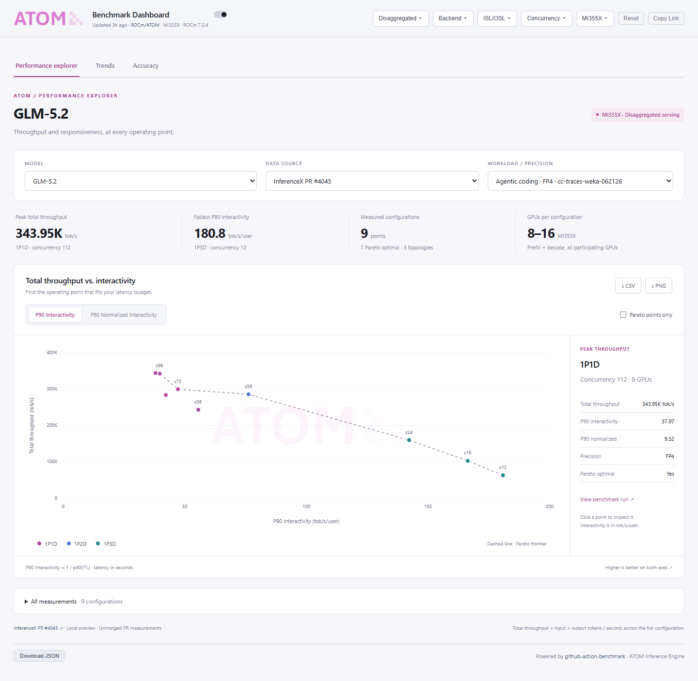

# Benchmark explorer preview

The disaggregated performance view shows one model at a time. Choose a model,
data source and workload, then switch between P90 Interactivity and P90
Normalized Interactivity. The vertical axis always shows **total throughput
across the configuration**, in input + output tokens per second.

```sh
python tools/preview_benchmark_dashboard.py \
  --points .github/dashboard/demo/inferencex-pr-4045.json
```

Open the local URL printed by the script (port 8890 by default). It downloads
the current public dashboard data, logos and existing Chart.js dependencies,
then serves a local copy of the dashboard. Assets are cached in the system's
temporary directory; use `--refresh` to update them. The generated preview works
offline after the initial download. Use `--no-serve` to only prepare the files.

The model selector also exposes the available published ATOM CI results. Extra
measurements are kept separate by source and workload. The preview never edits
or uploads published benchmark data. The production dashboard does not load the
sample automatically.



## Sample provenance and metric definitions

The sample contains all nine GLM-5.2 / MI355X configurations from
[InferenceX PR #4045](https://github.com/SemiAnalysisAI/InferenceX/pull/4045),
[run 42462488505, attempt 4](https://github.com/SemiAnalysisAI/InferenceX/actions/runs/42462488505),
at commit `de6ec5c1588bb7c29b79b627ae7848fed8584bf9` on November 8, 2026.
They are unmerged PR measurements, not an official InferenceX leaderboard entry.
The fixture records the artifact ID and SHA-256 of `results_bmk/agg_bmk.json`.

| Display | Original `request_metrics` field | Definition |
| --- | --- | --- |
| P90 Interactivity | `latency.intvty.p90` | `1 / p90(ITL)` |
| P90 Normalized Interactivity | `latency.e2e_norm_intvty.p90` | `1 / p90(ITL + TTFT / output_tokens)` |
| Total throughput | `throughput.total.tokens_per_second` | Total input + output tok/s over all participating GPUs |

Latencies in the formulas are in seconds. Both P90 values are copied directly
from the source artifact; normalized P90 is not reconstructed from aggregate
latency percentiles. The sample's peak total throughput is 343,950.97409 tok/s;
its fastest P90 interactivity is 180.81277 tok/s/user. Configurations use 8, 12
or 16 GPUs, so the total-throughput comparison is not a per-GPU efficiency chart.

The dashed Pareto frontier maximizes both axes, is recomputed for visible
topologies, and stays within one model variant, source, workload and precision.
Dominated points remain visible unless “Pareto points only” is selected. Older
measurements without the selected P90 definition stay in the measurement table
and are omitted from the chart; a median TPOT value is never substituted.

## Add local results

Pass `--points path/to/results.json` (repeatable). Each file contains a `points`
array using ATOM's `perf_point` fields; this sample is a complete example. The
principal fields are:

```json
{
  "points": [{
    "model": "My model",
    "hardware": "mi355x",
    "source_label": "Local sweep",
    "precision": "fp4",
    "benchmark_kind": "aiperf_agentic",
    "public_dataset": "dataset-name",
    "config_label": "1P1D",
    "concurrency": 32,
    "total_gpu": 8,
    "total_tput": 123456,
    "interactivity_p90_itl": 60,
    "interactivity": 30,
    "interactivity_method": "p90_e2e_normalized"
  }]
}
```

The numbers in this schema example are illustrative. Use measured values when
importing results. Add `run_url`, `source_url`, `source_status`, topology details
and other metric fields when available. Missing metrics are left unavailable.
CSV exports include all measurements in the selected model/source/workload;
PNG exports capture the selected axis and visible topologies.

## Validation

```sh
python tests/test_dashboard_explorer.py
```

The checks cover the P90 definition guard, Pareto dominance and ties, fixture
units, JavaScript syntax, and safe local-preview embedding. Browser verification
also covers both axes against all nine source points, source/model switching,
point selection, all-hidden and missing-metric states, URL reload/back/forward,
CSV/PNG exports, both themes, narrow screens, and existing dashboard tabs.
