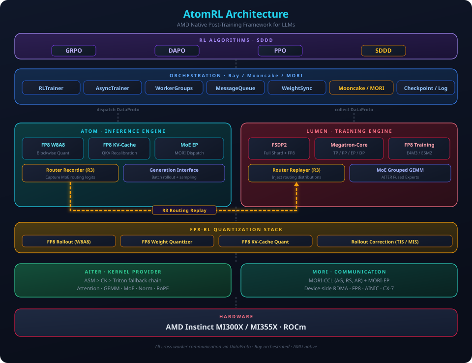

# AtomRL

An AMD-native post-training framework for large language models. AtomRL runs RL
post-training (GRPO, DAPO, PPO, and FlowGRPO for diffusion models) and speculative-decoding
draft distillation (SDDD) on AMD Instinct GPUs, with [ATOM](https://github.com/ROCm/ATOM)
for rollout and [Lumen](Lumen) for training.

<div align="center">
  
</div>

## Highlights

| | Result | Setup |
|---|---|---|
| **Fully async RL** | **2.7×** faster to step 60 (204 vs 555 min) at matching accuracy: train reward 0.421 vs 0.426, AIME24 0.211 vs 0.225 | Qwen3-30B-A3B DAPO, 8× MI355X: 4 training + 4 rollout GPUs vs synchronous on 8 |
| **Multi-node async** | **2.3×** faster to step 30 (47 vs 108 min), AIME24 0.225 vs 0.228 | Same model and data on 2×8 MI355X (8 training + 8 rollout GPUs) vs 4 + 4 on one node; RCCL weight sync over RoCE |
| **ATOM rollout** | **1.9×** faster per step than vLLM (56.7 vs 106.7 s) at the same train/rollout alignment (`k3_kl` 0.00153 vs 0.00144, within run-to-run spread) | Qwen3-30B-A3B DAPO, 4k-response smoke, 8× MI355X |
| **Diffusion RL** | Validation reward **0.978** at step 300 (official best 0.975); **0.523** images/GPU/s vs 0.517 for the official run on 4× H200 | Qwen-Image (20B) full-parameter FlowGRPO, 8× MI350X |
| **Reproducibility** | 15 examples and the unit-test suite pass against recorded references in the published release image | One command per example; see [release validation](release/VALIDATION.md) |

## News

- **[2026/11]** AtomRL ships inside [ROCm/ATOM](https://github.com/ROCm/ATOM) (`atomrl/`), with a published release image and [one-command reproduction](examples/README.md) of every example.
- **[2026/11]** One-step off-policy and fully async training on the Ray controller path: 2.7× faster on Qwen3-30B-A3B DAPO at matching accuracy ([details](atomrl-docs/docs/source/advance/async_training.md)).
- **[2026/11]** Diffusion RL: Qwen-Image full-parameter FlowGRPO on 8× MI350X reaches validation reward 0.978; Lumen actor patches cut actor time by 8% ([example](examples/FlowGRPO/README.md)).
- **[2026/09]** The ATOM fixes AtomRL's rollout depends on (FP8 expert weight sync, CUDA graph release across sleep/wake) are merged upstream ([ROCm/ATOM#2028](https://github.com/ROCm/ATOM/pull/2028)).
- **[2026/07]** MoE RL training on Qwen3-30B-A3B with fused routing and R3 router alignment; Megatron-Core backend (TP/EP/DP, distributed optimizer, sequence parallelism); training-inference separation.
- **[2026/06]** FP8 training on Qwen3-8B: hybrid E4M3/E5M2 training and blockwise W8A8 FP8 rollout.
- **[2026/05]** Speculative decoding draft distillation: Eagle3 drafts for Kimi K2.5 and Qwen3-8B on MI350, with Mooncake/MORI RDMA transfer.
- **[2026/03]** [R3](https://arxiv.org/abs/2510.11370) router replay for stable MoE RL, and the [FP8-RL](https://arxiv.org/abs/2601.18150) stack with TIS/MIS rollout correction.

## Capabilities

| Category | Supported |
|---|---|
| Algorithms | GRPO, DAPO, PPO; FlowGRPO for diffusion models (via verl-omni); SDDD (Eagle3, DSpark) |
| Training | FSDP2, Megatron-Core (TP / EP / DP / PP / CP, sequence parallelism), LoRA |
| Rollout | ATOM, vLLM; colocated or on dedicated GPUs and nodes |
| Scheduling | Synchronous, one-step off-policy, fully async with partial rollout |
| Weight sync | CUDA IPC on one node; RCCL over RDMA across nodes |
| Quantization | FP8 rollout (blockwise W8A8), FP8 KV cache, FP8 training (hybrid E4M3/E5M2), MXFP8 / MXFP4 inference; TIS / MIS rollout correction |
| MoE | R3 routing replay, fused routing with aux loss, expert parallelism |
| Kernels and communication | [AITER](https://github.com/ROCm/aiter) (ASM / FlyDSL / HIP / Triton), [MORI](https://github.com/ROCm/mori), [Mooncake](https://github.com/kvcache-ai/Mooncake) |
| Integrations | In-tree adapters for [verl](examples/plugin/verl/README.md), [vime](examples/plugin/vime/README.md), [miles](examples/plugin/miles/README.md), and slime |
| Hardware | AMD Instinct MI300 / MI350 architecture coverage; the release image is validated on MI350X / MI355X (gfx950). MI450 is a target with no recorded run |

### Model coverage

The table below lists the model paths exercised by current examples. “Validated”
means a recorded smoke passed on the published ROCm release image; other status
text calls out evidence that was produced outside the current smoke catalog.

| Workload | Model / checkpoint | Training backend | Rollout / teacher | Status |
|---|---|---|---|---|
| GRPO quick start | Qwen3-0.6B | FSDP2, BF16 or FP8 | ATOM rollout | Validated, 1 GPU |
| DAPO / GRPO | Qwen3-8B-Base | FSDP2, BF16 or FP8 | vLLM or ATOM, BF16 or FP8 | Validated, 1×8 MI355X |
| DAPO / GRPO MoE | Qwen3-30B-A3B-Base | FSDP2 or Megatron EP=8 | vLLM or ATOM | Validated, 1–2 nodes; R3 is exercised on the vLLM path |
| FlowGRPO | Qwen-Image (20B DiT) | VeOmni, with optional Lumen actor patches | vLLM-Omni; Qwen3-VL-8B reward model | 300-step MI350X results recorded; current catalog marks it long-run |
| SDDD | Kimi K2.5 / Kimi-K3 | FSDP2 Eagle3 / ATOM DSpark runtime | ATOM teacher | Kimi K2.5 has a 1×8-GPU long-run recipe; Kimi-K3 runtime is unvalidated |

### Recipe and architecture coverage

This table combines validated model paths with additional implemented
architecture coverage; each row states its current evidence.

| Model family | Implemented path | Current evidence |
|---|---|---|
| DeepSeek-V4-Flash-BF16 | Megatron TP4 / PP4 / EP4 training with vLLM FP8 rollout | Three-node GRPO long-run recipe |
| Qwen3-30B-A3B-Base | FSDP2 or Megatron EP=8 training with vLLM or ATOM rollout | Validated DAPO / GRPO smokes, including one-node and two-node async runs |
| Llama 3.1 8B Instruct | Dense FSDP2 GRPO / DAPO, including FP8 configs | Configuration coverage; not in the current release smoke catalog |
| Other Llama/Qwen-style dense or routed-MoE checkpoints | Generic Megatron GPT bridge | Compatibility path only; validate each architecture before use |

### Speculative draft models

| Teacher | Draft | Teacher execution | Status |
|---|---|---|---|
| Kimi K2.5 | Eagle3 | ATOM MXFP4 or mixed BF16 | Long-run recipe |
| Kimi-K3 | DSpark (MLA draft) | ATOM DSpark proposer | Runtime support in ATOM; no recorded AtomRL distillation run |

### Backends

| Feature | FSDP2 | Megatron-Core |
|---|---|---|
| Dense FP8 training | Yes | Yes |
| MoE training | Limited | Yes |
| FP8 rollout (ATOM) | Yes | Yes |
| R3 router replay | Yes | Yes |
| Training-inference separation | Yes | Yes |
| Multi-node | Yes | Yes |

## Installation

AtomRL and Lumen are a separate `atomrl` distribution. They are not part of
the root `atom` wheel, and their Ray/OmegaConf dependencies are intentionally
not installed by `pip install -e .` at the repository root.

### Supported installation: Docker

Use the repository Docker build for all AtomRL and Lumen workflows. It installs
the root ATOM package first, then installs `atomrl/` with its RL dependencies
and builds the optional Lumen extensions in one reproducible environment.

```bash
git clone https://github.com/ROCm/ATOM.git
cd ATOM
bash atomrl/docker/build.sh          # production image: atomrl:latest
bash atomrl/docker/build.sh --dev    # development image: atomrl:dev
```

Start the image with the AMD GPU devices exposed:

```bash
docker run --rm -it \
  --device=/dev/kfd --device=/dev/dri \
  --group-add video --ipc=host --network=host \
  --security-opt seccomp=unconfined \
  --shm-size=256g \
  -v "$PWD":/workspace/ATOM \
  -w /workspace/ATOM/atomrl \
  atomrl:latest
```

Verify the unified installation inside the container:

```bash
python -c "import atom, atomrl, atomrl.lumen; print(atom.__file__, atomrl.__file__)"
```

The release image described below is the preferred path for running the
published examples. For package-only local development, install `atomrl/`
directly as shown below; this does not install the root `atom` package.

### AtomRL package only

For an editable AtomRL installation without building the Docker image, install
the package defined by [`atomrl/pyproject.toml`](pyproject.toml):

```bash
cd ATOM/atomrl
pip install -e .
python -c "import atomrl; print(atomrl.__file__)"
```

### Megatron backend install

Megatron workflows use a fixed ROCm Megatron-LM revision, while AITER and the
Lumen HIP extensions are built from their latest source revisions in the
container. The development layer extends the published ATOM vLLM image
`rocm/atom-dev:vllm-latest`, which already provides the compatible vLLM plugin
runtime:

```bash
# Unified image
bash atomrl/docker/build.sh

# Unified image with pytest, Ruff, and MyPy
bash atomrl/docker/build.sh --dev

# Equivalent direct build
docker build --pull --no-cache \
  --build-arg BASE_IMAGE=rocm/atom-dev:vllm-latest \
  -f atomrl/docker/Dockerfile.dev -t atomrl:latest .
```

Run the resulting image with the AMD GPU devices exposed:

```bash
docker run --rm -it \
  --device=/dev/kfd --device=/dev/dri \
  --group-add video --ipc=host --network=host \
  --security-opt seccomp=unconfined \
  --shm-size=256g \
  atomrl:latest
```

The Dockerfiles install the root `atom` package and the separate `atomrl`
package with `LUMEN_BUILD_EXTENSIONS=1 --no-build-isolation`; the latter owns
Ray and OmegaConf. The Megatron revision is fixed by these images, while AITER
and the Lumen sources follow the latest revisions selected by the Docker build.

### Published release image

For the validated MI350X / MI355X examples:

```bash
git clone https://github.com/ROCm/ATOM.git
cd ATOM/atomrl
docker pull rocm/atom-dev:atomrl-dapo-gfx950-rocm7.2.3-261119
export DATA_ROOT=/path/to/data
bash examples/run.sh prepare 1
bash examples/run.sh 1
```

## Examples

| Family | Coverage | Key result |
|---|---|---|
| [DAPO](examples/DAPO/README.md) | Qwen3-8B and Qwen3-30B-A3B; FSDP2 or Megatron; vLLM or ATOM; BF16 or FP8; synchronous and fully async, one or two nodes | 11 configurations validated; fully async 2.7× |
| [GRPO](examples/GRPO/README.md) | Trainer and rollout on separate nodes over RDMA; Qwen3-30B-A3B with vLLM or ATOM, DeepSeek-V4-Flash | Qwen3-30B-A3B at 196–239 s/step with vLLM or ATOM, weight sync 4–5 s |
| [FlowGRPO](examples/FlowGRPO/README.md) | Qwen-Image full-parameter RL on verl-omni, with and without Lumen | Validation reward 0.978; actor −8% with Lumen |
| [SDDD](examples/SDDD/README.md) | Eagle3 draft distillation; Kimi K2.5 with an ATOM MXFP4 teacher | Smoke validated in the release image |
| [Framework integrations](examples/plugin/README.md) | In-tree verl, vime, miles, and slime adapters | Examples cover verl, vime, and miles; slime has adapter/unit coverage but no upstream example |

```bash
bash examples/run.sh list          # every example, its hardware and status
bash examples/run.sh suite         # regression suite: unit tests and one-node smokes (two-node on two hosts)
```

## Documentation

| Topic | Link |
|---|---|
| Installation and first run | [quickstart](atomrl-docs/docs/source/quickstart/install.md) |
| Asynchronous training | [async_training.md](atomrl-docs/docs/source/advance/async_training.md) |
| FP8 quantization and rollout correction | [fp8_quantization.md](atomrl-docs/docs/source/advance/fp8_quantization.md), [rollout_corr.md](docs/rollout_corr.md) |
| MoE and R3 | [moe_r3.md](atomrl-docs/docs/source/advance/moe_r3.md) |
| SDDD | [sddd.md](atomrl-docs/docs/source/advance/sddd.md) |
| Distributed training and Ray | [distributed.md](atomrl-docs/docs/source/advance/distributed.md) |
| Configuration reference | [config.md](atomrl-docs/docs/source/api/config.md) |
| Plugin integration | [plugin-integration.md](docs/plugin-integration.md) |
| Running the examples from source | [examples/docs](examples/README.md#documentation) |
| Release validation | [VALIDATION.md](release/VALIDATION.md) |

## Third-party libraries

| Library | Package | Role |
|---|---|---|
| [Lumen](Lumen) | `atomrl.lumen` | Quantized training: FP8 / MXFP8, AITER kernels, MORI communication |
| [ATOM](https://github.com/ROCm/ATOM) | `atom` | Inference: FP8, MXFP4, MoE expert parallelism, speculative decoding |
| [AITER](https://github.com/ROCm/aiter) | `amd-aiter` | GPU kernels: attention, GEMM, MoE, normalization |
| [MORI](https://github.com/ROCm/mori) | `mori` | RDMA and GPU communication, MoE expert dispatch |
| [Mooncake](https://github.com/kvcache-ai/Mooncake) | `mooncake` | RDMA / TCP transfer engine for hidden states |
| [Ray](https://github.com/ray-project/ray) | `ray` | Distributed orchestration |

## Citation

```bibtex
@misc{atomrl,
  title   = {AtomRL: AMD Native Post-Training Framework for LLMs},
  year    = {2026},
  url     = {https://github.com/ROCm/ATOM}
}

@article{fp8rl2026,
  title   = {FP8-RL: A Practical and Stable Low-Precision Stack for LLM Reinforcement Learning},
  author  = {Qiu, Zhaopeng and others},
  journal = {arXiv preprint arXiv:2601.18150},
  year    = {2026}
}

@article{r3moe2025,
  title   = {Stabilizing MoE Reinforcement Learning by Aligning Training and Inference Routers},
  author  = {Ma, Wenhan and Zhang, Hailin and Zhao, Liang and Song, Yifan and Wang, Yudong and Sui, Zhifang and Luo, Fuli},
  journal = {arXiv preprint arXiv:2510.11370},
  year    = {2025}
}
```

## License

MIT License
