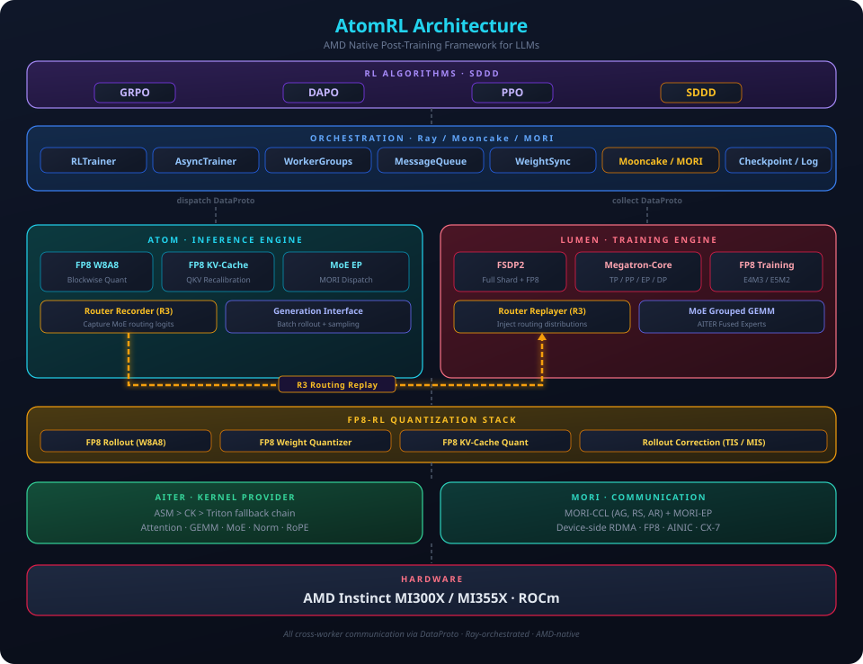

# Architecture

AtomRL is an AMD native Post-Training Framework for LLMs that supports both **RL post-training** and **Speculative Decoding Draft Distillation (SDDD)**. It follows a controller/worker split: a Ray driver owns scheduling and batching, while specialized workers host ATOM/vLLM inference, policy training, reference models, rewards, and critics. For SDDD, Mooncake/MORI RDMA transfers connect teacher inference GPUs with draft model training GPUs. All cross-worker payloads are `DataProto` batches—tensor dictionaries with small metadata sidecars—so the same protocol works for dense models, quantized paths (FP8, MXFP8, MXFP4), and MoE with R3 side channels.

<div align="center">
  
</div>

## Ray controller

The controller (`atomrl/controller/`) connects Ray clusters, builds worker groups, and dispatches `DataProto` batches according to data-parallel and colocation policies. It is responsible for:

- Bootstrapping Ray (local or `cluster.ray_address` remote)
- Grouping GPUs into actor / rollout / ref / reward / critic pools
- Sequencing the RL outer loop: generate → score → (optional) ref/KL → train

## Workers

Workers (`atomrl/workers/`) encapsulate device-local logic:

| Worker role | Responsibility |
| --- | --- |
| Rollout | ATOM-backed generation, logits/log-prob capture, FP8 rollout quant hooks |
| Actor | Policy forward/backward under FSDP2 or Megatron |
| Reference | Frozen reference policy for KL-regularized algorithms |
| Reward | Rule or model-based scoring surfaced as `rewards` tensors |
| Critic | Value heads for PPO-style advantage estimation |
| Hybrid | Colocated paths when memory or placement favors fused processes |

Each worker receives CPU-staged tensors and moves them to GPU as needed; see {doc}`/api/protocol` for batching utilities.

## DataProto protocol

`DataProto` is the universal batch container: a `dict[str, torch.Tensor]` plus `meta` for non-tensor fields (for example sequence lengths used by DAPO overlong shaping). The controller merges partial batches from data parallel workers and splits for micro-batching inside actor steps.

## Engine layer

Two engine halves share weights through the sync utilities under `atomrl/engine/`:

- **Inference** wraps ATOM or vLLM for generation, KV-cache extensions, and weight loaders so rollout matches training naming and sharding conventions. Supports quantized inference with FP8, MXFP8, and MXFP4.
- **Training** selects FSDP2 or Megatron backends, applies Lumen quantization hooks, and applies MoE R3 replay during forward passes when enabled.

This split lets you tune inference for throughput (quantized rollout, speculative decoding, TP/EP) independently from training parallelism.

## Quantization stack

AtomRL supports multiple quantization formats: FP8 (blockwise W8A8), MXFP8, and MXFP4. Rollout quantization uses `FP8RolloutQuantizer` and `FP8KVCacheQuantizer`; training uses `FP8TrainingManager` to bridge into `atomrl.lumen.quantize`. MXFP8/MXFP4 online quantization via AITER is used for efficient SDDD teacher inference. When quantized rollouts diverge from the trainer’s BF16 policy, `apply_rollout_correction` adjusts advantages using TIS or MIS. Details: {doc}`/advance/fp8_quantization` and {doc}`/api/quantization`.

## MoE R3

For MoE models, `R3Manager` coordinates `RouterRecorder` on the inference side and `RouterReplayer` during training forwards, with tensors carried alongside sequences via `DataProto.add_router_distributions`. This closes the router mismatch that otherwise spikes policy–inference KL. Details: {doc}`/advance/moe_r3` and {doc}`/api/moe`.

## SDDD pipeline

For Speculative Decoding Draft Distillation, AtomRL splits GPUs between teacher inference and draft model training. The teacher model runs on ATOM/vLLM with quantized inference (MXFP4/FP8), while the Eagle3/DFlash draft model trains via FSDP2 on separate GPUs. Hidden states are transferred between the two GPU groups via Mooncake or MORI-IO. Details: {doc}`/advance/sddd` and {doc}`/examples/sddd_training`.

## Repository layout

The on-disk layout mirrors the separation of concerns above:

```
AtomRL/
├── atomrl/                        # Main Python package
│   ├── core/                       #   Config, DataProto, registry, types
│   ├── controller/                 #   Ray cluster, worker groups, dispatch
│   ├── workers/                    #   Actor, critic, ref, reward, rollout, hybrid
│   ├── engine/
│   │   ├── inference/              #   ATOM engine wrapper, generation, weight loader
│   │   └── training/               #   FSDP2/Megatron backends, weight sync
│   ├── algorithms/                 #   GRPO, DAPO, PPO, loss functions
│   ├── quantization/               #   FP8 rollout, KV-cache, training, correction
│   ├── moe/                        #   R3 recorder/replayer/manager, expert parallel
│   ├── trainer/                    #   RLTrainer main loop, callbacks
│   └── utils/                      #   Logging, checkpoint, metrics, distributed
│
├── configs/                        # Reference YAML configs + production recipes
├── examples/                       # Launch scripts (run_grpo.py, run_dapo.py, etc.)
├── scripts/                        # SLURM launchers
├── tests/                          # Unit / integration / e2e tests
└── docker/                         # Dockerfile.dev, Dockerfile.release, Dockerfile.lumen*
```

For runnable entrypoints and configs, continue with {doc}`/quickstart/quick_start` and the {doc}`/examples/grpo_training` section.
