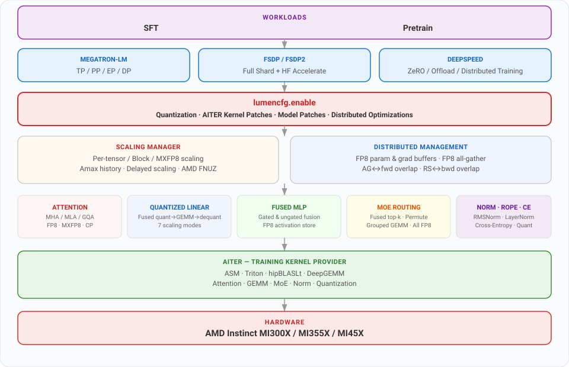

# Lumen

Lumen is an **AMD GPU Light Unified Model Engine built on [AITER](https://github.com/ROCm/aiter)**. It combines AITER-optimized training kernels with model-level integrations for quantized pretraining and fine-tuning.

- **Quantized Formats** — FP8 (E4M3 / E5M2), MXFP8, and MXFP4 with a unified `QuantConfig` interface
- **[AITER Kernels](https://github.com/ROCm/aiter)** — high-performance GPU kernels for attention, GEMM, normalization, RoPE, MoE, fused MLP, cross-entropy, and quantization with a unified `lumencfg.enable` interface

## Architecture

Lumen integrates AITER-optimized kernels into model training through quantization, model patching, and backend adapters. It owns the quantized training lifecycle while delegating optimizer execution, data loading, and distributed orchestration to the training backend; MORI remains available as an optional communication provider:

<div align="center">
  
</div>

## Installation

Lumen is shipped as part of the separate `atomrl` distribution. Install it
through the AtomRL Docker image so ATOM, AtomRL, Ray, OmegaConf, AITER, MORI,
and the optional Lumen extensions use one compatible environment.

From the ATOM repository root:

```bash
bash atomrl/docker/build.sh
# or, for development tools:
bash atomrl/docker/build.sh --dev
```

Run the resulting image with the AMD GPU devices exposed:

```bash
docker run --rm -it \
  --device=/dev/kfd --device=/dev/dri \
  --group-add video --ipc=host --network=host \
  --security-opt seccomp=unconfined \
  --shm-size=256g \
  -v "$PWD":/workspace/ATOM \
  -w /workspace/ATOM/atomrl \
  atomrl:latest
```

Inside the container, the root `atom` package and the separate `atomrl`
package are both installed:

```bash
python -c "import atom, atomrl, atomrl.lumen; print('ATOM/AtomRL/Lumen: OK')"
```

Do not install `atomrl/lumen` as a standalone Python package, and do not add
AtomRL's Ray or OmegaConf dependencies to the root ATOM installation. The
published release-image examples are documented in
[`atomrl/examples/README.md`](../examples/README.md).

## Quick Start

### Unified Training Optimization

```python
from atomrl.lumen import LumenConfig

# Configure quantization, AITER kernels, model patches, and distributed features.
lumencfg = LumenConfig(
    format="fp8_e4m3",
    scaling="delayed",
    fp8_attn="dpa",
    lumen_norm=True,
    lumen_linear=True,
    fused_mlp=True,
    fp8_param_gather=False,  # set True with a distributed DP group
)
lumencfg.enable(model)

# Training loop is unchanged
output = model(input)       # Lumen applies the configured training optimizations
loss.backward()
optimizer.step()
```

### Training Backends

See [`lumen/models/`](lumen/models/) for Megatron, FSDP and DeepSpeed stack documentation and usage examples.

## Examples

FP8 and MXFP4 recipes, with the launch command for each, are indexed in
[`examples/README.md`](examples/README.md) ([中文](examples/README_cn.md)).

| Example | Description | Docs |
|---------|-------------|------|
| **LLaMA2 SFT** | Full fine-tuning / LoRA on LLaMA2 7B–70B with FP8 attention, packed sequences, early stopping (Megatron + FSDP) | [`examples/llama2/`](examples/llama2/) |
| **LLaMA 3.1 Pretrain** | Pretraining LLaMA 3.1 8B with FP8 hybrid training and MXFP8 attention, MLPerf-aligned (Megatron + FSDP) | [`examples/llama31/`](examples/llama31/) |
| **Qwen3-8B LoRA SFT** | LoRA SFT on Qwen3-8B with PyTorch FSDP + Lumen FP8 blockwise2d quantization on 8×MI350X | [`examples/qwen3/`](examples/qwen3/) |
| **Qwen3-8B MXFP4 Pretrain** | Pretraining Qwen3-8B with MXFP4 quantized training on gfx950 | [`examples/qwen3/`](examples/qwen3/) |
| **Qwen3-30B-A3B MoE** | Qwen3-30B-A3B (128 experts) MoE training with FSDP2 + 2D parallelism (DP×EP) on multi-node MI308X | [`examples/qwen3-30b-a3b/`](examples/qwen3-30b-a3b/) |
| **DeepSeek-V4** | DeepSeek-V4 full finetune / pretrain with native torchrun + Lumen + GRPO policy loss on MI308X | [`examples/dsv4/`](examples/dsv4/) |
| **VeOmni Qwen-Image / Wan2.1 performance** | Training on 8× MI350X, stock example → configuration tuning → Lumen (aiter FlyDSL VAE conv, SDPA backend and Triton forward, RMSNorm fusion, local-shard AdamW): Qwen-Image 1.855 → 0.971 → 0.680 s/step (2.73×), Wan2.1 3.569 → 2.654 → 1.160 s/step (3.08×), Wan2.1 video embedding 5.96× | [中文](examples/perf-veomni/README.md) / [English](examples/perf-veomni/README_EN.md) |

## AtomRL Integration

Lumen provides the quantized training engine for [AtomRL](https://github.com/ROCm/ATOM/tree/main/atomrl), an AMD-native RL training framework. AtomRL uses Lumen for:

- **Megatron training backend** — FP8/MXFP8 quantized forward and backward through Lumen's Megatron spec patching (`lumen/models/megatron.py`)
- **FSDP training backend** — FP8 quantized training with PyTorch FSDP/FSDP2 through Lumen's FSDP integration (`lumen/models/fsdp.py`)
- **MoE expert parallelism** — Lumen's grouped linear modules and MoE dispatch for models like Qwen3-30B-A3B (128 experts, EP=8)
- **Per-block FP8 quantization** — Lumen's per-block FP8 quantization for ATOM/vLLM rollout inference

See the [AtomRL repository](https://github.com/ROCm/ATOM/tree/main/atomrl) for GRPO, GSPO, and agentic RL training examples.

## License

MIT License
