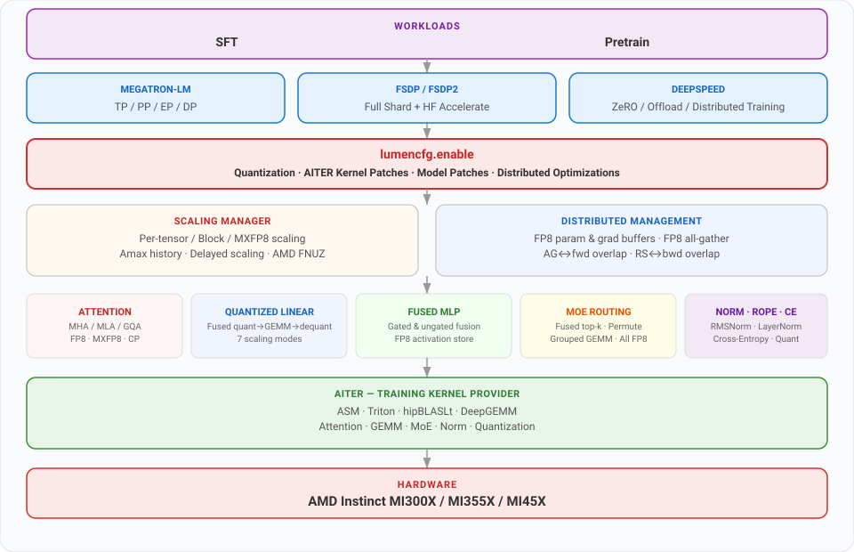

# Architecture

Lumen owns the **quantized training lifecycle** and delegates everything else to the training backend. This page describes the layered architecture from workloads down to hardware kernels.

## Layered Design

<div align="center">
  
</div>

## Key Components

### Quantization Lifecycle (`lumen/quantize/`)

The entry point for all quantized training. `quant.enable(model)` walks a model's module tree and patches eligible layers with quantized equivalents. `QuantConfig` provides a unified interface for:

- **Format selection** — FP8 E4M3, E5M2, MXFP8, Hybrid
- **Scaling strategy** — Dynamic, Delayed (with amax history), Blockwise
- **Activation and gradient quantization** — Independent control over forward activations and backward gradients

### Operators (`lumen/ops/`)

Stateless functional API backed by AITER. Each operator uses an **ASM → CK → Triton** fallback chain selected at runtime via ~30 `@lru_cache` dispatch probes in `dispatch.py`:

| Op | Source | AITER Backend Priority | FP8 Support |
|----|--------|------------------------|-------------|
| **Quantize** | `ops/quantize/ops.py` | C++ (per-tensor) → Triton (blockwise, MXFP8) | Core FP8 |
| **Linear** | `ops/quantize/linear.py` | hipBLASLt → CK → Triton | 7 scaling modes |
| **Attention** | `ops/attention/attention.py` | CK (csrc) → Triton | BF16 / FP8 blockwise / MXFP8 / blockwise2d |
| **Grouped GEMM** | `ops/gemm/grouped_gemm.py` | Triton (fused MoE) → sequential | BF16 + all FP8 modes |
| **Normalization** | `ops/normalization/` | ASM → CK → Triton | Fused norm+quant |
| **Fused MLP** | `ops/mlp/fused_mlp.py` | Triton (fused) → decomposed GEMM | FP8 activation store |
| **MoE Routing** | `ops/moe/` | ASM (gating) → HIP (permute) → Triton (GEMM) | BF16 + all FP8 |
| **RoPE** | `ops/rope.py` | Triton only | N/A |
| **Cross-Entropy** | `ops/cross_entropy.py` | Triton + optional SDMA | N/A |
| **SDMA** | `ops/sdma.py` | mori.ccl | float32 |

### Modules (`lumen/modules/`)

`nn.Module` wrappers that serve as drop-in replacements for standard PyTorch / Megatron layers:

| Module | Source | TP Support | FP8 Support |
|--------|--------|------------|-------------|
| `LumenColumnParallelLinear` | `modules/parallel_linear.py` | Column-parallel | All scaling modes |
| `LumenRowParallelLinear` | `modules/parallel_linear.py` | Row-parallel | All scaling modes |
| `LumenLayerNormLinear` | `modules/layernorm_linear.py` | Column-parallel | Fused norm+quant |
| `LumenDotProductAttention` | `modules/attention.py` | — | BF16 / FP8 / MXFP8 |
| `LumenDotProductAttentionMLA` | `modules/attention_mla.py` | — | BF16 / FP8 |
| `LumenFusedMLP` | `modules/fused_mlp.py` | — | FP8 store |
| `LumenGatedMLP` | `modules/fused_mlp.py` | — | FP8 store |
| `LumenGroupedLinear` | `modules/grouped_linear.py` | Col/Row parallel | All scaling modes |
| `LumenRMSNorm` | `modules/normalization.py` | — | Fused quant |
| `LumenLayerNorm` | `modules/normalization.py` | — | Fused quant |
| `SdmaTpComm` | `modules/sdma_comm.py` | TP AG/RS | float32 |
| `CommOverlapLinear` | `modules/comm_overlap.py` | — | AG/GEMM + GEMM/RS overlap |

### Distributed Management

Handles FP8-aware parameter lifecycle in distributed settings:

- **FP8 parameter buffers** — Contiguous FP8/BF16 storage for parameters and gradients
- **FP8 all-gather** — Communicates parameters as uint8, achieving ~2× bandwidth saving over BF16
- **Compute-communication overlap** — AG ↔ forward and RS ↔ backward pipelining
- **Distributed optimizer** — FP8 shard + all-gather integration

## Project Structure

```
Lumen/
├── lumen/
│   ├── core/              # FP8 dtype helpers, gradient quantization, device detection
│   ├── kernels/           # AITER kernel wrappers (FP8/MXFP8 flash attention impl)
│   ├── ops/               # Stateless ops API — all backed by AITER
│   │   ├── attention/     #   MHA/MLA/GQA + Context Parallelism (A2A, P2P)
│   │   ├── quantize/      #   Quantized linear, GEMM, quant/dequant ops
│   │   ├── gemm/          #   Grouped GEMM, MoE GEMM dispatch
│   │   ├── normalization/ #   LayerNorm, RMSNorm (fused FP8 variants)
│   │   ├── mlp/           #   Fused gated & ungated feed-forward
│   │   ├── moe/           #   Fused routing, sorting, aux loss
│   │   ├── rope.py        #   Fused RoPE (SBHD, THD, 2D, 3D)
│   │   ├── cross_entropy/ #   Vocab-parallel cross-entropy
│   │   └── dispatch.py    #   ASM → CK → Triton fallback dispatcher (~30 probes)
│   ├── modules/           # nn.Module wrappers (drop-in for Megatron / FSDP)
│   ├── quantize/          # Quantization lifecycle (enable/disable, config, scaling)
│   ├── rl/                # RL training integration
│   └── models/            # Training utilities & model definitions
│       ├── megatron.py    #   Shared Megatron stack (spec patching, FP8, LoRA)
│       ├── fsdp.py        #   Shared FSDP stack (FP8, LoRA, state mgmt)
│       ├── llama2/        #   LLaMA2 SFT
│       └── llama31/       #   LLaMA 3.1 Pretrain
├── examples/              # End-to-end training examples
└── tests/                 # Test suite
```
