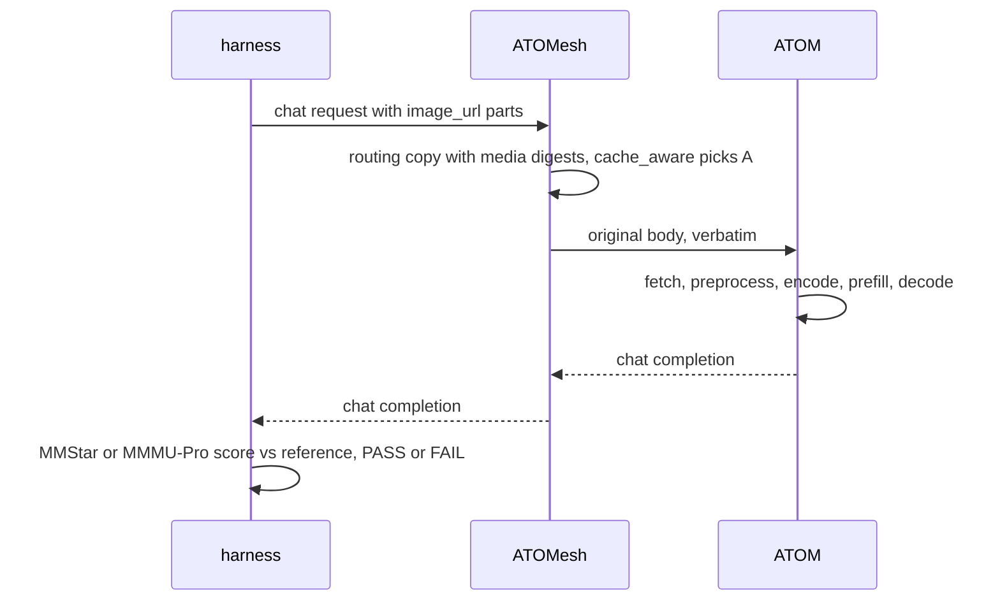
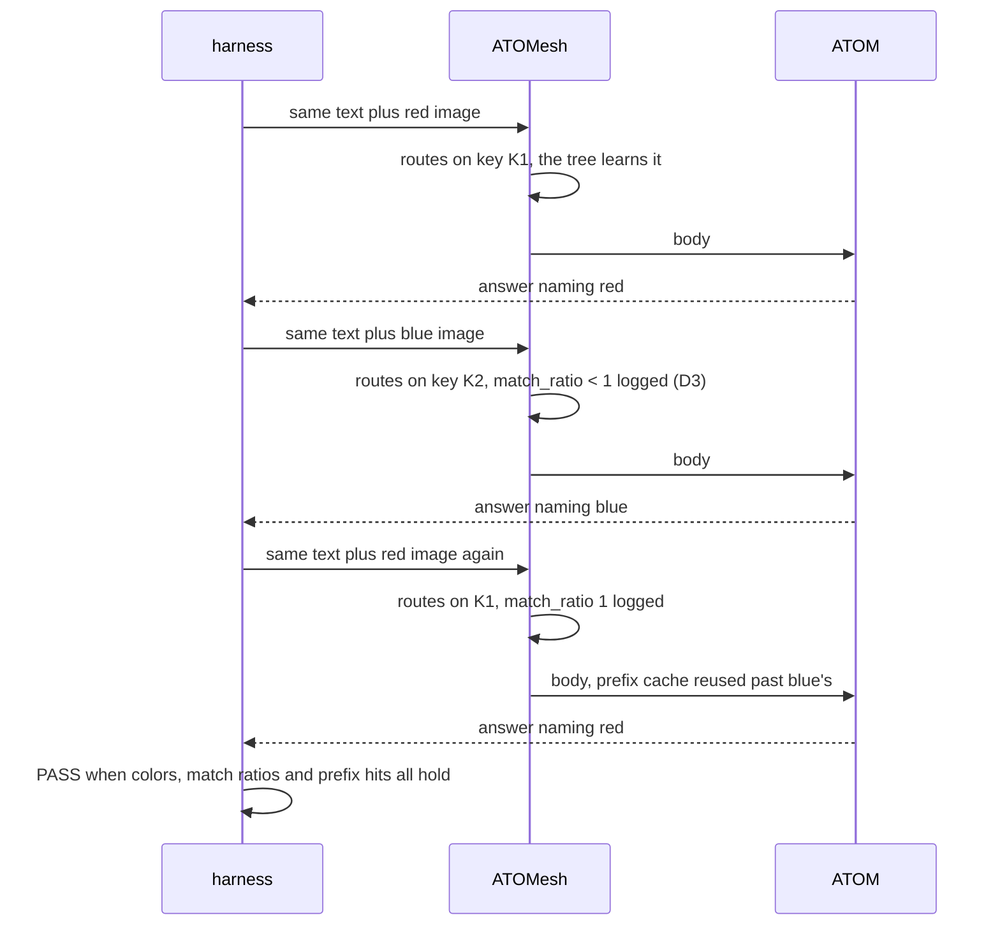
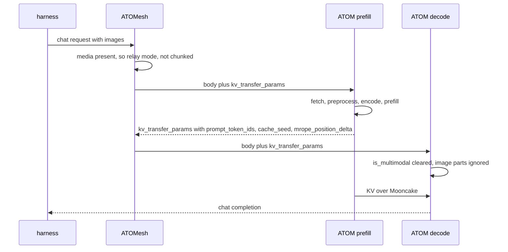
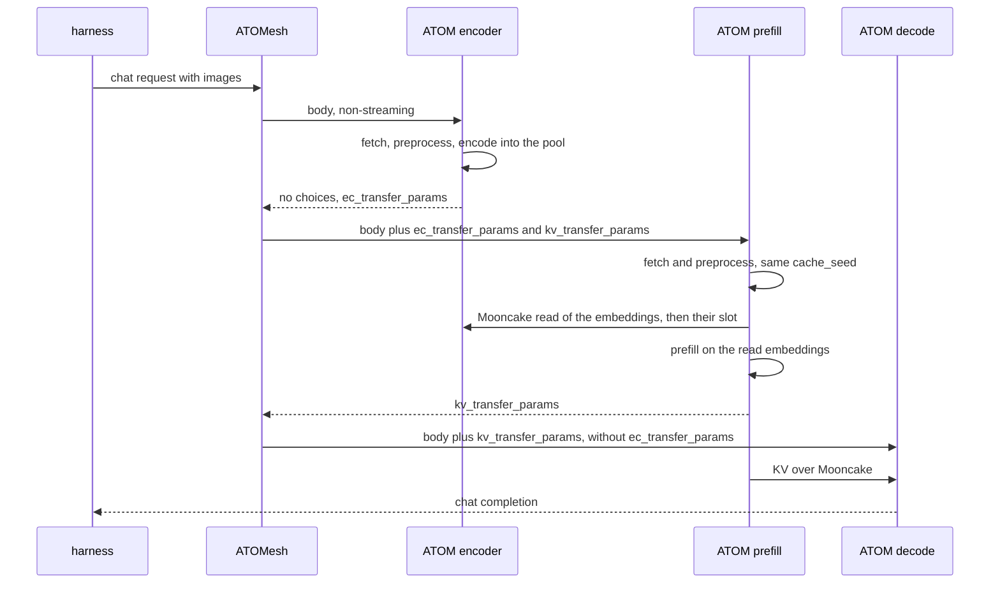
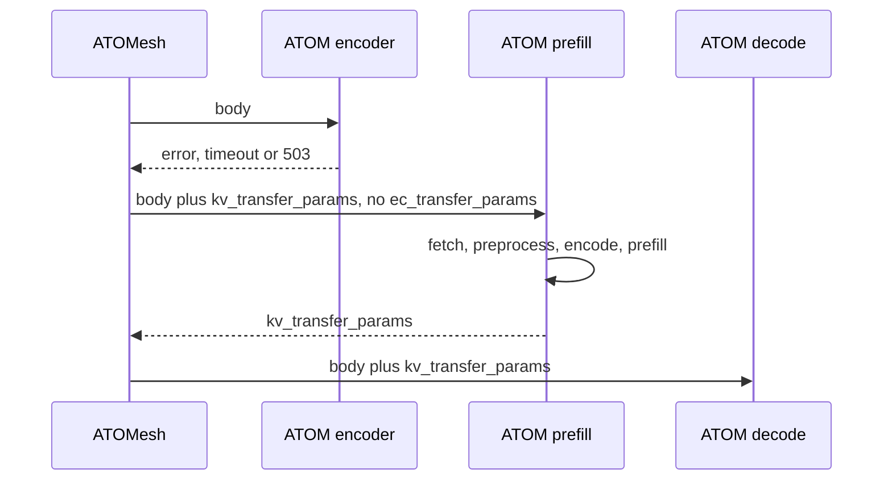
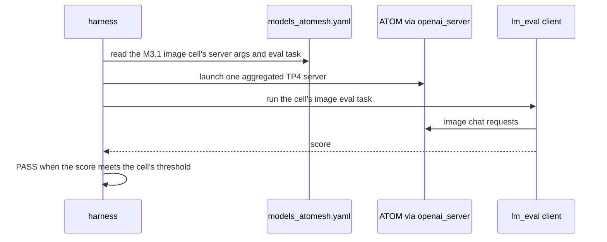

# ATOMesh multimodal image requests and E/P/D disaggregation

> **Status: design of an open PR stack.** Each decision names the PR that
> implements it. None of them is on `main` until that PR merges. The stack,
> in merge order: #3410 (engine PD), #3407 (routing), #3411 (embedding
> transport), #3412 (encoder-only server), #3408 (encode workers), #3409
> (E before P), #3415 (CI case), then this document (#3417). The
> acceptance harness is kept out of ROCm/ATOM; each acceptance result is
> posted on the PR it checks.

This document covers image chat requests through ATOMesh for
MiniMax-M3.1-Flash (M3.1) and Kimi-K3.1 (K3.1). It covers three
deployments: a single instance, 1P1D, and E/P/D with an encoder-only ATOM
instance.

Terms:
- **E** is the encoder-only ATOM instance, **P** the prefill instance and
  **D** the decode instance.
- `cache_seed` is the engine's hash of a request's processed pixels
  (`atom/model_engine/multimodal_runtime.py: multimodal_cache_seed`).
- A **media digest** is ATOMesh's xxh3 of an image URL string
  (`atom/mesh/src/routers/prepare/inference.rs: media_digest`).
- **g07**, **g08**, **g15** and **g24** are the 8-GPU MI355X nodes
  `pit2-p03-g07` and so on. Acceptance runs use g07 for M3.1 and g24 for
  K3.1. The measurements below were taken on g15, whose HCAs are
  `rocep9s0` to `rocep249s0`.

Code facts were checked against `main` at 36adbfddb and the heads of the
stack's PRs on 2026-11-23.

## Requirement

Goals:
1. M3.1 behind ATOMesh on a single ATOM instance. Image chat over HTTP
   works, accuracy matches direct ATOM, and routing keys tell images apart.
2. M3.1 1P1D. P encodes the image and D receives only KV. Accuracy matches
   the single instance.
3. M3.1 E/P/D. E runs the vision tower and hands the embeddings to P, and
   ATOMesh orchestrates E, then P, then D. Accuracy matches PD, and
   multi-image TTFT is no worse than PD's.
4. K3.1: goals 1 to 3, after its image inference is verified on direct ATOM.
5. CI: one M3.1 image case in `.github/benchmark/models_atomesh.yaml`.

Non-goals:
- Video and audio input.
- Images on `/v1/messages` and `/v1/responses`.
- Images over the gRPC worker path.
- An image or embedding cache beyond E's lease (D12).
- Fixing direct-ATOM image accuracy if it fails. That is an engine accuracy
  bug, escalated separately.

## Scenarios

### Single instance (A1, A2)

ATOMesh forwards the body unchanged and routes on a copy that carries the
media digests. The engine's request path does not change.



### Image distinction (A3, both models)

The acceptance harness sends one text three times: with a red image, a blue image,
then the red image again. The requests share their text, so only the media
digests separate their routing keys.



On ATOM the prefix cache keeps the colors apart through `cache_seed`,
which seeds the block hash chain (`atom/model_engine/block_manager.py`).
The second red request shows the red image's KV was there to reuse, so the
blue request's lower hit is the seed's doing.

### 1P1D (A4)

P preprocesses and encodes. D receives the expanded prompt ids, the
`cache_seed`, the MRoPE position delta and the KV, and never touches the
image.



### E/P/D (A5)

E fetches, preprocesses and encodes, and keeps the embeddings in a
Mooncake-registered GPU pool. P still fetches and preprocesses to get its
prompt ids, spans and `cache_seed`. It then reads the embeddings from E
instead of running its own tower. D works as in 1P1D.



The A5 TTFT check runs the same 4-image, 32-concurrent load against this
deployment and against A4's PD deployment. It prints both medians and
their delta.

### E/P/D when E cannot serve

Any of the following ends with P encoding locally, as in PD:
- no available encode worker, or a failed encode worker selection,
- an E error or timeout, including a full pool (E answers 503),
- an E answer without an `ec_transfer_params` object,
- on a P rank: a reader that cannot start (unknown transport, Mooncake
  missing), a failed read, a given-up or reused slot, a `cache_seed` or
  dtype mismatch, a malformed handle, or embeddings larger than its read
  buffer.

The first three are ATOMesh's decision for the whole request. For the
last, P's ranks agree: if any rank's read fails, every rank encodes (D12).



### Kimi-K3.1 (A6, A7)

A6 runs MMStar on direct ATOM and records the score, and it gates A7. A7
runs the single, 1P1D and E/P/D flows above with K3.1 and checks each
score against A6's. A failing A6 is an engine accuracy bug, which is
escalated rather than fixed here.

```
k31 direct mmstar ──PASS + score──> reference
        │ FAIL: escalate, A7 not run
        v
k31 single|pd|epd mmstar ──> within 2 x stderr of reference
k31 epd ttft             ──> median TTFT <= K3.1 PD
```

### CI case (A8)



## Acceptance

An acceptance run deploys the topology on MI355X nodes, runs the check
through ATOMesh, and prints one JSON line, then `PASS` or `FAIL <reason>`.
Its harness is kept out of ROCm/ATOM. The Result column names the PR where
the run's result is posted.

| Item | Requirement | Run | Result |
|---|---|---|---|
| A1 | M3.1 single: MMStar through ATOMesh within 2 x stderr of direct ATOM, 0 failed requests | `m31 single mmstar` | #3407 |
| A2 | M3.1 single: MMMU-Pro standard / vision within 2 x stderr of the recipe's 0.791 / 0.682 | `m31 single mmmu-pro` | #3407 |
| A3 | Both models, prefix cache and `cache_aware` on: red and blue answers name their own color, and the router log shows two routing keys | `m31 single distinct`, `k31 single distinct` | m31 on #3407; k31 not yet run |
| A4 | M3.1 1P1D: MMStar within 2 x stderr of A1, 0 failed requests | `m31 pd mmstar` | #3410, #3407 |
| A5 | M3.1 E/P/D: MMStar within 2 x stderr of A4, 0 failed requests; at 4 images x 32 concurrent, median TTFT <= PD's | `m31 epd mmstar`, `m31 epd ttft` | not yet posted |
| A6 | K3.1 direct: MMStar with 0 failed requests; the score is K3.1's reference | `k31 direct mmstar` | not yet run |
| A7 | K3.1 single, 1P1D, E/P/D: as A1, A4, A5 against A6 | `k31 single\|pd\|epd mmstar`, `k31 epd ttft` | not yet run |
| A8 | The M3.1 image case in `models_atomesh.yaml` passes when run the way `atomesh-accuracy-validation.yaml` runs it | `m31 single ci-case` | #3415 |

## Decisions

### Request path and routing

**D1. The single-instance request path needs no change (A1, A2).**
*#3407.* The HTTP path forwards the body verbatim and routes on a copy that
carries media digests.
- Basis: `atom/mesh/src/routers/ingress.rs:
  InferenceEnvelope::parse_for_routing`, `prepare/inference.rs:
  with_media_digests`.
- Rejected: route by `cache_seed`. The router cannot compute it without
  running the image processor in Rust.

**D2. The routing key keeps the URL-string digest.** *#3407.* The same
image under two URL spellings routes as two images. That costs hit rate but
never gives a wrong answer, because the engine's prefix cache is seeded by
the pixel hash.
- Basis: `multimodal_runtime.py: multimodal_cache_seed` hashes processed
  pixels. This is the simplest option.
- Rejected: decode images in the router and hash the bytes. That adds image
  decoding to the Rust hot path for a hit rate no acceptance item asks for.

**D3. Routing observability is the per-selection `mesh::route` log line.**
*#3407.* With `--route-log-sample-rate` above 0, each dispatch logs a
"Selected worker" event (target `mesh::route`,
`atom/mesh/src/observability/route_trace.rs`). It carries pool, policy,
branch, worker, `match_ratio` and, from #3407, the request's `media_count`.
- A3 reads the routing keys off it without logging the keys. A media
  request always routes on `cache_aware`'s prefix tree, because the
  KV-event index skips requests that carry media (`cache_aware.rs:
  select_by_kv_events`). When the blue request arrives, the tree holds the
  red request's routing text. A blue key equal to it would match whole
  (`match_ratio` 1), so a blue `match_ratio` below 1 shows the keys differ.
  The repeated red request matches whole, which shows the log reflects key
  identity rather than noise.
- A3's run checks that, plus `media_count=1` on every event, with
  `--route-log-sample-rate 1`. The E/P/D run counts image requests on the
  same event (`pool="prefill"`, `media_count` >= 1).
- Basis: a metric label cannot carry the key.
  `atom/mesh/src/observability/metrics/schema.rs: intern_string` interns
  every label string and never frees it, which its comment accepts only
  for bounded label cardinality. A per-request key would grow memory
  without bound.
- Rejected:
  - Log a hash of the routing key. That is a new log field for a property
    the existing `match_ratio` already shows.
  - A response header carrying the key. That is a public interface the
    requirement does not ask for.

### Multimodal PD

**D4. The non-streaming multimodal chat branch carries
`kv_transfer_params`.** *#3410.*
- `generate_async_multimodal` takes `kv_transfer_params` and passes it on,
  as `generate_async` does.
- It returns `kv_transfer_output_meta_info` with the sequence's
  `cache_seed` and `mrope_position_delta` added.
- The non-streaming single-request branch of `_chat_completions` passes it.
  That is the branch the ATOMesh relay calls P through.
- The streaming branch (`setup_streaming_request`) and the n>1 branch
  (`generate_async_fanout`) already pass `kv_transfer_params` on `main`.
  They do not return `cache_seed`, so a D fed by them keeps its media (D5).
- `_prepare_engine_input` keeps refusing images with `kv_transfer_params`.
  It serves only `/v1/messages` and `/v1/responses`, whose images are a
  non-goal. Their shared `_generate_nonstream` does not hand
  `kv_transfer_params` to the multimodal generator. Without the refusal, a
  PD request there would stall D waiting for KV that P never sends.
- Basis: on `main`, `generate_async_multimodal` has no such parameter, and
  `_prepare_engine_input` raises "image input cannot be combined with
  kv_transfer_params". This fixes shared code rather than callers.
- Rejected: fold the multimodal generator into `generate_async`. That is a
  larger change to the text path than this feature needs.

**D5. Decode clears `is_multimodal` when P kept the media.** *#3410.* In
`_chat_completions`, `is_multimodal` is false when both of these hold:
- the request carries `prompt_token_ids`,
- `kv_transfer_params` has `do_remote_prefill` and a `cache_seed`
  (`atom/model_engine/sequence.py: leaves_media_on_prefill`).

The request then takes the existing pretokenized branch with
`multimodal_data` `None`, and its image parts are ignored. Without a
`cache_seed`, D keeps the media and preprocesses it, because otherwise its
blocks would hash as text.
- Basis: `is_multimodal` is derived from the body's content parts, not from
  `multimodal_data`. Branching on the pretokenized ids alone would still
  send a media request to `generate_async_multimodal` with
  `multimodal_data` `None`.
  `atom/mesh/src/core/placement/backend/atom.rs:
  AtomAdapter::carry_prompt_token_ids` already sends P's expanded ids to D.
- Rejected: ATOMesh strips image parts from D's body. That saves bytes no
  item measures, and other routers would still hit the engine's refetch.

**D6. D's prefix-cache identity comes from P.** *#3410.*
- `Sequence.__init__` sets `cache_seed` and `mrope_position_delta` from
  `kv_transfer_params` for such a decode leg, and marks it
  `media_on_prefill_instance`. An MRoPE model's decode positions need the
  delta.
- D cannot prefill that sequence locally, because it has no media to put in
  the placeholders. Whenever the scheduler would otherwise prefill it
  locally, `Scheduler._refuse_prefill_without_media` finishes it with
  "unschedulable: image decode leg has no media". That covers no connector,
  a failed receive, a requeue, a preempted decode and an offload tier's
  resume or refusal. Recovering such a sequence is future work.
- `InputOutputProcessor` refuses such a leg under RapidServe, and checks
  that the delta is in `[1 - len(prompt), 0]`.
- `protocol.py: check_media_handoff` range-checks both values.
- Basis: `atom/model_engine/sequence.py` otherwise derives `cache_seed`
  from media only, and `block_manager.py` seeds the hash chain with it.
  Without it, D hashes the expanded ids alone, and two images with the same
  text could share KV. A3 runs with prefix caching on.
- Rejected: disable D's prefix cache for image requests. That is a second
  code path with the cache off, while A3 wants it on.

**D7. Requests with media take the relay path, never chunked mode.**
*#3407.* `AtomAdapter::can_chunk_request` returns false when the request
carries media (`AtomPairCtx::carries_media`).
- Basis: `atom/mesh/src/routers/http_pd_router.rs:
  dispatch_atom_chunked_internal` starts D before P answers. D would lack
  the expanded ids and the `cache_seed`. Without #3410, P answers
  `kv_transfer_params: null`, and the relay returns 502
  `prefill_missing_kv_transfer_params`.
- Rejected: let D preprocess in chunked mode. That contradicts Goal 2,
  under which D receives only KV.

**D8. 1P1D for M3.1 runs on one node.** *Acceptance topology; result on
#3410.*
- Layout: P on GPUs 0-3 and D on GPUs 4-7 of g07, each at the recipe's
  TP4, with DSpark on as in the recipe.
- Mooncake runs with `MC_DISABLE_HIP=1` and the HCAs named as in D11.
- The run fails when P's HCAs sent no RDMA bytes or D's received none.
- Basis: a text 1P1D run on g15 (GSM8K, first 200 questions, median of 3
  runs, flexible-extract) scored 0.96 with DSpark on and 0.965 with it off.
  A single instance scored 0.955 and 0.96, with 0 failed requests in each
  case. The same run without `MC_DISABLE_HIP=1` scored 0.0, because
  Mooncake's intra-node HIP transfer returned garbled output.
  `.github/benchmark/models_atomesh.yaml` cell `minimax-m3-fp4-1p1d-tp4`
  already sets `MC_DISABLE_HIP=1`.
- Rejected: two nodes. That needs a second node for a topology already
  shown correct on one.

### E/P/D in the engine

**D9. E encodes, and P still preprocesses.** *#3412.*
- E fetches, preprocesses and encodes, and keeps the embeddings under the
  media's `cache_seed`.
- P still fetches and preprocesses to get the expanded ids, the spans and
  the same `cache_seed`. The chat handler puts E's `ec_transfer_params`
  into `multimodal_data`. The encode callback that
  `embed_multimodal_batch` hands `VisionEmbeddingCache.acquire` reads E's
  embeddings through `ModelRunner.read_image_embeddings`, and runs the
  tower only when that returns `None`.
- D works as in PD.
- Basis: vLLM's disaggregated encoder keys encoder output by media hash,
  and the prefill instance loads it while processing the prompt
  (<https://docs.vllm.ai/en/latest/features/disagg_encoder/>).
  `VisionEmbeddingCache.acquire` is P's one point that obtains embeddings.
- Rejected: E returns ids, spans and embeddings, and P takes them
  pretokenized. That saves P's CPU preprocessing, but adds a second request
  shape to P and moves template rendering to E.

**D10. E is `openai_server --encoder-only`, without an engine core.**
*#3412 (`atom/model_engine/encoder_only.py`).*
- A `Config.encoder_only` field and `--encoder-only` flag, declared as
  `enable_rapidserve` is.
- The server builds only the model's vision modules on GPU 0
  (`build_vision_modules` of M3.1 and K3.1, chosen by
  `VISION_BUILDERS`), and loads their weights through
  `load_weights_into_model`, skipping the checkpoint's `language_model.`
  and `model.language_model.` tensors.
- It encodes one request at a time on one thread
  (`ThreadPoolExecutor(1)`). The chat handler preprocesses with the
  existing `_prepare_multimodal_inputs`, and answers non-image requests
  with an error. Every route the absent engine would serve, all but chat
  completions, models, health and metrics, answers 400.
- The embedding pool takes what `--gpu-memory-utilization` leaves after
  the vision modules, rounded down to whole GiB so that Mooncake's
  registration slices stay aligned to 2 MiB GPU pages.
- Basis: both towers are replicated on every TP rank (see their module
  docstrings), so E at TP1 runs the same tower P runs.
  `embed_multimodal_batch` encodes request by request, so P does not batch
  encodes across requests either. This reuses existing code.
- Rejected: a vision-only mode of `ModelRunner` behind the engine core. It
  needs encoder-only branches in KV sizing (`allocate_kv_cache`),
  `warmup_model`, `capture_cudagraph` and the scheduler's `Sequence` model,
  all on the text hot path, to buy batching P does not use. Low confidence:
  see below.

**D11. Embeddings move over Mooncake, behind their own interface, and P
pulls.** *#3411 (`atom/ec_transfer/`, `atom/utils/mooncake_hca.py`).*

The interface (`atom/ec_transfer/base.py`), apart from the KV connector:
- E's `EcWriter.put(key, rows)` returns a handle, and P's
  `EcReader.get(handle, key, dtype)` returns the rows or `None`.
  `create_writer` and `create_reader` pick the backend by name.
- A handle names its backend: `transport`, `key` (the `cache_seed`),
  `rows` and `dtype` at the top, the backend's own fields under its name.
  ATOMesh and the API carry it without reading it, so a second backend
  changes neither.
- Mooncake (`atom/ec_transfer/mooncake.py`) is the one backend. Neither it
  nor the helpers it uses import `kv_transfer`: HCA selection is the public
  `atom/utils/mooncake_hca.py`, and the PCI topology under it
  `atom/utils/pci_topology.py`, both shared with the KV connector and the
  Mooncake Store offload.
- Basis: vLLM keeps encoder output transfer in its own `ECConnector`
  (`vllm/distributed/ec_transfer/`), with Mooncake as one backend; SGLang
  picks one with `--encoder-transfer-backend`.

How the Mooncake transfer works:
- E's `MooncakeEcWriter` registers its pool with a Mooncake TransferEngine.
  P's `MooncakeEcReader`, one per TP rank and built on first use, reads with
  `transfer_sync_read` inside the encode callback, into a registered
  buffer. The buffer starts at the first request's size and grows, at least
  doubling, up to `max_model_len` rows: a buffer that size from the start
  would be 12 GiB at M3.1's 1M context, outside the KV cache's share of the
  GPU. A rank that cannot grow it fails its read, and the ranks fall back
  together (D12).
- Both open their engine through `mooncake_hca.select_ib_devices`, as the
  KV connector does, with `ATOM_MOONCAKE_IB_DEVICE`, now declared in
  `atom/utils/envs.py`, taking precedence. P's reader also takes its
  server's `kv_transfer_config` `ib_device`, `ib_enable_alternate_hca` and
  `ib_hca_count`, so KV and embeddings register on the same HCAs.
- Unconfigured, `mooncake_hca.auto_select_ib_device` picks the ACTIVE HCA
  on the PCIe switch of the engine's GPU, found from the GPU's PCI address
  (`pci_topology.gpu_pci_bdf`, `rail_rdma_device`; main's #3884), whatever the HCAs
  are named. Each rank, and E on its one GPU, registers on its own GPU's
  HCA. Where the topology names no single HCA, the engine refuses to start
  and names `ib_device` and `ATOM_MOONCAKE_IB_DEVICE`.
- The acceptance runs (D8) predate #3884 and name the HCAs: they set
  `ATOM_MOONCAKE_IB_DEVICE` on E, P and D to the HCAs local to each role's
  GPUs, together with `MC_DISABLE_HIP=1`. The selection then tried
  `rdma<N>` and `ionic_<N>`, and on g15, whose HCAs are named `rocep*`,
  handed Mooncake a missing `rdma<N>`: in D8's 1P1D run the HCAs received
  0 GiB and loopback 22.3 GiB. A run after #3884 may leave the variable
  unset.
- The variable holds one value per server, not per rank: set, each TP4
  rank of P and D registers on every HCA listed for its role, and the
  connector advertises `ib_device` as `None` for a multi-HCA engine
  (`MooncakeConnector.__init__`). The PD and E/P/D runs fail when a role's
  HCAs moved no RDMA bytes, so a run off RDMA cannot pass.
- Naming the HCAs also puts A4's and A5's KV on the same transport, so A5's
  PD baseline runs on it too.

Why not `ATOM_MOONCAKE_MATCHED_RAILS` (`docs/mooncake_matched_rails.md`):
- That doc warns that a multi-HCA engine may pick a disconnected rail.
  Matched rails avoids that with one single-HCA engine per rail.
- It does not apply here: it covers only the KV connector's P-to-D writes,
  not E's pool. E and P warn at engine setup when it is set.
- E and P sit on different nodes (D17), so the risk of a disconnected rail
  applies to E's read. The RDMA byte check above catches it.

Basis, measured on g15 between two GPUs of one node: Mooncake RDMA took
0.56 ms for 16 MiB and 2.1 ms for 64 MiB. An HTTP pull from host memory
took 15.5 ms and 82 ms, and base64 inline through ATOMesh took 118 ms and
552 ms. At A5's workload, a request carries a median 11 MB of bf16
embeddings (22 MB max), and encoding takes 8.5 ms per image inside a
4-image request. `embed_multimodal_batch` runs the callback inside the
forward step, so a fetch blocks every request in the batch on every rank.
This reuses an existing dependency.

Rejected: an HTTP pull from E's host memory, about 100 lines against about
300 for Mooncake.
- It would likely meet A5 as well, at about 11 ms per median request
  against an upper bound of 300 to 480 ms saved.
- But those 11 ms sit in P's forward step, where they give back a third of
  the 34 ms of encode that E removes from it. They also accumulate across
  queued steps, as the encode share does.
- How much of the upper bound survives E's hop, fetch, preprocess and
  encode stays unmeasured until A5's TTFT check runs. Mooncake keeps that
  third for the extra 200 lines.

Low confidence: see below.

Follow-up: P reads inside its forward step (the `embed_multimodal_batch`
callback), which is what makes RDMA a requirement above. vLLM loads
encoder output before the forward instead: the scheduler side records what
a request needs (`update_state_after_alloc`, `build_connector_meta`) and
the worker starts the load (`start_load_caches`), taking only what has
arrived. If P fetched while scheduling the request, an HTTP pull would no
longer sit in the forward step, and Mooncake would be an optimization
rather than a requirement. The interface above allows that backend without
changing the handle.

**D12. E keeps an entry for a lease, guarded by a slot table.**
*#3411 (pool, slots and reader), #3412 (fallback).*

E's region (`MooncakeEcWriter`) is one registration of the size E chose,
in whole GiB: a slot table carved from its front, then the pool of rows.
- There is one slot per 64 KiB of region (`default_slots`): 16384 for
  1 GiB, a 512 KiB table. An entry holds at least one image's rows,
  hundreds of KiB, so space runs out before slots, and past a 60 s lease a
  1 GiB E still takes about 273 requests a second.
- An entry's rows sit in the pool; its slot holds `(generation, address,
  length, ack)`. Rows never overlap a slot, so a later entry's rows cannot
  forge an earlier entry's generation.
- E places new rows after the last entry, wrapping to the start, and takes
  a free slot. It evicts entries oldest-first when space or slots run out,
  but only once an entry is older than `ATOM_EC_LEASE_S` (default 60 s, in
  `atom/utils/envs.py` and `docs/environment_variables.md`).
- When an entry in the way is still inside its lease, E is full:
  `EcStoreFull`, which the encoder-only chat handler answers with 503.
  ATOMesh then falls back to PD for that request (D16).
- E zeroes an evicted entry's slot before writing over its rows, and writes
  a new entry's slot after its rows. Generations only grow from a random
  start, so a slot never matches a handle given out for another entry.

P's read (`MooncakeEcReader.get`): P checks `cache_seed` against its own,
synchronizes its buffer's stream so that no queued fill or copy lands after
the NIC's write, reads the rows, then reads the slot. It takes the rows
only if the slot's generation, address and length are the handle's. A
`cache_seed` mismatch, a dtype other than the one E stored (the handle
carries it), a malformed handle or a generation of 0, a failed read, a
given-up or reused slot, or rows larger than its buffer make it return
`None`. Each such read is logged with its reason and the running counts per
reason (`MooncakeEcReader.fallbacks`). A reader that cannot start
(`create_reader` raises: unknown transport, Mooncake missing, no memory or
HCA) is recorded as unavailable for that transport, and the rank's verdict
is `None` as for a failed read.

Follow-up: reclaim an entry as soon as P has read it. After the ranks
agree, P's rank 0 would write the generation into the slot's `ack` field,
and E would reuse acked entries at once, keeping the lease as a backstop.
Today reuse waits for the lease, so a P queue longer than the lease wastes
E's encode and runs the tower.

P's ranks agree before any of them uses the rows
(`ModelRunner.read_image_embeddings`). Each rank passes its verdict to
`atom/distributed/group_agreement.py: group_agree` on its TP group's CPU
group, then its PCP group's, as `agree_kv_budget` does. If any rank's read
failed, every rank logs "Image embeddings over ... are unavailable" and
runs its own tower, which P keeps loaded. E at TP1 and P's ranks need not
produce bit-identical rows, so mixing E's rows on some ranks with the
local tower's on others could split the ranks' activations. Every rank
reaches the call for the same request at the same point of the step, so
the collective lines up.

Basis: `MiniMaxM3SparseForConditionalGenerationVL.__init__` builds the
tower wherever image input is accepted, so the fallback is the existing
encode path. This is the simplest option.

Rejected:
- P's ranks release each entry after reading over a channel of their own.
  That gives an exact lifetime, but needs a channel from the `ModelRunner`
  subprocesses to E, and E has to know P's TP size. The `ack` follow-up
  above needs neither: rank 0 writes once, after the ranks agree, over the
  RDMA path P already reads on.
- Rank 0 reads and broadcasts to the other ranks. That is consistent by
  construction, but adds a device broadcast of up to 22 MB to every image
  request's forward step, where a one-integer CPU all-reduce suffices.

**D13. E answers with `ec_transfer_params`, as P answers with
`kv_transfer_params`.** *#3412; ATOMesh's side in #3409.*
- E returns a chat completion with no choices and an `ec_transfer_params`
  object, the handle of D11: `transport`, `key` (`cache_seed`), `rows`,
  `dtype`, and under `mooncake` the session, address, length,
  generation and slot (`MooncakeEcWriter.put`, `api_server.py:
  _encoder_only_response`).
- ATOMesh copies it into P's body. P's chat path puts it into the
  request's `multimodal_data`, which the scheduler already carries to the
  runner for prefill. A body without it behaves as today.
- ATOMesh removes any client-supplied `ec_transfer_params` before P, and
  removes E's before D, so only E's output reaches P.
- P takes `ec_transfer_params` only when started with
  `--accept-ec-transfer-params`, and drops them otherwise. A handle names
  memory P reads on the strength of the request alone, so the flag belongs
  on a P that clients reach only through ATOMesh; E/P/D launches P with it.

This conflicts with the principle "Change public interfaces only when the
requirement does": `ChatCompletionRequest` gains an optional
`ec_transfer_params`, and E's response has no choices. Goal 3 settles it.
E hands embeddings to P, and ATOMesh orchestrates E to P to D, so the
handoff must cross the HTTP interface between them. It follows the
precedent of `kv_transfer_params`, the optional field the chat request and
response already carry for the P-to-D handoff. A client of a single or PD
deployment sees neither the field nor a choice-less response: only an
`--encoder-only` server answers that way, and only ATOMesh calls it.

- Basis: `atom/entrypoints/openai/protocol.py: ChatCompletionResponse`
  (`kv_transfer_params`, extra fields allowed), `api_server.py:
  _with_kv_transfer_params`, `atom.rs: AtomAdapter::enrich_decode_kv`.
  `multimodal_runtime.py: prefill_media_payload` keeps every key except
  `token_types`, and once the worker owns a lease it also drops
  `pixel_values` and `image_grid_thw`. `ec_transfer_params` therefore
  survives into the runner, and the tower fallback in D12 runs only while
  the pixels and grid are still present, which is before the lease. This
  follows existing conventions.
- Rejected: a new `/v1/encode` endpoint with its own schema. That changes
  the public interface more than an optional field on the existing one.

**D14. E/P/D can meet A5 on the measured margin.**
- At A5's workload, measured on g15 with M3.1 on a single instance over 3
  runs, the tower takes 44-51% of P's prefill forward time and a median
  32-36% of TTFT. Median TTFT was 921-1333 ms.
- E removes the tower from P's forward step for under 1 ms of transfer on
  one node (D11), plus E's hop. The cross-node read is under Low
  confidence.
- The request's own encode moves to E rather than vanishing. The gain is
  P's shorter step, which every queued request waits on.
- Rejected: hold the E role until a prototype measures A5. The margin is an
  order of magnitude above the added transfer, and A5's TTFT check
  measures the built system.

### ATOMesh E role

**D15. `WorkerType::Encode`, `--encode <url>` and `--encode-policy`, in PD
mode.** *#3408 (declaration), #3409 (dispatch).*
- Encode workers are declared and registered like prefill and decode
  workers. Config validation refuses them outside PD mode.
- For a chat request with media and at least one available encode worker,
  the PD router selects one under the encode policy and posts it the body,
  non-streaming, before P (`http_pd_router.rs: attach_encode_output`). It
  then runs the existing P-to-D relay with `ec_transfer_params` added to
  P's body.
- Text requests, and deployments without `--encode`, take today's path.
- `IngressRouting::candidates` never admits an encode worker as a request
  target.
- Basis: `atom/mesh/src/core/worker.rs: WorkerType`, `cliargs.rs`,
  `config/validation.rs: validate_encode`,
  `core/steps/worker/local/create_worker.rs`, `routers/ingress.rs`,
  `http_pd_router.rs`. The text path does not change, and the choice is
  easy to reverse.
- Rejected: a separate E/P/D router. It would duplicate the PD router's
  retry, reservation and load guards.

**D16. An E failure falls back to PD.** *#3409.* With no available encode
worker, a failed selection, an E error, a non-success status, a timeout
(`--encode-timeout-secs`, default 30) or an answer without an
`ec_transfer_params` object, ATOMesh logs a warning and sends the request
to P without `ec_transfer_params`, and P encodes.
- Basis: D12 keeps P's tower loaded. This is the easier choice to reverse.
- Rejected: fail the request. That turns an E outage into client errors,
  although P can serve the request.

### Topology, models, CI and harness

**D17. E for M3.1 runs on one GPU of a second node.** *Acceptance
topology.*
- P and D take all of g07, as in A4, and E runs on GPU 0 of g08. PD for
  A5's comparison runs on g07 as in A4.
- E's node must reach P's HCAs over RoCE, so that D11's read stays on
  RDMA. The E/P/D run fails when E's HCAs sent no RDMA bytes, when E
  served no request, or when every read P made fell back.
- Basis: the requirement allows additional nodes for multi-node runs. One
  node holds P and D at the recipe's TP4. See also D11.
- Rejected: E on a D GPU with D's memory utilization lowered. That departs
  from the recipe and muddies A5's comparison. Low confidence: see below.

**D18. K3.1 uses the same code at the recipe's TP8.** *Acceptance
topology; no code of its own.*
- Its input builder already emits spans and `cache_seed` on `main`.
- A6 runs first and gates A7.
- The single instance runs on g24. 1P1D puts P on g24 and D on g07, and
  E/P/D adds E on g08.
- Basis: `atom/models/kimi_k3/image_processing.py: build_kimi_k3_inputs`
  sets `multimodal_data["cache_seed"]`. `recipes/Kimi-K3.1.md` says "TP4
  cannot hold the resident checkpoint; use TP8".
- Rejected: a smaller TP to fit one node, which the recipe rules out.

**D19. The CI case is an M3.1 aggregated cell in `models_atomesh.yaml`.**
*#3415.*
- The cell `minimax-m31-flash-mxfp4-agg-tp4-mmmu` serves the recipe's
  aggregated TP4 ATOM OpenAI server, without ATOMesh, from
  `atomesh-benchmark.yaml`, and scores MMMU through chat completions,
  with a threshold of 0.77. Only a manual dispatch runs it.
- ATOM standalone (`USE_ATOMESH_ENTRYPOINTS=1`) serves no image request:
  since #3698 its Rust frontend refuses one with a 400.
- An eval-only cell may run MMMU and name its metric, model arguments and
  generation arguments (`pd_matrix.py`, `pd_submit.sh`, `pd_server_atom.sh:
  run_eval`). Every other cell keeps GSM8K's eval.
- Basis: `.github/scripts/atomesh/pd_matrix.py` allowed only `gsm8k` and
  `swebench_lite`, so the models file could not hold an image case.
- Rejected: put the case in `models_accuracy.json`. That contradicts Goal
  5, which names `models_atomesh.yaml`. Low confidence: see below.

**D20. The acceptance harness stays out of the tree.** Its runs deploy
each topology on named MI355X nodes over ssh, run MMStar, MMMU-Pro, the
red/blue probe, the TTFT load or the CI case through ATOMesh, and print one
JSON line and `PASS` or `FAIL <reason>`. Each result is posted on the PR it
checks (see Acceptance).
- Basis: nothing in CI runs it, and its defaults are the hosts and paths of
  one deployment. The CI case it also checks is in the tree (D19).
- Rejected: check it in under `tests/`, which the review of the harness PR
  turned down for those reasons; or a pytest GPU suite, which the CPU-only
  gate cannot run.

## Simpler alternative

The simplest E/P/D: E returns the embeddings base64-encoded in its
response, ATOMesh copies them into P's body, and P decodes them in its API
server. There is no Mooncake pool, lease or slot table, and the
transport is about 100 lines against about 300.

It puts A5 at risk:
- Inline transfer through ATOMesh measured a median 31 ms for 4 MiB and
  118 ms for 16 MiB, one transfer at a time, mostly Python base64 and JSON.
- A5's median request carries 11 MB and its largest 22 MB. Inline therefore
  adds roughly 80 to 170 ms to each image request's critical path, before
  any contention from 32 concurrent requests on ATOMesh and on P's API
  server, which also preprocesses images.
- The saving it must fit inside is an upper bound of 32-36% of a median
  TTFT of 921-1333 ms, and E's own hop and encode already come out of that.

## Low confidence

- **D10, E encodes on a server thread.**
  - The encode thread shares the server's GIL with HTTP handling and
    preprocessing. Whether that limits E at 32 concurrent requests shows
    only under load, which is what A5's TTFT check runs.
  - The rejected `ModelRunner` mode costs a branch on the text hot path in
    several places. The fallback, should the thread limit E, is the encode
    loop in one spawned process behind the same queue, inside the encoder
    module.
- **D11, the cross-node read.**
  - Mooncake was measured on one node only. E sits on a second node (D17),
    so the read P makes in its forward step is unmeasured across nodes.
  - No cross-node figure would favour the HTTP pull while the read stays on
    RDMA, which the E/P/D run requires of E's node. The pull's single-node cost
    (11 ms for a median request) is Python HTTP and host copies over
    loopback. Across nodes it pays the same plus a real network hop, so it
    does not fall.
  - Mooncake's read across nodes is bounded by the 400 Gb/s HCA ports
    (`/sys/class/infiniband/*/ports/1/rate` on g15): about 0.25 ms of wire
    time for 11 MB. To match the pull it would have to slow about 28-fold,
    from 0.56 to 15.5 ms at 16 MiB, which only a fallback to TCP does.
  - That leaves the read's own cost to A5's TTFT check.
- **D17, E's node.** It rests on g08 reaching g07 over RoCE, which the
  E/P/D run checks but no measurement has settled yet. K3.1 (D18)
  spans three nodes for the same reason.
- **D19, the CI case.** Goal 5 names `models_atomesh.yaml`, while A8 names
  `atomesh-accuracy-validation.yaml` as how the case runs, and that
  workflow reads another file. No data settles which reading is meant. If
  A8 is read otherwise, only the CI cell and its `ci-case` check change.

## Measurements

All were taken on g15 with M3.1, at the recipe's launch flags.

| What | Result |
|---|---|
| Text 1P1D correctness (GSM8K first 200, flexible-extract, median of 3) | single 0.955 / 0.96 (DSpark on / off); 1P1D 0.96 / 0.965; 1P1D without `MC_DISABLE_HIP=1` 0.0. 0 failed requests. KV went over TCP (0 GiB on the HCAs), see D11. |
| Vision encode cost at A5's workload (4 images x 32 concurrent, 3 runs) | encode share of median TTFT 32-36%; encode / prefill forward time 44-51%; median 11 MB (max 22 MB) bf16 embeddings per request; 149 rows per image median (8-570), 12 KB per row; 34 ms per image alone, 8.5 ms per image inside a 4-image request |
| E-to-P transfer, two GPUs of one node, median ms at 1 / 4 / 16 / 64 MiB | Mooncake 0.052 / 0.162 / 0.559 / 2.102; HTTP pull from host memory 0.348 / 4.315 / 15.456 / 82.123; base64 inline via ATOMesh 4.953 / 31.081 / 118.175 / 552.349 |

## Changes per PR

| PR | Files | Decisions |
|---|---|---|
| #3410 | `atom/entrypoints/openai/api_server.py`, `protocol.py`; `atom/model_engine/sequence.py`, `scheduler.py`, `llm_engine.py` | D4, D5, D6 |
| #3407 | `atom/mesh/src/routers/prepare/inference.rs`, `routers/ingress.rs`, `observability/route_trace.rs`, `core/placement/backend/atom.rs` | D1, D2, D3, D7 |
| #3411 | `atom/ec_transfer/` (`base.py`, `mooncake.py`); `atom/utils/mooncake_hca.py` and the KV connector's use of it; `atom/utils/envs.py` and `docs/environment_variables.md` (`ATOM_EC_LEASE_S`, `ATOM_MOONCAKE_IB_DEVICE`) | D11, D12 |
| #3412 | `atom/model_engine/encoder_only.py`, `model_runner.py` (the reader per transport, its size and the ranks' agreement), `multimodal_runtime.py`, `arg_utils.py`; `atom/config.py`; `atom/entrypoints/openai/api_server.py` (`--accept-ec-transfer-params`), `protocol.py` | D9, D10, D12, D13 |
| #3408 | `atom/mesh/src/cliargs.rs`, `config/`, `core/worker.rs`, `core/worker_registry.rs`, `policies/registry.rs`, `routers/factory.rs` | D15 |
| #3409 | `atom/mesh/src/routers/http_pd_router.rs`, `routers/ingress.rs` | D13, D15, D16 |
| #3415 | `.github/benchmark/models_atomesh.yaml`, `.github/scripts/atomesh/pd_matrix.py`, `pd_server_atom.sh`, `pd_submit.sh`; `tests/test_atomesh_pd_matrix.py` | D19 |
| Out of tree | the acceptance harness; results on #3407 and #3410 | D8, D17, D18, D20 |

Each PR carries CPU tests under `tests/` and Rust tests in `atom/mesh` for
what it changes.
