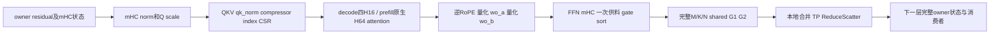

# C256 / FP8 / TP4：面向整网 2× 的重新诊断与优化方案

2026-10-29。本轮重新读取当前结果、实际调用链、Mono/Window 实现，并在线核对公开配置及 AITER 相关源码。**本轮交付是重新诊断与实施方案；没有启动 GPU、重跑旧实验或修改生产算术。** 当前代码基点为 `96405d8609abdb0e9be594b47dcd4a492e81c6d4`。

本方案替代[旧 Window 下一步](dsv41_fp8_owner_window_next.md)的实施队列。三种列 Window 均已完成，应停止继续修补该路线。保留已取得局部收益的 owner 供料，将研究主线扩大为：**完整 attention 的数据布局与 KV 复用 → 大矩阵投影及 FFN 的重复转换删除 → 主要 prefill 与层间状态接续 → 同配置组合整网验证。** 2× 保留为研究目标，当前没有可达承诺，也没有硬件极限证据。

## 1. 目标与分母：还缺 151.45 秒

固定 attention/routed/shared TP4、EP1、DP1、无 DEP/DPA，FP8 KV、FP4 index、真实 DSpark5、full 验证行数；C256、random 8K/1K、seed 0、2560 条正式请求。运行参数保持 max-seqs512、max-batched16384、level3/FULL、原生 prefix 与 bounded replay。C256 的主要全局行数为 M1536，每 owner384 行；不能用旧 packed M768 替代。

| 项目 | 已有值 | 使用边界 |
|---|---:|---|
| 锁定同配置主线 | 5269.8108 output tok/s；446.783019 秒 | 保留 A1/A2 合并记录 |
| 当前 FP8 owner 迁移样本 | 6281.294 output tok/s；374.837073 秒 | 新单臂对保留主线，1.191939× |
| 相对该主线 2× 的目标时间 | 223.391510 秒 | 同请求、同输出量的目标分母 |
| 相对当前仍须减少 | **151.445563 秒；40.4030% 时间** | 不等于再提高 40.4% 吞吐 |
| 单一范围局部快 2× 所需覆盖 | **80.8061% 当前时间** | 未计新增开销 |
| 下一组合筛选目标 | 当前时间减少 5%，即 **18.741854 秒** | 5% 是结构投入/集成目标，允许先做有限 A/B |

“吞吐提高 5%”只需时间减少 4.7619%，约17.85秒；本文统一用“时间减少”，不再混用两种口径。10% 时间目标为37.483707秒。

当前结果尚有三个限制：两侧存在时间间隔；每 rank 正式出现4个冷 Triton 特化；没有本配置的新完整模型精度验收。正式接受长度主线2.488826→迁移2.471299，decode执行行数5,804,691→5,835,366（+0.528%）。输入、输出 token 总数相同仍不等于内部执行轨迹相同。历史1.324404976×来自 Spec0/BF16→DSpark5/EP4/packed 等组合，分母不同，不能连乘。

证据：[迁移整网结果](dsv41_fp8_owner_result.md)、[成本与实际行数](../../validation/dashboard_whole_20261029/FP8_MIGRATION_COST_RESULT.json)、[本轮计算与检索记录](../../validation/dashboard_whole_20261029/C256_2X_REPLAN_RESEARCH.json)。

## 2. 已抓清的根因，以及仍不能归因的部分

| 判断 | 证据 | 对下一步的约束 |
|---|---|---|
| 优化范围与目标缺口不匹配 | layer8 按38个非 hash decode层、18个 prefill层及旧调用次数外推，完整 FFN 仅约占49.02%–49.10%当前时间 | 不能继续把 G2/RS 的一小段当作整网2×主线 |
| 列流水确实改变了依赖，也确实收回时间 | BF16 RCCL 版的相同计算串行/流水对照收回35/97/234µs；紧凑 BF16 版分块等待收回36/89/180µs | 不能再把所有失败解释为“没有重叠” |
| 当前装配新增成本超过重叠收益 | 删除独立 RCCL/pack/stitch 后 FP8版仍退化；再删除逐列 barrier 和 FP8中间转换后 BF16版仍退化 | 不继续扫描这套 Window；必须保住原生全N大GEMM效率或删除更多实际工作 |
| 原供料迁移是有效小收益，尚未进入生产 decode | M1536完整 FFN/RS/下一消费者 .75551→.72667ms，1.03969×；显式 full-M gate 调度对齐 logits/top-6 | 可以独立保留并集成验证；条件整网仅约1.09%，不能扛2× |
| 当前 attention 仍有迁移适配物化 | decode四次H16均复制Q/scale，输出再cat；V41原生ABI支持独立步长 | 有可直接删除的工作，适合作为完整attention窗口的首个有限A/B |
| 观察与基准存在边界 | 迁移前decode profiler约2×扰动；当前稀疏enclosing估计比wall高3.54%–3.64%；layer8并非所有层型 | 不能拿旧trace时长、跨图阶段之和或行数占比冒充精确整网覆盖 |

三轮结果汇总如下。decode对照已包含保留的供料候选，prefill对照为原生 owner 路径；不同轮次只能各自成对判断。

| 候选 | M1536时间变化 | M7550时间变化 | M16291时间变化 | 当前决定 |
|---|---:|---:|---:|---|
| BF16十列＋RCCL RS | +33.92% | +7.90% | −0.30% | 停止 |
| FP8设备内Window | +4.99% | +10.47% | +8.89% | 停止；新增压缩数值也未验收 |
| 紧凑BF16＋chunk ready | +27.19% | +30.42% | +43.33% | 停止；最终decode用R5，prefill保留R4 |

最终BF16实现已无逐列全rank barrier、无FP8中间编解码，仍有1次入口会合、10个G2阶段和2个drain。所有有效净配对为负，编译产物无spill。因此“RCCL太多”“FP8转换”“spill”“十次barrier”均不能单独解释全部退化。G2调度效率、BF16物化、每CTA内重复flag acquire和计算/服务CTA竞争尚未逐项计时；本文不编造各自占比，也不为分摊旧失败再开一轮实验。

上述回收量来自同次、相同算术的等待/调度对照，不是逐kernel时间线分解；不能把回收量全部归给物理传输重叠。

两项已定位的实现错误另行归类：多形状布局特化复用了前一形状，以及BN128配BF16x8/32lane导致零次写回。它们解释前期失败和无效计时；修复后的完整有效结果仍慢，不能把这些错误当最终退化的全部原因。后续必须在计时前验证真实加权G2写回，零G2/仅shared预检不足。

研究流程也须调整：先前曾只测原生、却以“未达准入”结束，随后又连续投入覆盖有限的Window。新的每次GPU工作必须同时具备**一个具体候选、一个完整窗口、一个可判定问题**；观察只用于解释本次候选和选择下一条主线，不无限扩充工具。

详见[供料](dsv41_fp8_owner_supply_result.md)、[列RCCL](dsv41_fp8_column_rs_result.md)、[设备FP8](dsv41_fp8_device_window_result.md)、[紧凑BF16](dsv41_bf16_chunk_window_result.md)。

## 3. 重新检索：公开配置一致到哪里，是否有可直接换用的新内核

本轮固定在线检索快照：ATOM `70dee2a7a64774decd5e43595aa5b2e026e148aa`、AITER `a24724ef850a67346350637b1c908c88fd25148c`、InferenceX `f58175bd45c343f1bab7bed35f052a7e429935fc`。URL、SHA256及对照结果保存于本轮检索记录，不下载整仓或重复旧运行包。

| 来源 | 本轮核查 | 对研究的影响 |
|---|---|---|
| ATOM random dashboard catalog | DSV4.1 TP4、FP8 KV、FP4 index、DSpark5，含C256；catalog完整SHA与此前核查一致 | 继续TP4/EP1/full；没有依据把C256改成DEP |
| 已验明的公开C256运行 | run40724946700，实际ATOM646da00f、AITERc90842ad | 当前最新源提交不是这个历史性能点的运行提交；本轮未重新下载artifact |
| SemiAnalysis ATOM AgentX | 最新master矩阵仍TP2/EP1到C64、TP4/EP1到C32，无DPA；recipe仍BF16 KV、DSpark5 | 工作负载、KV和AL协议不同，不能把其大并发成绩当本C256基线 |
| SemiAnalysis调度 | TP2/C64设prefill/decode interval4；TP4/C32设16 | 说明多轮服务会调度prefill以保护decode；不是random C256可照搬的kernel优化 |
| AITER当前相关实现 | `mla_sparse_prefill.py`、`opus_mla_prefill_fwd.cu`、V41 traits、`comm_fused_moe/.../window.py`四文件与本地依赖逐字节相同 | 这四处没有“升级依赖即可获得”的新实现；不据此推断整个仓库无变化 |

Semi的throughput路径使用golden acceptance注入，真实评测使用真实接受；仍需按实际运行包验证某个发布点。最新recipe与以前一致不代表本轮验明了所有发布点。本轮一次提交历史API请求受限，因此不声称完成全仓近期提交穷举；关键结论来自固定提交的原始文件与本地SHA对照。

公开源码入口：

- [ATOM models catalog](https://github.com/ROCm/ATOM/blob/70dee2a7a64774decd5e43595aa5b2e026e148aa/.github/benchmark/models.json)。catalog→矩阵→workflow→`atom_test.sh`→server/benchmark→model registry/runtime的完整链接保留在[公开配置与调用链](dsv41_wide_window_next.md)；实际C256参数见[运行包核对](dsv41_c256_verified_config.md)。
- [Semi master矩阵](https://github.com/SemiAnalysisAI/InferenceX/blob/f58175bd45c343f1bab7bed35f052a7e429935fc/inferencex-e2e/configs/amd-master.yaml)、[ATOM AgentX recipe](https://github.com/SemiAnalysisAI/InferenceX/blob/f58175bd45c343f1bab7bed35f052a7e429935fc/inferencex-e2e/benchmarks/single_node/srt-slurm-recipes/dsv41flash/atom/mi355x-fp4-mtp/agentic.yaml)。
- [AITER V41 API及split选择](https://github.com/ROCm/aiter/blob/a24724ef850a67346350637b1c908c88fd25148c/aiter/ops/mla_sparse_prefill.py)、[实际C入口及H16/H64分派](https://github.com/ROCm/aiter/blob/a24724ef850a67346350637b1c908c88fd25148c/csrc/kernels/mla/opus_mla_prefill_fwd.cu)、[traits](https://github.com/ROCm/aiter/blob/a24724ef850a67346350637b1c908c88fd25148c/csrc/kernels/mla/opus/mla_v41_prefill_traits.h)、[Window实现](https://github.com/ROCm/aiter/blob/a24724ef850a67346350637b1c908c88fd25148c/aiter/ops/flydsl/kernels/comm_fused_moe/gfx950/a8w4/window.py)。

## 4. 预算决定覆盖范围，不能先给各候选虚构收益

[真实FFN成本](dsv41_fp8_owner_window_cost_result.md)为独立观察图，以下是四rank范围，单位ms；不能将这些列直接相加。

| 全局M | 完整FFN | G1 | G2＋本地归约 | RS | 下一层mHC/norm/QKV |
|---|---:|---:|---:|---:|---:|
| 1536 | .7070–.7083 | .2413–.2581 | .1539–.1584 | .1008–.1158 | .0351–.0357 |
| 7550 | 1.9172–1.9217 | .5690–.5747 | .3987–.4150 | .4301–.4405 | .0812–.0833 |
| 16291 | 3.6255–3.6375 | 1.0319–1.0433 | .7702–.7736 | .9022–.9172 | .1431–.1484 |

按旧3724个M1536 FFN调用、1199/647个主要prefill调用和38/18层条件外推，FFN总计约183.74–184.06秒，即49.02%–49.10%。这是layer8代理，尚不是完整逐层积分。用49.06%的中间值说明目标要求：

| 假设完整FFN局部倍率 | 可减少当前总时间 | 距离2×仍需其他范围减少 |
|---|---:|---:|
| 1.25× | 9.81% | 30.59% |
| 1.50× | 16.35% | 24.05% |
| 2.00× | 24.53% | **15.87%，约59.50秒** |

即使FFN整体2×，其他不重叠范围还需要贡献约15.87%时间；若它也只能快2×，其覆盖须约31.75%。新增成本会进一步提高要求。这些是条件，不是FFN或attention已能达到的倍率。

现有普通event稀疏估计中，prefill target约185.68秒、decode target约186.75秒；M1536 target约176.58秒。after-target约15.85秒，不能让draft/context小段独自承担40.4%缺口。上述估计含重叠/采样误差，不能归一化后伪装精确饼图，也不能用“总时间减FFN代理”精确反推出attention耗时。

统一成本式为：

`ΔT组合 = Σ实际层型/形状调用次数 × (原完整窗口 − 候选完整窗口) − 窗口之外新增时间`。

只对**互不重叠的窗口**求和；包含关系用组合A/B取代各自相加。理论情景可用`Σ f_i(1−1/s_i)−新增成本/T`，实际验收仍使用完整服务。每行预算记录：版本、端点、真实M/有效行、层型、调用数来源、原生时间、可删除工作、必要通信、新增算术/同步/格式转换、完整净差额、数值与状态资格。

若仅在M1536的40个attention层起效，旧调用代理为148,960层次；单独削掉5%整网时间平均要省约125.82µs/层。**去copy的76.28MB逻辑读写不能自动换成这个时间承诺。** 已有供料1.09%也不能与重叠范围的其他收益机械相加。

## 5. 当前执行图与可改变的边界

模型状态写入横跨这些边界，不能把它们当无副作用tensor函数。实际源码为[owner target](../atom/models/deepseek_v41/owner_service/owner_serving.py)、[decode attention](../atom/models/deepseek_v41/owner_service/owner_cost_attention_chain.py)、[四H16适配](../atom/models/deepseek_v41/owner_service/owner_head_attention.py)、[prefill owner attention](../atom/model_ops/deepseek_v41/owner_attention.py)、[runtime与bounded replay](../atom/models/deepseek_v41/runtime.py)。

借鉴Window的是按消费者需求安排真实生产、将供料和通信成本放在同一个完整范围内；此次结果说明，改变完成顺序也可能破坏大GEMM效率。借鉴Mono的是一次绑定、单一step/layout计划、显式状态和原生seam、生产者直接生成消费格式、必要时将residual收尾交给下一层。当前[Mono config](../atom/models/deepseek_v41/mono/config.py)目标上限48行、MoE上限96行；[runner](../atom/models/deepseek_v41/mono/runner.py)及[attention计划](../atom/models/deepseek_v41/mono/attention_plan.py)的小行数任务分工不能扩guard后用于M1536。

实现复用`atom/mono/{runtime,plan,device,weights}`中适用的布局、绑定与生命周期机制；先用一个真实候选验证ABI，再决定共享。保留大矩阵库调用与原生状态边界，不为“一次launch”重写完整专家计算或复制整条forward。

## 6. 实施顺序与候选合同

### A0：先完成四H16去物化的完整attention A/B

**唯一主问题：保留四H16的原生算术和split选择，删除迁移适配的copy/cat，能否缩短真实完整attention窗口？** 这是小改动进入大范围诊断的入口，不单独承担2×。

当前每个H16调用对Q values、scales执行`contiguous()`，四份BF16输出最后`torch.cat`。候选分配一个完整owner `[rows,64,512]` BF16输出，传入四个不重叠H16输出view；Q/scale直接传原始view。保留四次调用、各自sink、CSR、softmax scale与输入shape。首版输出独立分配，不复用仍可能被读取的Q底层存储。

已有静态证据：V41 kargs分别携带Q、scale、O的row/head stride；Python `_out_bf16`与fake接受调用方out；C入口仅要求最后维连续、Q/O 16B对齐、scale 4B对齐。H16边界满足这些条件。split选择依赖N/H/CSR nnz和CU数，保持这些参数应保持原选择；必须记录实际调用证明，不能只看接口声明。

每rank每M384层删除Q/scale复制12,976,128B、输出cat有效载荷25,165,824B，对应逻辑读写76,283,904B。保留必要输出写回、四次KV读取路径与原生计算；不宣称HBM流量一定减少同样字节。完整H输出交给原生inverse-RoPE/group-quant与投影，保证消费者实际使用新buffer。

新fixture建议置于独立`validation/dashboard_whole_20261029/attention_stride_r1/`，尚未创建。一次准备/权重加载，比较当前四H16路径与去物化版本；先M1536/owner384，附带一个ragged owner布局验证尾部。计时包含`prepare_attention → QKV/压缩/索引/缓存 → attention → wo_a/wo_b → prepare_ffn`，禁止只报稀疏attention算子时间。首个代表为layer8 FULL，layer9 REUSE用于检验复用关系；cache/history必须有效。

同次可用已验证的双marker方法观察三个互相说明的范围：QKV/压缩/索引准备、attention适配与本体、输出投影/mHC。每个观察图分别对完整窗口检查≤1%扰动，不从计时中扣估计开销。不用迁移前失真的profiler时长。以三个变化输入、native-self、eager/graph/replay及真实out写入证明在计时前过关。

优先复用已有合法cache构造/快照；若没有真实服务隐藏输入，不称该fixture为真实服务轨迹。可用真实权重＋明确构造的合法KV/CSR状态完成局部A/B，随后在一次新的有限服务诊断中检查实际调用/状态。不得为此次候选重复旧完整2560服务或旧reviewer。

通过条件：候选确实删除copy/cat，四H16实际kernel/split一致，输出符合相同算术的预期，完整窗口净收益超过本次重复漂移。若view经过编译后又被物化，则本候选未实现，不登记收益。若完整窗口无收益，保留记录、停止A0，不继续view参数扫描。

### A1：attention主线——原生H64复用KV，再决定是否按请求复用

AITER已经有`16mx4_64nx1`的V41 H64内核和预编译对象；H16使用`16mx1_16nx4`。H16的四个wave分摊KV tile，H64的四个wave覆盖不同head tile并共享该workgroup的KV阶段；H64同时改变资源需求和计算次序。**这不是将四次调用合成一次的纯调度重构。** retained-prefill已经调用原生H64，不能把decode的这个改动再次记到prefill。

A0的完整窗口数据先回答attention本体是否足够大。若值得推进，下一次只做一个现成H64候选，比较A0四H16与H64的完整attention；记录实际split、LDS/VGPR、局部/完整输出误差、CSR长度及ragged分布。H64的split fit与H16不同，不能不查实际选择就把差异归给head复用。原生预编译H64无本地源码主体的部分，以实际code object/metadata和运行结果为准，不从traits单独推断最终指令。

可减少：重复的CSR走访、KV读取/解码和调用边界。必须支付：不同workgroup布局、较高共享内存需求、并行度变化、可能的split partial/reduction，以及数值验证。四H16读取相同KV不意味着HBM读了四遍，cache命中会改变收益。

只有H64仍受重复KV访问/解码限制、且预算足够时，才另立“相同请求多个验证query共享KV tile”的候选。DSpark5的query不同、因果window不同，不能复用attention结果；只共享明确相同的prefix/KV数据加载与解码。先从实际owner映射及CSR确认可共享集合，不能假设每六行天然连续或同属一个owner。此候选保留每query的softmax/sink/positions，改变tile算术则另行验收。它目前仅为后备研究方向，无实现排期、无收益数值。

### B：投影与FFN重复转换——保留完整大GEMM

| 子项 | 明确工作与保留合同 | 实现前要补的证据 |
|---|---|---|
| 已验证owner供料接入 | 固定full-M gate；一次Q/scale/logits AG供shared和routed；原生top-k和全部专家保留 | 从layer8扩到实际38个非hash层及实际shape的gate/dispatch资格；其余走原生。保持现有供料样本，不重跑 |
| M1536 G1 epilogue直接生成G2 FP8输入 | 当前G1先写BF16，再独立量化；目标在原tile epilogue内保留BF16舍入，再按原group32产生Q/scale，删除该中间往返 | 必须输出与原G2实际输入相同的values/scales、sort布局和tail；新增group归约/LDS/寄存器成本；原GEMM主体M/K/N及权重复用保持 |
| attention投影接续 | inverse-RoPE/group-quant→wo_a→BF16 mid→quant→wo_b，可研究相邻epilogue直供消费布局 | 哪些物化在实际编译图仍存在；每处原生BF16舍入与scale分组，不能只统计Python调用 |
| 全N G2之后直接生成owner归约输入/输出 | 保留原生全N大GEMM，优先删除local routed＋shared额外full-M物化；若自定义RS，读取所有rank贡献 | 精确buffer读写与完整净成本；原生RCCL对照；新增跨rank次序/舍入合同。无明确新增删除工作则不再做一个IPC变体 |

decode与prefill单独设计：M1536 G2为atomic，已经向token输出累计，不能声称删除一个不存在的完整route tensor。大prefill为layout-reduce，G1已有融合FP8输出，不能重复计该项；它的route物化与本地归约可另查。有效中间维576、物理640，M16291名义G1 N256实际降N128；以实际dispatch计成本，不能从配置名编预算。

对全N后续归约，首版允许完整G2结束后再通信，以避免再次破坏GEMM；收益来自删除实际物化，不能冒称早就绪重叠。若后来需要同kernel通信，必须说明生产者前进保证和驻留资源，不能让等待CTA占满资源。不得重跑旧G2 ready、预取、owner stage、输入重叠或EP4旧IPC实验来为新配置背书。

owner输出的shared是TP分片。每rank先按既定BF16位置形成`routed_r + shared_r`，再归约到owner，或显式实现等价的所有rank贡献；绝不能只在routed RS后加owner本地shared。decode wo_b仍保留四个原K2048边界和BF16 partial的原rank求和；合成K8192是新的数值方案，首版不采用。

### C：prefill与层间状态——按真实拓扑覆盖另一半时间

主要prefill两档都需要覆盖，代表M7550与M16291；只让16K变快不够。当前大prefill已经是owner H64、一次量化供FFN，优先查完整QKV/压缩/索引/投影和层间materialization，而不是重做decode适配。

| 层型/边界 | 必须保留的工作 | 首个代表及选择目的 |
|---|---|---|
| FULL：2/8/14/20 | compressor、index投影/score、完整KV状态写入 | 8→9：FULL生产与REUSE消费，可复用已有FFN权重/合同 |
| REUSE | 原生已生成选择/缓存的复用、独立query/attention | layer9：不把缺少compressor的收益推给FULL |
| REINDEX：24/28/32/36 | 候选来源、索引score与选择更新 | layer24：后半层真实tail行数，不能套前半大M |
| Engram：1/14 | embedding/staging join与residual顺序 | layer14：不得跨Engram延迟未结算状态 |
| prefill→bounded tail | layer20全行compress；之后完成prompt的尾窗口；layer39只做实际last-query | 19→20→tail：验证实际行数、状态传输和最后输出 |

这些是资格/覆盖类别，**不是一次运行五套完整模型或扫描层号**。A/B先落在一个完整窗口；有收益后按实际代码共用情况补最少代表边界，复用一次服务诊断记录实际层型/shape调用分布。

当前2/8/14/20/24/28/32/36有BF16 norm辅助读者，其余32层没有这些读者；现ABI仍产出BF16。可在无读者的REUSE层让mHC/norm直接产出消费者Q/scale并保留原生BF16舍入，延迟或省掉无读者tensor写回。先证明编译图仍存在该写回；有辅助读者层保留BF16，不能为了统一接口重复算norm。mHC需要完整H统计，部分N列到达不能直接完成下一层norm。

对prefill `gather_norm → RoPE/FP8 cache write` 等路径，先写明哪个rank拥有有效KV、谁写持久cache、压缩/索引是否仍读取BF16。只有生产者可直接提供完全兼容的最终记录，才考虑传输FP8记录来删除BF16中间；当前V41记录是512个E4M3值＋16个E8M0 scale，共528B，不能混用V3/V4 FP8格式。不能仅凭“少传一半”选定实现。

### D：服务排程为独立分支

Semi的interval设置提示可以调查prefill连续阻塞decode，但C256 random与AgentX不同。该分支只有实际服务时间线证明调度等待可回收时再进入：固定一项明确策略，对吞吐、TTFT/TPOT、真实AL、实际target/draft行数、prefill批次/行数同时记账。不能把batch形状变大、prefix命中改变或接受轨迹变化算成kernel加速；不照搬interval16，也不通过合成AL、DEP或packed减少本目标工作量。

## 7. 同步、数值、状态和编译的统一合同

1. **布局/key**：分清request顺序、owner packet顺序、expert sort槽与padding；编译key显式含实际M及布局、dtype/scale格式、head/tile、层型/消费者策略和必要步长。设备runtime参数与constexpr边界明确，禁止通过对象身份猜测特化正确。
2. **真实写回**：计时前检查非零真实加权G1/G2和所有有效输出cell，覆盖多形状切换、ragged尾部、空route；读写范围以实际BN/向量宽度/lanes校验。共享专家单独贡献、每rank贡献均可辨认。
3. **数值**：A0追求相同kernel/split的直接等价；若不等，先定位ABI/调度，不改门槛掩盖问题。H64、融合epilogue或归约顺序改变分别记录独立参考、native-self、candidate-self与下游误差；FP8 values/scale格式不能凭dtype判断。局部L2不是模型任务精度验收。
4. **状态**：`begin_forward`每实际整层pass一次；压缩/索引/KV/PAGE/STATE按原生顺序提交；保持DSpark proposal接受、拒绝/回滚、37–39层draft taps、最后flush、prefill→decode转换。任何不支持的step在状态写入前由四rank一致回退。
5. **进度与生命周期**：若新增peer通信，计划明确writer总数、release/acquire可见性、何时完整owner可读、谁确认最后读者及何时复用slot。按CTA聚合通知仍需证明所有writer已完成，不能仅首线程发flag。图停止replay并同步后，释放图和绑定，再释放peer/workspace；每层/shape永久分配一份通信池不可接受。
6. **算子与模型验收**：未改变的原生部分复用有效证据；新增路径检查真实callable/标量/shape/产物和路由。新算术不能继承旧BF16/EP4 GSM成绩。既定完整1319题、3-shot、local-completions、C65、flexible≥0.91协议应与最终配置核对；本轮不执行GSM，无适用精度证据不得默认晋级。

## 8. 有限实验、整网对照与停止条件

| 顺序 | 交付物 | 继续条件 / 停止条件 |
|---|---|---|
| 0，本轮已完成 | 本方案、固定源码检索、现有预算重算 | 不启动GPU，不修改冻结版本 |
| 1，下一实际工作 | A0四H16去物化＋完整attention A/B；同次获取有限阶段成本 | 真实消费/状态/输出合格，完整净收益可判定；若不快则停止A0 |
| 2，依步骤1选择 | 原生H64完整窗口；或被实测证明更大的投影/准备阶段候选 | 一个候选一个问题；没有成本依据不同时做H64、跨query共享与投影融合 |
| 3，组合 | attention有效版本＋保留供料；再按成本选择G1 epilogue或prefill接续 | 重新测同一个完整attention→FFN→下一消费者窗口，避免收益重复计算 |
| 4，最小新服务筛选 | 实际40层路由、层型/shape计数、AL/行数、状态与zero-cold | 补齐旧4个冷签名及新key；正式不得编译/捕图；短筛选不当最终成绩 |
| 5，最终完整服务 | 新版本同配置主线与组合候选的连续交错A/B，完整2560请求；必要任务精度验收另记 | 只有新候选成立才做；不重新执行旧冻结arm/旧reviewer，不跨版本连乘倍率 |

第五步使用独立新输出目录和冻结清单，重新生成针对新组合的对照协议；它是验证新实现，不是重跑旧实验。需保留两种比较：当前owner实现→新组合的增量，以及锁定同配置主线→新组合的总倍率。可以在一套预先约定的比较流程中复用合法共享对照，避免为了小改动启动多轮全模型；不能把时间间隔很长的旧单臂当最终配对。

同输入与固定合法状态的局部replay用于算子因果；真实服务保留真实AL和轨迹，所有wall原样报告。若正式再遇冷特化，该arm不获得稳定性能验收，不扣估计编译时间；先定位具体新key，再决定是否准备一个新版本。精度、生命周期、性能分别写结论，不能用其中一个代替另两个。

每个候选只有在以下至少一项成立时才继续增加复杂度：覆盖实测较大的阶段；删除明确的计算/传输/物化；改变已证实可回收的依赖且新增成本可接受。5%时间目标用于大结构组合；简单可靠的小收益可独立保留，但不让它无限延长2×主线。

明确停止：完整链退化超过重复漂移；真实weighted writer错误；状态/数值不合格；组合收益低于各小段推算且没有未计新增工作解释；主要prefill不能覆盖；达到理想局部上限仍不足目标。若测清的全部可优化范围在零新增开销下仍填不满40.403%，结论应为“这组候选不足以达到2×”，不改分母、不用换EP/AL伪造达成，也不自动升级为“硬件理论极限”。

本轮不追求给出硬件极限数字。要做该判断，至少还需按实际稀疏行/专家padding区分有效与执行FLOPs，区分cache命中后的HBM与XGMI字节，并结合不可重叠依赖和实测资源利用率建立下界；峰值TFLOPS、逻辑读写或“无spill”任何单项都不够。

## 9. 本轮交付与资源边界

新增本文和小型检索/预算记录，更新旧next及handoff入口；未创建上述fixture、未编译新kernel、未运行GPU/服务/GSM，生产HEAD不变。旧成功/失败SOURCE、raw、产物与reviewer均保持冻结。没有子代理、参数扫描、rebase/merge/push。

本轮不连接节点。248783/v3-085八卡空闲是15:02:33的既有退役记录，不能当作下一次启动的实时证据；下一次按资源技能重新核查作业/独占/空闲与有效期，不重申请已有借用资源。本轮写入前已重新核算验证目录及544,768B已知遗留spool，约147.63MB，距离148MB上限余约0.37MB；只增加小型记录。后续实验需要单独重新做输出、导出副本、cache和临时池预算，不能沿用这点余量启动GPU。
