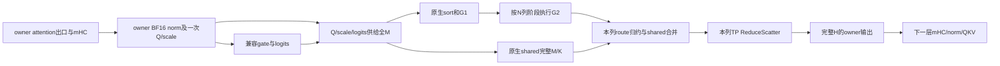

# FP8 C256 下一项结构优化：owner FFN 输入、Window-RS 与下层消费者

2026-10-29。实现基线为`f723af820`，部署保持TP4/EP1/DP1、FP8 KV、FP4 index、真实DSpark5、owner full；C256主容量为全局M1536、每owner384行。该提交包含已跑完整服务的迁移实现。性能基线仍是冻结R3的6281.294tok/s、374.837秒，并保留单臂时间间隔、正式4个冷特化和未做新GSM的限制。

**下一项大结构方向选定为：保持owner行所有权的完整FFN窗口，统一输入供料，按N列安排G2及归约，输出直接交给下一层owner消费者。** 首个实例是layer8 attention出口→完整shared/routed FFN→layer9的mHC、norm和真实QKV消费。先做新配置的完整链成本诊断，再决定实现预算；当前没有新GPU任务、kernel、winner或排队。

## 1. 迁移后的实际缺口

本次重新读取实际源码，发现不能直接沿用迁移前普通TP的AR方案：

| 路径 | 实际输入和计算 | 实际输出 | 对下一步的影响 |
|---|---|---|---|
| owner decode，40层 | `OwnerServing.target`把owner BF16 norm做全量AG；分别调用`shared_experts(packed)`与`experts(packed, router_logits(packed))` | `routed + shared`后RS，只保留本owner行 | 没有调用`RuntimeBlock.ffn_forward`的预量化路径，也绕过`routed_expert_forward/forward_maybe_comm_fused`；打开backend开关不能完成接入 |
| retained prefill，满足准入的2–19层 | `RuntimeBlock.ffn_forward → v41_owned_prequantized_moe → prequantized_owned_ffn`，owner量化一次，分别AG Q、scale、logits，供shared和routed消费 | combine/pad后RS | 一次量化供两路已经存在，不能重复记收益；输入guard为M≥4096，decode不会自动使用 |
| 原生回退、其他层与bounded replay尾部 | 各自原生路径；后半层可能只处理完成prompt所需末窗口 | 按原生合同 | layer8收益不能乘40；必须记录实际逐层行数和调用次数 |

源码：[owner target](../atom/models/deepseek_v41/owner_service/owner_serving.py)、[runtime](../atom/models/deepseek_v41/runtime.py)、[prefill FFN](../atom/models/deepseek_v41/prefill_ffn.py)、[路由供料](../atom/models/deepseek_v41/prefill_router.py)。

还有三道明确接口约束：

- `supports_prequantized_input()`支持TP4/EP1，但`_validate_preselected_routes()`只允许TP1/EP4。首版沿用**logits AG＋原生top-k**，不假装EP1已有route packet接口。
- owner384 gate与原生M1536 gate的计算顺序、kernel选择和效率尚未核对。现有prefill local-router只准入2–19层、M4096–16384。其full-M零填充fallback提供另一种保持原生M的方式，但需支付清零、复制和完整gate计算，并验证实际kernel及top-k；不能只扩guard。
- 当前loaded模块的comm-fused backend均为None，H5120/I640/E384的原表无winner。owner需要显式的RS输出合同，不能通过打开DPA/DEP来绕过普通backend的AR选择。

## 2. 目标执行链与保持的计算

采用三个可分别核算的变更，最终预算以组合后的同一个完整窗口为准：

1. **输入供料统一。** 给owner decode增加独立的部署/shape准入，复用预量化消费者API；full-M G1、shared GEMM及原生权重不拆分。首版不引入侧流。保持native gate兼容前，不能认领删除BF16 AG；如果必须保留它，按实际重算后的净预算决定输入方案是否继续。
2. **Window-RS。** 借用commfusedmoe主动按输出N列组织G2的方式：第j列阶段计算时推进前一阶段的local reduction/RS。保留全部M、G1 K5120、G2 K640和真实专家权重；I640含576有效列及原生padding。当前Window的K分块应为128，不能套K256。窗口宽度只在测得预算后固定一个，不扫参数。
3. **下层消费接续。** 让plan/runner持有通信workspace和输出，结果直接进入layer9实际`Block.prepare_attention`及QKV。第一版保留原来的五字段返回与`normed`结构；待完整链获益后，再在无BF16辅助读者的层显式删除无读者norm物化。

这里借用Mono的是一次绑定真实权重、step布局、状态所有权和明确的原生边界。当前Mono目标上限48行、MoE上限96行，其CTA资源和任务安排不能扩到M1536。专家仍按原生大M方式复用权重，不变成逐token的完整专家计算。

与旧ready方案的区别是**主动改变G2列完成顺序**。不给原expert排序加计数器来假定早就绪。mHC需要完整H统计；第一版仍在一行全部列齐备后进入下一层，不声称某256/512列到达就能完成norm或QKV。

现成Window并非透明的BF16调度替换：它将G2 route输出编码成FP8，再把local partial编码成MXFP8/4。首版只考虑8-bit partial，最后输出BF16；route与partial新增量化、求和顺序变化都须单独数值验收。若此合同不合格，不能自动切4-bit或继承旧GSM；保留BF16的另一个实现须另立预算，不把它当零成本替代。

## 3. 整网预算与容量

新[静态预算](../../validation/dashboard_whole_20261029/FP8_OWNER_WINDOW_BUDGET.json)复用R3数据并读取实际WindowConfig/host分配规则，没有运行GPU或旧reviewer。

| 时间范围 | 迁移后普通event稀疏估计 | 占374.837秒的估计比例 |
|---|---:|---:|
| C256/M1536 target | 176.578秒 | 47.11% |
| 全部decode target | 186.747秒 | 49.82% |
| 4096＜M≤8192 prefill target，1199次/19样本 | 85.602秒 | 22.84% |
| 8192＜M≤16384 prefill target，647次/11样本 | 99.246秒 | 26.48% |
| 全部prefill target | 185.682秒 | 49.54% |

这些范围含父子关系，不能相加；稀疏enclosing估计还比wall高3.54%–3.64%。它们用于确定调查覆盖范围，**不是FFN的时间占比，也不是精确积分**。

若研究目标定义为相对保留的同配置主线达到2×，当前样本还需从374.837降到约223.392秒，即再减40.403%。单个阶段仅加速2×时，需要覆盖80.806%的当前时间。即使整个M1536 target都加速2×，条件整网也只有约1.308×；只做decode不足以填平目标。旧BF16/EP4的33.78%缺口及67.56%覆盖率不再使用。

下一诊断需要填写如下账本，不用逻辑字节代替实测毫秒：

| 候选 | 可能删除或隐藏 | 必须支付／保留 |
|---|---|---|
| owner一次供料 | BF16 AG、两路各自的重复输入量化；以实际dispatch为准 | owner量化；Q/scale/logits三次collective的启动和传输；gate兼容或full-M fallback；native sort/scale布局转换 |
| G2列窗口＋RS | 原全量route中间tensor的峰值容量、部分最终combine物化、实测可重叠的G2/归约串行时间 | G2重排退化、按N阶段重复读MID/scale、route及partial量化、local reduce/shared join、服务CTA资源、RS、fill/drain |
| 下层接续 | 完整输出的多余copy，以及已证实无读者的BF16 norm写回 | 原生BF16舍入、完整H统计、residual/pre/post/comb、QKV、所有状态操作；有辅助读者层的BF16必须保留 |

删除全尺寸route tensor的**容量**不代表删除全部route写读：分片版本仍写入/读取route。是否命中cache、实际HBM/XGMI流量及耗时另测。已有G1融合SiLU/FP8并直写G2消费布局的部分，不计为新收益。

M1536每rank的完整接收tensor：BF16输入15,728,640B；Q＋E8M0 scale＋BF16 logits为9,289,728B，逻辑体积少40.94%。三次collective可能抵消部分节省；这不是通信时间预测。更小的Q/scale/top-k包8,183,808B仅作后续容量项，EP1接口尚不支持，首版不认领。

按512列、10阶段、8-bit partial的容量示例，**RS模式**为：

| 全局容量M | 双slot route | 十阶段partial | 完整owner BF16输出 | 合计／rank |
|---|---:|---:|---:|---:|
| 1536 | 10,616,832B | 8,112,640B | 3,932,160B | 22,661,632B（21.61MiB） |
| 8192 | 56,623,104B | 43,256,320B | 20,971,520B | 120,850,944B（115.25MiB） |
| 16384 | 113,246,208B | 86,510,080B | 41,943,040B | 241,699,328B（230.50MiB） |

实际`_window_workspace_sizes`在`gather_output=False`时不分配reduced payload/scale，也没有最后AG。此前AR模式36.49/194.58/389.16MB不能直接套用。**但当前owner基线本来就是RS，所以“没有AG”本身不是新增收益。** 上表不含VMM取整、原生shared/G1 scratch、输入准备、allocator和graph池，也未选service worker参数；多个layer/M必须共用有界lease，不能各自永久缓存整份workspace。

完整链采用实际端点计算`Δt = native_window - candidate_window`，不相加跨rank最大值或重叠事件。服务估算为`Σ(实际层型/shape调用次数 × Δt) / T`，使用相同owner行数及prefill replay合同；不同变更的收益不连乘。作为研究准入标准，完整方案保守估计至少应有**5%整网收益**（约17.85秒），优先争取10%（约34.08秒）；这是继续投入大结构实现的门槛，不是已测预测。

## 4. 下一个实际任务

写一个新的、一次真实权重加载的完整链fixture，而不是重启旧服务：

1. 固定`f723af820`与本次实际AITER依赖，绑定layer8/9、原native权重和三个不同输入；decode M1536，prefill取R3真实样本M7550和M16291。三形状分别代表主decode、两档主要prefill，非参数扫描。
2. 对每个形状比较**原完整窗口与仅加观察点的窗口**：attention出口→FFN mHC→输入供料→shared/router/sort/G1/G2/local reduce→combine/RS→layer9 mHC/norm/QKV。复用已准备的四点stage observer，但先验证真实unwrapped globals、运行绑定和graph事件位置。普通event计时；不使用曾造成decode约2×扰动的kernel-profiler时间作预算。
3. 同一次绑定记录实际gate/G1/G2完整key、M/K、sort行数、route-output模式、shared输入量化和workspace；观察点开销超过完整窗口1%则该计时不准入，先修观察方式。G2 callable中包含的local reduce要标出，不能冒充纯GEMM。
4. 唯一附加的数值问题是**原生全M gate与owner供料的兼容性**：对同一输入比较原全M、当前兼容local方案或full-M零填充fallback的有效logits与top6 ID/weight，并记录真实kernel及准备成本。没有兼容方案就不删除BF16 AG。首版保持native top-k，EP1 route packet不进入此次实现。
5. 用实测值填入第3节；若有正向组合预算，首先实现一个Window-RS候选，并将输入供料变更单独保留为可归因对照。比较完整窗口、三个输入、所有返回字段及状态；只有完整链通过且预计达到整网准入门槛，才接服务screen。

如当前读取材料没有保留真实隐藏输入，fixture应在一次新真实模型运行中捕获这个限定窗口，或明确使用真实权重加独立输入的局部验证；不得把随机输入fixture称为真实服务轨迹。输出文件、code cache和GPU资源都须按新任务重新准入。

## 5. 状态、数值和服务准入

- 行顺序分清全局请求顺序、owner packet顺序与原生expert sort顺序。prefill M7550/16291仍使用原始M选原生GEMM，只在既有输出owner合同中padding；不能为了Window bucket改变G1的实际M或把尾部padding移到错误rank。RS返回的每rank有效行数和补零位置须逐项验证。
- layer9为REUSE、无Engram和BF16辅助读者，适合首个消费者窗口。辅助BF16读者位于2/8/14/20/24/28/32/36；Engram seam另算。最后层flush、37–39层draft taps、KV/PAGE/STATE、generation、proposal接受/拒绝/回滚及prefill→decode转换完整保留。
- 一个plan绑定权重与所有buffer extent；step仅更新元信息/epoch，不能热路径建立通信对象。consumer结束前不复用slot；所有TP rank一致决定原生回退，且在状态或通信buffer写入前决定。退休顺序为停止replay、同步、释放graph、解除绑定、释放workspace/通信对象。
- native自重复误差、独立数值参考、完整窗口候选误差分别记录。Window的route/partial量化必须通过新的完整模型精度协议，旧BF16/EP4 GSM不继承。
- 服务阶段两侧都用同一TP4/EP1/FP8/DSpark5/full、相同请求指纹；记录formal AL、target/draft行数和每层路由。新的准备版本补齐R3四个已观察Triton签名，再检查完整key；不通过减少请求或裁剪验证行来获得zero-cold。
- input路径没净收益就停止该子项；Window完整链退化、状态/数值不合格、GEMM退化吃掉重叠、窗口仅在layer8有效却达不到整网门槛，均停止晋级。若完整FFN覆盖不足，下一调查转向实测最大的attention/投影/状态阶段；不再回头累积router、旧ready或旧prefetch。

本轮只提交已有迁移实现、读取源码并核算新RS容量及时间门槛。历史冻结源码、运行及review保持原样；没有新的GPU性能或精度成绩。
