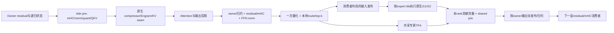

# DSV4.1：从小并发 Mono 到大并发完整链路融合

本方案的目标是减少真实消费者之间的重复计算、HBM 往返和跨卡传输，并把依赖交接留在设备端。融合边界由数据所有权、数值语义和可调度性决定。不能用合并文件、少几个 launch、单个 GEMM 更快或换专家布局代替完整链路目标。

本轮先收敛 R13 性能候选、运行入口和代码分支，再实施清理。下文的大并发融合是架构方案，尚未实现；不会因该方案修改已测算术、同步或调度参数。

## 1. 基线与证据边界

当前交付基于本轮开始时锁定的 `origin/main = ebd5f84f3`，将运行实现、统一入口、部署与架构文档整理成线性主题提交。旧 merge 和开发分支已经退出当前分支历史；22 个旧 worktree、10 个本地分支的源码与修改保存在项目验证目录的 `WORKTREE_ARCHIVE.json` 及对应 Git 归档引用中。

rebase 后的 **C5** 已完成 ABBA（保留同一新主线的 C4 A1，修复后运行 B1/B2/A2）：主线 **5741.094198**、候选 **7603.533722** 输出 tok/s，**1.324404976×**；平均 TPOT **42.541209→31.636498 ms**。两对 **1.315218× / 1.333702×**，候选 B2/B1 为 **1.012029851**，主线 A2/A1 为 **0.998004086**。受测提交 `fc4da1513`；四臂各 593 warm / 2560 formal，输入 18,859,319、输出 2,357,150 token，正式新增 JIT/图捕获为零，完整图键保留。主线 Spec0、候选 DSpark5，这是完整服务组合收益；本轮没有新的 GSM8K 整网精度验收。

| 臂 | 输出 tok/s | 平均 TPOT ms | P99 TPOT ms | 实际 C256 q |
|---|---:|---:|---:|---:|
| A1 | 5746.835 | 42.499 | 53.272 | 0.999464 |
| B1 | 7558.343 | 31.850 | 53.525 | 2.152715 |
| B2 | 7649.268 | 31.423 | 51.046 | 2.144061 |
| A2 | 5735.365 | 42.583 | 53.039 | 0.999460 |

P99 按每臂报告，不对两个 P99 求平均冒充合并分位数。

测试期间远端 main 又前进到 `773eb3625`（新增缓存卸载/公共调度接口和 gfx1250 两项提交）。本轮以开始时锁定的 `ebd5f84f3` 收尾，新增提交已记录在 `NEW_MAIN_DURING_C5.json`，尚未纳入本轮分支或性能验收；不能将 C5 成绩标为 `773eb3625` 的结果。

收敛后的 **C3** 在受测提交 `d52127533` 上完成新鲜 ABBA：主线 **5751.659051**、候选 **7606.091425** 输出 tok/s，**1.322416951×**；平均 TPOT **42.458006→31.640445 ms**。两个配对为 **1.336870× / 1.308267×**，候选第二次比第一次慢约 **2.10%**。四臂请求/token 数相同，正式新增编译/图捕获均为零。

C3 与下述 R13 的比较口径均为 **主线 Spec0、完整候选 DSpark5**，这是完整服务组合的收益。C3 主线是 `713eb0614`；它不是 rebase 到 `ebd5f84f3` 后的性能验收。新主线包含有效行计数和路由/专家接口修改，新的 C5 对照结果见上；C3 保留为 rebase 前的历史证据。

这次 rebase 复用主线 `x_scale → _run_experts → place_experts → apply`，预选 routes 不再生成替代 routing callback，也不复制旧版专家计算。尾窗同时保留原生 GPU 有效行计数和 owner host 布局。owner packet 可能含各 rank 的空槽，不能以外层连续前缀计数裁剪；其独立 context 使用自己的 mask，外层 native context 保持主线计数。draft owner 的 `ContextPacket` 显式声明 `window_fp8=False`，以 BF16 传输 context keys，恢复全局行顺序后交给原生 window writer；DSpark 的投影、量化和尾处理计算不变。7 项真实 consumer 的 CPU 合同测试覆盖三条融合路径与 replay 尾窗。

历史 R13 新鲜 A1/B1/B2/A2：主线 `713eb0614` 5755.113309 tok/s，完整候选 7623.064164 tok/s，1.324572385×；平均 TPOT 42.427437→31.556413 ms。每组 593 warm、2560 formal，输入 18,859,319、输出 2,357,150 token；TP4、C256、BF16 KV、FP4 index、主线 Spec0 / 候选 DSpark5、level3/FULL。正式新增 JIT/图捕获为零。

候选基础提交 `56a9afaf0` 加 23 个未提交修改/新文件。本轮整理首先逐字节核对全部 2053 个仓库文件。R13 的 1.32457×来自完整服务组合，不是 comm-fused kernel 的独立倍率；没有把历史 10%/13%/18%/3%相加。固定专家分配来自两个 prefill 样本，第三个留出；它是当前配置的一部分，并非跨工作负载通用的最优分配。

R13 全模型没有新的 GSM8K 验收。保留已有按层 L2 与原生自重复结果，不能把旧任务分数迁移成新配置的验收。后续算术/同步变更按 GSM8K 与相对 L2 验收，阈值及协议见第 9 节。

R8 是 R13 的实际诊断，已完成且原始数据保留。本次只对其新增离线细分，未重跑旧诊断。rank1 普通 forward：prefill 从 R7 的100.5889降到91.3446 ms；C256从33.7263降到33.4727 ms。prefill请求组成508→513、C256步骤758→751，因此不能把均值差直接分配成某开关的因果收益。

R8 同一 rank1、单个 GPU 标记窗口的独占命名组：

| 实际样本 | query rows | 全窗口 ms | G1 / G2 ms | named AG / 其余 collective ms | MXFP8/BMM / MHC / cat / quant ms |
|---|---:|---:|---:|---:|---:|
| initial prefill，3请求 |16262|127.431|15.217 / 8.628|10.144 / 31.636|15.067 / 5.512 / 2.850 / 1.322|
| replenishment，1请求 |7835|69.382|9.481 / 5.417|5.294 / 15.115|8.159 / 3.117 / 1.315 / 0.767|
| decode_64，256请求 |768|31.504|6.418 / 3.283|2.928 / 4.146|3.067 / 1.417 / 0.119 / 0.340|

这是保留事件的分类，collective含等待，MXFP8符号未必对应同一个投影；不是可删除时间，不相加不同rank的最大值。“没有保留kernel”的间隔也不等于GPU空闲。大链路仍同时涉及投影、专家计算、通信和状态边界，不能只追路由小包。

## 2. 当前能力合同

| 路径 | 实际准入和并行 | 已有行为 | 不能混淆的范围 |
|---|---|---|---|
| Native target Mono | decode，实际含padding的M≤48；TP2/4/8构建域，具体GPU证据依版本 | K1＋K2大融合段，原生 compressor/Engram seam | C不是M；不能据此声称所有TP/宽度均有性能和精度验收 |
| Native draft Mono | ≤8请求，完整draft block；DP另受总行数限制 | draft backbone使用相同任务/绑定机制 | 可在prefill后的草稿阶段执行，不代表prefill target走Mono |
| R13 owner decode | C256时常见总M768，每rank owner capacity192 | packed验证，grouped attention，native EP4 FFN，共享专家TP4 | R13的EP配置会拒绝原来的target和draft Mono包装器 |
| R13 large prefill | 大行数FFN在0–19层；预量化/local router/packet主要覆盖2–19 | row-owner输入，EP4完整专家，shared TP4，AG/RS | 第20层及后续FFN进入尾窗；不能把剩余22层都按大M扩展 |
| 尾段与混合步 | 实际owner容量、q、bands、padding、prefill/decode按步判断 | 保留原生fallback与完整图键 | `decode_16`是采样序号；图容量16也不是全局C16 |

权威代码：`atom/models/deepseek_v41/mono/{config,dispatch,runner,draft_runner}.py`、`owner_service_contract.py`、`runtime.py`。现有`Dims`拒绝attention TP>1同时EP>1；R13的attention TP4/expert EP4不能靠删除这个guard套入旧Mono。原recipe里旧“12行/MXFP4 activation”的描述不作为当前能力表，实际准入及kernel源码优先。

## 3. 小并发 Mono 为什么可能获益

### 3.1 它组织的是完整生产者/消费者链

`mono/kernels/attn_pre.py`的K1依次处理延迟post/residual、mHC collapse、norm与量化、QKV投影、Q/K归一化和RoPE、KV窗口写入、query投影。部分结果直接生成下一个消费者需要的dtype/layout。

`mono/kernels/layer_post.py`把K2a和K2b放入同一个launch：索引/稀疏attention、inverse RoPE与group quant、wo_a及中间量化、wo_b、TP归约、residual/mHC/FFN norm、router/top-k、共享专家、G1/SiLU/中间量化、G2、shared合并、最终归约。norm生产者发布每token就绪位，router与量化消费者按需等待，避免每段都由host组织。

Token-owner变体只把部分结果发给真正的owner；K1可接下一层的延迟residual/post。收益机制包括更少的重复量化、更少的整张量中间落盘/重排、owner直接发布、更少host和kernel边界，以及设备端细粒度推进。**并非所有数据留在寄存器/LDS**：mailbox、peer buffer和scratch仍有全局存储访问，需要按实际指令核算。

### 3.2 小行数为什么适合这一组织

小M的独立算子很短，启动、归约和阶段交接占比容易变大；按token或少量被选专家的任务表可在固定驻留CTA中运行。现有公共执行模型为MI355X的256 CTA、512线程、每CU一个CTA，设备端等待以所有生产者可驻留为前提。合并K2还复用两个阶段的LDS空间，且保留阶段间barrier。

当前服务使用 FULL graph，多个原生 kernel 的 host launch 开销已经被压缩。因此后续不能按少了几个 launch 估算收益；应在相同 graph 模式下比较 HBM 物化、跨卡字节、设备调度、producer 等待和同步的完整净费用。

源码说明M>48时，部分TP形状的shared任务超过现有CTA分配，K1/K2出现寄存器压力/溢出风险。这是结构约束。把MAX_ROWS改到768，或简单复制若干小M Mono再拼输出，会破坏权重复用、sort/padding效率和进度保证。

历史recipe记录2026-09-29的TP4、level0/FULL：1请求完整draft＋verify步骤3.7对10.9ms，2请求5.1–6.3对11.3ms。该旧实现/基线不等同当前R13，不能把这个倍率外推到新ABI或C256。

这里区分机制与归因：已有旧TP配置中确有draft Mono的实际GPU记录；没有对当前R13做小并发Mono开关的受控性能消融，所以不声称已量出其独立收益百分比。

### 3.3 当前收益与完整融合目标如何对应

| 已落地手段 | 服务于什么 | 当前边界 |
|---|---|---|
| owner/packed、retained prefill、选择性状态发布 | 减少无效行、重复前缀计算和不必要的状态交换 | 仍有原生状态、压缩与 attention seam |
| 复用 mHC/QKV/FFN 量化、grouped H16 attention | 让生产者输出直接服务已有高效消费者，保留原生计算几何 | grouped launch 本身不等于 attention 到 FFN 全链融合 |
| EP4 完整专家、固定分配 | 改善矩阵几何和当前工作负载的跨 rank 完成时间 | 属于执行策略，不等于实现了通信/计算重叠 |
| 本地 router/top-k 与 route packet | 在保持适用数值合同下减少冗余路由计算与传输 | 激活、shared 和输出仍需完整供给/归约 |
| 稳定输入与完整键预热 | 把 JIT/捕获从正式阶段移出，恢复可重复的快路径 | 是稳定性基础，不冒充新的融合算子收益 |

历史 10%/13%/5% 等是当时的分项预期；目前没有同一受控基线下的完整逐项消融，不能把它们相加或分配成当前倍率。已有组合已经达到本轮性能门槛；后续架构目标仍是第 5–7 节的实际数据链，不能用继续调专家分配替代链路闭合。

## 4. 架构先确定三种计划，复用一套语义

新主线已有 `RoutedRowsWire`、`pack_routed_rows/gather_rows` 和原生 route/placement/expert 分界，后续输入链应先复用这些接口。owner-local transport、真实有效行和 EP4 完整专家是具名策略，不能再复制一套通用 MoE forward。

以现有`atom/mono/{runtime,plan,device,weights}`为公共机制。模型侧保留少量具名变体：

- `SmallDecodeTP`：现有token任务策略；保留能力边界与原生seam。
- `WideOwnerEP`：C256/M768及已观测的中等owner宽度；以expert tile复用权重，以owner row负责状态与输出。
- `LargePrefillEP`：保留大M GEMM，按已经完整到达的行/tile推进，不按小row chunk反复sort。

这三个名称是待实现的计划类型，不是新增运行开关。不要再用大量互相独立的布尔flag表达不可能的组合。R13 flags作为固定兼容profile保留，未来由一个部署合同生成。

| 唯一职责 | 建议落点 | 合同 |
|---|---|---|
| deployment/eligibility | 模型config＋公共deployment | checkpoint/量化、attention TP、expert EP、shared TP、M/q/padding、layer type、fallback，在状态写入前四rank一致 |
| immutable plan | 模型plan＋公共plan/layout | 所有权、任务依赖、native seam、buffer extent、tile排序、build key；不在热路径重复推导 |
| weight/state binding | 现有weights＋模型state view | 一个权重owner；持久KV/递归状态与当步元数据分离；target与draft分别绑定并行合同 |
| ABI | 公共runtime/abi＋模型ABI表 | 一份参数表生成flatten顺序/校验，不手写多份签名，不用动态反射隐藏依赖 |
| execution | 模型runner/runtime | 一条层循环、显式seam和提交/回滚边界，不复制TP/EP整条forward |
| kernel composition | 模型kernels | 选择原生阶段/融合阶段，明确ready与publish；不包含scheduler或服务协议 |

完整链路允许多个高效kernel，但中间缓冲、状态和通信只有一个所有者。巨型单kernel如果损失GEMM效率、阻断通信推进或反复写scratch，就不满足目标。

## 5. 先固定数据流，再选择融合边界

图中是目标责任链，不表示所有箭头已经融合，也不预设每个节点都用同一个kernel。

### 5.1 缓冲与搬运账本

对每条边记录producer、所有consumer、dtype/scale/layout、有效M与padding、设备owner、是否跨卡、物化次数、最后读者、复用epoch及当前实际kernel。分别核算HBM逻辑读写字节、链路逻辑字节和实测时间，不能按字节比直接推导时间。

| 边 | 当前R13行为 | 拟消除的重复 | 必须保留的消费者/语义 |
|---|---|---|---|
| norm→FFN输入 | owner-local BF16；一次FP8 value/scale，再AG | 独立quant output再pack/unpack；无意义的BF16重建 | router仍需要原BF16；shared/routed的scale格式和舍入 |
| route→expert | 本地top6 ID/weight小包AG | 全M logits传输、重复top-k、重复sort/布局转换 | global ID、tie规则、有效owner行、sentinel/mask |
| G1→G2 | 原生FP8中间量化/排序消费 | 写通用中间布局后再转成G2布局 | FP4权重/FP8 activation、原scale规则与K累加 |
| G2/shared→RS | 原生本地专家输出、shared相加、RS | 独立完整combine tensor、重复清零/复制及整层末尾等待 | 每行所有本地expert贡献、shared就绪、原数值顺序 |
| RS→下层mHC/norm | owner结果进入下一层 | 纯搬运、可延迟的residual/post物化 | mHC读取完整H的统计；最后层flush；prefill→decode和拒绝路径 |
| state publication | 选择性owner状态/packet | 重复打包相同状态、无读者广播 | KV、Engram、压缩状态、spec commit/rollback及generation |

R13中H=5120：完整BF16行10240B，FP8 values5120B；scale字节由真实blockscale ABI计算，不用假设值。top6的int32 IDs＋FP32 weights为48B/行；这不等于所有通信都能缩到48B，专家激活与shared仍要供给。跨卡TP4/EP4 payload按实际发送目的和去重次数计算。

## 6. 两个优先融合段

### A. 输出段：G2/shared → owner归约 → 下一层消费者

先在保持原生G1/G2矩阵形状和排序的前提下，设计以owner行×H输出块为单位的publication。每个输出块只有在本rank的全部有效expert贡献完成、shared对应部分完成后才发布。不能把某个expert/tile完成误当成整个owner块完成。

接收端收齐所需rank贡献，按现行数值合同归约，直接写下一层所需的owner缓冲。若mHC需要整行H统计，则在整行片段齐全后执行；其前面的H块发布仍可推进。延迟residual/post需定义末层flush、图复用和原生fallback，不能只优化中间层。

原生atomic G2若不能提供正确的块完成边界，应先增加明确的completion接口并测其成本，或保留整G2完成的native seam。不能猜测CTA结束顺序、窥探普通数据充当flag，或声称在原G2未改时已经消除了其完整输出物化。

### B. 输入段：owner norm/quant/route → 完整expert tile就绪

全步只做一次route/sort/padding。按expert保留GEMM的权重复用，把完整K输入和对应scale都已到达的原生M tile标记为ready；G1可以完成并退休该任务后，再执行下一任务。

不要回到旧K-band假设：G1拿不齐K就不能退休，一CTA/CU下等待会阻断后续波次。也不要把M16384切成许多小M并分别sort/GEMM，旧实测分析已表明padding会膨胀。新增arrival-order plan、worklist和epoch维护必须计入完整FFN。

R13预量化复用和route packet是该输入段的已有基础；EP布局和固定分配作为策略输入保留，不作为替代链路融合的新终点。

## 7. 通信进度与生命周期是架构合同

为每个mailbox定义`(step_epoch, layer, stage, owner, tile)`身份，payload写完并完成正确scope的release后发布ready；消费者acquire后读取。图重放、双缓冲复用与最后读者确认必须绑定，禁止用host时间或上次step的计数推断可复用。需要明确epoch回绕/重置。

所有等待者驻留并不自动保证通信进度。必须证明producer CTA、通信kernel及shared计算能得到CU/LDS/VGPR资源；保留完整原生dual-stream的资源争用成本。设计阶段给出launch资源和等待图，证明不存在“消费者占满所有CU，生产者无法运行”的环。

当前Direct用对称内存和固定rank虚拟地址stride；原生HIP IPC不能保证相同flat地址关系。新实现必须使用真实peer-pointer表，并独立验证映射、所有权、释放顺序和system release/acquire，不能仅替换allocator或用Tensor包装掩盖ABI不符。MORI初始化失败不证明重叠无收益，也不允许无改动反复加载整网。

buffer由graph/runner持有，容量由immutable plan确定。保留地址、shape、stride、q、bands等完整图键；输入就地更新。编译和捕获在真实完整键覆盖的预热阶段完成，正式新增计数必须为零。

## 8. 实施顺序及停止条件

| 阶段 | 交付 | 进入下一阶段的证据 |
|---|---|---|
| 0 分支收敛 | 唯一目标分支、固定R13 profile、一个启动入口、可恢复归档、原始性能记录 | 当前模型字节/配置绑定、CPU与实际入口、整理后性能复核；无悬空实验路径 |
| 1 执行图/搬运账本 | 两条完整链的buffer表、依赖图、native seam、同rank时间范围 | 每个拟删除物化有真实producer和最后consumer，成本不重复计算；复用R8，不为已有信息重跑trace |
| 2 输出链合同探针 | peer-table/epoch/所有本地贡献完成/共享join/直接consumer布局 | 变化输入eager和graph重复、原生自重复与各rank L2、资源/ISA及进度证明 |
| 3 完整单层FFN | 原生G1/G2快路径＋输出段，再接输入ready plan | M768、4096/4097边界和真实大prefill/偏斜route的完整费用改善，所有复制/等待计入 |
| 4 整网接入 | 同一LayerPlan接入真实early/late层与owner状态 | 小并发/尾段/填充/补请求/结束请求、KV与回滚、full-key warm、正式zero-cold |
| 5 任务与服务验收 | 固定checkpoint/协议GSM8K；fresh主线/候选对照；清理前后对照 | 任务门槛、适用L2及真实路由证据；吞吐/TPOT/尾延迟各自报告 |

先选输出段还是输入段的最终实施顺序，以第1阶段的可消除完整费用和ABI可行性为准；当前建议先闭合输出段，因为它能让结果直接服务下一层，避免再只优化小输入packet。若完整FFN不收益、GEMM退化吃掉重叠、producer不能前进、数值/状态不合格或接口需要复制一整条forward，停止该候选并保留R13，不用参数扫描或更多独立小包凑倍率。

不以2×作未经证据支持的预测。先保住实测1.3×，再用完整周期净节省制定下一阶段目标。小并发Mono应先在合法TP配置中做真实开关对照，保持同输入/状态和proposal预算；targetEP4＋draftTP4是独立部署设计，不能直接改全局config来恢复草稿Mono。

## 9. 验证与代码组织约束

- 精度以GSM8K和相对L2为主。当前仓库`.github/benchmark/models_accuracy.json`的DeepSeek-V4.1-Flash DSpark条目阈值0.91、历史3-shot/flexible-extract协议作为来源；EP4是不同部署，运行时必须明确标注。完整test集1319题，不以小样本冒充全量。
- L2比较同输入、权重、初始KV/STATE及真实有效元素，先测Native自重复；保留逐层/逐rank最差项。没有适用L2阈值时报告数值，不自行放宽或宣称通过。路由ID完全一致作诊断，整数索引和无损transport仍履行精确合同。
- 重构与算法修改分提交。若kernel源、输入、launch、ABI和资源不变，记录证据并复用适用验收；变化的kernel需fresh编译、规范化ISA与LDS/VGPR/private/spill检查。
- full-chain性能包括pack/unpack、量化、route/sort、shared、同步、通信、state和runner；同时报告GPU步骤、target forward、实际接受q、TPOT和服务吞吐。不能用单算子倍率替代服务结论。
- 默认off的实验开关只存在于隔离候选。晋级到目标分支的是一个具名、受支持profile及必要fallback。独立oracle留在tests/验证材料；历史实验代码归档，不混入生产调用链。
- 状态机、参数绑定、能力表、任务计划各只有一份权威定义。未来架构工作先更新本执行图和合同，再写kernel；禁止以新增分支/新目录长期代替主分支收敛。

## 10. 原始证据索引

原始证据在项目验证目录`validation/structure_ceiling_20261024/`；归档后按清理receipt恢复并验证decoded SHA：

- `STEP12_PERFORMANCE_R13_RESULT.json`、`STEP12_PERFORMANCE_R13_FINAL_RECHECK.json`：原始完整服务结果。
- `STEP12_TRACE_R8_REVIEW.json`、`STEP12_TRACE_R8_EP_COSTS.json`：实际当前候选trace。
- `STEP12_R7_R8_ORDINARY_PHASE_COMPARISON.json`、`STEP12_TRACE_R8_OTHER_DEVICE_COSTS.json`：本轮新增离线分析。
- `STEP12_EP_MONO_FASTPATH_FINDINGS.json`：实际旧TP draft Mono与EP拒绝边界。
- `STEP12_PREFILL_BALANCE_FINDINGS.md`、`STEP12_ROUTER_DIAGNOSIS_AND_FIX.md`：路由和负载的证据与数值限制。
- `STEP12_NATIVE_IPC_PEER_TABLE_DESIGN.json`、`BREAKTHROUGH_CANDIDATES.md`：尚未实现的IPC合同与旧K-band预算撤回。
- `validation/consolidation_20261028/`：源码迁移、清理归档、入口及新性能验收凭据。

新主线验收：`validation/rebase_main_20261028/STEP12_PERFORMANCE_C5_RESULT.json`、`FINAL_DELIVERY_RECHECK.json`；其中 A1 provenance 明确指向 C4，旧 C4 B1 预热接口故障原始证据独立保留。
