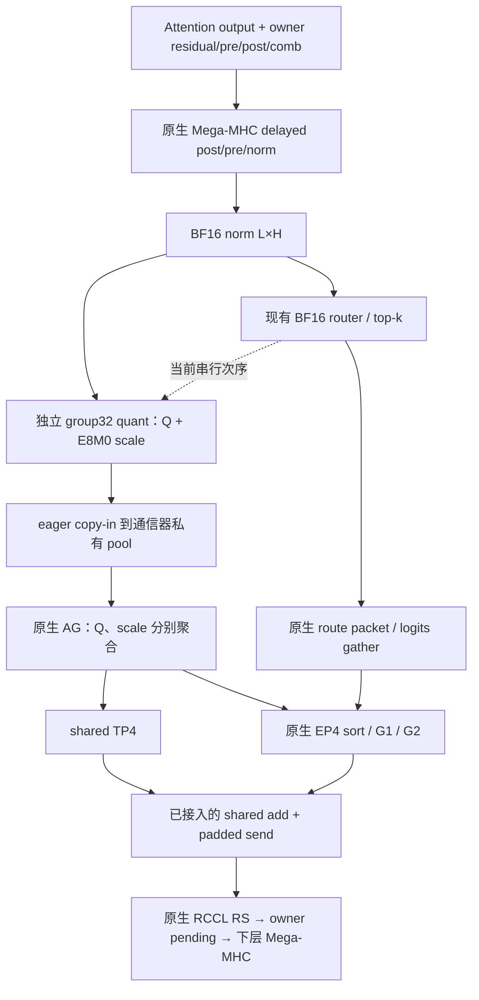
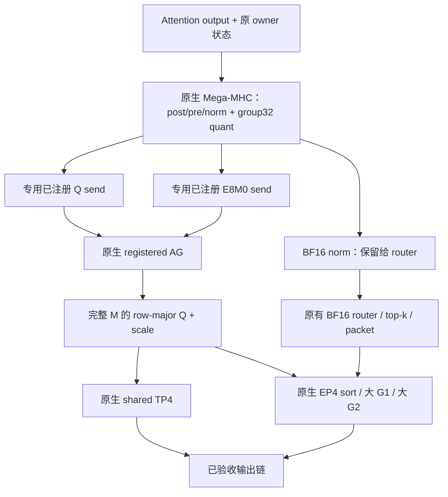
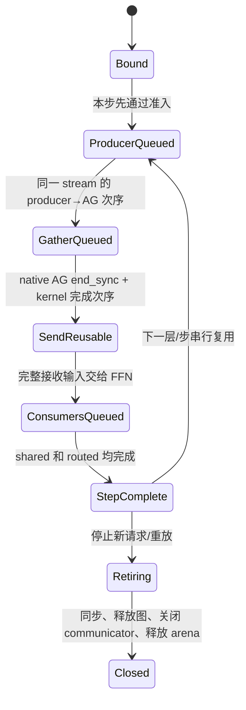

# DSV4.1 大 prefill 输入融合：从原生 Mega-MHC 直达专家消费布局

本轮优先闭合 **delayed post/pre/norm → 一次量化 → 原生 AllGather → shared 与 routed FFN**。保留大 M 的原生 G1/G2、完整 K、专家权重复用和现有输出融合；借鉴小 M Mono 的数据归属、依赖和最后读者管理。

实施分两步：先让独立量化直接写入专用、已注册的 Q/scale 发送缓冲；再复用原生 Mega-MHC 的融合量化能力，让 norm 的生产者直接写这些缓冲。两步分别度量，最终以包含生产者的完整 FFN 和整网净收益决定是否晋级。

**状态：2026-10-28 两步已实现并完成整网验证，但未晋级生产。修复IPC allocation offset和DSpark融合KV预热漏项后，全量GSM8K为1207/1319=0.9150871873，通过0.91门槛；相对原生产编译边界的2560请求ABBA为1.001218223×（+0.1218%），第一对持平、第二对小幅正向，尚未确认稳定收益。候选精确源码已归档，模型恢复已验收的输出融合版本；生产只新增融合KV预热修复。旧错误版6.54%和新边界内768筛选0.63%均不计作已验收整网增量。** 源码基准为 ATOM `75a56a37a1e0c55fff748887c7846f64826ea885`，分支 `yifehuan/dsv41_fusedmoe`，主线截点仍为用户确认的 `ebd5f84f3`；AITER 依据 pinned reference `729feefb7210ebc3a87ebd00a44e0c43f30bf3f2`。本方案不改变这组基准，也不需要重跑已完成的输出实验。

## 1. 已知收益、失败与本轮选择

| 项目 | 已有证据 | 对本方案的约束 |
|---|---|---|
| C5 完整服务组合 | 相对锁定主线 Spec0，DSpark5 候选为 **1.324404976×** | 历史组合倍率，不能分摊成独立融合收益 |
| shared add＋ragged padding 输出融合 | 同节点 C5 → 新输出：7782.992051 → 7825.518820 tok/s，**1.005464064×**；两对 1.010770831 / 1.000148327 | 已接生产；baseline 漂移 1.2329%，不承诺稳定 1%；不能乘到 C5 倍率上 |
| 输出版 GSM8K | 1212/1319 = **0.9188779378316907 ≥ 0.91**，18 层实际融合路径 | 适用于已测 BF16 KV/EP4 部署；不自动覆盖本轮输入修改 |
| IPC push / owner pull 输出原型 | 新增发布、搬运和同步抵消融合收益，已停止 | 当前没有 G2 内部 completion；不再通过调包大小重复同一路线 |
| `quant_destination` | 三个 M 全部命中 native custom AG 回退 | RCCL 原位分支从未执行，不提供原位 API 或性能证据 |
| `quant_pool` | 真实 layer8 eager FFN：M7835 **1.002444209×**，M16315 **1.004872609×**；每层省约 3.84 / 13.78 μs | 实际只把 Q 直写私有 pool，scale 仍走旧路径；未生产接入、未整网验收 |

`quant_pool` 的 FP8 相对 L2 为 0，scale 字节一致，变化输入与重复 graph replay 已检查。但 communicator 私有 input pool 被多个调用者复用，不能将指针直接散布到 18 个生产层。已有证据说明 copy-in 可以删除，尚未证明删除后足以产生显著整网收益。

本轮主方案采用 AITER 已有的 **external input registration**：runner 绑定专用发送 arena，借用原生 peer table、AllGather 和 `end_sync`。这样下一步可以把量化生产者接进来，而无需重新实现通信或复制 MoE forward。

详细已测结果见 [大 M 输出与输入探针记录](dsv41_wide_output_findings.md)。下文保留归档候选的设计合同；实际实现、编译边界修复、完整结果与退役决定见第13节。本文中的输入arena及destination接口均指归档原型，不表示当前生产入口已启用。

## 2. 支持域先于算子选择

| 项目 | 首版合同 |
|---|---|
| 模型与硬件 | 当前 DSV4.1 checkpoint、gfx950；沿用当前已加载权重及量化布局 |
| 并行 | attention TP4、expert EP4/TP1、shared TP4、DP1；DSpark5 固定 |
| 专家 | 384 个 global / 每 rank 96 个 local，intermediate 2304，H5120；原生 W4A8 group32 |
| 层 | 已有 prequantized owner 路径中的非 hash 层 **2–19**，文本输入 |
| 步形状 | 实际大 prefill **4096 ≤ M ≤ 16384**；L=ceil(M/4)，每 rank 形状 `[L,5120]` |
| 状态 | 沿用当前 owner residual、pre/post/combination 和 pending；不改变 KV、投机提交/回滚 |
| 通信 | 原生 IPC communicator、独立 cached HIP input allocation、TP4 fully connected；Q 和 scale 各自通过原生 `should_custom_ag` |
| 执行 | 首版一个串行 stream、一个 arena slot；side streams 关闭，不允许并发重放共用 slot |
| 图 | 第一步只在实际 eager seam 启用 registered 直写；捕获走现有 native 路径，后续单独验收融合 producer 图 |
| 回退 | 超界 M、小步/decode、hash、图策略不支持、不同后端或任一原生 consumer 条件不满足，写入前选择现有完整路径 |

M 是执行行数，C 是请求并发；C256 的 decode 可能是 M768，不在此首版域内。当前通用 `row_sharded_mhc.eligible` 只有 M≥4096 等条件，**16384 是本方案新增缓冲容量的上界**，不能误写成所有既有 prefill 路径的共同限制。

部署检查在加载后统一完成；逐步检查只依赖已经存在的 M、owner 布局、层类型、metadata 和绑定信息，不读取 GPU 数据决定各 rank 的 collective 分支。复用 [原生 prequantized consumer 合同](../atom/model_ops/moe.py) 和 [prefill 路由合同](../atom/models/deepseek_v41/prefill_router.py)，不另造一套宽松能力表。

## 3. 当前链路与目标链路

当前真实入口见 [RuntimeBlock.ffn_forward](../atom/models/deepseek_v41/runtime.py)、[Block.prepare_ffn](../atom/models/deepseek_v41/model.py) 和 [prequantized_owned_ffn](../atom/models/deepseek_v41/prefill_ffn.py)。owner 路径调用 `prepare_ffn(row_sharded=False)` 是跳过末尾 BF16 norm gather，输入仍为 owner-local；不能将这个参数误读为恢复 replicated FFN。



图中的 copy-in 是实际 eager custom AG 行为；某些 native graph 策略已经直接注册输入，因此 graph 上不能重复计算这项节省。



目标删除两类重复：独立量化重读 BF16 norm；Q/scale 在 AllGather 前再次 copy-in。BF16 norm 的必要写出、router 的读取、AG 传输及完整接收结果仍存在。首版维持串行次序；图中分叉表示数据依赖，不表示已实现并行或重叠。

## 4. Buffer 的所有者、布局与原生接口

### 4.1 专用注册发送 arena

当前实现用两个独立的 `IPCBuffer(raw_cached=True)` HIP allocation，通过非拥有的 uint8 tensor view 提供 Q `[Lmax,H]` 和 scale bytes `[Lmax,H/32]`；arena 强持有两个分配 owner。注册前核对 tensor 指针等于 HIP allocation 基址，不能以 `torch.empty` 的 `storage_offset()==0` 代替此条件。每步取从 offset 0 开始的前 L 行，始终使用同一个起始指针。

在启动、预热和捕获之前，各 rank 按相同顺序执行一次 Q 注册、一次 scale 注册：

```text
comm.register_input_buffer(q_send 的固定起始地址 view)
comm.register_input_buffer(scale_send 的固定起始地址 view)
...
comm.all_gather_reg(q_encoded, out=q_receive, dim=0)
comm.all_gather_reg(scale_encoded, out=scale_receive, dim=0)
```

这些方法已经存在于 pinned AITER 的 `aiter/dist/device_communicators/custom_all_reduce.py`；外部 arena 已完成独立注册、真实完整FFN和四卡producer→AG检查；证据见第13节，不能用此前借用私有pool的结果代替。

注册必须遵守以下源码事实：

- 当前 IPC 路径的 `register_input_buffer` 交换真实 handles，但 Python pool 发送的 offset 固定为 0，因此输入必须位于 allocation 基址。不能假设各 rank 地址相同或固定 stride；非零 offset 子分配的缺陷与修复见13.4。
- C++ `get_buffer_RD` 按 **精确 data pointer** 查表，不按父 storage 的范围匹配。注册父 tensor 不覆盖所有子 view。未来非零 offset 布局还必须先修复并验证 IPC metadata 的 offset 传递，单独调用当前注册函数并不够。
- `register_input_buffer` 每次推进 rank-data 表，即使同一指针重复注册也会消耗容量。不能每层、每 M、每 replay 注册。
- symm backend 上该 API 是 no-op；首版拒绝 symm、VMM 和未验证的 allocator 导出模式。专用 raw cached HIP allocation 已在四卡验证；它不同于未验证的 raw/VMM communicator backend。
- 保留 `should_custom_ag` 对实际 encoded tensor 的原生判定；它与 `custom_all_gatherv` 的限制不同。不能为套用 arena 放宽大小上限、连通性或对齐条件。

首版由 runner 建立 binding，communicator 的存活期内持有 arena 的强引用。IPC 路径未找到对应的逐 buffer unregister，因而不能在 communicator/旧图仍引用地址时释放或换址。不要直接套用 Mono `owned_peer_buffer` 的“runner 析构即释放”规则；这里只复用其明确 ownership 的原则。

### 4.2 接收缓冲与精确 ABI

| 对象 | producer → consumer | dtype / shape | 首版 owner 和最后读者 |
|---|---|---|---|
| BF16 norm | Mega-MHC → router | BF16 `[L,H]` | 当前调用/图；router 与选路完成后不再依赖它 |
| Q send | 独立 quant，后续 Mega-MHC → native AG | E4M3 FP8 `[L,H]` | 注册 arena；最后读者是所有 peer 的 AG |
| scale send | 同一量化 producer → native AG | uint8 E8M0 编码 `[L,H/32]` | 注册 arena；最后读者同上 |
| Q receive | native AG → shared 与 routed | E4M3 `[4L,H]`，消费 `[:M]` | 先保留原调用/图的分配方式；两个 FFN 分支都是读者 |
| scale receive | native AG → shared 与 routed | E8M0 `[4L,H/32]`，消费 `[:M]` | 与 Q receive 同生命周期 |
| route | BF16 router/top-k → 原生 expert placement | 连续 FP32 weights、int32 logical IDs `[M,6]`，或原 logits fallback | 原生 route/placement 路径 |
| residual/pre/post/comb | 当前 Mega-MHC → finish_ffn / 下层 seam | 现有 BF16/FP32 状态布局 | 原模型状态 owner，不能作为发送 scratch |

继续使用现有 `_gather` 的字节传输方式：Q/scale 以连续 BF16 view 传输，分别是 `[L,2560]` 和 `[L,80]`，接收后 view 回原 dtype。`view` 是位解释，不能换成 `.to(BF16)`；scale 的 uint8 → E8M0 也不得数值转换。H5120 的 Q 行5120B、scale 行160B 均满足16B整除，但仍调用原生完整 eligibility。

首版 Q、scale、route 保留三个独立对象。先删除真实 copy-in，不重新打包大 packet，不重启已无收益的 grouped gather 方案。两个 AG 都完成后才把输入交给完整 M 的 FFN consumer。

所有 L 行都必须由本步 producer 写入，含 owner capacity 尾行；只截去 native 路径本来不消费的 `4L-M` 行。沿用已有 owner mask、logical ID 和 sentinel，不能把 E8M0 padding 字节随意设为 0 当作“零 scale”，也不能以未初始化 padding 污染下一次 replay。

## 5. 复用 Mega-MHC，逐步移动融合边界

### 5.1 现有能力与待补接口

[pre_delayed](../atom/model_ops/deepseek_v41/mhc_pre_delayed.py) 已有 `fuse_quant`，attention 当前启用，FFN 的 `prepare_ffn` 尚未启用。HIP Mega-MHC 的 `out_dtype="mxfp8"` 已返回 `(BF16 norm, E4M3 Q, uint8 scale)`，并保留原 residual、pre、post、comb 输出。Triton 后端不支持此融合模式。

pinned AITER `aiter/ops/mega_mhc.py` 当前自行分配 Q 和 scale，没有可选输出 destination；底层 native launcher 已接受 `norm / quant_out / quant_scale` 指针。所需扩展是 wrapper 中的窄输出参数及其绑定校验，优先保持 native kernel 与默认调用行为不变。

源码中的融合量化从 **已舍入的 BF16 norm** 取值，group32 scale 为 `ceil_pow2(max(amax,1e-10)/448)`，编码为 E8M0。不能改为 FP32 norm 直接量化，也不能以 Q 代替 BF16 router 输入。复用源码语义仍需与当前独立量化比较实际结果，尤其是尺度边界、零输入和真实层状态。

### 5.2 两个可独立判断的改动

**第一步：独立 quant → 专用注册 arena。** 对现有量化 wrapper 增加窄的 `out` 支持，或在模型 helper 中绑定同一个已测 kernel 的现有输出指针。检查 shape、dtype、device、连续性、容量和无重叠，量化算法/launch 参数不变。Q 和 scale 分别 direct-write；先保持现有 router→quant→gather 次序以及新输出融合。

**第二步：原生 Mega-MHC → 同一 arena。** 先用原生 `fuse_quant=True` 的新分配输出，隔离核对 producer 数学和 prequantized consumer；再新增拟议 `quant_out` / `quant_scale_out` 参数，把它们指向同一 arena。两参数一起提供或一起省略，仅 `out_dtype="mxfp8"` 使用；不与 residual、norm、workspace 或其他输出重叠。旧调用仍自行分配，不改变 attention 默认行为。

开启 fused quant 后，计算发生在 router 之前，但 router 继续读取同一语义的 BF16 norm。FFN 接口需显式接受已有 Q/scale，跳过再次 `quantize_fp8`，然后复用同一个 shared/routed/route/combine 后缀。不得复制整个 `prequantized_owned_ffn` 形成两套专家执行逻辑。

即使 fusion 已有实现，它也会增加 BF16-only Mega-MHC 的指令和资源需求。必须检查实际 dispatch、ISA、VGPR/LDS/private/spill，并比较 **Mega-MHC＋router＋transport＋完整 FFN**。如果只计 `prequantized_owned_ffn`，量化被移到计时窗外会制造假收益。

保留 Mega-MHC 当前 scratch 策略和 capture 前 warm。显式 workspace 必须匹配精确 `(T,H)`、device 和 stream；不能为了复用 arena 顺便构建无限增长的按 M/地址缓存。共用 native scratch 的图仍然串行执行。

### 5.3 Compile 边界必须表达真实写入

当前 `v41_mhc_pre_delayed` 声明 `mutates_args=[]`，fake 返回新分配 tensor。不能在此声明下偷偷通过全局对象写 persistent arena；编译器必须看到输出 destination 是显式输入并被修改。

拟议新增一个具名 out 变体，保持 flat tensor ABI：

- 输入包含原有状态、权重，以及明确的 Q/scale destination；schema 声明这些 destination 被修改。
- guarded op 返回原来独立生成的 residual/pre/post/comb/BF16 norm；wrapper 在边界外组合 destination views。避免 custom-op 返回值别名限制，fake 的返回数量、dtype、shape 与真实路径一致。
- 后续 FFN guarded op 显式接收 BF16、Q、scale，不能靠层级全局 registry 查找“最近量化结果”。未用到的 native 变体仍按原 ABI 调用。
- 变体在部署/层绑定阶段固定；不在 Dynamo traced 函数里加日志、计数、Python 异步状态切换或动态 kernel import。
- eligibility 在 mHC 改写状态和 arena 之前决定；写入后发生的错误直接报告，不能重跑原生 post 再次更新状态。

将当前 `supported(moe, local, rows, metadata)` 中可在 producer 前判断的合同提为同一纯 eligibility 来源，以 shape/部署描述检查。producer 后的 Tensor 检查只作合同断言；避免为拿到 `local` 先跑一次 mHC，再判定后重跑。

## 6. 最小 plan、binding 和运行流程

不新增通用大框架。先在 `atom/models/deepseek_v41/` 放一个模型专用 transport helper，复用 `atom/mono/runtime/consensus.py` 的加载期 bind/agreement 机制；已有公共机制不具备相同生命周期时，保留窄的具名实现。

| 责任 | 拟议内容 | 禁止进入热路径的工作 |
|---|---|---|
| `PrefillInputPlan` | 不可变 H/group/Mmax/TP/EP、layout version、consumer 合同、producer 变体、capture policy | 重新推导容量、枚举所有层和专家 |
| `PrefillInputBinding` | communicator 身份、两个 allocation 强引用、注册状态、stream/slot、plan | 注册、IPC exchange、重新分配或热更新配置 |
| step views | 当前 M/L/valid、arena 的 offset-0 views，接收 buffer 与调用上下文 | 新建 tensor storage、按每个 M 保存新地址；现有接收分配暂保留 |
| 执行 wrapper | 一次 eligibility → producer → BF16 router → 两个 AG → 原生 FFN → 原输出链 | 复制层循环/共享专家实现、按 M 重新选择专家权重布局 |

本轮只有固定原生、独立量化直写、Mega-MHC 融合直写这几种具名实验变体；最终只晋级经验证的变体及必要 fallback，不新增一组互相独立的布尔开关。

加载顺序：先完成本地无 collective 的部署、容量及 backend 检查，并全 rank 一致确认；再分配并一致确认成功；最后按一致顺序注册和绑定。注册阶段发生实际 IPC 故障时停止该实例，不让一部分 rank 继续 gather、另一部分 rank 单独回退。首版不在每层加入 CPU all-reduce 决策，逐步路由使用现有一致的 batch metadata 和固定 profile。

```text
step admission（尚未写状态）
  unsupported → 原有完整路径
  supported   → 取固定 slot 的 L 行 views
                → producer 写 BF16 norm / Q / scale
                → 原 BF16 router 和 top-k
                → Q AG → scale AG → route AG
                → full-M shared + routed
                → 当前 shared-add/pad + RCCL RS
                → finish_ffn，保存 pending 给下层
```

## 7. 同步、复用与销毁合同

### 7.1 两种最后读者不能混淆

发送 arena 的最后读者是所有 peer 的 AllGather；接收 Q/scale 的最后读者是本 rank 的 shared 和 routed FFN。前者完成并不代表后者完成。



这是 GPU 依赖模型，不是在 host 每一步同步的状态机。host 函数返回只表示提交完成；首版通过同一 stream 排队和串行模型执行保证上述顺序，不为每层插入 `torch.cuda.synchronize()`。记录 epoch 只用于身份/调试，不能替代 GPU 的完成保证。

pinned C++ `allgather_naive` / `allgather_vec` 都以原生 `start_sync` 开始、`end_sync<ngpus,true>` 结束。后续在同一 stream 改写发送 arena 时，前次 native AG 已完成其 peer read 协议。保留这些同步，不能省掉 end_sync、猜测远端读取进度或用 host “release” 提前覆盖。

如果以后启用 shared alt-stream，必须保留当前 main→alt wait 以及 main 等待 shared 完成；接收 arena 复用要覆盖两个最后读者。跨 stream producer/AG/重放还需独立 slot 和 event 依赖，并检查资源争用与实际进度。`record_stream` 只跟踪 allocator 使用，不能代替 event 或 peer barrier。

### 7.2 Graph 与模型 reload

首版在 capture 入口沿用 native fallback，不在 capture 中注册外部地址。AITER 的 `_agree_capture_path` 是全 rank 的原生选择，还包含 host opt-out；不能直接低层 `all_gather_reg` 绕过配置的 copy-in 策略。

后续 graph 融合变体需满足：启动前创建所有固定地址、完成 registration；遵守原生 capture policy；producer 变体、layout、stream/slot 均进入相应 build/graph 身份；完整现有地址、q、bands、shape/stride 键保留。覆盖有限实际完整键预热后 seal，正式新增 JIT、trace、compile、capture 为零。容量上界不会自动消除 producer 的其他 shape specialization，必须看真实计数。

不允许同时 replay 两张写同一 slot 或共用 Mega-MHC scratch 的图。若服务确需并发，先把 slot 数和 scratch 分配作为新的配置验收，不通过临时 mutex 隐藏 GPU 地址冲突。

销毁顺序为：停止调度/新 replay → 等待所有相关 streams 完成 → 清除图及 runtime binding 的使用 → 关闭原生 communicator/peer mappings → 释放 arena storage。没有逐 buffer unregister 的条件下，首版模型 reload 要重建这组 communicator；保留 communicator 又反复建立新 arena 的 reload 暂不支持，不能靠 Python finalizer 提前释放或无限保留旧 arena。

## 8. 容量和搬运账本

设 TP=4，H=5120，L=ceil(M/4)，Q 为1B/元素，E8M0 为1B/group32。

| M | L | Q send B/rank | scale send B/rank | 两者合计 B/rank |
|---:|---:|---:|---:|---:|
| 4096 | 1024 | 5,242,880 | 163,840 | 5,406,720 |
| 4097 | 1025 | 5,248,000 | 164,000 | 5,412,000 |
| 7835 | 1959 | 10,030,080 | 313,440 | 10,343,520 |
| 16315 | 4079 | 20,884,480 | 652,640 | 21,537,120 |
| 16384 | 4096 | 20,971,520 | 655,360 | 21,626,880 |

按最大容量首版发送 arena 的 tensor payload 为 **20.625 MiB/rank**，18 层串行共用一份；allocator 对齐、缓存与 IPC metadata 的实际费用另计。后续若固定接收 arena，需要 **82.5 MiB/rank**，发送＋接收 payload 为 **103.125 MiB/rank**。接收对象目前已存在，只是瞬时分配；持久化增加存活区间，不等于峰值必然净增82.5MiB，也不能在没有实测时认定峰值不变。首版不需要这项变更。

双 slot 的持久空间相应翻倍，且只有存在真实可重叠工作才值得引入。GPU HBM 与编译/tmp/shm/原始输出存储是两本账，不能用 HBM 空闲代替原有10GB磁盘/临时空间准入。

| 删除项 | 每 rank 每次执行的逻辑 HBM 流量 | M7835 | M16315 |
|---|---|---:|---:|
| Q＋scale copy-in 的读和写 | `2*L*(H+H/32)` B | 20,687,040 B | 43,074,240 B |
| 独立 quant 对 BF16 norm 的重读 | `2*L*H` B | 20,060,160 B | 41,768,960 B |
| 两项合计 | `2*L*(2H+H/32)` B | 40,747,200 B | 84,843,200 B |

这是两项都接入、且基线确有 copy-in 时的逻辑字节差，未包含分配器、cache、同步或资源退化；它不是带宽测试，也不是可直接换算的耗时。`quant_pool` 只删除 Q copy-in，不能将其倍率当作整张表的收益。

仍须支付：BF16 norm store 与 router read；Q/scale 产生与完整接收；AG 跨卡 payload；route/sort、完整 G1/G2 和 shared；输出 join/RS 与下一层状态消费。图路径若原来已注册输入，第一行可删量为0。整网预算按同一个 rank/完整窗口测到的净时间及实际触发次数估算，不把各 rank 最大值相加，不把18层比例直接当整网比例。

若受影响链路占原总时间比例 f、链路实测速比为 s，只能在其他费用不变的假设下使用 `1 / ((1-f)+f/s)` 作预算示例；f 必须来自当前工作负载。历史10%/13%/3%等预期、本轮输出倍率与单层输入倍率不相加、不相乘。本方案不承诺新的固定整网涨幅。

## 9. 按最小完整链递进的交付

| 阶段 | 独立可审阅的改动 | 晋级所需证据 |
|---|---|---|
| A 注册 arena | 一个模型 transport helper；两个专用 buffer、加载期一致注册、native AG 与明确 fallback | 小型无权重的实际 IPC 注册/变化输入/原生回退/串行复用/退役验证；证明外部路径真实执行 |
| B 独立 quant 直写 | 同一量化 kernel 接收 Q/scale destination，复用 FFN 后缀；暂不改 Mega-MHC | 真实 checkpoint layer8，实际 eager 完整 FFN 两个配对均记录；与已验收生产基线比较，成本含两次 AG |
| C 原生 fused quant 语义 | FFN 使用现有 Mega-MHC fused 输出；先允许原生新分配，明确 Q/scale 的消费入口 | 受影响18层的实际权重与状态，norm/量化/状态 L2；真实消费者与 producer 资源检查 |
| D producer 直达 arena | AITER wrapper 可选 destination、ATOM 显式 mutation ABI、单一生产者到 consumer 绑定 | 包含 Mega-MHC 的完整链净收益，eager/compile/适用 graph 各自核验；无隐式状态重放 |
| E 服务筛选 | 对最终组合建立新的不可变测试入口与 source manifest；复用单次加载机制适用部分 | 同配置4×768筛选，实际路径/图/前缀状态一致、zero-cold；完整触发分布与尾段费用 |
| F 完整验收 | 选定组合后一次4×2560对照与对应GSM8K；主题提交收敛回当前分支 | 完整吞吐/TPOT/尾延迟、协议与任务门槛、L2及实际路由；结果不继承已改输入链的旧GSM |

下一次实现首先交付 **A＋B 的专用注册 arena 和真实单层完整 FFN 结果**，不立即再跑四次整网加载。C 可在同一计划内继续研究，但每项收益与失败分别归档；B 收益小不自动证明 C 无空间，C 的资源退化也不能被 B 的少量正收益掩盖。

AITER wrapper 扩展与 ATOM 接入分主题提交，保留原默认行为；不修改 frozen reference 或历史 probe。新验证代码和原始产物放在仓外验证目录，生产 helper 不导入实验目录。最终只保留受支持实现与原生回退。

停止条件：注册/lifetime 合同无法闭合；实际执行仍全 fallback；量化误差来源未解释或出现状态污染；完整区间里 producer/GEMM/同步退化吃掉节省；修改必须复制整条 forward；新增驻留内存或预热开销超过可消除成本。停止相应候选、保留原始结果和已验收生产路径，先解释原因再设计新的结构变更，不重复 unchanged 测试或扫描无依据参数。

## 10. 验证如何既可信又更快

### 10.1 先证明被修改的合同

CPU 阶段只检查有意义的拒绝条件、注册次数/精确指针模型、fake/mutation ABI 与 fallback 次序。首次 GPU 检查用小型无权重 fixture 验证外部注册的实际路线、两 tensor 独立地址和变化输入，先解决 API/生命周期，避免失败后才发现整网权重白加载。

真实层检查至少覆盖4096、4097、7835、16315、16384，并含越界/小步的原生回退；这是一组边界和真实形状，不是参数扫描。连续变化输入、多层交错使用其他 native collective、重复 replay 后再次更新，核对没有旧 payload、尺度混用或地址失效。实际记录注册次数、Q/scale producer destination、native registered/copy-in/回退计数；不以函数名字推断路径。

加入 fused producer 后，逐层读取2–19的真实 mHC 参数与有效状态，覆盖有/无 pending、carry pre、Engram settle 后状态及 ragged owner。保持残差/状态对应同一语义位置。按部署可能遇到的边界确认退出新路径后的原生小步、尾窗、最后层 flush 和 prefill→decode，不能让第19层 arena 被后续状态误用。

相对 L2 采用 `||candidate-reference||₂/||reference||₂`，FP32或更高精度计算；零参考范数时报告绝对 L2。依次记录 BF16 norm、Q/dequantized输入、scale、router logits、owner FFN输出、residual/pre/post/comb；先测 native 自重复，保留逐rank/层最差项。transport 字节和整数索引履行精确复制合同；top-k 变化作诊断，不自行升级为额外整网精度门槛。没有已确认适用的 L2 阈值时，报告数值与范围，不写“精度通过”。

### 10.2 计时窗随融合边界一起移动

阶段B可沿用完整 `prequantized_owned_ffn` 窗口，因为 producer 未改变；阶段C/D必须从原生 FFN 前置 mHC 之前开始，到 owner output/下一状态交接为止。另列 producer、router、AG 与 expert 的同rank分段，诊断结果不冒充整段关键路径。

首版主看实际 eager 路径，graph测试同时用于复用正确性和该模式的独立性能。图中原先已经免 copy-in 时应允许没有对应增益，不据此删图键。新 producer kernel 做fresh编译并检查实际产物；未改变的 expert GEMM 用 dispatch/形状/输入绑定证明保留，不机械重编译或重复旧全矩阵。

### 10.3 单次加载流程的适用边界

已完成的 `single_load` 将两条 eager 输出路径在启动前安装并预热，idle EngineCore 串行切换，四rank确认，清空 KV/state-checkpoint 前缀索引。四组768请求共 **861.355s（14分21秒）**；旧四次启动、每组2560请求为 **3008.283s（50分8秒）**。3.4925×是筛选周期差，包含减少请求数；仅重复准备部分约省1311s。没有“模型吞吐提高3.49×”这一结论。

阶段B若仍完全处于同配置 eager seam，可以按同一机制安装 native/direct 两变体，并在启动前完成arena注册及双方warm。每阶段继续核对PID、权重指针、真实路线、完整图绑定和formal cold delta；沿用 prefix清理，不保留上一臂的缓存命中优势。

**阶段C/D修改了 traced `prepare_ffn` 的 producer，当前只切换 eager 出口的脚本不能覆盖。** 有两条合法验证路线：

1. 在启动前绑定两种完整producer变体，各自完成compile/capture/warm，保留不同variant身份及完整图键，共享只读权重、按规则串行使用状态和arena；idle时切换完整已构建路径。本轮已实现完整producer＋FFN的opaque seam，Inductor小测试及真实producer＋AG已通过；整网图路由仍由当前服务筛选验证。不能在原脚本中只改一个出口开关。
2. 若双变体会显著扩大实现或内存成本，使用独立实例验证，复用精确版本的权重文件、native产物和已审核的cache恢复流程；初始化前检查source与graph配置，不能把旧编译缓存直接当新版本命中。

先用768筛选，最终选定后再执行2560完整协议。短测排空尾段占比不同，不替代完整服务结论。改变TP/EP、权重布局或Spec0/DSpark5仍需独立配置验收；同实例切换不用于伪造主线对照。需要更新主线相对倍率时，单独运行新鲜主线对照，不能用输入增量乘历史C5。

### 10.4 精度和正式运行

最终组合的 GSM8K 沿用当前 DSpark 对应3-shot、local-completions、flexible-extract、C65、全1319题、`score ≥ 0.91`，并在运行前复核实际catalog和评分入口。记录checkpoint/tokenizer、题号/数据版本、prompt、生成预算/seed/stop、KV dtype、EP及图配置。本部署BF16 KV与catalog FP8 KV的差异继续披露。验收同时给出任务分数、协议符合情况以及新输入融合在真实层上的执行证据。

不为每个小原型重跑GSM，不设置相对Native固定少几题或逐token一致的门槛。已完成且源码/配置/合同未变的验证直接复用；输入producer和同步改变后，旧输出版GSM仅作历史证据。

预热按实际完整图键覆盖，稳定输入buffer，seal后统计所有rank正式新增JIT/trace/compile/capture。若失败，保留失败臂和源绑定，先完成最小故障定位，只重做受影响的新候选或臂；不增加warm请求数量来掩盖缺失键，不删除地址、bands或q。

## 11. 后续更深融合的准入条件

首版保留大GEMM、现有expert分配和串行通信。只有完整链测量显示仍有可消除等待，才考虑BF16 router与Q/scale AG的独立流重叠；必须证明资源争用、communicator次序和接收最后读者，不先上双缓冲。

G1的细粒度输入ready需要完整K和scale，不能拆成许多小M反复sort/GEMM。G2→RS的进一步融合需要真实“本行所有local expert＋shared完成”接口；当前整个G2返回的seam不提供这种块完成信息。RS→mHC必须保留整行H统计与delayed post语义。上述均为后续独立结构工作，不计入本方案收益，也不通过调路由负载代替输入链闭合。

## 12. 源码与证据索引

仓内可直接审阅：

- [总体架构](dsv41_fusedmoe_architecture.md)、[已测输出与输入探针](dsv41_wide_output_findings.md)。
- [模型 prepare/finish](../atom/models/deepseek_v41/model.py)、[owner runtime](../atom/models/deepseek_v41/runtime.py)、[prequantized FFN](../atom/models/deepseek_v41/prefill_ffn.py)、[BF16 router](../atom/models/deepseek_v41/prefill_router.py)。
- [Mega-MHC compile seam](../atom/model_ops/deepseek_v41/mhc_pre_delayed.py)、[独立 group32 量化](../atom/model_ops/blockscale.py)、[MoE prequantized ABI](../atom/model_ops/moe.py)、[已验收输出融合](../atom/model_ops/deepseek_v41/ffn_combine.py)。
- [加载期一致绑定机制](../atom/mono/runtime/consensus.py)、[Mono peer owner 生命周期参考](../atom/mono/runtime/lifecycle.py)；本方案的外部注册寿命与后者不同。

pinned AITER reference 位于项目相邻 `/home/yifehuan/dsv41_origin_aiter_reference`，版本见文首；实现时绑定实际源码与产物，不改 frozen reference：

| 文件 | 本方案依赖的事实 |
|---|---|
| `aiter/dist/device_communicators/custom_all_reduce.py` | `register_input_buffer`、`should_custom_ag`、`all_gather_reg/unreg`、capture全rank一致策略 |
| `csrc/include/custom_all_reduce.cuh` | 精确指针注册/查询、rank-data容量、copy-in、原生AG的start/end同步 |
| `aiter/ops/mega_mhc.py` | fused MXFP8返回合同、workspace限制、Q/scale当前分配与launcher参数 |
| `csrc/kernels/mega_mhc.cu` | `MegaMHCQuantOutput` 的BF16舍入后group32量化及native dispatch |

项目仓外 `validation/whole_join_20261028/` 中的不可变证据：`node155/r3/PERFORMANCE_RESULT.json`、`node155/r3/EXTENDED_RESULT.json`、`node155/gsm_r4/GSM_REVIEW.json`、`single_load/REVIEW.json`、`single_load/TIME_SAVINGS.json`、`quant_destination/ROUTE_CORRECTION.json`、`quant_pool/REVIEW.json`、`FINAL_DELIVERY.json`。它们记录已完成实验，不是本设计的实现或验收凭据。


## 13. 本轮实施与证据（2026-10-28）

### 13.1 两步各自的实测范围

所有数字来自node155、job244395；保留历史C5与输出R3原始结果，不相乘。

| 变更与计时窗 | M7835 | M16315 | 证据与判断 |
|---|---:|---:|---|
| 独立量化直写专用注册Q/scale；真实layer8完整FFN | 1.590529 → 1.585206 ms，1.003358× | 2.852011 → 2.834619 ms，1.006135× | `registered_input/REVIEW.json`；两对均正向，但增量较小 |
| Mega-MHC融合量化＋专用注册直写；包含producer的真实layer8完整链 | 1.670345 → 1.651230 ms，1.011576× | 2.984914 → 2.966640 ms，1.006160× | `producer_bound/REVIEW.json`；两对均正向，未计整网 |
| 接入实际RuntimeBlock后的完整入口；含native seam费用 | 1.649393 → 1.647086 ms，1.001401× | 2.995900 → 2.962438 ms，1.011296× | `input_integration/PARTIAL_REVIEW.json`；M7835第二对0.999404×，不能称稳定收益 |

不同实验的随机路由不同，表中横向差异不能全部归因于一次host优化。第一版destination wrapper重复构造protected-storage集合，单独测得约4.1μs；合并为一次集合检查后约1.4μs，保留全部alias拒绝。初版融合直写在M7835为0.990071×，该失败保存在`producer_input/REVIEW.json`，没有删去。

使用2–19层真实mHC参数、变化的合成状态，有/无pending共468项producer检查：BF16 norm、Q及residual/pre/post/comb相对L2均为0，scale字节一致。128次producer graph replay后更新输入也已核验。真实FFN的owner输出另与native自重复比较，仍报告原始L2，不将producer的零误差扩展成整网精度结论。

完整入口的4096、4097、7835、16315、16384已完成数值、Dynamo与native graph fallback检查；最后M16385触发550MB临时盘耗尽，保留该次失败。随后仅补了M768、M16385、错误stream的实际dispatch检查，native算术使用明确的test double，证明选择回退且不写arena；没有声称M16385完整FFN已经通过。服务使用原有1.1GB共享tmp/shm池，不扩大历史10GB总账。

### 13.2 实现边界与地址合同

`prefill_input.InputPlan`固定H5120、Mmax16384、TP4及group32；`RegisteredInput.bind`复用模型加载期的一致绑定机制，执行两次外部注册。communicator强引用arena，arena弱引用communicator；18层共享同一个串行slot。Q与scale接收结果仍为调用/图所有，native AG end_sync保持不变。

归档候选由`ATOM_DSV41_PREFILL_INPUT_FUSION=1`启用，启动时要求EP4 owner profile、原生HIP backend及AITER destination API。最终该候选未晋级，开关和运行代码已从生产树撤回。AITER变更原位于`tools/dsv41/patches/aiter_mega_mhc_destinations.patch`，现连同候选保存在`input_delivery/archived_source/`；它只给native wrapper添加可选destination；测试实例只挂载该文件的已核对overlay，不改pinned reference或用户AITER工作树，也没有更换Mega-MHC设备算术。

完整输入链收在`v41_owned_prefill_ffn_chain`：准入→producer→BF16 router→Q/scale/route AG→原生shared与G1/G2→已验收输出融合。`prequantized_owned_ffn`复用唯一后缀，接收可选的预量化输入和明确binding。原生与候选位于同一完整边界，capture仍走原生路径；不同stream、超界shape及consumer拒绝均在写状态前回退。

整网首次启动暴露了此前`backend=eager`不能发现的AOT接口问题，正式请求数为0，失败与源代码已归档：

1. 当前PyTorch不能functionalize“mutable输入＋Tensor[]返回”的custom op。普通attention的`v41_mhc_pre_delayed`恢复原有只读schema；destination采用独立的固定tuple返回，完整FFN seam也使用固定tuple，均显式声明Q/scale写入，不从guard返回输入alias。
2. 实际FP8/E8M0输入基类型仍触发Inductor的`auto_functionalized_v2 was not removed`。编译边界改持有两个`uint8`原始storage，在opaque op内零拷贝取得FP8/E8M0 view；容量、内容编码和注册地址不变。
3. 不能假定functionalization会保住指针：小测试中`aot_eager`确实克隆输入，而实际Inductor保留原地址。修复后完整ATOM seam在原生／融合四次切换中只编译一次，producer和consumer均核对实际destination指针。

四卡进一步使用真实layer8 Mega-MHC、M4097和M16384、三次变化输入，运行Inductor→native producer→registered AG：norm/状态相对L2为0，Q/scale聚合字节一致；每rank恰好2次注册和12次实际registered AG。此检查不包含expert GEMM。证据为`input_compile_r5/REVIEW.json`与`input_bytes_tp4_r2/REVIEW.json`；中间编译及fixture失败同样保留。

### 13.3 整网筛选与晋级

`input_service_r2`在启动前绑定完整原生／融合路径；先预热原生完整图域，再预热注册路径，seal后按A1原生、B1融合、B2融合、A2原生各768请求执行。每次切换仅允许idle EngineCore，四rank确认，清空KV/state-checkpoint前缀索引，保留权重、arena与完整图地址。两臂都使用已验收的输出融合，本次只评估输入增量。

筛选已完成并独立复核：每臂768请求、5,668,289输入token和706,891输出token相同，18层实际路径符合切换，四rank正式新增JIT/trace/compile/capture为0，权重、arena和39个原生图的完整绑定不变。总墙钟848.192s，正式生成371.272s。

| 臂 | 输入链 | tok/s | mean TPOT ms | 全decode平均q | C256平均q |
|---|---|---:|---:|---:|---:|
| A1 | 原生 | 7360.376 | 28.4497 | 2.19617 | 2.15979 |
| B1 | 融合注册 | 8025.330 | 27.3317 | 2.42859 | 2.23623 |
| B2 | 融合注册 | 7710.573 | 27.5220 | 2.41599 | 2.24126 |
| A2 | 原生 | 7404.191 | 28.2994 | 2.21236 | 2.16931 |

Pooled 7382.218525→7864.803296 tok/s，**1.065371239×**；两对1.090342370/1.041379486×。Native重复1.005953×，candidate重复0.960780×，候选自身仍有明显时长波动。全decode q的变化比只看C256更大，完成相同输出的request cycles减少。因此不能将6.54%全部归因为少搬运数据，更不能与历史主线倍率相乘；单层时窗才是直接输入链费用的现有证据。后续GSM8K未达标，因此这项短测不能作为可用性能收益。

`input_full_r1`保持相同模型源代码，下一轮只加载一次：609个既定warm请求之后，先在未seal阶段做全1319题GSM8K，确认新输入路径实际执行且score≥0.91，再seal并运行四臂2560请求。这样不需要为GSM再次加载，也不需要解除seal。每一性能臂仍清空KV/state-checkpoint前缀索引；精度阶段可能新增的图在正式计时前全部固定，完整图键不删减。实际全量GSM8K得到1137/1319=0.8620166793025019，低于0.91；四rank的18层注册输入路径均实际执行。驱动按既定门槛停止，四个2560请求性能臂均未启动，容器已退役。`input_full_r1/GSM_REVIEW.json`独立复核了完整样本、协议、路由和失败判定。提示、生成选项、seed及服务配置已与此前通过的输出版核对，未发现协议差异；尚未证明精度下降的根因。

下一项诊断`input_diagnosis_r1`保留失败源码，只在仓外替换opaque op的CUDA观察入口：用真实GSM提示对18层做同输入candidate/native/native-self/独立重数量化对照，检查norm、Q/scale、实际AG接收以及FFN输出和mHC状态；首个candidate完成FFN前不插入额外GPU操作。随后在同一份已加载权重中运行新opaque seam内的native输入全量GSM，区分producer与编译入口接法的影响。该诊断及后续修复已在13.4闭合；旧q增加不作为优化收益。

串行tmp/shm仍为1,099,997,184B。从原10GB总账未使用的headroom中增加5,000,000B输出预留，聚合新输出预算64MB→69MB，新的保守总上界9,997,345,856B；没有折扣旧节点账单，也没有扩大GPU临时盘。


### 13.4 注册地址偏移缺陷与修复

`input_diagnosis_r3`在真实GSM提示的M9543上完成18层、四rank分段诊断。第2层传入的五个状态张量全部有限；candidate与native的BF16 norm、residual/pre/post/comb相对L2为0，本地Q/scale与同一norm的独立量化一致，聚合Q也一致。但注册AG后的scale不一致，candidate FFN输出出现非有限值；重新量化并复制进注册缓冲仍复现。后续层已接收这次异常输出，因此不将后续逐层误差当成独立producer故障。

同一实例切回新opaque seam内的native输入后，全1319题GSM8K为1211/1319=0.9181197877，通过0.91门槛，18层native路径均有实际执行。它用于隔离新编译入口，不能验收注册输入。

AITER `IPCBufferPool._broadcast_ipc`返回handle与固定offset=0；HIP handle标识底层分配，`torch.empty`即使`storage_offset()==0`也可能只是该分配的内部子块。`input_ipc_offset`在四rank强制构造内部指针：本rank数据正确，另外三个rank数据错误。改用独立原生cached `IPCBuffer(raw_cached=True)`后，Q与scale的HIP allocation offset均为0，M4097/9543/16384、三次更新的AG全部与原生传输一致。

当前修复将Q/scale分别置于独立cached HIP分配，以Mono已有`_DeviceBytes`建立非拥有的uint8视图；arena持有两个分配owner，communicator及模型持有arena，关闭IPC映射后才允许释放owner。注册前用`get_allocation_base`核对基地址，容量仍为21,626,880 B/rank。没有增加逐层buffer、每步注册或复制，也没有修改Mega-MHC设备算术、原生AG屏障或GEMM。

`input_bytes_tp4_r3`用真实layer8 mHC参数验证修复后的Inductor→Mega-MHC→registered AG：三种M、三次更新、四rank的norm/状态L2=0，Q/scale字节一致，每rank恰好两次注册、18次AG。修复版`input_service_r3`的全GSM已得到1207/1319=0.9150871872630781，通过0.91门槛且18层注册输入实际执行；随后768筛选的A1完成且zero-cold，B1因正式阶段新增FlyDSL编译拒收；详见13.5。仍须完成性能复核，不继承旧6.54%。失败arena源文件保存在`failed_input_arena/SOURCE_ARCHIVE.json`；已完成诊断与旧服务日志无损压缩记录在`INPUT_DIAGNOSIS_ARCHIVE.json`、`INPUT_ACCEPTED_LOG_ARCHIVE.json`，解压SHA保留。


### 13.5 尾段编译漏项与精确预热

`input_service_r3/FAILURE_REVIEW.json`独立核对了933项源码绑定、原始客户端结果和四rank计数。有效A1为7359.692346 tok/s、mean TPOT 28.347160 ms。B1虽然完成768请求，但四rank各新增一次FlyDSL compile-lock，rank2实际新增IR context和codegen，因此B1不作为有效性能；B2/A2未启动。GSM8K在seal前已完整完成，其精度结论保留。

漏项为原生`launch_bmm_a8w8_mxscale`的N1536/K5120/batch1、tile64x64x256、waves2x4、4 buffers、split4特化。完整key包含所有ABI、constexpr与全局/环境身份，未删减。它由原生调度在M97开始的一段行数域选择；M是runtime参数，不是该key的constexpr。不能将请求并发或名字中的数字当作实际GEMM行数。

实际消费者为`DeepseekV41DSpark.write_context_kv`。`_context_kv_fusion()`把3个stage的512x5120 KV权重沿N拼为1536x5120，结果按需缓存于普通属性`_context_kv_fused`。原预热只遍历注册的`LinearBase`，因而看到了1792x5120的完整QKV，却遗漏该融合KV绑定。新预热在权重加载后调用同一个native getter，按实际weight/scale几何生成family，通过原生lookup枚举M1..16384、去重后调用AITER no-dispatch preload；不新增第二份权重、不改实际kernel选择。

`input_draft_preload/REVIEW.json`验证四rank、无模型加载的真实native fusion getter与`native_quant_linear`：33个dispatch特化、38个代表/边界行数各重复2次，预加载后的真实调用无新增FlyDSL compile-lock/IR/codegen。合成权重为不受16x16 shuffle影响的stage常量；该试验验证预热与消费者ABI，不扩展整网精度范围。

`input_service_r4`保留R3有效A1，只加载一次模型，沿用609 warm并补跑B1/B2/A2各768请求。A1来自前一实例，后三臂在同一新实例；不能宣称四臂共用同一组地址。各臂内部完整图键、权重与arena均固定，后三臂之间另核对身份不变。新增预热属于启动期变化，R3全部模型源码未变，复用已通过的GSM8K。

本次比较的A/B均在新完整producer/FFN opaque边界内，只能判断该边界下输入融合的增量。若候选值得晋级，还需要与未启用输入融合的已验收生产编译边界作完整2560请求对照；不能将768筛选倍率乘上历史C5或输出R3倍率。


### 13.6 有效768筛选与完整生产边界对照

`input_service_r4/REVIEW.json`复核结果：pooled native 7368.941843 → registered 7415.143755 tok/s，**1.006269816×**；两对1.003377173/1.009186530×。Native重复1.002516718×，candidate重复1.008321094×。四臂请求/token相同，正式zero-JIT/capture，18层路径均实际执行。A1来自已复核R3；新B1/B2/A2共一次加载。补跑墙钟814.428秒，新运行三臂生成286.469秒；完整四臂生成382.518秒含保留A1的96.049秒，不能把二者混作本轮墙钟拆分。

| 臂 | tok/s | mean TPOT ms | 全decode q |
|---|---:|---:|---:|
| A1 native | 7359.692346 | 28.347160 | 2.211564 |
| B1 registered | 7384.547298 | 28.210634 | 2.211301 |
| B2 registered | 7445.994809 | 28.212765 | 2.204336 |
| A2 native | 7378.214619 | 28.210833 | 2.212270 |

修复版q不再像错误版那样从约2.20升到2.42；不过768结果仍只是同一新opaque边界中的筛选，不直接晋级。有效A1实际9072次eligible层调用/rank；要使该96.049秒服务快1%，需少0.951秒，即每次调用约104.826微秒的墙钟预算。`INPUT_SERVICE_COST_SCALE.json`仅作量级核算，不是收益预测、上界或跨rank可加的归因。

已完成`input_full_r2`：**全新A1→B1→B2→A2，每臂2560请求**。A1/A2只读挂载优化前四个模型源文件并使用原生AITER，实际worker核对源码SHA、无注册arena且无新增完整FFN opaque入口。B1/B2用当前候选并共享一次加载，总计三次加载；每臂切换前要求idle并清空前缀索引。两侧保留相同输出融合、TP/EP、DSpark和请求协议。完整结果已复核，见13.7；GSM复用本次未变候选的1207/1319。

`INPUT_FULL_PREPARATION_ARCHIVE.json`记录66个已完成大JSON/日志的无损压缩，回收23,317,291字节，解压SHA均保留；新完整对照预留25MB输出，聚合69MB与总10GB合同不变。


### 13.7 原生产边界的完整结果与最终决定

`input_full_r2/REVIEW.json`已一次性复核932项源码绑定及四臂原始结果。每臂2560请求、18,859,319输入token、2,357,150输出token；四rank正式新增JIT/编译/捕获为0，完整图键不变，40层EP权重合同和18层实际输入路径均符合各自模式。所有实例正常退出并退役。

| 臂 | 输入路径 | tok/s | mean TPOT ms | P99 TPOT ms | 全decode q |
|---|---|---:|---:|---:|---:|
| A1 | 原生产编译边界 | 7814.241007 | 30.770898 | 50.091364 | 2.194911 |
| B1 | 融合producer＋注册直写 | 7813.960593 | 30.800905 | 50.483276 | 2.199628 |
| B2 | 融合producer＋注册直写 | 7804.657720 | 30.788894 | 50.197709 | 2.188882 |
| A2 | 原生产编译边界 | 7785.421205 | 30.910867 | 50.618359 | 2.198641 |

按总输出/总时长合并，原生产**7799.804484 → 候选7809.306386 tok/s，1.001218223×（+0.1218%）**。两对为**0.999964115 / 1.002470838×**；原生产重复变化−0.368811%，候选重复变化−0.119055%。等样本mean TPOT为30.840882→30.794900ms；不合并P99。均值有微小正向变化，但第一对持平且原生产重复波动大于合并收益，未确认值得新增编译/IPC路径的稳定增益；这不是统计显著性检验，也不宣称证明了性能退化。

**决定：保留原型和所有证据，不晋级输入候选。** 四个模型文件及输入观察hook恢复到原始archive的精确字节，归档新arena及AITER destination patch，生产继续使用已经验收的C5＋输出融合。C5相对锁定主线的历史1.324404976×保留；本轮没有新主线臂，不把任何输入/输出增量乘到该历史倍率上。

修复后精度独立成立：GSM8K全1319题为1207/1319=91.5087%，满足当前BF16 KV、EP4部署下的91%门槛；3-shot/local-completions/flexible-extract/C65，保留与catalog FP8 KV的部署差异。真实layer8、四rank、三种M与三次输入更新的producer→Inductor→AG中，norm和mHC状态相对L2为0，Q/scale字节一致。该局部零误差不扩展为完整FFN或整网L2为0。

### 13.8 收益为什么小、下一轮要证明什么

两步确实删除了Q/scale的eager copy-in和独立量化对BF16 norm的重读；它们只影响2–19层的大prefill，常见C256/M768 decode不在域内。BF16 norm写出及router读取、两次原生AG的通信/接收、shared和G1/G2完整计算、route/sort以及输出归约仍然存在；本版也没有通信重叠。因此不能从“少两次复制/少一个量化”推导出几个百分点的整网收益。

已有通过数值核对的单层原型，完整入口净节省约2.31μs（M7835）和33.46μs（M16315）；它们的路由、编译入口及分配版本不同于最终整网，不作为当前候选的精确分项归因。新完整A1实际每rank有33,354次eligible层调用，服务快1%需减少约2.987秒，即平均每次约89.54μs的墙钟预算；A2对应91.45μs。这个账本是所需节省的量级，不是预测、上界，也不能跨rank相加。见`input_full_r2/ANALYSIS.json`。

当前证据支持停止晋级这个串行直写版本，不能推出融合或重叠已无空间。后续若继续同方向，应先核对真正的shared/G1消费者前仍有哪些重读、重排或等待，再选择能消掉更多完整中间结果的producer/consumer边界；同时保留完整M/K和原生GEMM权重复用。增加双缓冲之前，必须用完整链证明有可重叠的独立工作，并计入资源争用、最后读者和额外同步。没有这些新证据，不重复当前候选、不扩大Mono的行数guard，也不转成路由参数扫描。

### 13.9 保留的预热修复、复现与周期成本

`step12_draft_kv_preload.py`现已接入生产验收bootstrap，安装在原有EP/placement audit之后，与本轮实际运行顺序一致。它调用同一个native `_context_kv_fusion()`，按实际N/K/scale绑定覆盖完整M域的原生dispatch；不改模型算术、dispatch选择、图键或warm请求数量。字段`jit_preload_gpu_dispatches=0`仅指JIT预加载不执行kernel，native lazy binding中的`torch.cat`仍可能执行GPU操作。

四卡38个代表/边界M的轻量消费者验证、修复后四臂zero-cold，以及新生产bootstrap的五项CPU导入/安装顺序与warmup返回链检查共同作为接入证据；不再为报告字段或安装位置重复加载模型。该修复单独收敛，不宣称提供服务吞吐增量。

本次完整ABBA用三次模型加载：原生产A1、共用实例的B1/B2、原生产A2。实测总墙钟**2797.017秒（46分37秒）**，正式生成**1208.090秒（20分8秒）**，其余**1588.927秒（26分29秒）**包含初始化、预加载、请求预热及收尾，不能都叫权重加载。不同编译边界的A/B未伪装成单出口热切换；已完成的GSM及前三臂没有重复运行。下一次同类验证先做完整单层筛选；只有不改变traced边界的候选才直接复用已验证的单实例切换流程。

仓外`validation/whole_join_20261028/input_delivery/SOURCE_ARCHIVE.json`保存9个精确源码版本的原路径→archive→SHA映射，涵盖输入候选、AITER patch以及预热/入口修改前版本；旧SOURCE、raw结果和失败证据不重写。`input_delivery/README.md`说明隔离复现和依赖；`BOOTSTRAP_REVIEW.json`记录最终入口检查。节点244395/155的全部测试实例已退役，8卡空闲，无反向代理；保留用户借用的整节点allocation至2026-10-29 06:51:29 UTC。
