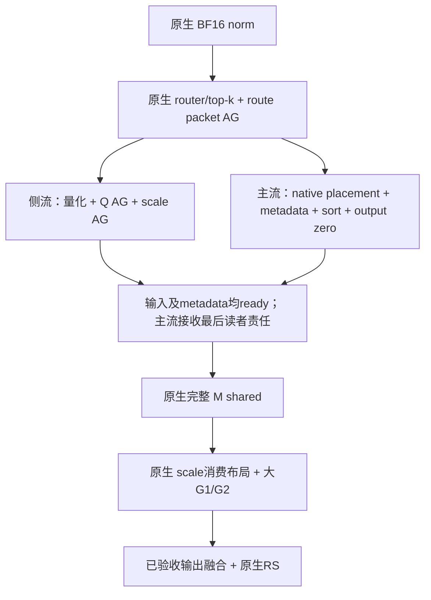

# DSV4.1 大 prefill：通信与消费者准备的执行计划

本轮继续优化已验收的 C5＋输出融合组合。上一轮注册直写输入在完整服务中仅有
1.001218223×，没有确认稳定收益，故该候选已归档；这不结束整体优化。本轮先找
原生 G1 前能够提前完成的工作，保留完整 M/K、shared TP4、routed EP4 和大 GEMM
的权重复用。基准分支为 `yifehuan/dsv41_fusedmoe`，实现基准 `f2d3ee47f`，主线
截点仍为 `ebd5f84f3`。

## 1. 从实际消费链确定目标

当前链路为：

```text
Mega-MHC → owner-local BF16 norm
  → BF16 router/top-k
  → Q/scale量化 → Q AllGather → scale AllGather → route packet AllGather
  → shared完整M GEMM/activation/quant/GEMM
  → 原生expert placement → 原生sort/输出清零 → G1 scale重排
  → 原生G1/SiLU/FP8 → 原生G2 → 已验收shared join/padding → 原生RS
```

新鲜真实layer8时间线已确认：大M G1运行
`mfma_moe1_silu_mul_afp8_wfp4_fp8_t128x256x256_pm1_fp8q_sort_async_gui_v2out_v33`，
已经融合activation/FP8并生成G2所需布局。不能把这段已有融合重复列为新收益。
前面的 `mxfp4_moe_sort_kernel` 仍将输入scale变为G1消费顺序；routed activation
本身仍由G1按sorted ids读取。没有证据支持额外复制整份activation来“优化布局”。

现有入口在 [prefill_ffn.py](../atom/models/deepseek_v41/prefill_ffn.py)，
原生expert职责在 [moe.py](../atom/model_ops/moe.py)。pinned AITER
`aiter/fused_moe.py` 的 `fused_moe_` 先选择metadata并排序，随后进入
`fused_moe_2stages` 才重排输入scale及启动G1；这个依赖分界是下一步的接口依据。

## 2. 已完成的第一项消融：router与输入通信重叠

用一个侧流执行Q/scale量化及原生AG，主流执行原生BF16 router/top-k；主流等侧流
完成后再发route AG，并串行运行原生shared/G1/G2。没有双缓冲、额外注册、M/K分块
或调度参数扫描。所有collective保持Q→scale→route顺序。

真实layer8权重、四卡、三个变化输入、eager完整FFN ABBA结果（各窗口取rank最大值）：

| M | 原生 ms | router重叠 ms | 倍率 | 两对倍率 |
|---:|---:|---:|---:|---|
| 7835 | 1.577806 | 1.584928 | 0.995506× | 0.993545 / 0.997466 |
| 16315 | 2.852310 | 2.859863 | 0.997359× | 0.997503 / 0.997216 |

Q/scale字节及route ids一致，route weights相对L2为0；owner输出candidate/native
相对L2为0.000251–0.000332和0.000201–0.000251，另保留native自重复值。
原生图fallback经过128次replay，再更新输入返回eager路径也已检查。未做新整网或GSM。
所有四rank正常退出，完整测试容器约42秒退役。

时间线证明有kernel重叠，但不等于净收益。一个M16315/rank0诊断窗口中，router
GEMM由49.639μs延长到212.282μs；G1/G2符号不变。跨流资源争用及发射/同步成本需要
计入完整链，不能把两个stream区间相交直接当作已隐藏时间。profiler与单独event标记
均只用于诊断；上表64次/窗口的eager计时没有这些观察代码。

证据在仓外 `validation/whole_join_20261028/input_overlap/REVIEW.json`，
逐rank原始结果和压缩trace全部保留。该候选不晋级，也不重跑同一候选。

## 3. 第二项消融已完成：route先到，metadata准备与Q/scale通信重叠



与第一项消融不同，BF16 router先完成，避免它与大输入AG争用。routes先传播后，
placement/sort只读routes和静态expert信息，无需等activation到齐；提前准备完成后，
G1仍等完整Q/scale，使用同一原生kernel、block M、完整K与G2布局。

首个原型已实现于仓外 `input_prepare_overlap/`。它在测试进程中临时包住
`fused_moe_2stages` 入口：**原生placement、metadata选择和sort已入队之后，任何
scale读取/G1启动之前**，加入输入ready依赖并执行原生shared。除此之外原样调用
原生stages，不复制AITER调度表，不重新排序，不重复做placement或统计。
这只是验证接口边界的方法；生产实现必须使用显式API，不能带入这种拦截。

真实layer8、四rank、三个变化输入及完整FFN ABBA已完成：

| M | 原生 ms | metadata重叠 ms | 倍率 | 两对倍率 |
|---:|---:|---:|---:|---|
| 7835 | 1.572534 | 1.591536 | 0.988060× | 0.990429 / 0.985699 |
| 16315 | 2.848832 | 2.861555 | 0.995554× | 0.994994 / 0.996111 |

每rank实际执行284次准备后回调；Q/scale、route ids一致，route weights相对L2=0。
owner候选/原生L2分别0.000265–0.000335、0.000221–0.000243，与原生自重复
0.000271–0.000329、0.000219–0.000234一并保留，未冒称任务精度验收。
G1/G2符号保持不变。M16315/rank0单独诊断trace里，四段sort由
4.68/4.60/4.76/41.68μs延长为26.84/31.64/43.52/57.36μs，确实与Q AG重叠，
也出现明显争用。这些profiled时间不能相加当作正式慢下来的因果分解。
该候选已停止晋级，证据为仓外 `input_prepare_overlap/REVIEW.json`。

## 4. 保留的接口设计：prepare/consume（当前不接入）

两个重叠原型均未获益，因此本轮不为它新增生产API。未来若有不同依赖或资源策略的实证，
原生MoE的 `PreparedExperts` 应属于单次调用：

- `prepare` 使用原生placement和原生metadata选择，输出sorted ids/weights、expert
  blocks、有效计数及已经初始化的输出。保留full M、top-k、量化/activation、EP map
  和实际kernel配置；placement与EPLB统计只执行一次。
- `consume` 接收已ready的Q/scale及这一个prepared对象，保持原生scale重排和G1/G2。
  metadata只选择一次，不能二次lookup改变原来的GEMM或sort block合同。
- prepared对象及Q/scale接收结果由当前调用/图持有；side stream读取norm、main stream
  消费接收结果，分别记录allocator的跨流使用。等待event不能替代`record_stream`。
- 所有rank只按一种collective次序运行：route→Q→scale→RS；下一次fork必须等前一次
  主流链结束。首版一个侧流，无双缓冲、无并发借用communicator私有pool。
- 准入在状态写入前决定。首版限定当前EP4 owner、非hash 2–19层、4096≤M≤16384、
  现有local router支持域；capture、TBO或部署不符保留完整原生路径。生产接入前补齐
  4096/4097、16384/16385、切换及实际Inductor入口检查。

G1输入scale直达排序布局作为后续候选单独评估。必须先有原生sorted ids和明确最后
读者，才能考虑消除scale中间结果；不能为它重算routes、再复制完整Q、改FP8/E8M0
格式，或自行引入未验证的P2P同步。

## 5. 验证与成本

先用一次真实单层加载，比较基线与改变依赖后的完整FFN；计时覆盖router、量化、
全部AG、shared、placement/sort、G1/G2、输出融合和RS。如果后续把量化移入
Mega-MHC，计时必须再次扩到该producer之前。本轮没有移出计时窗的工作。

GPU计时与诊断trace分开；报告同rank实际kernel区间和每个完整窗口的rank最大值，
不相加不同rank最大值，不用profiled forward代替性能窗口。保留native自重复L2，
校验三个变化输入、接收内容、owner输出以及原生图重放后返回新eager路径。

只有完整链改善才接生产入口、做768筛选，再对选定完整组合执行2560和GSM8K＋L2。
不因新增轻量probe重跑已完成整网，不把局部倍率乘历史1.3244×。前轮实际服务要快1%
约需每次eligible调用少90μs，这只是所需预算，不能当作本候选收益预测。

继续使用用户借用的244395/155整节点；无反向代理。每次只有一个测试容器，复用
已验证native产物；本轮临时盘/shm合计1,068,433,408 B，仍在原串行容量内，聚合
输出69MB和保守总账9,997,345,856 B不变。源代码从各次启动起冻结，完成后只写新复核
记录；不覆盖失败、不重跑无改动候选。

## 6. 下一项已实施原型：shared 与 G2 共用最终发送缓冲

优先删除实际物化，不继续增加侧流。当前生产是 shared 写 S、排序清零 R、G2 原子
累加 R，再由已验收 `_combine_pad` 读 S/R 并写 C。新原型保持原输入链和执行顺序：


C 的形状为 `[ceil(M/4)*4,5120]`、BF16、连续，当前调用所有；仅尾行清零。
W2和G2都写 `C[:M]`。没有额外整张量copy或输入pack，不拆M/K，不改变shared TP4、
expert EP4、kernel配置或RCCL算法。相比当前融合combine，逻辑上删除 R 的清零
以及combine对S/R的两读一写，共 `4*M*5120*2` 字节/rank：M7835约306.05MiB，
M16315约637.30MiB。该数是逻辑HBM访问量，不能按峰值带宽换算或承诺实测收益。
原子G2仍需读写累加目的地；sort的metadata工作仍保留。

原型只用现有原生接口：

- AITER `gemm_a8w8_blockscale_bpreshuffle(out=)` 的group32 FlyDSL分支写入调用方Y。
  原生shared量化和W2选择保持原样，校验返回别名与普通W2输出。
- `fused_moe(output=)` 传到原生sort和两阶段MoE。仅对本次已经初始化的目的地，
  将Opus排序的清零extent设为0；route、mask、block、所有aux输出完全保留。
- 原生Opus C++接口通过moe_buf最后一维决定清零大小，`[0,0]`是已有非累加路径
  使用的空目的地。校验sort之后shared内容未改变、G2确实为atomic、最后两路输出
  都别名C且尾行仍为0。

**算术变化必须单独验收。** 旧路径先用BF16原子累加expert结果，再与BF16 shared
相加；新路径先写BF16 shared，再逐次原子加入expert结果，舍入点顺序改变。
不得继承旧GSM。首轮原型先记录所有rank、三个变化输入的owner相对L2、native-self
和candidate-self，完整FFN ABBA再决定是否进入GSM与整网。

首版 `shared_g2_destination/` 在候选G1/G2启动前因测试guard错误停止：generic
FlyDSL atomic路径的output_aux为False，不能要求scatter才需要的aux输出。失败原件
保留于 `FAILURE_REVIEW.json`。修正版 `shared_g2_destination_r2/` 使用原生G2 parser
检查atomic，并限制原生generic FlyDSL两阶段（G1不清零该输出）；已在244395/155启动。
它使用ContextVar限定单次调用的接口拦截；不会进入生产代码。若确认完整链收益，
再提供显式shared输出、MoE初值和RS消费合同；量化、placement及metadata仍只各做
一次。首版capture保留原生fallback；生产接入须验证4096/4097/16384边界、变化输入、
实际Inductor和图捕获/replay，再做768请求筛选、选定组合的2560及全量GSM8K。

### 6.1 真实完整 FFN 已确认局部收益（仍未整网验收）

修正版在真实layer8权重、EP4/shared TP4下完成，四rank均正常退出并退役：

| M | 当前生产FFN ms | 共用目的地FFN ms | 加速 | 两对倍率 |
|---:|---:|---:|---:|---|
| 7835 | 1.564985 | 1.520198 | 1.029461× | 1.027532 / 1.031393 |
| 16315 | 2.841317 | 2.739568 | 1.037141× | 1.035939 / 1.038345 |

每rank有282次W2指定输出、MoE指定输出、跳过清零、原生G1/G2和RS消费，计数一致；
三个变化输入下shared普通输出与直写输出一致，sort没有改写shared种子，尾行始终0。
四rank诊断trace均确认原有三次AG以及相同G1/G2符号，候选没有 `_combine_pad`。
M16315/rank0诊断中原combine为91.28μs，sort P23从41.48降为25.40μs；完整未插桩
FFN均值减少101.75μs。这些观察与删除搬运相符，不能把profiled分段求和当精确归因。

精度尚未验收：owner candidate/native相对L2为0.003448–0.003490和
0.003458–0.003488；native-self分别0.000230–0.000313、0.000190–0.000250；
candidate-self分别0.000381–0.000450、0.000311–0.000378。加法顺序影响明显超过
native自身波动，不能称L2=0或无数值变化。没有已确认的该张量L2门槛，因此只报告
实值，下一阶段必须重新运行完整GSM8K，不继承旧1207/1319结果。

证据：仓外 `shared_g2_destination_r2/REVIEW.json`，绑定887个源文件及所有原始结果。
`shared_g2_boundaries/` 已完成4096/4097/16384三个边界与两个完整路径实际图捕获。
每形状三个变化输入、每次128次replay；每rank捕获时确认candidate回调增量为1、
native为0，因此候选图确实包含优化。每rank全部429次目的地调用计数一致；正常退出、
退役并复核887个源码绑定。其完整FFN eager ABBA为：

| M | 当前生产FFN ms | 共用目的地FFN ms | 加速 | 两对倍率 |
|---:|---:|---:|---:|---|
| 4096 | 1.012316 | 0.992551 | 1.019914× | 1.017161 / 1.022681 |
| 4097 | 1.052359 | 1.025319 | 1.026372× | 1.027363 / 1.025382 |
| 16384 | 2.859694 | 2.748040 | 1.040630× | 1.035303 / 1.045983 |

对齐形状也正向；候选图/native图的owner L2约0.00345–0.00349，候选graph/eager
L2分别0.000651–0.000730、0.000490–0.000560、0.000298–0.000366。
未发现重复replay残留初值或非有限值，数值差异仍需GSM评估。所有性能表是完整
单层eager计时；图测试验证执行与数值，没有冒称图模式性能收益。
证据在 `shared_g2_boundaries/REVIEW.json`。

### 6.2 生产接口与下一阶段实施顺序

本轮得到了五个M、各两对正向的单层证据，下一阶段只推进这个候选。两个重叠方向
保持退役，注册producer沿用上一轮完整服务“不晋级”结论，不把这些倍率相乘。
接口应先在隔离候选中实现并复核，再并入 `yifehuan/dsv41_fusedmoe`；原生AITER
参考和本次冻结源码不可原地改写。

| 责任 | 显式接口与合同 | 原生回退/检查 |
|---|---|---|
| shared最终投影 | `Expert.forward(..., out=)`只传给W2；Linear的native group32路径把out传到`native_quant_linear`，再传原生presuffled GEMM | 无out时保留原行为；FP4、非presuffled或不支持的backend不能静默忽略out |
| 专家入口 | `forward_impl → _run_experts → Mxfp4MoEMethod.apply`传目的地与初值模式 | placement、EPLB统计、预选routes及scale只走一次；禁止临时改变module属性作为热路径参数 |
| 原生MoE调度 | 在原生metadata选择处验证当前输出是否支持保留初值；具名`output_initialization="preserve"`，默认`"zero"` | 首版只允许本次实测generic FlyDSL G1 + layout-v2 atomic G2；拒绝1stage、scatter、stage2独立reduce和会重新清零的G1 |
| sort初始化 | 真实输出仍为C[:M]，仅零初始化目的地为空；routing/aux/排序配置原样 | 不能把累加模式改成False，后者可能改变输出形状与下游语义；默认路径照旧清零 |
| FFN装配 | 当前`v41_owned_prequantized_moe`自定义算子边界内分配C、shared写C、G2累加C、RS读C | 中间buffer不暴露为新的traced mutable FP8 ABI；output初始化模式是显式数据依赖，不能靠全局callback或ContextVar |
| 生命周期 | C由单次调用或captured graph持有；同一流串行发布与消费 | 不借用跨层全局cache、不移除图键地址或bands；RS消费结束之后才可复用 |

原生metadata是唯一能力来源，不能仅凭kernel名字包含某个词判断输出合同。
服务层eligibility需在写C之前选定所有rank一致的策略；不支持时走原完整FFN。
显式接口应保留原native GEMM选择过程，不为检查能力二次选metadata，也不复制
整个AITER MoE实现。公共AITER新参数需要版本/能力检查，不应假设旧依赖已经支持。

验证按以下顺序串行推进：

1. 显式接口的真实单层：确认W2目的地、sort初值保留、G2别名、RS布局，复核新ABI
   没有隐藏copy、默认原生路径不变。当前原型的GPU证据只覆盖接口设想，不能直接
   作为改完显式API后的结果。
2. 真实 `v41_owned_prequantized_moe` 的Inductor入口及候选图捕获/replay；检查边界和
   不支持形状/层/部署的完整fallback，并覆盖受影响2–19层的实际dispatch与owner L2。
   本轮已完成原型图测试，尚未完成这一步的生产编译入口。
3. 768请求筛选使用固定来源的两个完整变体，权重只加载一次时需在启动前完成二者
   构建与预热；正式计时排除JIT/capture新增，记录真实路径。候选仍需覆盖完整模型
   producer到consumer；没有把shared或量化工作挪出计时窗口。
4. 对选定完整候选执行GSM8K全1319题、3-shot、local-completions/flexible-extract、C65，
   按已确认score≥0.91验收，并报告原始分数、实际优化路由和L2。性能筛选与精度都
   成立后，做2560请求完整ABBA；最终相对当前生产报告增量，若要更新相对主线倍率，
   使用同轮主线对照，不将新局部倍率乘历史1.3244×。

若新GSM不达门槛，先保持当前生产组合，定位首次误差放大位置。可研究保留原生
routed累加顺序的消费者融合，但不能用更多热身、删除精度检查或继续增加小包通信
补齐收益。本轮没有把约0.0035的L2事后设为通过线，也没有将候选晋级生产。


### 6.3 显式接口已落地并验证，整网验收运行中

`shared_g2_explicit_r2/` 已将临时拦截替换为显式接口：ATOM五个模块及原生AITER
`fused_moe.py`的隔离副本，未改共享参考树。W2 out、专家initial_output及AITER
output_initialization参数贯通；原生metadata只选择一次。默认初始化仍为zero。
原生FP8专家使用gate/up交错布局（`is_guinterleave = env or fp8_activations`），
必须保留这一布局；首版误写的separated-only保护已在新副本修正，失败证据保留。
实际能力由gfx950、原生generic G1、layout-v2 atomic G2和Opus排序共同约束。

| M | 原生 ms | 显式接口候选 ms | 加速 | 两对倍率 |
|---:|---:|---:|---:|---|
| 7835 | 1.574305 | 1.527047 | 1.030947× | 1.029342 / 1.032555 |
| 16315 | 2.861284 | 2.744876 | 1.042409× | 1.041349 / 1.043471 |

所有rank的真实 `v41_owned_prequantized_moe` 通过Inductor入口及候选图重放；
compiled/eager的owner L2为0.000414–0.000469、0.000306–0.000369，compiled图
128次replay后为0.000407–0.000483、0.000303–0.000374，处于候选自身波动尺度。
候选/native仍约0.00346–0.00349，未作整网精度结论。复核文件绑定895个源文件、
六个实际导入路径和schema，八个独立trace确认大G1/G2不变且combine消失。

整网候选位于 `shared_g2_service/`，已经启动一次加载的GSM8K＋768请求ABBA。
为安全复用模型加载和全部已捕获图，这次服务候选只优化eager大prefill：在捕获前
回退完整native FFN。原型的candidate graph结果仍保留，但不把它混入本轮单加载
切换。相对已验证显式FFN源码仅新增`not is_current_stream_capturing()`准入。
两种eager模式均在正式阶段前完成预热，只有空闲EngineCore允许切换，四rank确认
epoch/模式、权重绑定、图摘要，prefix索引按既有协议清理。

服务观察器只读取传入原生AITER的初始化模式并计数，不再注入output或更改排序。
每个2–19层、每个rank都必须真实执行seeded；捕获时出现preserve立即拒绝。
实际server --help预检及GSM数据/协议准备已完成，当前模型加载中；源文件已冻结。
后续按原始GSM分数及完整ABBA结果决定是否晋级，不重跑已完成单层或无改动候选。


### 6.4 新 GSM8K 已通过，性能窗口进行中

2026-10-28 16:13 UTC，`shared_g2_service/GSM_REVIEW.json` 独立复计完整结果：
**1217/1319 = 0.9226686884003032 ≥ 0.91**。协议为3-shot、local-completions、
flexible-extract、C65；四rank的2–19层均有真实seeded执行增量，40层EP loaded合同
前后一致。该结果验收当前BF16 KV/EP4/DSpark5配置中的eager输出候选，不继承前轮
注册producer的GSM，也不宣称所有任务数值等价。逐层/owner L2实测仍按6.1–6.3报告。

当前同一实例已经进入768请求A1/B1/B2/A2性能窗口，完整结果尚未产生。


### 6.5 768请求完整筛选通过，2560请求对照已启动

`shared_g2_service/REVIEW.json`复核930个源码绑定、四臂原始压缩结果和每个rank
的路径/图记录。A1/B1/B2/A2分别7304.1861、7513.1674、7472.8470、7302.7170
tok/s；pooled **7303.4515→7492.9530，1.025946843×**，两对1.028611172×和
1.023296813×。每臂768请求、5,668,289输入token、706,891输出token；完整图键、
权重与worker身份固定，正式新增JIT/capture均为零，18层均实际执行对应路径。
投机接受长度同时有变化，不能把全部吞吐差額归为输出搬运节省。

本轮只加载一次，包含全量GSM、预热与四臂筛选总墙钟968.101秒，正式生成382.259秒；
其余包括加载、编译、预热、GSM、客户端和收尾，不能统称模型加载。

在同一244395/155节点确认旧实例正常退役、全部GPU空闲后，16:21 UTC启动
`shared_g2_full/launch.py`：新一次加载、四臂各2560请求、同一原生图与空闲阶段切换。
六个模型/依赖文件与已通过GSM完全相同，复用1217/1319结果，不重新跑GSM。
本轮正式结果仍待完成；768筛选不能替代2560验收，也不与历史1.3244×相乘。

### 6.6 完整2560结果：只有0.295%，暂不默认晋级

16:51 UTC四臂全部正常退役，`shared_g2_full/REVIEW.json`一次独立复核通过931个
源码绑定、原始结果和四rank状态。A1/B1/B2/A2分别为7786.757878、7798.882854、
7837.183372、7803.175189 tok/s；pooled **7794.957890→7817.986205 tok/s，
1.002954258×**。两对为1.001557128×和1.004358249×，native重复漂移+0.211%，
candidate重复漂移+0.491%。这与768筛选的+2.595%明显不同，收益与本次重复漂移
同量级；保留已通过GSM的冻结候选作为下一结构实验的组件，暂不默认并入生产。

每臂2560请求、18,859,319输入token、2,357,150输出token，正式JIT/capture新增
均为零，完整图键/权重/worker身份固定，四rank18层均实际执行所选路径。因此本次
小收益不能解释成“候选未执行”或“正式JIT吃掉收益”。它只改大prefill的输出段，
没有改变完整G1/G2计算，也不覆盖C256下M768的target decode。自由生成的接受长度
仍有变化；没有本次分段GPU事件数据时，不能把全部差值或短测落差归因于某一个算子。

一次加载的总墙钟1791.139秒，四臂正式生成1207.795秒，其余583.344秒包含启动、
加载、编译、双路径预热、客户端和退役。后续选定候选的服务流程应在启动前声明
“768筛选后条件执行2560”的完整方案，让两级窗口复用同一实例与已预热变体，避免
再次支付这段固定开销。不同traced producer仍必须预先构建完整变体，不能在线改图。

## 7. 接续边界：shared激活直接生成W2消费的MXFP8

当前shared仍执行完整M的W1/W3 GEMM，得到BF16 `[M,2D]`，随后原生SiLU/clamp
写BF16 `[M,D]`，独立group32量化重读它，才把E4M3值与E8M0 scale交给完整M的W2。
这里D由实际TP4 shared权重读取；checkpoint全宽2304，TP切片通常为576，不能误用
routed EP的2304或TP专家padding640。

首版候选仅融合激活与量化：保留W1/W3、W2的原生选择、完整M/K、shared TP4、
输出目的地与原子G2。融合kernel读取同一个BF16 gate/up，完成原生clamp/SiLU/乘法，
**先在寄存器中舍入为BF16**，再按原group32规则生成E4M3与ceil-power-of-two E8M0
scale，直接成为W2的输入。删掉BF16激活的一次写和一次读，以及一个launch。
没有新增通信、side stream、activation重排或跨层缓存。

已有AITER `silu_and_mul_quant`不能直接用于本合同：当前FP8分支输出FP32 scale，
且直接从未舍入FP32乘积计算amax；E8M0路径对应FP4输出。必须保留本模型BF16
舍入和MXFP8格式，不能只把group_size设为32或强制view scale后声称复用成功。
源码依据为pinned AITER `csrc/kernels/activation_kernels.cu`及ATOM
`blockscale_kernels/quantization.py`。原生SiLU使用OCML exp与硬件rcp，原型应沿用
对应计算并报告实际L2，不默认为不同exp近似没有影响。

D=576时删除的逻辑HBM流量为`4*M*576`字节/rank，M7835约17.22MiB、M16315约
35.85MiB，远小于shared/G2共用目的地删除的流量。已有单层诊断的激活＋独立量化
约二十几微秒，因此它是有限的后续融合点，不能承诺再次获得几个百分点整网收益。
先测真实shared和完整FFN，若收益被调度/资源开销抵消即停止，不扫描tile参数凑倍率。

验证顺序：当前2560对照完成后，在新隔离原型中一次加载真实layer8；比较已选输出
候选与叠加shared激活量化的完整FFN。覆盖4096/4097/7835/16315/16384和变化输入，
检查W2输入值/scale、shared输出、owner输出的L2及native-self，确认GEMM不变。
仅完整链正向才进入显式API和服务筛选；如果量化数值发生变化，选定组合重新做
GSM8K，不能继承当前1217/1319。W1/W3 GEMM epilogue进一步直写FP8只作后续研究：
gate与up必须在同一CTA具备完整group32数据，不能为融合破坏大GEMM或引入跨CTA等待。


16:30 UTC实施状态：仓外 `shared_activation/` 已有独立融合kernel、真实权重完整FFN
对照、变化输入L2、独立producer graph重放及原始结果复核脚本；CPU语法、Black、
Ruff和尾部group32边界检查完成。尚未启动GPU，因此不能称该原型可编译或有收益。
它只在测试进程中按作用域替换shared调用，生产接入仍须显式API。当前shared/G2的
五个ATOM文件和AITER依赖已整理为可应用补丁，等待2560结果后决定是否并入分支。

16:53 UTC该原型已完成并退役。真实完整FFN在M7835为1.523545→1.520311ms，
**1.002127333×**；M16315为2.725054→2.713372ms，**1.004305357×**。
M4096/16384为1.00548×/1.00473×，M4097为0.99960×且第二对退化。四rank、
三次变化输入中Q、scale和shared输出均无差异，owner L2处于native-self实测范围，
原生G1/G2保持一致。它删掉了中间激活搬运，但完整链只省3.2/11.7微秒，暂不进入
单独整网筛选或默认生产接入，也不据此重跑GSM。

原始reviewer把同名CPU/GPU annotation都计成窗口而失败，GPU计算和退役正常。
保留原脚本和所有raw；新`review_trace_schema.py`仅明确选择CPU user_annotation，
其余源绑定、kernel和数值检查不变，已一次复核完成。没有重跑GPU。

## 8. 更大的输出链方向：G2直写可被owner读取的最终缓冲

重新核对旧IPC失败实现后，可以明确区分两条数据流。旧owner-pull仍从独立的routed
和shared张量读取、相加，再由`owner_publish`把整份结果写入`PeerBuffer`。该buffer
由`UncachedIpcHeap`分配，每个32KiB packet还有ready/ack和system fence。随后才由
owner读取四卡数据。旧实测证明这条完整路径比RCCL慢；没有独立实验证明uncached、
payload复制或逐包fence各自占多少，因此不能把失败单独归因于其中一项。

现在原生shared W2和G2已有显式out，新的结构候选可以删除整条发布复制：

```text
上一代owner读者全部结束
 → shared W2直接写cached IPC C[:M]
 → 原生sort保留初值，完整原生G1/G2累加同一个C
 → 整个本地G2完成后，每rank一次ready交接
 → 每个owner连续读取四个rank的C对应行，归约为本地BF16
 → 保留原生Mega-MHC消费者
```

这与旧方案的区别是生产者目的地和最后读者责任改变，不能用调整packet大小实现。
首版不声称G2内部重叠，也不修改G1/G2 tile或拆M/K。shared激活融合是已经准备的
低成本小候选；直写可共享C才是后续较大输出链实验的主方向，但目前尚未实现。

### 8.1 内存与生命周期合同

- 数据C用独立raw-cached HIP allocation，控制字使用独立uncached存储。不能把旧
  uncached payload直接交给大GEMM后默认其效率不变。当前`IPCBuffer(raw_cached=True)`
  只在输入AG场景验证过；用于G2原子写和owner归约是新的合同，需要重新验证。
- 每rank最大C为`16384*5120*2 = 167,772,160`字节，即160MiB GPU内存。只建一个串行
  slot；shape由当步M决定，映射地址和allocation生命周期由communicator绑定的owner
  持有。核对allocation base与IPC导出offset，避免重现先前注册scale的内部地址错误。
- 单流中先完成上一代本地读取，再发布进入下一代的arrival；所有rank到达后才允许
  W2/G2覆盖C。G2在本地流上完整结束后才发布ready；所有rank ready后才读peer。
  arrival和ready使用不同控制位置、单调generation，不依赖host在graph replay时改epoch。
- 不允许TBO、跨stream或多个captured graph并发借用这个slot。所有graph销毁、GPU
  工作完成、peer映射关闭之后才能释放allocation；完整图键中的地址与bands保留。

### 8.2 可见性与进度是首个GPU验证对象

“后继kernel发布一次ready”不能单凭代码顺序证明所有G2 CTA的cached原子写已经被
远端看见。必须明确HIP stream完成关系、system release/acquire和peer缓存可见性的
接口保证，并用实际G2/原生GEMM写入后的变化数据验证。输入AG的既有同步证据不能
自动转移到新归约kernel。若必须增加payload copy或全量逐包flush，先计入成本再决定。

首个无权重探针使用同一cached目的地，四rank、代际变化输入、ragged和对齐行、重复
graph replay及eager/graph切换；保留独立原生RS参考和owner L2。控制barrier只占一个
CTA，且都位于完整本地producer之后，避免消费者占满CU而producer无法执行。超时或
状态错误必须使本次实验失败，不能把未完成输出当作原生fallback。

### 8.3 完整链比较与停止条件

在真实layer8上比较当前已选shared-seeded C＋RCCL与cached共享C＋ready＋owner归约，
两边都包括router、输入AG、shared、sort、G1/G2和原生Mega-MHC。分别记录GEMM写
普通C和cached IPC C的实际耗时，确认目的地改变没有吃掉通信节省。保持相同完整M/K，
不使用仅通信后缀或不同rank最大值求和推算整层收益。

FP32 rank-order owner归约与RCCL的BF16归约顺序不同，必须重新报告owner和下游mHC
输出/状态L2以及native-self；只有选定完整链正向后再做新GSM8K与服务验收。第一版
保留原生Mega-MHC，待这条路径本身成立，再研究在其输入读取处融合rank归约，继续
删除owner BF16物化，保留原生舍入、residual和norm计算。不能用更换归约的局部收益
直接宣称1.3×或2×整网收益。

### 8.4 首先复用原生registered ReduceScatter验证新的目的地

进一步读取pinned AITER后，首个实验优先复用已有原生RS，不新写owner归约或同步。
`register_input_buffer(C)`登记独立cached allocation；随后显式
`reduce_scatter(C, owner, dim=0, registered=True)`把注册地址直接交给原生kernel。
C++中`reg_ptr==0`分支没有staging memcpy，也不使用内部input pool；first-dim kernel
按16B连续读取、FP32累加、BF16输出，grid上限80与原生signal slots一致。

常规`should_custom_rs`仍经由`should_custom_ar`保留64MiB上限，因此M7835/16315
本来落到RCCL。新实验只为已登记的160MiB专用C建立显式容量/布局合同；不扩大公共
AR/AG/RS guard，不把其它调用转入大buffer路径。所有slice从allocation base开始，
注册一次、单流单slot复用；最大元素数83,886,080在底层int32索引范围内。

原生`start_sync`在ROCm上使用relaxed信号，源码明确不为之前内存访问提供额外可见性；
它依赖原生stream/IPC执行合同，不能将其重新描述为自写的system release发布。
原生末尾`end_sync<true>`保留每block跨rank读者会合。无权重探针先验证多CTA写入、
每次replay变化的设备epoch、五种M、eager/graph切换和同slot覆写，再验证实际G2
cached原子目的地。前者通过仍不能替代后者或构成普遍内存模型证明。

`validation/whole_join_20261028/registered_output/`已准备这项独立容量/复用实验，
CPU源码和边界检查完成，GPU尚未运行。计时是合成producer＋RS；它只筛选下一次
真实FFN接入方向，不能当作完整FFN或服务收益。图先reset，communicator先销毁，
最后才释放cached allocation。与已准备的shared激活探针串行执行，复用同一临时池。

### 8.5 registered RS容量/复用通过，真实完整链验证进行中

16:54 UTC无权重实验完成并退役，`registered_output/REVIEW.json`复核892个源码
绑定及四rank原始结果。五种M、三次变化输入、每次replay自增设备epoch的128次
连续重放、eager/graph切换均通过整数解析参考L2=0；全部peer映射在allocation前
释放。公共64MiB guard保留，M7835及以上常规入口仍拒绝custom RS。

| M | 合成producer＋RCCL | 合成producer＋registered RS | 比值 |
|---:|---:|---:|---:|
| 4096 | 0.242160ms | 0.206008ms | 1.17549× |
| 4097 | 0.241360ms | 0.208299ms | 1.15872× |
| 7835 | 0.432960ms | 0.382248ms | 1.13267× |
| 16315 | 0.887952ms | 0.793881ms | 1.11849× |
| 16384 | 0.891108ms | 0.806967ms | 1.10427× |

这些数值只证明新目的地及原生通信路径值得继续接入，不代表真实G2原子写或模型
精度已经验证。与旧owner-pull不同，本实验无payload发布复制、无新归约kernel、
无逐packet自写同步。不能把旧owner-pull失败原因单独归为uncached。

16:59 UTC启动`registered_output_ffn/`：新显式`output_arena`只替换C获取与最终RS，
CPU AST消去这两个seam和新增参数/拒绝后与冻结FFN完全一致。使用真实layer8
router/shared/routed权重和layer8 FFN、layer9 attention的八个mHC/norm权重；
确认layer9无Engram，沿用实际`rms_norm_eps=1e-20`。两边均计入前置Mega-MHC、
完整router/AG/shared/G1/G2/RS和后置Mega-MHC，初始residual/attention为变化的
合成输入。检查全部下游有效owner行的L2、native-self和真实G2反复graph replay，
没有缩小M/K或改GEMM调度。结果尚待完成，不计入整网收益。

### 8.6 真实G2和前后Mega-MHC完整链成立，服务验收已启动

首轮在M4096的第一张baseline图捕获时被原生Mega-MHC检查拒绝：预热在默认流，
scratch却按capture stream另建。该失败及四rank退出记录保存在
`registered_output_ffn/FAILURE_REVIEW.json`。新R2仅补上实际capture stream内的
完整链预热，原生scratch key、归约和GEMM未改；五种M均完成变化输入、重复graph
replay和完整链ABBA，正常退役后一次复核903个源码绑定及原始结果。

| M | seeded C＋RCCL＋两端Mega-MHC | cached C＋registered RS＋两端Mega-MHC | 比值 |
|---:|---:|---:|---:|
| 4096 | 1.210890ms | 1.150023ms | 1.05293× |
| 4097 | 1.203249ms | 1.115781ms | 1.07839× |
| 7835 | 1.657250ms | 1.575806ms | 1.05168× |
| 16315 | 2.965921ms | 2.826730ms | 1.04924× |
| 16384 | 2.969740ms | 2.848232ms | 1.04266× |

两对均正向；trace中G1/G2及前后Mega-MHC的kernel名称一致，没有`owner_publish`
或独立combine。profiler样本含跨rank等待和采样扰动，M7835的rank0甚至显示单次
registered RS比RCCL长，不能单独拿它作为归约稳定加速的因果证明；正式结论来自
未profile的完整链ABBA。没有把不同rank的最大分段时间相加。

M7835/16315的owner candidate/native相对L2约0.00288–0.00296，明显高于各自
native-self约0.00030–0.00046；下一层residual约0.00044，norm约0.00066–0.00068，
Q约0.0057–0.0077，scale约0.0042–0.0059。candidate graph/eager owner约
0.00030–0.00045，处于自身累加波动量级。归约顺序已改变，不能继承shared/G2
版本的1217/1319分数；选定服务组合必须重新按GSM8K门槛验收。

17:16 UTC新`registered_output_service/`已启动，生产运行源码仍未改。七个显式
override文件中，五个与已测shared/G2版本逐字节相同；新seam仅改变C获取和RS，
保留native capture fallback。单个160MiB cached C由原生communicator buffer pool
持有，输出40MiB也复用；同流串行，18层共用一个slot。原生close先dispose peer
映射，再关闭pool，无额外global cache或关闭方法替换。

启动前四rank实际生命周期检查已通过：重复bind返回同一slot、三个M的解析参考、
跨流拒绝，以及communicator/pool释放顺序。真实服务入口`--help`检查通过；随后
只加载一次模型，执行新GSM1319、768 ABBA，只有两对筛选均正向才自动执行2560
ABBA。阶段标签含screen/full前缀，原始结果不会互相覆盖；每次切换仍要求idle、
四rank一致、完整图键/权重不变及prefix索引清理，所有正式新增JIT/capture必须为零。

新临时池为1GiB；四个已完成完整服务启动的实测峰值最高975,241,216B，保留
98,500,608B余量，并新增本次峰值观察。旧1.1GB临时池均已退役，持久旧账
8,828,348,672B＋新池1,073,741,824B＋聚合输出90,000,000B＝9,992,090,496B，
仍低于10GB。该预算不保证任意未来编译峰值；若本次实测超出应保存失败再调整。
服务结果尚待完成，不计入整网收益，也不与历史C5倍率相乘。

### 8.7 整网故障与已完成的定位（17:40 UTC）

新registered-output组合的GSM8K已完整完成并逐题复计分：
1211/1319＝0.9181197877，达到0.91门槛，四rank的18层均实际运行新路径。
随后768筛选的A1原生对照在17:26:10发生三卡GPU memory access fault，
尚无完整性能arm。模型worker退出，但HTTP进程仍存活，旧client supervisor只查
HTTP进程退出和Python异常文件，因此客户端继续等待。停止本任务的客户端后，
driver保存失败并退役容器；没有保留无效吞吐，也没有合入候选。

`registered_output_service/FAILURE_REVIEW.json`核对936个源码绑定和原始失败日志。
三张卡的报错地址均在新增C和owner输出allocation之外；这个事实不能排除更早的
状态污染，也不能把故障归因于原生内核。最后打印的prefill为M13994，同样不是
具体出错kernel的证据。GSM任务分数通过不能覆盖该运行故障。

新`registered_output_fault_m13994/`只加载真实layer8及两端Mega-MHC权重，使用
整网的同一个`RegisteredFFNOutput`实现，在M13994做三次变化输入、原生→候选→
原生，以及96次候选eager→原生graph切换。四rank均完成，正常退役；切回原生的
owner L2约0.00023，处于native-self量级。这个用例没有复现整网故障，不能写成修复。

新`registered_output_diagnosis/`保留七个模型/dependency override和原编译路径，
在完整预热后对原生768请求做操作边界同步和有界地址记录，定位最后完成/未完成的
FFN、路由、gather、原生MoE、Mega-MHC或外层forward。日志只保存张量shape、dtype、
指针和storage范围，不导出张量。该运行跳过已经完成的GSM，增加了同步，所有计时
只作故障定位。17:40入口检查通过并开始加载；结果尚待完成。

新`worker_health.py`补齐HTTP存活但GPU worker死亡的监测：每0.5秒检查本次有界
server日志中的明确终止消息，结束对应HTTP子进程，使现有client清理继续执行。
实际失败/健康日志及真实子进程检查通过，约0.515秒发现并完成终止。当前只装入新
诊断入口，未改正在冻结的旧入口或生产源码。

17:49补充：首个整网诊断在请求开始前遭遇共享`/home`的`EDQUOT`，最后保存状态
仍为loading；退出记录的写入也失败。已保留原始ADMISSION，并以新节点观察确认
无容器、无KFD进程，`registered_output_diagnosis/QUOTA_REVIEW.json`复核949个源码
绑定。未执行诊断请求，不能称为一次未复现；容器退出码缺失，不补造。

新入口把有界输出先放在节点本地，结束后逐文件SHA校验、fsync和原子导出；导出
失败保留本地原件。CPU注入quota失败、恢复重试和冲突拒绝检查通过。第一次挂载
检查发现只读`/home`下的目的目录缺失，在Python启动前退出，无模型加载。
修复目的目录后，真实无GPU的OCI挂载检查通过。`registered_output_diagnosis_r3/`
于17:54恢复同一同步诊断，四个运行文件和七个模型override不变；未重跑GSM。
节点暂存和最终导出都计入96MB聚合输出预算，连同1GiB串行池与旧账总上界
9,998,090,496B。

18:05结果：R3完整完成native768，四rank各2186次forward、2268次ReqGraph replay、
508次native decoder replay；图键不变，正式JIT/捕图新增为0，四rank日志栈正常收尾。
退出码0且容器退役；967个源码绑定、日志导出SHA和实际原生FFN路径复核通过。
节点输出暂存峰值2,400,256B。本轮没有复现GPU故障，但增加同步且没有原GSM前置
流量，不能称为修复或候选性能验收。

18:09启动`registered_output_async/`，只加载一次，先native256/C256，再
seeded384/C65，最后native768/C256。取消诊断器中的device/stream同步，以固定64个
CUDA event非阻塞query记录当前stream的完成边界；队列满则记观测缺口，不等待或
提前复用未完成event。记录补上层号和权重名，保留原有算术、原生图及idle阶段切换。
这是改变同步和执行历史的定位实验，不重跑GSM，也不计入吞吐收益。随机C65流量
不是原GSM执行序列的重放，event和host记录仍会改变时序；结论须保留这些边界。
CPU事件复用/满队列、实际OCI挂载检查通过，977个源码绑定冻结；整网结果待完成。

已校验并删除R2/R3节点暂存的重复副本，2,437,120B；共享目录中的原始导出全部保留，
`DIAGNOSTIC_SPOOL_RETIREMENT.json`保存逐文件SHA。未删除GSM、正式性能或GPU trace。

### 8.8 精确输入通过，下一项只补齐并发背景（18:42 UTC）

异步历史诊断已完整完成并退役，`registered_output_async/REVIEW.json`复核977个
源码绑定；native256→seeded384/C65→native768均无GPU fault。它保留原生图和
idle阶段交接，但逐算子event和JSON记录仍可能改变时序，不能因此取消故障结论。

`registered_output_exact_pair/`从原始随机客户端种子恢复了第403、404条prompt，
长度7407、6587，令原生CoreManager一次提交这两条请求。四rank在原生→候选→
原生三阶段都确实执行M13994，18层FFN路径和注册RS计数匹配；完整图键不变，
正式新增JIT/capture为0，991个源码绑定和原始导出校验通过，正常退出。只排除了
这两条输入单独必现的情况，原故障的254个后台decode、KV内容、请求slot历史仍
未复现。旧review里继承的“C65 history”限制描述过宽：本次仅有通常609请求预热
和这三组双请求，未重放前一轮384请求历史或GSM；以driver/RESULT为准。

本次双请求的实际服务记录为485.31s，其中到ready为359.92s，完整预热结束为
481.49s，三个诊断阶段合计约3.82s（含控制）。这说明下一次加速诊断应首先复用
已加载模型的预先安装场景，把可预见的用例放进同一次生命周期；不能减少必要图
覆盖或把预热工作移入正式窗口。已有完整诊断、GSM和性能臂不重复执行。

新`registered_output_mixed_pair/`于18:42启动同一模型的并发补充实验：每阶段先
进入254条唯一32-token prompt的decode，四rank确认实际254请求后才注入精确双
请求；要求双请求完成时后台254仍活跃，实际出现M13994及C256。三阶段原生→
候选→原生在同一加载周期执行。短背景不是原故障的KV状态重放，所以阴性结果
仍不能标为修复或性能验收。

新诊断器用每rank512条、固定64KiB的mmap环记录host提交/返回与必要指针，取消
逐算子文件重写和所有诊断GPU event/query/synchronize。记录先置零提交字、写完
字段后发布序号；CPU已验证多轮覆盖及未完成记录拒绝。它只证明host提交边界，
不证明GPU完成或具体故障kernel。模型七个override、原生图、GEMM和归约代码
均与故障版本相同。实际CPU-only OCI挂载、源合同、Black/Ruff通过；GPU结果待定。

暂存输出仍限制6MB，暂存与导出同时计费，聚合上限96MB不变。双请求已导出的
2,818,048B节点副本经逐文件SHA验证后退役；R3完成日志628,213B无损压为77,181B，
保留decoded SHA和原始review。未删除性能原始数据、GSM或GPU trace。

18:51结果：带后台请求的三阶段全部完成，正常退役，1003个源码绑定和原始输出
校验通过。四rank每阶段各一次M13994、最大decode请求数256，双请求完成时仍有
254个后台请求活跃；全部18层FFN/registered RS路由、稳定权重/图键以及正式零新增
JIT/capture通过。总服务记录549.37s，其中准备到sealed为482.35s，三阶段约67.02s。
没有复现原GPU fault；不据此宣称修复或整网性能收益。

另外核对了request ID与STATE slot的分离：`Sequence.counter`是host身份计数，真实
`RequestSpan.slot`来自调度器的`state_slots_committed`，cache逐项检查slot范围及
唯一性。没有源码证据支持“请求编号超过2048直接越界”的猜测，不为此做次数扫描；
更长的KV/slot回收历史仍与原故障不同。记录在`REQUEST_ID_AUDIT.json`。

### 8.9 下一项隔离：调用者持有RS返回值，发送C继续单槽复用

既有`RegisteredFFNOutput`同时持有160MiB发送C和40MiB owner输出；每次reduce
返回后者的view。单流、前一结果已被消费的条件下，这是一个可用的借用合同，但
`v41_owned_prequantized_moe`的普通Tensor返回值本身没有表达借用期限。当前没有
证据证明实际调用者违反过该期限，因此不把它认定为原GPU fault根因。

新的`registered_output_owned_result/`只改变RS结果分配：`torch.empty`分配本次
owner输出，原生RS直接写入该输出，**不增加payload复制**。C仍由communicator
持有、注册一次、由G1/G2完整写入；通信、舍入、同步、GEMM及全部拒绝条件的AST
与原实现相同。这样下一层可持有结果，后一次调用不会覆盖先前返回的Tensor。
这是为了明确producer→consumer的输出所有权，不能替代原故障定位。

18:56已启动真实layer8单层完整链比较，M7835/13994/16315、两端原生Mega-MHC、
三次输入更新、四rank L2和native-self、ABBA以及原生graph回退交替执行。额外检查
两个同时存活的返回值：记录旧lease被复用的事实，要求新结果在后续调用后L2=0。
性能窗口包含分配和完整消费者，不单测RS后缀。为与旧方法在一个加载周期直接
对照，fixture暂留原40MiB输出，仅供旧对照；它不是新生产API的必要存储。

18:58单层完整链已完成并审查：M7835借用/独立输出为1.575544/1.575161ms，
M13994为2.531938/2.523114ms，M16315为2.853625/2.848888ms，三个比值
1.000243/1.003497/1.001663；其中两种形状的一组对照略负，判定成本基本持平。
owner相对L2约0.00030–0.00044，与借用/独立结果各自重复运行的波动接近；
两端Mega-MHC的residual、norm、Q/scale及混合参数均单独记录。所有新返回值
在后续调用后保持不变，生命周期L2=0。见`registered_output_owned_result/REVIEW.json`。
这证明新接口没有可见的额外单层成本，不证明原服务故障已修复。

19:05已将**同一份已测代码**接入`registered_output_owned_service/`。七个模型
挂载与单层已审查版本完全一致，只保留现有调用者分配语义；生产分支未改。
单次加载执行593条原生预热＋16条候选预热，然后768请求ABBA；仅当两组
筛选对照均为正时，在同一服务生命周期继续2560请求ABBA。真实各层路由、
40层EP、完整图键、零正式JIT/capture、稳定权重和worker身份均继续检查。
无逐算子事件/同步/journal，保留仅观察终止日志的worker健康检查。旧版
GSM1211/1319作为参考，本次筛选不新增或冒领GSM验收，也不重复已完成评测。
原GSM历史未重放，因此成功结果也不能单独证明原fault根因。

输出使用节点本地5.5MB有界暂存，退出后逐文件SHA/fsync导出；暂存和共享
目录副本同时计费。五份已退役server观察日志无损gzip回收3,889,110B，
映射及decoded SHA保存在新目录`PRIOR_LOG_ARCHIVE.json`。聚合输出96MB、
串行tmp/shm1GiB、含历史账单的总界9,998,090,496B不变。正式原始结果、
GSM样本和GPU trace保留。运行源码冻结；独立结果审查器在启动后另建。

## 9. 下一处融合边界：归约读者直接供给Mega-MHC

先解决8.7的故障并恢复完整服务验收，再实施此结构。当前归约输出仍写为owner BF16，
下一层Mega-MHC从`g_sub`再次读取。目标是在Mega-MHC的sublayer加载位置直接读取
四rank的cached C，在寄存器做原生registered RS同序FP32累加和BF16舍入，然后
接原有post/pre、Sinkhorn、norm和MXFP8。完整shared/G1/G2以及其M/K保持不变。

### 9.1 先按消费者映射，避免远端重复读取

实际`mega_mhc.cu`的输入映射有区别，不能给所有变体机械替换load。

| 原始M | owner行数 | 原生post变体 | sublayer逻辑读者 | 首版处理 |
|---:|---:|---|---|---|
|4096|1024|mid1024 / VARIANT9|四个stream wave重复读取同一元素|保留registered RS＋原生Mega|
|4097|1025|mid2048 / VARIANT10|四stream保留在一个wave，元素唯一归属|可接直接归约loader|
|7835|1959|mid2048 / VARIANT10|同上，split只分H|可接直接归约loader|
|16315|4079|large / VARIANT11，post streams4|八wave各自拥有H条带|可接直接归约loader|
|16384|4096|同上|同上|可接直接归约loader|

M4096若照搬四peer读取，会把原来本地重复读取变为远端重复通信。因此首版限定
4097≤M≤16384、H5120和上述唯一读者变体。继续使用原生tile、wave和stage选择，
不为融合重新切分GEMM或扫描参数。真实trace已确认M7835用VARIANT10，M16315用
VARIANT11；源码表不是所有后端/宽度的能力承诺。

对于唯一读者变体，可删除的逻辑owner写入＋读入为
`2 * ceil(M/4) * 5120 * sizeof(BF16)`，每rank每层分别约：
M4097 20.020MiB，M7835 38.262MiB，M16315 79.668MiB，M16384 80MiB。
四peer C的必要读取仍存在；这些是接口搬运量，不是实测HBM字节、整层比例或服务收益。

### 9.2 同步边界不能直接复制RS的block barrier

原生RS的`Signal`只有80个block槽；上述Mega-MHC常有144–256个CTA。直接在
Mega的每个block上调用现有`start_sync/end_sync`会越界，也会改变原生Mega的
跨CTA进度关系。首版结构为同一stream的三个步骤：

```text
完整本地G2结束
 → 单CTA的跨rank ready交接
 → 原生Mega-MHC计算，sublayer loader读取注册C并归约
 → 单CTA的跨rank最后读者会合
 → 下一层允许复用C
```

ready/end使用communicator持有的原生信号域和单调代际，映射从已注册buffer的
RankData获得；不从Python拼凑远端虚拟地址。此处需要新的受限原生入口，不能把
空张量all-reduce假定为可用barrier。仍须查清原生relaxed信号与stream/IPC的可见性
约定，使用真实G2写入和每次replay变化的数据验证；不把测试通过替代内存模型说明。

第一版增加两个小同步launch、删除一个RS launch和owner物化，净launch数可能增加。
必须测完整链的净结果，不能用“融合成一个kernel”描述它。后续只有在此版本有益且
进度合同明确时，才考虑将交接并入现有producer/consumer。

### 9.3 算术、状态和图合同

归约顺序须与当前registered RS一致：先本rank，再`(rank+i)%4`，FP32累加后舍入
为BF16，再进入原生post算术。不能省掉这个BF16边界，也不能换成固定全局rank顺序
后声称算术未变。一次只保留一个FP32向量累加器，逐peer读取，避免四份payload
同时驻留；新增指令和寄存器必须通过实际编译资源检查。

`SinglePassHCState.pending`目前是已完成的owner张量。新状态若携带待归约的C，
应使用显式、可检查的owner lease及消费者身份，不伪装成普通BF16张量。checkpoint
实际Engram层为1、14；FFN13到Engram14必须先独立归约并settle。FFN19跨early阶段
到layer20压缩/decoder尾窗的接口也先保留已完成owner张量，待单独闭合生命周期。
首轮最多覆盖2..18中的16条普通FFN→下一层attention边，不额外扩大支持范围。
阶段退出、native fallback和最后层flush必须在写入之前确定，并由各rank一致选择。

新入口影响traced producer/consumer，不能再只用当前eager出口开关比较。先做真实
单层完整链和变化输入/graph/Engram拒绝检查，再启动前构建并预热完整A/B变体；
保留地址、bands和完整图键。量化、残差、混合参数、有效owner行分别报告L2和
native-self，选定完整候选后再做GSM与完整服务对照。若额外peer读取、寄存器压力、
同步或状态管理抵消收益，就停止该候选，不用局部减少的搬运量推算2×。


### 9.4 图中的发送C必须有显式写入依赖

当前`runtime.v41_owned_prequantized_moe`是不透明算子，返回普通owner Tensor；
`SinglePassHCState.pending`持有它，下一层post或`settle`消费它。8.9的新分配
保持这份合同。下一版若去掉owner物化，不能简单把`pending`改为`arena.value`
的view：这会再次让普通返回值带有未表达的借用期限。

原型接口应把注册C作为显式destination传给FFN算子并声明mutation；消费者
明确读取同一个C，完成归约＋Mega-MHC之后才允许下一层写C。若采用纯不透明
seam，先验证当前PyTorch对该mutation schema和固定tuple返回的实际functionalize
行为；不可重复使用已经失败的mutable输入＋Tensor[]返回形式。调用者应区分
完成的owner与待归约C及其consumer身份，fallback、Engram与阶段退出在写入前决定。

已核对原生`CustomAllreduce`的`get_buffer_RD(stream,input)`按**精确地址**查注册表，
未注册地址只在capture时走延迟绑定。新native入口必须传注册基址并从该接口取得
真实RankData，不能以切片偏移地址重新猜测peer指针。`rank_`、`sg_`、`self_sg_`
归communicator所有，不能把Python侧整数地址拼成永久、无生命周期的公共ABI。
原生RS先按本rank旋转累加，post大M路径使用16B向量加载；融合应保留BF16舍入
再进入post，并逐peer累加，避免四份输入向量同时驻留造成寄存器压力。

该接口审查是下一原型的具体约束，尚未实现新的RS→Mega设备算子。当前在跑的
整网筛选只验证调用者持有的已归约owner；它不会偷偷启用这里的下一阶段融合。


### 9.5 现有trace可计价范围（未运行新GPU）

对已审查的`registered_output_ffn_r2`八份trace做离线提取，保留每个rank的完整
单流顺序，不相加不同rank的最大值。M7835的RS→Mega span为396.6–697.7us，
M16315为830.3–1043.8us；其中后置Mega分别51.9–54.8us、101.9–106.6us。
这些是原借用输出版本的单次profiled执行，既不是正在跑的整网成本，也不是
可删除时间。跨rank的G1/G2时长与RS时长不同，RS含同步和远端读取，不能把
全部RS时长都记作owner物化或断言它全部在等待。

新接口可明确删除的本地owner写/读逻辑字节分别为40,120,320B和83,537,920B；
它仍保留四rank归约输入读取。新方案的收益窗口必须从完整producer开始，跨过
新增ready/最后读者交接，到原生Mega输出结束；记录实际VGPR/LDS、每rank结果和
完整链ABBA。离线证据在`registered_output_owned_service/CONSUMER_COSTS.json`。
原生另有AR＋MHC-post入口，但它没有同时完成现用Mega的post/pre/norm/量化，
且AR的输出归属与row-sharded RS不同，不能仅按API名字直接替换。


### 9.6 2026-10-28 19:24：短测正收益，但长测再次非法访存

新独立返回值的768 ABBA已完整审查1024个源码绑定、四rank路由和原始结果：
原生7473.066919 tok/s，候选7619.965446 tok/s，汇总1.019657060×；两组
1.021919551×/1.017388181×，原生重复1.007290251、候选重复1.002823750。
各轮正式JIT/capture新增为零，完整图键与40层EP/18层FFN一致。

同一进程继续2560长测时，原生A1在日志进度1818/2560附近发生非法访存，
没有完整长测结果。最后日志的prefill序列8050→14465→7658（请求长度
8050；7498+6967；7658），后台resident counts为64×4。三个rank分别在
layer3/4 shared-W2量化分配、layer5输入量化取当前device时报告异步错误。
这些调用点不是故障kernel证明。**独立返回值未解决故障；+1.9657%只能保留为
短测结果，不能晋级生产或称为完整验收。** 旧GSM未重跑，也没有乘历史1.3244×。

全服务正常受控退役，容器返回1；节点无Docker/KFD残留。完整原始记录位于
`registered_output_owned_service/REVIEW.json`和`FAILURE_FINDINGS.json`。
下一次需要实际设备kernel/PC，而不是重复未定位的ABBA或修改全局图键。

19:28在模型退役后完成了CPU destination schema实测，PyTorch
2.10.0+rocm7.2.4：eager两次producer收到原始destination；aot_eager两次
分别收到不同的临时地址，最终copy-back与消费者数值仍正确。这说明第9.4节
的“显式mutation”是依赖合同的一部分，**不足以独自保证注册地址不变**。
这不是Inductor/GPU故障证明；后续必须验证实际后端能否消除这些副本，或者
把C的完整生命周期留在一个不透明的FFN→归约→Mega组合算子内部，仅返回
调用者持有的residual/norm/混合参数。CPU证据在`CPU_SCHEMA_RESULT.json`。


### 9.7 实施边界收敛：C不跨出组合算子（19:44 UTC，设计未实施）

依据9.6的真实CPU functionalization结果，首版选择将注册C的生产、归约读取和
最后读者交接全部留在一个不透明调用内。C既不作为普通返回Tensor交给下一层，
也不依赖编译器对mutable destination的副本消除。调用者只接收本次调用持有的
新residual、下一层attention norm（含原生Q/scale）和pre/post/comb。
这仍是多kernel的完整链：shared/G1/G2大GEMM不拆分；设备融合发生在归约读者
与Mega-MHC之间，不把完整FFN改成小并发的逐token Mono。

实际装配点已经逐项核对：当前`RuntimeBlock.ffn_forward`调用
`v41_owned_prequantized_moe`，`finish_ffn`将owner交给`SinglePassHCState.pending`，
下一层`Block.prepare_attention`消费它。`_Stage.run`目前循环完整Block。因此新
组合入口还需要明确的“下一层attention已经准备好”状态，并让下一次循环只消费
这份准备结果一次，不能仍调用完整Block而重复post/pre/norm。准备结果具有目标
layer身份与original_rows；普通`SinglePassHCState`继续只表示已物化的pending。
下一层的只读权重绑定沿用现有`no_compile_layers`注册，在编译前确认，不能在
正式热路径临时创建权重副本或修改注册表。

首版只考虑FFN2..18到下一层attention的16条普通边，排除FFN13→Engram14；
FFN19→early阶段出口也保留物化owner。M4096的VARIANT9有重复远端读者，继续
走原生接口。进入一条边之前统一检查形状、单流、TP4/EP4、H5120和消费者类型，
在任何C写入之前决定回退。完整A/B都应在启动前构建：基线用当前已验收链，
候选用组合入口；不能依赖现有只切换eager FFN出口的服务开关比较新traced图。

同步实现另有一个不能省略的步骤：原生`start_sync`源码明确不承担此前访问的
可见性，其发布/等待采用RELAXED。把ready和消费拆成两个kernel之后，必须为
此前G2写入定义system范围的发布以及远端消费者匹配的获取，并证明最后读者
退出后才复用C；不能只复制原有80个block信号槽给144–256个Mega CTA。
寄存器中按本rank旋转顺序FP32求和、舍入BF16后再进入原生Mega算术保持不变。

实施和验证顺序固定为：先闭合当前整网非法访存定位；再做真实单层完整链，
窗口包含前置Mega、输入通信、shared/G1/G2、新交接和后置Mega，核对动态输入及
graph replay的owner等效值、residual/norm/Q/scale与native-self；最后验证新装配
对16条边、Engram和early出口的单次消费，选定后才做768筛选、2560及GSM8K。
不把上述16条边或可删逻辑字节数直接换算为服务收益。

本节源码核对记录为`registered_output_fault_capture_r2/NEXT_CONSUMER_CONTRACT.json`。
当前设备故障定位使用单独的`registered_output_fault_capture_r2`，没有启用上述
新装配或归约loader。首次捕获入口的临时池容量断言错误在加载前发生，已保留
`registered_output_fault_capture/INFRA_REVIEW.json`；R2以真实无GPU容器执行
shared_pool检查后启动，挂载与运行检查共享992MiB常量，模型/流量/缓存恢复不变。

### 9.8 固定故障窗口闭合与启动缓存复用（20:43 UTC）

`registered_output_schedule_r2`在四rank上实际执行了8050→14465→7658，最大
decode C256，但后台输出预算1024不足：客户端检查时只剩249条存活，三阶段未
完成。该次按诊断协议失败归档，1081源码绑定和退役校验通过；没有设备fault，
不能将失败协议写为完整阴性结果。原始客户端断言与每rank形状记录保留。

新R3把合成后台输出预算改为2048，前台精确token、128输出、原生prefix cache、
七个模型override和完整图键保持不变；每组前后仍严格检查254后台存活，并在拒绝
前原子保存组进度及已完成后台的返回信息。CPU实际Future提前完成与HTTP异常
检查通过。R3随后完成native→seeded→native三阶段：四rank每阶段都出现指定
三组M和C256，各组完成时254后台全部存活，新增JIT/capture全零，没有设备fault。
1099源码绑定、原始结果及导出校验通过，容器正常退役，无Docker/KFD残留。

启动前恢复的是经过逐文件SHA校验的编译代码增量：2522文件、41,652,259B，
gzip为7,659,147B。它不包含模型、KV、图或allocator状态。此前未恢复此增量时，
同节点就绪耗时362.093s；R2为165.066s，R3为164.657s。R2相对前次观察减少
54.41%，尚未隔离其他启动波动，**不计作模型吞吐收益**。R3完整609请求预热
仍保留，到sealed为271.211s；三阶段完成为399.244s，sealed之后128.033s。
不为启动时间单独重载模型复测。

当前证据只说明指定形状加长上下文后台仍不足以复现原故障；并未重放原来的
KV/state-slot分配与长期allocator复用。下一诊断组合已做CPU准备：重用原来
native/seeded/seeded/native的4×768历史流量及种子，再进入一次固定native窗口，
记录实际`ScheduledBatch`的state slot、context、cached-token列及block-table
摘要，另在已有idle切换点记录allocator计数。host记录不读GPU Tensor、不增加
逐算子同步；只在后台ready和三次目标prefill保存。它仍缺原长臂此前1818次完成
的调度与物理分配历史，不能称为精确重放。

证据在`registered_output_schedule_r2/BACKGROUND_FAILURE.json`、
`STARTUP_OBSERVATION.json`及`registered_output_schedule_r3/COMPLETION_FINDINGS.json`。
新增host记录器位于`registered_output_history_window/state_evidence.py`，CPU校验
绑定真实ScheduledBatch字段、非连续slot顺序、int32块表摘要及快照不随源数据修改。
生产仍为f2d3ee47f；这批诊断不晋级registered输出候选，不新增GSM或完整性能结论。

### 9.9 下一同步原型：消费者获取epoch，最后读者释放C（设计，未实现GPU）

9.2中的单CTA ready会合还需要把“哪个读者执行acquire”说清楚。下一原型应为这条
组合链单独分配ready/done epoch，归communicator持有，使用适合system原子的
原生元数据分配方式；不占用或改变现有all-gather/RS的80个block信号槽。
注册基址仍由native `get_buffer_RD`解析为实际peer表，Python不公开拼接远端地址。

完整G2和C写入完成后，一个小publication kernel发布本代ready。**每个将读取C的
Mega CTA**先以system acquire确认四rank ready，再经CTA内屏障开始自己的H条带
读取。这样不把某一个CTA执行acquire假定为其它CTA已获取payload；所有CTA只读
ready，不各自递增epoch。按现有单stream合同，peer的G2和publication排在其Mega
之前，等待不依赖尚未驻留的同kernel生产CTA。

Mega全部CTA退出后，同stream的done kernel发布本rank最后读者完成，并等待全部
peer的done，本调用随后才允许下个FFN复用C。epoch在device端单调推进，以便graph
replay每次获得新代，不依赖Python计数；不同rank的调用次序必须在入口合同中一致。
ready发布需要覆盖先前G2/合并写入，done交接需要覆盖所有远端读取；HIP dispatch
fence与system原子的具体实现须在原生扩展编译、ISA与内存模型核对中确认，不能仅
凭变化输入测试通过就宣称满足。这里没有改动当前native同步实现。

首版依旧是publication→带归约loader的原生Mega→done三个launch。读者在寄存器中
按本rank旋转顺序累加四peer FP32，舍入BF16，再进入现用post/pre/norm/MXFP8；
M4096重复读者、Engram14和early出口继续保留原边界。完整shared/G1/G2不拆M/K。
同时报告新增等待、VGPR/private/LDS以及完整链耗时；若新增握手抵消收益，则停止
此实现。候选不以逻辑省掉的owner写/读字节量直接推算吞吐。

组合调用的外部ABI固定为七个调用者拥有的结果：residual、BF16 norm、FP8 Q、
E8M0 scale、pre、post、comb。`consumer_boundary_schema`已准备使用实际AITER
`torch_compile_guard`和原生`_pre_delayed_fake`检查这个ABI。其CPU算术是合成的，
只验证functionalization和地址/结果所有权；设备同步、真实Mega算术、下一层单次
消费、GSM及完整性能仍需要各自的证据，不能由此继承验收。

该CPU接口实验随后已完成：实际PyTorch2.10/原生AITER注册器，eager和aot_eager，
M7/11、H5120及三次变化输入均通过。两个连续组合调用产生14个返回值，旧返回值
在后续调用后保持原字节，内部C始终为同一地址，FX图中没有C的参数或get_attr。
七个结果的shape/dtype逐项匹配当前原生fake定义；五个源码绑定及原始结果复核
见`consumer_boundary_schema/CPU_SCHEMA_REVIEW.json`。这给出所选外部ABI的实际
functionalization依据；依然不证明GPU同步、Inductor行为或真实Mega算术。

装配层应按静态layer边决定是否接收prepared-attention，避免让Dynamo为了M阈值
改变外部状态类型。组合算子内部再检查M/变体/lease：支持时走归约loader，不支持
时用原生FFN→物化owner→原生下一层Mega，两个分支都返回相同七字段ABI。
因此M4096可以保持原生远端读者策略，下一层仍只消费一次准备结果；需要Engram或
stage出口的边则在静态装配中排除，继续返回原SinglePassHCState。这是后续装配
实现要求，尚未改`_Stage.run`或宣称通过真实graph验证。

### 9.10 历史流量通过后发现的生命周期缺口

`registered_output_history_window`已完成4×768历史与一次固定原生窗口，正常退役，
1119源码绑定及原始输出校验通过。四rank host快照完全一致，三组M、实际C256、
254后台存活和正式零新增JIT/capture均通过，无设备fault。总服务时间723.959s，
其中ready165.794s、sealed272.362s；这些计时用于诊断成本，不能记作吞吐验收。

快照揭示此前固定窗口的一处局限：三组前台所占committed slot依次为[254]、
[254,255]、[254]，因为客户端逐组等待完整128-token输出后才发送下一组。
而原失败日志中的8050、14465和7658三组prefill都记录于19:24:22这一秒。
这不能单独证明具体race，但说明此前测试未建立四条目标请求重叠存活的条件。
原始日志片段和客户端源码绑定在`registered_output_history_window/LIFETIME_GAP.json`。

新`registered_output_overlap_window`已通过CPU和真实无GPU容器入口检查并启动。
它用252条7000-token/2048-output后台给四条前台留出slot；依次提交8050、
7498+6967、7658，每次只等四rank外层prefill已记录，不等待前台生成完成。
要求先前前台请求尚未完成，最终在实际256条decode的host batch中同时包含四条
目标request ID；之后才等待前台结果和后台排空。保留模型、精确前台输入、原生
图键、debug-agent和严格cold检查。只做一个native窗口，未重复历史流量。
这个实验仍不是原分配历史的完整重放；结果待定，不作修复、精度或性能结论。

21:09结果：重叠窗口完成，rc0并正常退役，1138源码绑定及原始输出复核通过。
四rank的实际C256 decode都同时包含四条目标请求，其slot为252/253/254/255，
context为8056/7504/6973/7664；三个prefill M均正确，后台252持续存活，正式
JIT/capture新增为零。ready164.608s，sealed270.290s，完成309.928s，没有设备fault。
完整记录在`registered_output_overlap_window/COMPLETION_FINDINGS.json`。

这闭合了“前台同时存活”的诊断条件，没有闭合原故障。旧长臂在窗口前持续接入、
结束请求时的KV、slot、block-table和allocator复用仍未精确重放；几段已经排空的
历史流量与合成固定后台不能代替它。后续不能重复同一个固定窗口并据阴性结果
晋级。当前registered输出候选仍无完整整网性能验收，生产运行代码保持f2d3ee47f。

### 9.11 原生组合边界参考实现已写出，GPU验证待做

仓外`consumer_native_boundary/boundary.py`提供了实际
`v41_ffn_next_attention_reference`，复用当前生产的
`v41_owned_prequantized_moe`和`Block.prepare_attention`。它先检查普通相邻层、
TP4/EP4、M/H、dtype和state形状，再执行FFN；owner仍由原生RCCL物化，在算子内部
组成SinglePassHCState交给下一层原生Mega，最终返回七字段。没有另写FFN或Mega
算术，也没有接入旧shared-seeded实验的七文件override。

这是下一段结构验证的参考实现，尚未调用GPU或改`_Stage.run`，目前只有语法与
Black/Ruff检查。下一次先加载真实layer8 FFN及layer9 Mega权重，对照分开调用与
组合调用，检查变化输入、graph replay和所有返回结果，再替换内部的归约loader。
计时继续覆盖前置Mega、通信、完整FFN及下一层Mega。参考实现的预备源码绑定在
`consumer_native_boundary/PREPARATION.json`；它不构成新的性能或精度验收。

### 9.12 原生组合边界的真实 GPU / Inductor 验证

2026-10-28 新 `consumer_native_boundary` 已完成。实际生产 f2d3ee47f、真实
layer8 EP4 专家与 TP4 shared 权重，以及 layer8 FFN / layer9 attention 的
Mega 权重均装载一次；没有挂载此前 registered-output 的七份实验源码。
容器入口先验证实际 dispatcher/fake schema 和原生代码缓存，再装载权重。
四 rank 的五种 M、三次变化输入、eager 返回值生命周期及 Inductor / graph
replay 均完成，rc0 正常退役，1778 个源码绑定已复核。

| 全局 M | 分开原生调用 | 七返回值组合调用 | 比值 |
|---:|---:|---:|---:|
| 4096 | 1.051149 ms | 1.052654 ms | 0.998570× |
| 4097 | 1.123074 ms | 1.118347 ms | 1.004227× |
| 7835 | 1.680408 ms | 1.674257 ms | 1.003674× |
| 16315 | 3.042287 ms | 3.036260 ms | 1.001985× |
| 16384 | 3.036272 ms | 3.022360 ms | 1.004603× |

窗口包含前置 Mega、全部 FFN 和通信、下一层 Mega；取每个 ABBA 窗口的
rank 最大时间，再求两臂平均。原生算术没有改变，约 −0.14% 到 +0.46% 的差异
仅表明参考组合没有明显额外开销，不作为性能候选晋级或整网收益。
本次从容器启动到正常退役共 57.079s，说明先做实际单层闭环可以显著减少
一次完整模型加载和服务预热的验证成本；不将该时间与不同工作量的整网 ABBA 比速。

七项输出均独立于输入及后续 eager 调用；旧返回值保留原字节，输入也不被修改。
每种 M 只产生一个 Inductor 图，经过变化输入和重复 graph replay 后数量不变。
graph 的 residual 相对 L2 为约 2.79e-5～6.64e-5，norm 为
4.57e-5～1.10e-4，与本次 native-self 同数量级；FP8 Q/scale 的离散变化也逐项
记录，不能把所有输出写成 L2=0。完整原始数值和 native-self 在
`consumer_native_boundary/REVIEW.json`，摘要在 `COMPLETION_FINDINGS.json`。
这是实际 GPU ABI、所有权和原生组合验证，尚未验证新的远端归约 loader，
没有新增 GSM8K 或整网性能结论，也没有修复之前长臂非法访存。

下一步 `consumer_epoch_protocol` 使用原生 `get_buffer_RD` 和独立注册的
384B uncached ready/done/epoch 元数据，归 communicator 的 buffer pool 管理；
cached C 保持 160MiB 固定容量。每个读取 CTA 先执行 system acquire；同 stream
的 done kernel 在全部读取 kernel 完成后再发布和等待 done，才允许下一代写 C。
先验证延迟 producer、延迟 done、变化 epoch、graph/eager 交替与原生信号未改写，
再测两个握手 dispatch 的成本。当前这个验证消费者仍物化 owner，仅用于协议和
原生 rank 旋转 FP32 求和/BF16 舍入对照；尚未接到 Mega。实际 ISA 和 HIP dispatch
内存顺序仍需审查，不能单凭数值测试宣称整个融合协议已被证明。

### 9.13 独立 epoch 协议已通过设备验证，开始编译实际 Mega reader

`consumer_epoch_protocol` 随后完成四卡五种 M 的验证，rc0 正常退役，1784 个
源码绑定及实际 so/HSACO/ISA 均已复核。rank1 producer 和 rank3 done 的故意延迟、
64 次变化 epoch graph replay、graph→eager→graph 交替均完成；最终各 rank
epoch=896，解析参考和原生 registered RS 的 L2 全为 0。新协议前后，原生
collective 信号的原始字节保持不变；先 reset graph，再销毁 communicator，
两块专用 allocation 由其 pool 释放。

实际 gfx950 ISA 在发布前包含 `buffer_wbl2 sc0 sc1`，消费者的 system load 后
包含 `buffer_inv sc0 sc1`，随后才执行 CTA barrier 和 payload 的 16B 向量读取。
publish / done / consumer 分别用 4 / 6 / 46 VGPR，private 段为 0；publish
额外使用 8B LDS 保存统一 epoch。该证据确认了这次编译的 device acquire/release，
跨 dispatch 的 HIP runtime fence 合同仍须在接入前核实。

两 kernel 握手的四个 rank-max 窗口均值为 11.591µs。这来自 Python 每窗口提交
128 次小 graph，可能暴露 host 提交开销，不是纯设备下限；也没有计入每个 Mega CTA
的 acquire、额外远端读取或寄存器影响。这个值应作为后续完整链测量要解释的成本，
不能从逻辑删掉的 owner 字节直接减掉它来预测模型收益。

新 `consumer_mega_loader` 已生成真实 native device body 的带类型 reader 接口。
反向还原六组受控替换后，源码前缀与原生 `mega_mhc.cu` 完全相同：只增加 sublayer
类型、替换三个 descriptor 构造点，并在 kernel 入口添加 acquire；投影、Sinkhorn、
post/pre、norm、MXFP8 计算体没有另写。loader 使用原生向量读取、FP32 相加与
BF16 下转换 helper，按本 rank 旋转顺序读取四个 peer。

首版只承接全局 M4097..16384、H5120、普通相邻层、已注册 C 和专用 epoch。
owner rows1025..2048 使用原生 mid2048/split2/512 threads；2049..4096 使用
原生 large/stage3584/streams4/512 threads。M4096 在组合算子内部继续走原生物化
owner 的分支。C ABI 固定 152B，仅用于仓外真实消费者 fixture，尚未接入模型层循环。
本轮先进行无 GPU 设备的编译与产物检查；真实 Mega 数值和完整链性能仍待新测试。

### 9.14 实际 IPC reader 的寄存器问题与依赖修正

同一编译器、同一 library 同时实例化原生本地 reader 和 IPC reader，保持两种
原生 Mega tile、MFMA、LDS staging 和输出算术。补齐当前原生相关编译选项后，
本地 reader 无 spill，直接接入 16B IPC reader 却引入 spill。这说明删除 owner
物化带来的字节收益可能被新增临时状态抵消，不能只按 kernel 数量判断融合。

| reader 实现 | mid2048 private / spill count | large private / spill count |
|---|---:|---:|
| 同编译器本地对照 | 0B / 0 | 0B / 0 |
| 直接 16B IPC | 52B / 12 | 80B / 19 |
| 两个 8B 半包 | 68B / 16 | 96B / 23 |
| tile 先于 fn 权重加载 | 36B / 24 | 72B / 29 |
| 远端 BF16 tile 再先于 residual 加载 | 24B / 13 | 56B / 17 |
| 再显式声明 peer 基址在 wave 内一致 | 0B / 0 | 12B / 4 |

半包方案没有晋级。后两步按实际依赖缩短活跃区间：先完成四路 FP32 求和和
一次 BF16 舍入，再装载本地 residual，之后装载 fn 操作数。寄存器依赖加
compiler/scheduler 边界保证舍入结果已形成，不只依赖源代码语句顺序。

ISA 还揭示 peer 描述符被当作 lane 间不同的值：每次 buffer load 前都生成
readfirstlane、地址比较、EXEC 循环。实际 peer 表、rank、owner span 和 tile
基址均在 wave 内一致，且注册表在本次 lease 中不修改。明确广播指针的两个
32-bit 半部后，额外的 16 条描述符比较消失；每 lane 的元素 offset 保持原样。
mid2048 已无 scratch 指令；large 剩入口两次 scratch store 和尾部一次 load，
主归约循环中的 scratch 访问消失。metadata spill count 与静态指令数不同，
不能把 12B/4 解读成每轮固定四次访存。

所有编译都不挂 GPU 设备，源码及资源审查各执行一次。最新依据为
`consumer_mega_uniform_peer/REVIEW.json` 和 `ISA_DIAGNOSIS.json`。原始失败的
compiler flag、半包、先前调度版本及其产物保留；没有修改冻结文件。STAGE3584
仍是 LDS collapse staging，本轮没有缩小它，也没有改变大 GEMM 的 M/K。

### 9.15 真实 Mega 消费者已测到净收益，精度仍需整网验收

`consumer_mega_gpu_r2` 在 244395 / node155 完成四卡、五种 M、三次变化输入及
graph replay，rc0 正常退役，1805 源码绑定审查完成。加载真实 layer9 Mega 权重，
FFN partial 输出暂用 rank 不同的随机 BF16；因此下面是实际归约消费段，尚未
包括专家 G1/G2、shared 和前置 Mega。

| 全局 M | 生产 RCCL＋原生 Mega | publish＋IPC Mega＋done | 比值 |
|---:|---:|---:|---:|
| 4096 | 0.253911 ms | 0.254654 ms | 0.997082×（原生回退） |
| 4097 | 0.267332 ms | 0.205816 ms | 1.298888× |
| 7835 | 0.465145 ms | 0.414811 ms | 1.121341× |
| 16315 | 0.934464 ms | 0.847976 ms | 1.101994× |
| 16384 | 0.943653 ms | 0.850822 ms | 1.109107× |

每个图包含 16 次完整消费者，每个计时窗回放 8 次，避免用 Python 提交一个小图
的开销代表设备时间。每窗取四 rank 最大值，ABBA 两对在 M>4096 都有收益。
总启动至退役 16.396s；这是单消费者验证成本，不是整网启动或吞吐结果。

M>4096 的七项输出对“原生注册 RS＋同 library 本地 Mega”的 eager 和 graph
相对 L2 全为 0。对生产 RCCL，residual 约 0.00126、norm 约 0.00216，FP8 Q
约 0.019～0.023；本次两边 self 均为 0。这是不同归约数值路径之间的差异，
不能描述成 native-self 噪声，也不能代替 GSM8K 验收。M4096 原生回退对生产
七项输出均为 0。逐字段原始记录在该目录 `REVIEW.json`。

下一闭环已在 `consumer_full_ffn` 启动：真实 layer8 EP4 专家和 TP4 shared，
保留生产 prequantized FFN 的完整 M 输入、量化、路由及所有输入通信。通过可逆
生成，只把最终 combine/scatter 调用改为显式 emitter，生产 `_combine_pad`
直接写 private C，立即由 IPC Mega 消费。七项对外结果各自持有，C 不逃出
opaque 边界；M4096 继续原生。计时包含前置 Mega、全部 FFN 和输入通信、
输出 join/publication、下一 Mega 及 done。该实验结果待审查，生产代码仍为
f2d3ee47f，没有将消费者比值乘到已验收 1.3244× 上。

### 9.16 真实完整 FFN→下一层 Mega 已完成

`consumer_full_ffn` 于 22:05 UTC 完成并正常退役，1812 个源码绑定、真实权重、
四 rank 原始结果和 graph 状态审查通过。生产 FFN 前缀的 AST 除函数名、显式
emitter 参数和最后一行调用外相同；全 M/K 的 shared、G1/G2、输入量化、路由
和通信均保留。没有挂载旧 registered-output 的实验模型代码。

| 全局 M | 生产完整链 | 新完整链 | 比值 | 两对 ABBA |
|---:|---:|---:|---:|---:|
| 4096 | 1.054861 ms | 1.055979 ms | 0.998942× | 0.999191 / 0.998692 |
| 4097 | 1.118325 ms | 1.066225 ms | 1.048864× | 1.049862 / 1.047867 |
| 7835 | 1.671363 ms | 1.633350 ms | 1.023273× | 1.022575 / 1.023971 |
| 16315 | 3.035201 ms | 2.939281 ms | 1.032634× | 1.032246 / 1.033021 |
| 16384 | 3.042907 ms | 2.956750 ms | 1.029139× | 1.029483 / 1.028795 |

计时包含前置 Mega、router、输入通信、shared、G1/G2、join/padding、输出通信
或 publish/IPC reader/done，以及下一层 Mega；采用完整链 graph 的 rank-max
ABBA。消费者单测的约 10%～30% 收益在完整单层链中变为约 2.3%～4.9%，因为
没有改变其余 FFN 工作。这不是额外丢失了一项独立收益，不能把两张表的比值相乘。
M4096 保留原生路径，本次约 0.1% 差异不构成回退策略改变的依据。

每个 M 都只形成一个 Inductor 图，变化输入后图数量不变。七项 eager 返回值
独立持有，后续调用不覆盖旧值，输入未改写；graph reset 在 communicator 销毁前
完成，私有 C 和 epoch 由原生 pool 正常释放。从启动到退役为 56.802s，没有
反复装载完整模型。

M>4096 的 graph residual 相对 L2 为约 0.000439～0.000451，norm 为
0.000659～0.000685；native-self norm 约 0.000044～0.000092。差异高于自重复
噪声，属于新归约数值路径的待验收内容。候选 graph 对 eager 的 norm 误差回到
约 0.000046～0.000097，与原子 G2 自重复量级接近。Q、E8M0 scale 和混合参数
也逐项保留，不能由 BF16 的 L2 推断其逐位一致。此处 scale 按实际 E8M0 数值
比较；9.15 的独立 fixture 按 uint8 编码比较，两者 scale L2 不直接互比。

依据：`consumer_full_ffn/REVIEW.json`、`PREFIX_RECHECK.json` 及 `output/rank*.json`。
本轮尚无新的整网吞吐或 GSM8K 验收；已验收生产基线保持 1.324404976×。

### 9.17 下一交付：把准备结果准确交给层循环

单边已测出收益后，下一步是 `_EarlyOwnedLayers` 内的静态装配。当前
`_Stage.run` 每次调用完整 `layer.forward`，后者首先执行 `prepare_attention`。
若把上面的七返回值简单塞回旧 `SinglePassHCState`，下一次循环会再次做 pre/norm；
必须显式区分“欠下一次 post 的旧状态”和“已完成下一 attention 准备的结果”。

| 层循环位置 | 应消费的内容 | 后继合同 |
|---|---|---|
| 首层或未融合边之后 | 原 `SinglePassHCState`，调用原 `prepare_attention` 一次 | 正常 attention |
| FFN2..18 的普通边，排除 13→14 | 一次 FFN＋下一 Mega 的七项 caller-owned 结果 | 下一 attention 直接读 BF16/Q/scale；跳过其 prepare |
| 连续普通边 | 本层 attention→本层前置 FFN Mega→新组合 op | 每条边一次发布、每个 consumer CTA acquire、一次 done |
| FFN13→Engram14 | 原 owner/state 接口 | 保留 settle→Engram→原 prepare 的顺序 |
| FFN19→layer20/early 出口 | 原 owner/state 接口 | 保留五字段 stage ABI、decoder 尾窗和 restore/retain 语义 |
| M4096 或设备路径不支持 | 组合 op 内原生 FFN→RS→下一 Mega，仍返回七字段 | 静态装配相同，shape 分支不改变外部状态类型 |

实际改动应按下面顺序验收：

1. 先用原生算术贯通这 16 条静态边，检查每层 attention、FFN 和 mHC 次数，
   Engram14 前的 settle、early 出口类型及下一次 decode 的原状态合同。单边
   Inductor 验证已经完成，后续验证针对连续消费和 stage 边界，不重复单边实验。
2. 在该装配里接本轮 reader。由 communicator 持有唯一串行 C/epoch lease，
   stage/graph 持有工作区和返回值；只允许原生当前单流，按实际图生命周期释放。
   同时核实 HIP dispatch 间 fence 合同，不能用本轮没有失败代替同步依据。
3. 单次加载构建原生装配和候选装配两个完整变体，分别覆盖实际完整图键预热；
   正式阶段保持零新增 JIT/capture。先 768 请求筛选，再对选定候选做完整吞吐
   与 GSM8K＋L2 验收。此前长臂非法访存仍未解决，不能继承其旧候选验收。

本轮运行上界为历史 8,828,348,672B＋单个 976MiB tmp/shm＋140MB 总输出，
合计 9,991,758,848B。后续服务输出更大，必须按最新目录占用重新准入，不能
把 140MB 输出预算与旧 992MiB pool 直接相加。当前无 GPU 工作或排队任务，
借用 allocation244395 保留，不释放。


### 9.18 连续层装配验证（2026-10-28）

`consumer_stage_r2` 已完成 CPU/AOT 控制流验证，并独立核对原始结果与 10 项源码绑定：实际 stage/Block 控制流在 M33、M64 和 restore/retain 四种组合下保持五字段相等；20 层各执行一次 attention prepare、attention、FFN prepare 和 FFN。Engram 仅在 1、14 层，16 条 joined edge 精确排除 FFN13 和 FFN19。实际 fullgraph AOT 图包含 16 个边界 op，变化输入结果一致。这是合成 CPU 算术证据，不是 GPU 精度验收。

新的真实服务验证 `consumer_stage_service_r2` 于 22:31 UTC 启动：保留生产参数及 593 条完整图键预热，单次模型加载后运行 768 请求；仅以只读挂载替换 runtime 的两个 stage 装配方法。边界内部仍是原生 FFN→RCCL→Mega。新 bootstrap 在 Dynamo 前注册 op；审计加载后的两个 early-owned stage、实际 FX 图中的 16 条边，以及 opaque 边界中下一层 prepare 的真实完成调用。原生产 18 层 FFN 审计、完整图键、正式零新增编译/捕获检查继续执行。

此前无 GPU 的入口预检因 AITER 导入时探测架构失败，未加载模型；原失败保留。改为实际设备入口后，client/server 两条 bootstrap、976 MiB 共用 tmp/shm 与 2522 文件编译缓存恢复均通过。缓存只复用可执行代码，不恢复图、权重或 KV 状态。此时连续层服务结果仍待完成，不能据此报告新的整网倍率。

后续 IPC 接入必须将单边固定 M fixture 改为有界的服务 lease：一个 communicator-owned C/epoch 槽串行覆盖 16 条边，支持实际 M4097..16384，M4096 原生回退；Mega scratch 按原生两种 dispatch 的容量合同预分配，七返回值仍归调用方/graph 所有。预热图不得绑定临时 C 返回值。系统级 release/acquire 的跨 dispatch 发布合同以及高于 native-self 的 L2 差异仍需闭合，再进入 IPC 连续层及 GSM8K 验收。


### 9.19 IPC 服务槽容量与后续接入合同

直接执行当前 AITER 的 `_select_stream_variant` 对支持域作几何核对（仅 CPU 布局校验，非调参）得到：

| 原始 M | owner 行数 | 原生分支 | 最大网格 | 最大 partials | 原生私有 counters |
|---|---:|---|---:|---:|---:|
| 4097..8192 | 1025..2048 | mid2048 / split2 | 256 CTA | 524288 B | 32768 B |
| 8193..16384 | 2049..4096 | large / split1 | 256 CTA | 524288 B | 32768 B |

因此按两个分支各保留一份最大 workspace 即可覆盖全部实际 M：合计 1114112 B，加上单个 167772160 B 的 C 和 384 B epoch，固定槽共 168886656 B/rank。M4096 保留原生。两份 counters 必须独立，不能把不同协议的计数器视为可互换；partial 进一步合并只节省约半 MiB，首版无此必要。

槽由 communicator 生命周期持有，首次绑定在所有 rank 共同到达的启动点完成；只在准备时清零。每次 op 在任何写入之前核对设备、串行 stream、真实 M、消费者层以及 allocator 后端。拒绝的形状走完整原生边界，不能先写入 C 再回退。七个返回张量仍由调用方/graph 持有，C、flags、workspace 不作为返回张量逃出 opaque op。

下一轮接入还需要两个明确的接口变更：生产 FFN 保留一个可选末端 emitter，默认仍调用当前 combine/scatter，IPC emitter 直接写 C 后调用消费者；实际 FFN/出口审计同步记录这条调用，不能因绕过原函数而失去 18 层路由证据。运行时代码在启动时选择完整 native 或 IPC 装配，不在已追踪的 producer 外切换出口来声称改变图。

退役顺序为停止接收工作、所有 rank 完成、销毁持有指针的 graphs、释放原生绑定对象、最后关闭 communicator/pool。publish→Mega→done 仍需要核对当前 HIP 队列跨 dispatch 的系统可见性；已有延迟/replay 测试和 ISA 只证明所测执行，不代替该合同。当前原生连续层服务尚在验证，此节是后续 IPC 实施合同，不是新 GPU 结果。


### 9.20 连续层服务通过，以及初始化慢的具体原因

`consumer_stage_service_r3` 已完成并退役，931 项源码绑定与原始结果审查通过。真实服务一次加载，完成 593 条完整图键预热与 768 请求：四个 rank 的 `early_owned` 和 `early_owned_retained` 均各有一张包含 16 个新边界 op 的实际 FX 图；正式阶段每条边实际调用 517 次、累计 5649812 行，16 边及所有 rank 一致，原 18 层 FFN 审计仍通过。正式新增 JIT/图捕获为 0。此轮使用原生 FFN→RCCL→Mega，闭合的是连续层装配，不是 IPC 整网收益。

该单臂观测为 7292.567 tok/s、TPOT 28.758 ms，总流程 386.905 s；没有同次基线对照，不能给出新增倍率，也不能与历史 2560 请求结果直接比较。尚无新的整网 GSM8K 或 L2 验收。

此前 R2 初始化约 389.711 s 后主动退役，尚未进行 warm/formal。实际四个 rank 都在 Inductor IR 的递归字符串展开。R3 捕获了精确调用者：`torch/_inductor/graph.py:1283–1285` 在创建 implicit fallback 时直接调用 `error.operator_str(target,args,kwargs)`，随后才调用 `log.info`；即使 INFO 未启用，复杂多输出 DAG 仍先被展开。独立进程确认默认 logger level=WARNING。它是正常 fallback 日志准备，没有发现对应的算子缺失异常。

R3 只对诊断 `ExternKernel.__str__/repr` 使用简短表示，就完成了真实两种 stage 的编译与服务。这一宽泛诊断覆盖不作为交付实现。新的更窄方案仅在 native `GraphLowering.call_function` 的该条 INFO 日志前加 `log.isEnabledFor(20)`，要求 AST 去掉这一 guard 后与原方法完全一致，并保留原 class closure、lowering 和 layout 选择。CPU 测试按实际 Inductor 分别覆盖关闭日志和开启日志；完整校验结果以 `consumer_compiler_log_guard_r2` 的结果为准。没有把初始化修复当成吞吐收益。


上述 lazy INFO guard 的真实 CPU 编译器检查现已完成并审查：关闭日志时，原方法格式化 1 次、修复后 0 次；开启 INFO 时仍格式化并输出 1 次。三种情况输出完全一致，AST 反向还原与原函数相同，保留原 `__class__` closure。此修复已准备好用于下一次显式启动，未修改冻结的 R3 或生产环境；不为这一个日志条件重复完整模型验证。


### 9.21 跨 dispatch 的可见性合同（agent scope 不等于缺同步）

`consumer_dispatch_fences_r4` 在四设备上观察实际生产 `_combine_pad` 与 HIP publish/consumer/done 的提交。每设备一次 eager、两次变化输入 graph replay，共记录 70 个包，其中 48 个 kernel dispatch 全部为 barrier=1、acquire=AGENT、release=AGENT；SYSTEM 的枚举值为 2。因此不能把这批证据描述成“每个 kernel 自带 system fence”。观察器原样提交收到的包，未改包头；它不是性能测试，也不是跨卡 payload 测试。

HSA 队列头合同规定，barrier 等待此前同队列包完成，dispatch release/acquire 对本 agent 已完成的写入建立可见性。LLVM AMDHSA 内存模型明确 happens-before 可跨不同 scope 的 synchronizes-with 传递。由此，本候选保留以下链：

1. combine 写 C → dispatch agent-release → publish dispatch barrier/agent-acquire。
2. publish 内 system-release 写各 peer 的 ready → 每个 Mega CTA system-acquire 全部 producer 的 ready → CTA barrier → peer C 读取。
3. 所有 Mega CTA 完成读取 → dispatch agent-release → done dispatch barrier/agent-acquire → system-release done。
4. 每个 producer system-acquire 全部 reader 的 done → 后续同一串行 stream 重用 C。

同卡链使用 agent scope，跨卡链仍要求显式 system release/acquire。旧 ISA 已核对发布的系统写回和读取的 invalidate/CTA barrier，不能删除这些操作；也没有依据额外增加一个 system-fence kernel。此结论依赖单 stream、每 CTA acquire、固定注册表和正确生命周期，不覆盖任意跨 stream 并发。官方来源 URL、内容 SHA 和各段推理保存在 `consumer_dispatch_fences_r4/VISIBILITY_CONTRACT.json`。

R2/R3 观察 fixture 的 graph 失败已单独保留：单进程切换 GPU 时，PyTorch 的默认 capture stream 只在首次设备上创建。R4 为每设备传入显式 stream 后通过。它不构成此前真实服务非法访存已修复的证据。

### 9.22 服务固定槽与真实 FFN 边界验证已完成

隔离实现 `consumer_ipc_stage` 给原生产 FFN 增加 keyword-only 的可选末端 emitter；默认路径不变。生成脚本反向还原后，FFN 算术、路由、G1/G2、shared 和完整 M 均与生产源码相同。IPC 分支用生产 `_combine_pad` 直接写 communicator-owned C，下一 Mega 从各 peer 的 BF16 partials 读取并归约；七个输出仍归调用方所有。旧边界 guard 保留，并按固定 ABI 检查 Sinkhorn=20、post_mult=2。不同 stream、M4096 等不满足条件的调用，在写入前走原生完整边界。

`consumer_ipc_stage_check` 新实验一次加载真实 layer8 FFN 和 layer9 Mega，四卡依次执行 8192→8193→16384→4097→8192；不是重跑旧固定 M fixture。49.247 秒完成，1827 项源码绑定审核通过，全部进程退出并退役。每次变化输入、Inductor fullgraph 与 graph replay 均实际执行 IPC；五次 capture 被计数，七返回值独立且保留不被下次调用覆盖。C、flags、两份私有 workspace 的地址与总容量 168886656B/rank 始终不变，另一 stream 被拒绝；图先 reset，context 关闭后解除 communicator 引用，最后 native pool 两个分配均归零。

| 执行次序 M | 原生完整链 ms | IPC 完整链 ms | 加速 |
|---:|---:|---:|---:|
| 8192 | 1.719305 | 1.683210 | 1.021444× |
| 8193 | 1.780654 | 1.680497 | 1.059600× |
| 16384 | 3.036854 | 2.945018 | 1.031183× |
| 4097 | 1.117658 | 1.062943 | 1.051475× |
| 再次 8192 | 1.718683 | 1.682294 | 1.021630× |

计时包含前置 Mega、输入通信、shared/G1/G2、输出消费与下一 Mega；每个窗口取四 rank 最大时间，ABBA 两组均为正。五种执行位置的 graph norm 相对 L2 为 0.0006605～0.0006844，native-self 为 0.0000440～0.0000853；全部七字段保留有效行、rank、重复输入和自对照。候选偏差高于 native-self，尚无新增整网精度验收。

原 18 层 FFN 审计已通过显式 emit 参数转发接上新出口：保持原 calls/rows/combine 记录，另记 native/ipc transport，不能把 IPC 计成原生 RCCL。CPU 检查覆盖原生调用、IPC 返回、异常恢复 active_layer；真实 FFN 检查证明 IPC 计数等于 lease 调用数，原生对照也实际执行。生产分支未安装该候选，1.324404976× 仍为已验收基线。

### 9.23 16 条连续边的整网筛选与退役

`consumer_ipc_service` 使用两个启动时已选定的 early-owned stage，在 FFN2..18 排除13→Engram14的16条边接上述固定槽；FFN13和19仍走原生出口。client/server 新入口预检完成，945项源码绑定通过。整网593预热＋768正式请求已启动，结果待审核，不能计作新倍率。

新 bootstrap 用已验收的 lazy INFO guard，按原生方法 SHA 安装；不使用宽泛的 `ExternKernel.__str__/repr` 修改。lease 在实际 ModelRunner 的 warmup 前、当前设备/stream 创建，拒绝异步 runner。stage 审计同时验证 loaded stage、实际 FX 边、原18层FFN、IPC/native各出口以及全图键和正式新增 JIT/capture。

退出时先向本服务 HTTP 主进程发送 SIGTERM，让原生 engine.close/runner.exit 正常执行，而不是同时杀掉全部 rank。新 wrapper 的顺序为 GPU同步→原生 graph holder 释放→GC清理已失去引用的图→四rank barrier→context close及解除引用→原生 communicator/pool close。每个 rank 记录 `LEASE_rank*.json`；CPU只验证了实际 wrapper 的控制流，必须由本次服务补齐真实释放证据。

资源仍为借用244395/155的整8卡独占节点，未释放 allocation。新实验沿用单976MiB tmp/shm和148MB所有输出上界，总账9,999,758,848B。为本次准入仅将已退役原生stage的文本server日志无损gzip，解压SHA保留；原始请求、正式JSON、GSM、模型和GPU trace未改。每次启动继续按最新目录du准入。

### 9.24 减少整网对照的重复加载

当前768单臂完成后，下一对照采用一次权重加载、两个完整预建变体。实际入口是 `DeepseekV41RuntimeModel._build_replay_stages` 创建 `early_owned/early_owned_retained`，forward再选其中一个；`_Stage`共享owner层权重。因此可在启动时创建原生与IPC各两份stage wrapper，用不同compile tag，原生组在追踪前固定空consumer_edges，IPC组固定16条边。其余attention、decoder、层权重和原生部署合同共享。

切换必须由服务的runner控制路径在请求完全排空后统一到四个rank，选择已经构建好的stage引用；不得只切换已追踪producer的环境变量，也不能删除图键中的地址或bands。两组都按完整图键预热，分别记录18层FFN、实际native/IPC出口及正式零新增编译/捕获。先做768 ABBA筛选，选定后再做2560请求与全量GSM8K＋L2；同次原生A臂是新收益的分母，不乘历史局部倍率。

本节设计已实现于 `consumer_paired_stage`；原设计文件 `consumer_ipc_service/NEXT_PAIRED_VARIANTS.json` 保留历史状态。首轮发现 ordinary 的启动预热缺口，详见9.26。下一运行仍须计入四臂原始输出、已有日志和节点spool重新准入。

### 9.25 连续 IPC 整网计算已完成；退役证据还差最后一段

`consumer_ipc_service` 的593预热＋768正式请求已完成，945项源码与原始结果独立核对通过。四rank的两种early-owned stage各有16条真实FX边；正式每条边IPC调用497次、累计5639792行，全部边/rank一致。原18层FFN调用审计保持完整，正式新增JIT/捕获全部为0。固定槽实际绑定默认stream，服务期间没有把IPC槽捕获进图；下一attention直接消费七项准备结果。

单臂吞吐7462.085826 tok/s、TPOT28.068209ms，正式94.731020s，总流程375.572288s。它是本次服务执行证据；没有同次原生A臂，不能据此给出新增倍率，更不能与历史2560结果相乘。尚无新GSM8K或整网L2验收。

退役前四rank均同步、释放39个原生graph holder、完成barrier并关闭/解除IPC context。随后native runner exit未写出pool释放完成记录，EngineCoreMgr在5秒宽限期后发送SIGTERM；日志时间为23:27:27开始shutdown，23:27:32强制终止。对应源码 `engine_core_mgr.py` 使用 `envs.ATOM_SHUTDOWN_TIMEOUT_S`，当前默认值为5。容器最终rc0并退役，fresh节点检查无Docker/KFD且8卡显存与利用率均为0，但这不能替代native pool正常释放的证明。

下一候选准备于 `consumer_teardown_next`：使用原生支持的 `ATOM_SHUTDOWN_TIMEOUT_S=30`，保持已有退出顺序，同时在native destroy_dist_env入口/返回和pool释放后保存单调时钟。代码语法、Black/Ruff和环境复制检查通过，未启动；精确慢在哪个native子阶段仍未测出。该调整放入下一次新验证，不重跑本次已完成计算来补写一个成功状态。下一整网对照按9.24的一次加载双完整变体执行，并在晋级前闭合这项退役记录。

详见 `consumer_ipc_service/SERVICE_REVIEW.json`、`COMPLETION_FINDINGS.json` 和四份 `LEASE_rank*.json`。生产仍为f2d3ee47f，已验收1.324404976×保留，2×目标未达到。


### 9.26 双变体已实现；补齐启动 ordinary 路径，保留四图准入

`consumer_paired_stage` 在一次权重加载中创建 native/IPC × ordinary/retained 四个 stage，
共用40层实际权重；只在 scheduler 排空、worker 无活动 forward 且GPU同步后切换引用。
CPU/AOT四图切换验证已完成。但真实服务完成两组各593请求后，四rank只产生
native ordinary、native retained、IPC retained三张图。driver在正式ABBA之前拒绝继续，
所以本轮没有正式性能臂，也没有新增收益。960项源码绑定与1186个预热请求的原始记录
已复核，`consumer_paired_stage/FAILURE_REVIEW.json`保留失败，原服务和源码已退役冻结。

原因在实际入口：`ModelRunner.warmup_model`用`ScheduledBatch(is_dummy_run=True)`
触发ordinary；原设计只有初始化的native模式执行过它。后续真实请求主要走retained，
重复增加请求数并不覆盖缺少的ordinary变体。

新的`consumer_paired_stage_r2`在原生startup阶段分别执行native和IPC dummy warmup，
随后恢复native引用，再按原协议预热两组请求。第二次dummy只省略peak-memory reset，
使首个变体峰值仍被纳入原生KV容量评估；其余dummy构造、forward和清理完全沿用原方法。
实际原生dummy构造代码的CPU检查确认两次forward、一次peak reset、每次token清理，
以及异常传播和native引用恢复。四张FX图、完整图键、18层FFN、每rank真实transport及
正式零新增JIT/capture的检查保持原样。R2已启动，结果以新SOURCE/ADMISSION/output为准。

首轮的30秒退出宽限仍未闭合：所有rank释放39个graph holder、关闭/解除IPC context，
实际进入`destroy_dist_env`后没有返回；23:47:30开始退出，23:48:00触发外层SIGTERM。
下一轮保持30秒上限，对原生GroupCoordinator、process-group、device communicator、
CustomAllreduce和pool关闭的进入/返回分别记录，并在12秒保存一次Python调用栈。
此处只增加退出观察，不改变原生关闭顺序或把容器退役当作pool释放成功。

为新运行准入，将已退役native/IPC两次单臂服务的68份观察snapshot无损gzip，
解压SHA保留于R2的`SNAPSHOT_ARCHIVE.json`，节省2,140,160B。旧review不重跑；
历史snapshot按receipt从gzip读取。模型/源文件、请求及GSM原文、GPU trace均保留。
总账仍为历史8,828,348,672B＋单976MiB＋148MB聚合输出=9,999,758,848B。

### 9.27 后继候选：shared/G2直接生产IPC消费者的私有C

已生成隔离原型`consumer_direct_g2`，尚未GPU运行。它复用已验证显式接口的五个
ATOM/AITER依赖副本，新增FFN的`output_arena`参数和直写版lease；默认路径仍保持
生产量化、通信、router、shared/G1/G2和原combine。调用方必须先提供当前lease的
精确`[ceil(M/4)*4,5120]`连续BF16视图。该视图不会作为返回值逃出opaque边界。

新路径为：尾行清零→完整M的shared W2直写C[:M]→原生metadata/sort保留初值→
原生G1/G2累加同一C→原有publish→IPC Mega读取→done与所有reader完成确认。
没有新增侧流、M/K分块、路由重算、完整activation重排或GEMM调参。两个生成文件均
可反向还原到冻结基线；未修改公共AITER参考或生产分支。

与当前IPC-combine路径相比，候选删除routed清零和combine两读一写，逻辑搬运差额
仍为`4*M*5120*2`B/rank；它不是额外通信收益。BF16 shared由最后相加改为原子累加
初值，数值顺序改变，不能继承旧GSM或把旧shared/G2与IPC倍率相乘。

CPU已检查实际FFN的默认入口、out/initial_output传递、仅尾行清零、shared→G2→消费
顺序，并拒绝10种不满足形状、设备、dtype、EP/TP、PCP或emitter合同的输入。
下一GPU交付应比较“当前IPC-combine完整FFN＋两端Mega”与“新direct-G2 IPC完整链”，
保留当前原生自重复与三个变化输入的七字段相对L2，再决定整网接入。当前没有该组合
GPU、整网吞吐或精度验收；生产1.324404976×保持不变。


### 9.28 双变体启动适配的实际包装器修正

R2在四rank完成第一次native dummy之后，第二次dummy因`NameError: torch`停止；
请求预热和正式臂均为0，974项源码及原始日志已审查并退役。原生warmup被
`owner_initialization_progress.bind_initialization_lifetime`包装，`inspect.getsource`
读取了原函数，但克隆时误用了包装器的`__globals__`。这是新增启动适配的错误，
不是GPU算术失败。其解释器退出阶段的AITER schema异常保留为后续清理错误，
不与首个NameError混淆。

R3先`inspect.unwrap(method)`，再从同一个原函数读取源码、文件位置和globals。
CPU回归使用实际初始化观察器包装原生dummy构建函数：旧实现复现NameError，
修正后两次dummy完整执行、一次peak reset、两次token清理，异常恢复仍通过。
真实服务已在00:01:50–51为四rank生成IPC ordinary图，新增dummy约4.98–5.45秒，
随后进入原生capture和两组请求预热。正式性能结果仍待完整ABBA，不能把此修正
当作整网吞吐收益。R2和R3的源文件及失败记录分别保留。

下一项联合GPU fixture已准备于`consumer_direct_g2_check`：复用同一个native lease，
A使用现有IPC-combine边界，B使用独立的direct-G2边界；不把私有C返回给层循环。
计时含前后Mega及完整FFN，变化输入/图重放/七字段L2/释放顺序继续核对。此处
`native_self`字段的参考明确为当前IPC-combine自重复，不冒充RCCL。该fixture尚未
运行或排队，必须等当前服务完全退役并按新du准入后再启动。

### 9.29 单次加载的 IPC 整网筛选已完成

`consumer_paired_stage_r3/REVIEW.json` 已核对986项源码绑定及原始四臂结果。
每种变体593个预热请求，每臂768个正式请求，native/IPC两套ordinary和retained
stage均真实执行，正式新增JIT/capture为0。pooled增益为 **1.011651143×**，
两对分别1.007883569×、1.015417625×；native重复比0.992292475，IPC重复比
0.999709986。C256接受长度和prefill行数有变化，不能把全部增益归给一个kernel，
也不能把该筛选倍率乘历史1.324404976×。

总墙钟828.237秒，其中仅一次加载、初始化、编译与capture到ready为166.414秒，
两种变体请求预热200.736秒，四臂正式生成381.137秒，入口9.256秒，
控制/client/snapshot36.375秒，退出34.318秒。后续缩短流程应根据这些实际组成，
不能把13.8分钟都称为权重加载。较小请求筛选仍不能替代2560请求的验收。

四rank退出均停在TP device ProcessGroup的`pg.shutdown()`，发生在原生
device communicator、CustomAllreduce和pool close之前。已释放39个graph holder、
关闭IPC context并不等于pool释放成功。`TEARDOWN_FINDINGS.json`绑定实际
Python栈和同镜像distributed源码；原生C++内部等待位置尚未确定。

### 9.30 shared/G2 直写与 IPC Mega 的联合完整链已通过执行验证

首次联合fixture先因缓存恢复器要求AITER工作树干净而拒绝；新增显式API是单文件
只读挂载。R2改用已验证的精确overlay缓存恢复器，实际fake入口和单层权重加载通过，
但直写consumer第一次调用被ctypes拒绝：基线lease的launcher绑定的是基线Arguments
类，直写代码复制的同布局Arguments是另一个Python类型。两次失败分别冻结并保留，
没有从未完成窗口提取性能。

`consumer_direct_g2_check_r3` 让直写lease继承原lease，并直接导入唯一Arguments；
分配、注册、stream合同、工作区和close均共享，仅覆盖生产者的run方法。
原run方法AST及原生GPU算术未变。加载权重前执行实际导入类型检查，旧类型转换
失败可复现，21个ABI字段通过typed callback往返检查。没有用void-pointer强制转换
绕过错误，也没有放宽图键或缓冲准入。

四卡真实layer8 FFN＋layer9消费链、两端Mega、变化输入、Inductor、graph replay
与固定槽重复复用已完成。总墙钟55.604秒，只加载一次单层权重：

| M | 当前IPC-combine完整链 ms | shared/G2直写IPC完整链 ms | 倍率 | 两对倍率 |
|---:|---:|---:|---:|---|
| 4097 | 1.069740 | 1.039819 | 1.028776× | 1.028135 / 1.029417 |
| 7835 | 1.634731 | 1.579425 | 1.035017× | 1.034299 / 1.035735 |
| 16315 | 2.945353 | 2.827932 | 1.041522× | 1.043838 / 1.039207 |
| 16384 | 2.956197 | 2.828074 | 1.045304× | 1.048654 / 1.041953 |
| 4097再次 | 1.084820 | 1.049075 | 1.034072× | 1.037207 / 1.030938 |

所有计时包括前置Mega，没有把量化或shared移出窗口。完整M/K、EP4专家权重、TP4
shared和原生G1/G2选择保留。W2直接写私有C，G2在同一C累加，原combine和routed
清零移除；原publish/ready/done和最终Mega reader继续使用固定168,886,656B/rank槽。
四rank的图reset、context解除引用、原生pool正常释放均通过；这份单层结果不能替代
上节整网退出问题的修复证明。

七字段均保留候选/当前IPC、当前IPC-self、候选-self和graph/eager相对L2。
有效norm的候选/当前IPC为0.000730025–0.000746968，当前IPC-self为
0.000040906–0.000085227。shared的BF16相加顺序改变，误差超过自身波动，
尚未给出整网精度通过结论，后续必须用当前完整候选的GSM8K＋L2验收。
当前参考是IPC-combine，不能称作候选相对RCCL的L2。

`consumer_direct_g2_check_r3/REVIEW.json`核对1866项源码绑定。已退役单层原始
rank JSON通过无损gzip保留，解压SHA和位置见仓外
`CONSUMER_COMPLETED_L2_ARCHIVE_20261029.json`及
`CONSUMER_DIRECT_L2_ARCHIVE_20261029.json`；旧review不重跑，原始数值未丢弃。

### 9.31 连续层直写候选接入与退出定位

新候选`consumer_direct_stage`在同一个实例中预建native和direct-G2-IPC各两套stage。
候选仅接2→3到18→19之间排除13→Engram14的16条边，FFN13和19保留原出口。
stage组在原生dummy和请求预热之前构建，compile tag区分，随后只有scheduler排空
及四rank确认才能切换引用。实际执行名为`direct_g2_ipc`，route审计从FFN的显式
`output_arena`参数与最终emitter统计，不能把普通IPC次数冒充直写次数。


CPU验证实际原生dummy两次调用、一次peak reset和异常恢复通过。runtime相对已测
双变体版本仅Stage定义改变，其他函数/类AST相同；显式输出API使用联合fixture
同一批只读依赖。入口要求实际ABI/fake检查、正确route模块、cache精确恢复以及
真实server bootstrap均在权重加载前完成。2026-10-29 00:39 UTC已启动593请求/变体
预热和768请求/臂ABBA，运行期间源码冻结，当前尚无该组合整网倍率。

为隔离原生退出等待，已先完成`consumer_lifecycle_probe_r2`无权重四卡实验：
真实TP4/EP4 group、ReqGraph/TokenGraph、AG/RS/AR、变化输入与原生graph-holder
释放均执行，四个图全部销毁，shutdown各0.4283–0.4288秒，总流程23.958秒。
它没有复现服务等待，不冒称修复。首次辅助probe的AITER模块导入错误也已保留，
修正版在启动workers前核验canonical import。下一服务保持原关闭顺序和30秒宽限，
如果等待再次出现，在计算全部结束后采集rank0原生C++栈，定位实际阻塞点。

本轮先读取新完整筛选结果，正反收益、实际16边、完整图键与正式零新增编译同时
成立后再进入当前候选的整网质量和2560验收；原生退出异常仍须解决后才能晋级。
不把shared/G2旧筛选、IPC筛选与本轮联合单层倍率相乘。生产分支仍是
`yifehuan/dsv41_fusedmoe`的f2d3ee47f，历史已验收1.324404976×保持，2×未达到。

### 9.32 联合整网筛选完成：0.6386%，尚不晋级

`consumer_direct_stage/REVIEW.json`已核对1981项源码绑定、四臂原始请求结果、
四rank实际16条直写边和正式零新增JIT/capture。768请求筛选的pooled吞吐为
7390.979462→7438.176337 tok/s，即1.006385740×；两对1.002823275×与
1.009967115×，候选自身重复差0.5308%。没有把联合单层的3%–4%直接写成
整网收益，也没有乘历史1.324404976×。这套组合尚未做新GSM8K或2560验收。

本轮改动覆盖大prefill的16条连续边。C256 target decode的M768不在该域，
已有全图和原生G1/G2仍执行；正式候选确实执行，不能用“开关没生效”或JIT解释
短测收益较小。C256接受长度在四臂分别为2.14949、2.13612、2.17268、2.15577，
说明生成轨迹也在变化；目前不能把0.6386%完整归因于输出融合。

### 9.33 owner图释放缺口已在真实服务闭合

实际ROCgdb退出栈停在RCCL的`commDestroySync`内部
`ncclIntruQueueMpscDequeueAll<ncclCommCallback>`。此前只释放了ReqGraph/TokenGraph
注册表的39个图，`OwnerServing.graphs`还持有6个原始CUDAGraph。
`consumer_owner_graph_probe`无权重四卡对照中，延迟2秒释放这6个图使shutdown
相应增加2.001–2.036秒；注册并提前reset后为0.756–0.763秒。

修复复用原生弱引用graph-holder注册表，增加`OwnerServing.release_graphs()`，
显式reset每个图，再清空graphs和graph_pool。完整图键、sealed coverage、
运行时算术和所有现有forward方法保持不变。调用者仍须先停止replay并同步设备；
此方法不是允许在线释放/重捕获的接口。

`consumer_service_diagnosis_r2`随后在真实40层服务中验证：一次加载、593请求/变体
预热、native和direct-G2-IPC各256个诊断请求，四rank均释放45个图，IPC context
解除引用，原生distributed teardown返回，注册payload和flag的pool释放完成。
原生destroy耗时1.232–2.135秒，图释放记录到最终pool回收3.242–4.765秒。
这闭合了本次退出等待；不构成更早长测非法访存故障已修复的证据。

修复仍在独立的`consumer_owner_graph_lifetime/owner_serving.py`中，尚未覆盖生产文件。
生产入口还需统一保证在`destroy_dist_env()`之前调用原生图释放接口；不能只合入
注册方法而遗漏调用顺序。后续运行直接复用已验证修复，不再复测相同的无权重对照。

### 9.34 真实服务分段：下一处应看G2到消费者的交接

新的诊断共444.191秒，加载/初始化到ready为167.803秒，双变体请求预热199.573秒，
两个诊断阶段45.158秒，最后阶段到容器退役17.656秒；其余为入口与缓存恢复。
没有再跑完整四臂。每rank采集4个大prefill和2个C256 decode/变体，模型源文件
没有插入计时代码；事件位于外层forward和已有opaque FFN内部的eager调用边界。

以下是rank0、M约16K的每层平均诊断区间，不是无测量开销的算子benchmark：

| 区间 | native ms | direct-G2-IPC ms |
|---|---:|---:|
| router | 0.05140 | 0.05133 |
| 独立量化 | 0.02240 | 0.02240 |
| Q AllGather | 0.41027 | 0.43451 |
| scale AllGather | 0.02558 | 0.02573 |
| route packet准备及AllGather | 0.04184 | 0.04184 |
| shared | 0.19411 | 0.19299 |
| experts，含排序与G1/G2 | 1.10750 | 1.08439 |
| combine＋RS | 0.97532 | 原生保留边0.97386 |
| 发布＋IPC归约＋下一层Mega | 不适用 | 0.89992 |

两组M/请求分组不同；native FFN不含下一层Mega，候选16条边包含它。不能把表中
对应列相除当作完整链加速，也不能将外层与子区间相加。四rank各自FFN区间之和约占
对应采样forward的40%；这是采样诊断比例，不是整场服务的因果归因或Amdahl上限。
全部C256 decode样本均没有进入这些prefill FFN Python入口，与静态覆盖域一致。

明确的工程优先级是：Q发送和输出交接的区间远大于剩余独立量化，继续围绕大GEMM
与消费者的依赖/布局工作。尚未测出输出区间中纯链路搬运、remote load、native Mega
算术、各rank生产者到达等待各占多少，不能把0.9毫秒全称为可隐藏的通信。
下一架构合同见[生产者发布与消费者接续方案](dsv41_g2_consumer_pipeline_next.md)。

审查证据为仓外`consumer_service_diagnosis_r2/REVIEW.json`与`FINDINGS.json`，1995项
运行源码绑定通过。首次诊断启动因新输出目录没有可写挂载，在权重加载前失败；
R2修复实际mount及环境路径。GPU计算正常完成，但输出2,632,192B超过1,800,000B
预留，launcher在容器退役后报断言失败。该失败不抹去，也不冒称预算验收通过。
`STORAGE_RECONCILIATION.json`记录超额、保守总账及随后已完成观察文件的无损归档；
正式请求、GSM、模型、GPU事件和所有失败源均保留。后续应至少按本次真实输出加
余量重新准入，并处理解释器最终生成COMGR receipt晚于driver chmod的权限时序。

### 9.35 G2时间线及三个新消费端候选：均已完成，不晋级

本轮已完成真实G2→publish→Mega→done时间线，以及三个独立完整FFN对照。
G2已完成时，M16315的IPC/Mega仍为789.529–832.050µs；七项ready消费结果与完整
direct链逐字节一致。核对原生ISA后发现四peer读取本已提前发出，因此没有实现或
重跑仅在源码上显式写四个临时变量的候选。

| 新候选 | M16315完整链倍率 | M16384完整链倍率 | 结论 |
|---|---:|---:|---|
| 两个行片段8路预取、共同等待 | 0.971451× | 0.972762× | 退化，停止 |
| 相同8路预取、独立逐步等待 | 0.972220× | 0.975941× | 退化，停止 |
| 低资源归约物化owner，再原生Mega | 0.989048× | 0.993818× | 完整链退化，停止 |

每次均保留前置Mega、完整M/K的shared/G1/G2和下一层Mega；四rank、三次变化输入、
全图replay及最后reader/graph/context/pool退出已核验。前两版的VGPR/LDS/spill未增加，
第三版所有GPU指令与已有库完全一致；七项ready消费者输出均逐字节一致。
这些结果不能作为新的整网吞吐或GSM精度验收，生产历史1.324404976×不变。

三个fixture各只加载一次单层权重，分别用55.804s、42.138s、42.435s完成；没有为了
筛选局部失败候选再跑整网ABBA。详细结果在仓外`consumer_rowpair_ffn`、
`consumer_rowpair_stream_ffn`、`consumer_owner_stage_ffn`的`REVIEW.json`。
最后一项准备记录的Ruff PASS字段已由独立`PREPARATION_LINT_CORRECTION.json`纠正：
显式删除owner_buffer触发闭包引用F821静态告警，GPU全过程和删除顺序均已完成核验，
冻结原文件不改；后续源码应在闭包中捕获固定整数指针。

下一实施已改为原生G2的完成范围观察器，先建立sorted M tile/N tile到owner消费范围
的真实writer关系，再决定是否值得加入分段ready。约束、原生epilogue实际位置和
两级完成计数设计见[下一架构方案](dsv41_g2_consumer_pipeline_next.md#下一实施先观察g2可发布范围再决定分段接续)。
不能把expert tile完成当作owner范围完成，不能靠拆小GEMM获得表面重叠。

### 9.36 G2完成观察器已编译并审查，GPU完成曲线尚未测量

2026-10-29 02:18 UTC，仓外`consumer_g2_completion_r5/REVIEW.json`完成1849项
源码绑定、三份实际gfx950产物与静态指令顺序审查。编译容器已退出，未挂载GPU，
未加载权重；这一步不增加整网吞吐或精度验收结果。

最初无GPU环境的FlyDSL实际选择gfx942，尽管设置了GPU_ARCHS和PYTORCH_ROCM_ARCH。
显式FLYDSL_GPU_ARCH=gfx950后原生G2编译通过，前后实际backend已记录。
随后分别修复观察工具的产物API、MLIR二进制转义解析和int64时间戳指针的8字节对齐
声明。每个失败版本保留原始日志与独立FAILURE_REVIEW；最终使用公开CompiledArtifact.ir
和MLIR gpu.ObjectAttr.object，复用已保留的原生及无插桩产物，只编译修改后的观察器。

| 产物 | VGPR | SGPR | LDS字节 | private/spill | MFMA/BF16 atomic静态条数 |
|---|---:|---:|---:|---|---|
| 原生G2 | 158 | 65 | 32768 | 0 | 288 / 32 |
| 同grid原生tile装配，无时间戳 | 158 | 65 | 32768 | 0 | 288 / 32 |
| 完成时间戳装配 | 158 | 74 | 32776 | 0 | 288 / 32 |

观察器仍调用原生完整M/K的G2 tile emitter与spart4×2映射，未复制GEMM算术。
实际ISA中最后一次BF16 atomic之后依次出现vmcnt(0)/lgkmcnt(0)、CTA barrier、
结束s_memrealtime，随后写三个int64记录。原生与无插桩装配的资源相同，但指令调度
并不逐条相同；观察器新增SGPR/LDS也可能影响运行时间，因此不能把静态编译通过当作
无开销或GPU正确性通过。此处没有实现system-scope ready或并发消费者。

下一交付仍是一次真实layer8/layer9单层加载，M16315先行，比较原生、无插桩装配和
观察器的完整FFN图及三次变化输入。必须包含前置Mega；在原生sorted tensors仍有效时
取得实际sorted ids/eids/cumsum，转为调用者持有的观察缓冲，不在图外保存裸指针。
计时与路由映射导出分开，记录观察器本身的净开销；从每个(Mtile,Ntile)写者的结束时间
求owner局部16行范围的全部贡献最大值。先做同rank曲线，不比较未经校准的跨rank绝对
时间。GPU精度、真实映射、完成曲线和消费者前进性均待验证，尚未启动整网ABBA或GSM。

历史验收保持1.324404976×，达到2×仍需相对当前结果约51.01%的额外吞吐，等价于同
工作量时间再减少约33.78%。目前没有证据证明仅16条大prefill输出边可覆盖这个缺口，
也没有可靠完工时间；完成曲线用于决定是否继续分段重叠，不能作为默认承诺收益。

### 9.37 真实G2完成曲线不支持当前排序下的大幅分段重叠

`consumer_g2_completion_gpu_r2`在44.037秒内完成一次真实layer8 EP4/shared TP4及
layer9 Mega加载、M16315、三次变化输入、三种完整FFN图和独立记录图。1946项源码
绑定与四rank退出已审查。原生和装配版本均使用完整M/K；仅记录图将仍存活的sorted
ids/eids/cumsum复制到调用者持有缓冲，正式计时图没有这些复制。

首轮在G2执行前被观察器错误拒绝：原生传入g2_bf16_lds=None表示读取默认值，观察器
却要求原始参数必须为True。R1失败、已加载权重、没有完成FFN/GPU观察结果均保留。
R2改为在原生校验后检查其实际解析出的21字段G2_CACHE键；None默认及不支持的False
在权重加载前实际验证，已审查的GPU内核未改变。

| 完整FFN版本 | 同次各臂取最慢rank后，两臂平均 |
|---|---:|
| 原生G2＋现有direct-C/IPC/Mega | 2.827901ms |
| 无插桩G2装配 | 2.825416ms |
| 时间戳G2装配 | 2.835148ms |

时间戳相对无插桩装配额外0.3444%，相对原生额外0.2563%；这是诊断开销，不是优化
收益。原生/控制版差异约0.09%，也不作收益声明。观察器norm相对L2最大8.7962e-5，
原生自对照最大9.1361e-5；七项输出完整L2和FP8量化边界变化均保留，没有沿用GSM
或宣称新整网精度验收。全部三次输入的路由记录不同，各次EP4总计97890条token/slot
恰好覆盖16315×6，实际物理grid与原生spart4×2一致。

| 可消费范围 | 中位完成位置／同rank有效G2时钟区间 | 平均本地尾部提前量／该区间 |
|---|---:|---:|
| owner局部16行、全部5120列 | 97.451%–98.693% | 2.586%–3.640% |
| 假设可按16行×256列消费 | 95.921%–97.363% | 3.586%–5.041% |

到有效G2区间90%时，完整行范围只有2.157%–7.549%已完成。列分段分析直接读取同一批
记录，没有再运行GPU。上述时间从本rank首个CTA时钟到最后有效writer时钟归一化，
没有假定s_memrealtime频率、跨rank校准或计入后续发布/同步成本；平均提前量不是
可直接兑换的GPU延迟收益。

因此终止当前expert排序下的两级完成计数、分段ready和等待消费者实现，避免给很小
的窗口叠加控制流量与驻留压力。此结论不等于融合/重叠整体无空间；下一项改查输入
Q/scale通信与本地router/top-k的独立执行，维持完整GEMM与现有精度语义。
具体事件、缓冲生命周期和准入见[更新后的接续方案](dsv41_g2_consumer_pipeline_next.md)。

原始记录为12份lossless `.records.gz`，保存全部实际writer的起始/结束时钟、物理
CTA编号、sorted ids、eids和cumsum；相对时钟列可以精确重构int64原值。
完整审查在`consumer_g2_completion_gpu_r2/REVIEW.json`，列分析在`COLUMN_FINDINGS.json`。
旧退役源码清单元数据已无损gzip并保留SHA回执，代码、权重、二进制和GPU数据未改；
新R2使用压缩SOURCE.json.gz保存同样的完整绑定，旧审查器不重跑。
生产f2d3ee47f和历史1.324404976×不变，2×仍未达到。
