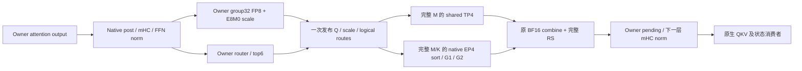

# DSV4.1 大并发：完整 owner 窗口的下一步方案

2026-10-29 代码归并更新：FP8 owner六文件迁移已收进显式可选路径，见[实现与证据边界](dsv41_fp8_owner_result.md#代码归并与运行入口)。下述旧时间戳中的生产未修改和排队状态仅描述当时；新结构优化必须以迁移后的EP1/full M1536为基线。

2026-10-29 10:53 UTC 更新：旧owner＋retained-prefill已迁移至FP8 KV、EP1、full M1536，并完成同工作负载C256/8K1K/n2560整网。迁移版6281.294tok/s，对保留主线5269.811为1.191939×（+19.19%），TPOT46.187→38.588ms；真实AL2.488826→2.471299，decode行数略增。每rank正式4个新Triton特化，且为新单臂对保留基线，尚未稳定性能／任务精度验收。完整配置、实际路由、成本及下一步见[FP8 owner迁移整网结果](dsv41_fp8_owner_result.md)。以下旧时间戳记录为历史过程；生产atom/保持f2d3，EP4和packed仍独立比较。


2026-10-29 执行更新：用户要求先适配新模型配置，当前先落地 public random 的 TP4/FP8 KV/DSpark5/C256 入口。见 [配置迁移与实际预检](dsv41_dashboard_adaptation.md)。该配置已通过真实 CPU 参数/模型准入检查，已进入真实 GPU 适配；同配置四臂整网对照已完成，但未通过整组零冷覆盖，且尚无稳定加速；见[完整基线](dsv41_c256_baseline.md)。公开运行包进一步确认 TP4/EP1/DP1、无 DPA，见 [实际 C256 配置](dsv41_c256_verified_config.md)；下面的 EP4/owner M768 候选保留为原研究部署方向，不直接套到新 TP4 基线。新配置的完整窗口成本和实际行数需要重新建立。

### 当前 C256 主线（09:20 UTC）

同节点四臂各2560正式请求已全部完成、退役并核对。主线5269.8108→分支5298.3810 output tok/s，合并1.00542148×；两对0.99462092×/1.01619355×，主线重复漂移−2.3811%，因此没有稳定、可归因的优化收益。正式AL2.48883→2.47287，分支decode执行行多0.5182%；四臂冷specialization为3/3/5/0，不能称整组零冷。详见[完整基线、工作量与成本结论](dsv41_c256_baseline.md)。

仍固定TP4/EP1/FP8 KV/真实DSpark5/C256，实际M1536，job248783/v3-085保留。原R8 B2共享目录配额失败与R9 B2退役后导出门槛失败均保留；已完成B2未重跑，只补缺失A2。最终是有两次管理中断的补齐ABBA，原始耗时未扣估计冷编译开销。原生模型源码未改。09:19节点无Docker/KFD进程、8卡利用率和显存均0。

历史R7 A1在旧节点155完成2560请求：5451.4144 output tok/s、TPOT44.6536ms、431.8993s，正式AL2.47454，但正式阶段有3次索引Triton specialization。R7 B1在warm512完成200条后非法访存，正式请求0，未得到B2/A2；后续fault_r1和window_cost_r1均完整跑过同输入512条而未复现，这不等于修复。旧155 A1不能与新085分支跨节点计算比值。见[本轮交接](../../validation/dashboard_whole_20261029/SESSION_HANDOFF.md)、[原故障](../../validation/dashboard_whole_20261029/r7/B1_FAILURE_REVIEW.json.gz)、[A1暂存结果](../../validation/dashboard_whole_20261029/A1_PRELIMINARY.json)。

四 rank 的40层实加载均为384专家、H5120、TP分片 I640、A8W4 routed、独立 MXFP8 shared。085 R8 A1的M1536为3682次decode调用；旧155 R7 A1中M1536占decode执行行数97.76%。旧 M768 来自 owner 每 rank192行的验证前缀预算；它不是 C256 或 DSpark5 固有的行数。新主线不再用旧 EP4 的33.78%缺口、67.56%覆盖率或1.3244×给自己记账。

这里 I640 是原生补齐后的存储/计算维度；checkpoint 的有效中间维度2304在TP4下每卡576。应区分576有效列与640物理列，保留原生权重切片、零填充和GEMM合同，不能把640全计成有效算术工作，也不能直接删掉尾部填充来宣称收益。

本轮成本诊断已完成、退役并核对46个源码绑定，详见[成本review](../../validation/dashboard_whole_20261029/window_cost_r1/REVIEW.json.gz)。M16298 prefill的enclosing约185.8–185.9ms；M1536 decode相邻原生control target约82.5ms，而profiled target为166.4–169.1ms，kernel profiler明显扰动了图调度，不能把trace通信占比当作生产瓶颈。

[初始成本边界](../../validation/dashboard_whole_20261029/C256_COST_BUDGET_INITIAL.json)只给条件上限：这个prefill采样内，40个原生FFN的G2合计12.486ms，紧随的TP归约合计33.068ms。仅把相同G2与相同归约重叠、忽略所有新开销，最多隐藏12.486ms，即该窗口6.72%。它不是整网预测；payload量化、GEMM/归约数值改变、更广范围的调度均须单独计成本和验收。decode不采用失真的trace时间编制预算。

R8两侧独立容器/缓存；私有缓冲预热的三种索引尾部规格已通过GPU逐key及整数参考核对。正式区间每类形状每64次调用记录普通target/after-target GPU event，不做额外同步、不启用kernel profiler，补充阶段覆盖估计。实际接受长度、执行行数与零冷覆盖会随每个完整结果核对。

[085 A1整网阶段预算](../../validation/dashboard_whole_20261029/C256_WHOLE_COST_A1.json)已得到稀疏普通event估计：prefill target约50.89%、decode target约44.68%、target后续约3.56%；其中C256/M1536 target约43.02%。prefill不能只看16K：<=8192一档贡献约23.71%整网，8192–16384一档约27.00%。各档分别18、11个样本，M1536为58个；不是精确积分或置信区间。单独将M1536加速2×，条件整网约1.274×，即便移除全部M1536 target时间也约1.755–1.759×。这些是保持工作量的覆盖约束，不能据此宣告硬件理论极限；下一方案必须覆盖decode和两档主要prefill。

第一个新成本诊断必须覆盖下面的真实 TP 路径：

```text
attention output → pending post / mHC / FFN norm（replicated M1536）
  → native shared TP4 + router/top6 + routed TP4 sort/G1/activation/G2
  → shared join + TP all-reduce（完整 BF16 M×5120）
  → 下一层 pending post / mHC / norm / 实际 QKV 消费
```

先用一次有明确问题、有限步数的真实 C256 诊断获得同一个 enclosing GPU span 内的阶段覆盖与依赖；区分 target decode、大 prefill、draft，记录各阶段实际 M，不能把 token 行数比例直接当时间比例。R8 A1现已获得target/after-target普通event阶段估计，但仍缺完整FFN内部各项净成本，因此**新 Window 实现的完整预算尚未成立**。

下一次阶段观察器已做静态准备：[window_stage_observer.py](../../validation/dashboard_whole_20261029/window_stage_observer.py)只在实际原生`_stage1_call()`与`_stage2_call()`前后插入四个事件标记；删除标记后原生函数AST完全一致，metadata选择、调用参数、M/K和算术均保持。它使用解包后的原生函数globals，避免复制decorator命名空间。当前仅AST/编译语法/Black/Ruff通过，尚未进行真实runtime绑定、GPU事件图计时或完整窗口测试，不能据此记收益。G2事件区间包含原生stage2内部的local route reduction，不能把它全算作纯GEMM。下一fixture需将这四点放回完整FFN及layer9实际QKV消费者，并以未插桩同窗口核对观察开销。

当前 native TP4 的 BF16 消费合同已按实际checkpoint拓扑细化，见[逐层消费者](../../validation/dashboard_whole_20261029/C256_CONSUMER_TOPOLOGY.json)：layer2/8/14/20的compressor及layer2/8/14/20/24/28/32/36的indexer读取BF16 norm；其余32层无这些辅助读者。首个8→9窗口的layer9为REUSE、无Engram，QKV读取FP8 Q/scale，因而BF16 norm有删除空间。此前只按通用Attention.forward判断“下一层总有BF16辅助读者”过宽。当前ABI仍返回并传递BF16，静态无读者不等于已删除；需要显式消费者接入与实际路由证据，并保留量化前的原生BF16舍入。残差、mHC状态、Engram、KV/query状态及bounded replay均是独立合同。对于有辅助读者的8层，只有QKV接通仍不够；不允许借局部窗口改成DEP或裁剪DSpark验证行数。

实验迭代本身也有明确开销：本次成本诊断896.67秒，launch到ready704.23秒，占78.54%，实际512请求窗口160.97秒。未来新候选采用一次真实权重加载内的native/changed成对窗口，复用已绑定版本的可执行产物，并在完整链通过后才进入服务比较；不能把编译/加载速度记作推理吞吐提升。当前R8已冻结，仍按既定独立容器ABBA完成。

外推prefill收益还要保留原生bounded replay：前20层处理完整prefill行，后20层只对完成prompt所需的末窗口重放，末层query进一步缩到最后一行；非final chunk不会完整跑后半段。这次trace同时出现大M和小M的G1/G2，不能把layer8大M窗口的收益乘40，也不能把入口row计数当成每层都执行的行数。decode M1536和draft则需分别使用其真实执行合同。

首个候选仅准备输出 N 列流水：完整 M、完整 K640、真实权重与原生 G1保留；主动改变 G2 的输出就绪顺序，使已完成列进入 local reduction/TP RS+AG，再向实际下一层消费者交付完整输出。K 必须取128的有效分块，不能把旧 K256配方直接搬来；N列窗口大小以预算选一个，不扫参数。复用 Mono 的绑定、缓冲所有权和状态合同，不放宽小 M guard。

预算的删除项是旧 G2/共享合并/AR 关键链中真正被替换或隐藏的时间；支出项包括新 G2 的退化、route/partial 物化与量化、完整 RS+AG、额外 MID/scale 读取、服务 CTA 对计算的挤占、填充排空、最终 BF16 输出与下一消费者。完整窗口实测净减少必须为正，再按本次真实 step 数和整网阶段覆盖估算服务收益。现成 Window 的 FP8 route epilogue 和4/8位 partial/reduced payload 都属于独立数值改变；输出、状态、top-k、回滚、图重放及 buffer 生命周期要与 reference 比较，通过前不部署。

[Window静态容量核算](../../validation/dashboard_whole_20261029/C256_WINDOW_CAPACITY.json)进一步确认：仅route scratch使用两个slot，partial/reduced/scale对全部N列阶段分别保留。以512列、10阶段、8bit partial/reduced为容量示例，M1536、8192、16384的route+对称区+完整BF16输出分别约36.49、194.58、389.16MB/卡；尚未计VMM粒度、通信库、其他tensor和图私有池。该列宽仅用于容量核算，未选择service CTA参数、未生成kernel或登记winner。动态M的服务接入必须有单一有界lease，不能把每层每个M的独立runner缓存当成无成本。

[实加载与静态接入记录](../../validation/dashboard_whole_20261029/C256_WINDOW_STATIC.json) 已确认两道独立缺口：GU_ITLV开关关闭；实际合并表中 H5120/I640/E384/A8W4 的16条配置没有任何 comm-fused winner。仅打开开关不能完成适配，也不能凭构造一个能编译的配置把它登记为 winner。若 enclosing span 的预算不成立，停止该候选，转向覆盖更完整 target 执行工作的调度或供料方案。

下面是原 EP4/owner 研究方案及来源，用作历史分析。

2026-10-29。状态：方案与源码核对完成，候选未实现、未编译、未启动 GPU。

下一步的首个验证对象定为 **C256、实际 packed M768 的 owner attention 出口 → 完整 FFN → 下一层 attention 输入**。首先准备“owner 一次量化、本地路由、一次供给两个 FFN 消费者”的候选；保留原生 EP4 专家、完整 M/K、共享专家 TP4、完整 BF16 输出归约及下一层状态合同。把当前排序的 G2 ready、已失败预取、owner stage 和已完成输入重叠从实施队列移除。

这只是首个有具体删除对象的切入点。冲击 2× 的研究范围必须包括其他 decode 容量，以及大 prefill 的 attention、投影、状态和 FFN 接续。现有数据不能给出 2× 可达承诺，也没有证明硬件理论极限已经达到。

本文接续 [已有架构与 R8 成本](dsv41_fusedmoe_architecture.md)、[历史 prefill 计划](dsv41_prefill_pipeline_plan.md) 和 [交接记录](../../validation/whole_join_20261028/SESSION_HANDOFF.md)。交接顶部的 02:43 状态比 `consumer_input_overlap` 的已完成结果旧；其中“输入重叠尚未实现”不再作为下一步指令。本文不修改历史记录、冻结源码或旧评审。

## 1. 一天收益很小，证据指向什么

| 已有证据 | 能支持的结论 | 不能推导的结论 |
|---|---|---|
| C5 历史组合 1.324404976×；基线 Spec0、候选 DSpark5 | owner/packed、EP4 等完整服务组合有效 | 这不是单个 comm-fused kernel 的倍率，也不是相对当前公开 DSpark 的倍率 |
| 后续完整输入融合约 +0.1218%、shared/G2 完整测试约 +0.2954%；IPC 768 筛选 +1.1651%、direct-G2 筛选 +0.6386% | 后期小边界的收益低，筛选结果尚不能代替整网接受 | 不能跨基线连乘，不能把微测改善当成已实现的 2× 进展 |
| 原 G2 排序下，owner-local 16 行中位完成在本 rank G2 活跃区间的 97.45%–98.69%；16×256 列也在 95.92%–97.36% | 此排序没有足够的早到达窗口来支撑计数器/等待消费者 | 不是 HBM、互连或计算单元达到峰值的证明 |
| 两种预取和 owner stage 均完整链回退 | 增加并发读或分离资源没有获得有用加速 | 不能仅凭这几次实验判定所有输出流水无效 |
| 新输入重叠 M7835 为 0.986415×，M16315 为 0.995762×；四 rank 采样图均为零 router/AG 重叠 | 该图执行没有实现预期重叠，并且完整链变慢 | 不应继续运行旧候选寻找“更好的样本” |
| 当前大 prefill 约 16K 样本，router 合计约 0.93ms，占其 outer forward 约 0.69%–0.78% | 解决这项调度问题不能承担剩余 2× 缺口 | 不能用这个局部样本代表整个服务占比 |
| R8 普通 forward 中，prefill 47.77%–47.86%，全部 decode 52.14%–52.23%；C256 本身仅约 25.6% | 主线必须覆盖比大 prefill 小边界更广的执行范围，M768 是试点而非终点 | 历史分布不是当前 2560 请求服务的实测 Amdahl 上限 |

停滞的主要原因是**选中的可删除工作太少、预想的生产者提前量不存在、图调度未产生实际重叠，以及局部指标和服务有效工作量之间缺少统一预算**。还有一部分时间花在编译、接口、生命周期和评审失败上；这些工作增加了证据和稳定性，但不能记为吞吐收益。并非整天毫无研究进展，而是已证伪的方向没有及时从 2× 主线中退出。

理论上限还缺少同一当前工作负载下的实际 HBM/互连流量、权重重用、MFMA 利用率、关键依赖及状态处理下界。不能用逻辑 tensor 字节除以硬件宣传带宽宣告饱和；也不能把各 rank 的最大阶段时间相加。

输入重叠的权威结果是 [REVIEW](../../validation/whole_join_20261028/consumer_input_overlap/REVIEW.json)、[图时间线](../../validation/whole_join_20261028/consumer_input_overlap/TRACE_FINDINGS.json)、[剩余预算](../../validation/whole_join_20261028/consumer_input_overlap/REMAINING_BUDGET.json)。G2 结论来自 [真实 writer 评审](../../validation/whole_join_20261028/consumer_g2_completion_gpu_r2/REVIEW.json) 与 [列窗口分析](../../validation/whole_join_20261028/consumer_g2_completion_gpu_r2/COLUMN_FINDINGS.json)。本次只读这些结果，未重跑评审。

## 2. 公开配置与当前方向是否一致

**模型家族、MI355X 和 DSpark5 一致；并行布局、KV 格式、工作负载、接受长度和执行行数并不一致。**“ATOM dashboard 大并发”至少有 random serving 与 AgentX 两条线；SemiAnalysis 的 ATOM AgentX 也有自己的配方，不能合成一个 C256/M768 基准。

公开源码固定到本次读取的提交：

- ATOM：[`bdec681249254846f73b833d1a5112f86730ca34`](https://github.com/ROCm/ATOM/tree/bdec681249254846f73b833d1a5112f86730ca34)，2026-10-29 01:53:39 UTC。
- InferenceX：[`98f0d6e30ce8e747e9eb4d94f9c53bf7a01c7d99`](https://github.com/SemiAnalysisAI/InferenceX/tree/98f0d6e30ce8e747e9eb4d94f9c53bf7a01c7d99)，2026-10-29 01:53:40 UTC。
- 当前研究 ATOM HEAD：`f2d3ee47f7f865b85b085899d750306895b969b6`；历史主线截点 `ebd5f84f3`。公开 main 与本分支不是同一版本。

| 项目 | 当前研究 R13/C5 系列 | ATOM random dashboard | ATOM AgentX nightly | SemiAnalysis InferenceX / ATOM AgentX |
|---|---|---|---|---|
| 模型 | DeepSeek-V4.1-Flash | 同名 HF 模型 | 同名 HF 模型 | 同名 HF 模型 |
| 并行 | attention TP4、routed EP4、shared TP4、DP1 | TP4；无 EP/DPA 参数，默认均关闭 | TP2、TP4；另有 DTP2/DEP2 | TP2 或 TP4，EP1、DPA false |
| 实际 GPU 数/engine | 4 | 4 | 2 或 4 | 2 或 4；配方节点有 8 卡不等于 engine 使用 8 卡 |
| KV / index | BF16 / FP4 | FP8 / FP4 | FP8 / FP4 | BF16 / FP4 |
| speculation | DSpark5，真实接受 | DSpark5，真实接受 | DSpark5，性能用合成 AL3.51 | DSpark5；throughput 注入 golden AL，eval 保留真实接受 |
| C | 256 主测，其他容量随步骤出现 | 1、4、8、16、32、64、128、256 | TP2：1–128；TP4：1/4/8；DTP2/DEP2：128 | TP2：1/2/4/6/8/16/32/64；TP4：1/8/32 |
| 负载 | random 8192/1024、range .8；2560 formal | nightly 8192/1024、range .8；weekly 1024/1024；默认 10×C 请求、2×C warm | AgentX trace，3600 秒、393 entries、每 lane 5 warm | agentic-coding/AgentX，多轮长上下文、prefix/state reuse |
| 最大序列 | 256 | 默认 512 | 默认 512 | 128 |
| memory utilization | .85 | 默认 .9 | .95；DTP/DEP override .9 | .9 |
| batching / graph | level3/FULL，owner 完整键、特有 packed/retained 路径 | 默认 max-batched/attention chunk 16384，DSV4.1 level3/FULL | 16384，FULL，显式 capture 列表 | 16384，FULL，capture 1…32/48/64/128 |
| prefix/state | 原生语义加 owner selective publication、retained prefill | prefix 默认启用 | prefix + checkpoint interval 8192 | prefix + checkpoint interval 8192、block-size16 |
| 关键调度 | 固定研究 profile | 公共默认 | DTP/DEP：least_tokens、affinity、req_equiv512、prefill/decode interval10 | TP2/C64：interval4；TP4/C32：interval16 |

这里的 FP4 benchmark precision 指权重精度标签，不能据此认定 KV 也是 FP4。双方 checkpoint 的不可变 revision/文件摘要尚未逐项对齐，因此“同名模型”不等于已证明权重字节相同。

ATOM random 公开 catalog 在该提交只列出 DSV4.1 的 DSpark variant；本地分支的 No Spec 条目不能写成公开现状。workflow 的文字说明与 catalog 并发上限可能不同，以上采用实际 catalog/matrix。ATOM AgentX 的手工 real-acceptance TP4 C2/4、900 秒配置属于另一条 profile，不与 nightly 的 synthetic AL 混用。

### 2.1 实际脚本和模型入口

ATOM random 调用链：

1. [models.json](https://github.com/ROCm/ATOM/blob/bdec681249254846f73b833d1a5112f86730ca34/.github/benchmark/models.json) 定义模型、TP4、FP8 KV、DSpark5 和 C 上限；[catalog.py](https://github.com/ROCm/ATOM/blob/bdec681249254846f73b833d1a5112f86730ca34/.github/scripts/catalog.py) 与 [build_benchmark_matrix.py](https://github.com/ROCm/ATOM/blob/bdec681249254846f73b833d1a5112f86730ca34/.github/scripts/build_benchmark_matrix.py) 生成矩阵。
2. [atom-benchmark.yaml](https://github.com/ROCm/ATOM/blob/bdec681249254846f73b833d1a5112f86730ca34/.github/workflows/atom-benchmark.yaml) → [benchmark-tmpl.yml](https://github.com/ROCm/ATOM/blob/bdec681249254846f73b833d1a5112f86730ca34/.github/workflows/benchmark-tmpl.yml) → [atom_test.sh](https://github.com/ROCm/ATOM/blob/bdec681249254846f73b833d1a5112f86730ca34/.github/scripts/atom_test.sh)。服务是 `python -m atom.entrypoints.openai_server`；客户端是 `python -m atom.benchmarks.benchmark_serving`，random、request-rate=inf、ignore-eos，DSpark variant 加 use-chat-template。
3. 公开 [registry.py](https://github.com/ROCm/ATOM/blob/bdec681249254846f73b833d1a5112f86730ca34/atom/models/registry.py) 将 `DeepseekV41ForCausalLM` 映射到 [runtime.DeepseekV41RuntimeModel](https://github.com/ROCm/ATOM/blob/bdec681249254846f73b833d1a5112f86730ca34/atom/models/deepseek_v41/runtime.py)，backbone 在 [model.py](https://github.com/ROCm/ATOM/blob/bdec681249254846f73b833d1a5112f86730ca34/atom/models/deepseek_v41/model.py)。Mono installer 也在 registry 注册；注册不代表 C256 实际走小 M Mono。本地旧版 registry 尚在 `model_engine/model_runner.py`，不能把路径变化误认成另一模型。
4. AgentX 另由 [models_agentic_nightly.json](https://github.com/ROCm/ATOM/blob/bdec681249254846f73b833d1a5112f86730ca34/.github/benchmark/models_agentic_nightly.json) 配置，数据集为 `semianalysis_cc_traces_weka_062126`。

SemiAnalysis / ATOM 调用链：

1. [amd-master.yaml](https://github.com/SemiAnalysisAI/InferenceX/blob/98f0d6e30ce8e747e9eb4d94f9c53bf7a01c7d99/inferencex-e2e/configs/amd-master.yaml) 的 `dsv41flash-fp4-mi355x-atom-agentic-dspark` 定义 engine 镜像 `rocm/atom-dev:nightly_202610121516`、上述 TP/C 矩阵和 recipe 路径。
2. [agentic.yaml](https://github.com/SemiAnalysisAI/InferenceX/blob/98f0d6e30ce8e747e9eb4d94f9c53bf7a01c7d99/inferencex-e2e/benchmarks/single_node/srt-slurm-recipes/dsv41flash/atom/mi355x-fp4-mtp/agentic.yaml) 定义 BF16 KV、DSpark5、prefix/state/graph 及 interval overrides。其 `frontend.container_image` 是 atomesh 的镜像，不能当作模型 engine 镜像。
3. [synthetic_acceptance.py](https://github.com/SemiAnalysisAI/InferenceX/blob/98f0d6e30ce8e747e9eb4d94f9c53bf7a01c7d99/inferencex-e2e/infx/srt_slurm/synthetic_acceptance.py) 在非 EVAL_ONLY 的 speculative agentic throughput 中注入 `spec-decode-acceptance-length`。[golden AL](https://github.com/SemiAnalysisAI/InferenceX/blob/98f0d6e30ce8e747e9eb4d94f9c53bf7a01c7d99/inferencex-e2e/infx/golden_al_distribution/dsv41flash_dspark.yaml) 的 thinking_on/K5 为 3.51，thinking_off/K5 为 4.07；AL 包含 target verification token。

这次核对了 Semi 的当前源配置，没有下载并验明每个已发布点的完整实际 launch bundle。因此不能从配置文件宣称某个已发布点实际命中了哪个 kernel，或镜像内部恰好包含本地研究代码。InferenceX 的 vLLM/SGLang 条目应另行按 framework 比较。

### 2.2 已发布 ATOM C256 点能说明什么

读取 [dashboard data.js](https://rocm.github.io/ATOM/benchmark-dashboard/data.js) 时，最新匹配的 DSV4.1 DSpark TP4、8K/1K、C256 点来自 [run 40724946700](https://github.com/ROCm/ATOM/actions/runs/40724946700)，**原先把页面聚合条目的 `bdec6812` 当成运行提交不准确。实际 summary artifact 已核对为 `646da00fe322d28cb7971082d2a8af6905c57cd8`**，详见 [C256 配置核对](dsv41_c256_verified_config.md)：

- output throughput **4816.42 tok/s**，total throughput **43532.59 tok/s**；比较输出吞吐时不能混用两列。
- TPOT **50.55ms**，TTFT **1418.69ms**；AL **2.44**，acceptance **28.85%**。
- 4 张 MI355X、每卡 288GB、ROCm 7.2.4，镜像标签 `rocm/atom-dev:latest`。

这不构成“我们的约 7600 tok/s 比公开版本快多少”的受控比较：EP、KV、版本、预热、实际生成/执行轨迹均不同。当前研究 q/接受长度约 2.14–2.17 的记录也不能直接与另一个工作负载的 AL3.51 比较；下一次必须同时保留原始指标定义和分子/分母。

读取快照：`data.js` 19,599,136 bytes，SHA256 `719d30c2fff7babcbb0e5b35b299f67b311d51b9ed9545f0e6343cff70e3e116`，Last-Modified 2026-10-29 02:54:19 UTC。页面会变化，引用时应保留 run/commit。读取文件未另存整份大 dashboard 数据。

## 3. Window kernel 与 Mono kernel，具体复用什么

本次 Window 源码来自本地 AITER checkout `36fea7fcf6baa6f8600f6593c25dbf13cf49b08d`。研究服务历史固定依赖是 AITER `729feefb7210ebc3a87ebd00a44e0c43f30bf3f2`；不能把当前 checkout 的 Window 实现当作历史服务已运行的 backend。

| 维度 | comm-fused Window | DSV4.1 Mono | 大并发新方案 |
|---|---|---|---|
| 调度单位 | 输出 N 列窗口；每个窗口仍遍历完整 expert M grid、完整 K | 小行数 token/task 表，固定驻留 CTA | 原生 full-M/K GEMM；独立的输入/输出/状态依赖计划 |
| 关键机制 | compute j、local reduce j−1、RS j−2、可选 AG j−3 流水 | 生产者直接输出消费者 dtype/layout；设备 ready；延迟 post/pre；任务与状态共用语义 | 先消掉 BF16 全量供料与重复量化；有预算才主动重排 N 窗口 |
| 进度条件 | 有限阶段 dispatch、计算/服务 CTA 交错、epoch barrier、fill/drain | 256 CTA × 512 threads、每 CU 一 CTA、约 160KiB LDS，等待依赖共同驻留 | 不引入需要未调度 CTA 才能解除的全网 spin；通信及 scratch 有唯一 owner |
| 数值 | A8W4 producer 的 reduce epilogue 输出 FP8 route；partial/reduced payload 为 4/8bit | 原生部分 K seam 保留；MoE 下投影/top-k 合并与 BF16 atomicG2 并非同一舍入顺序 | 首个候选保留既有 native 算术；任何改变作为独立数值 variant 验收 |
| 当前范围 | wrapper 排除 EP/TBO 等；winner table 决定实际采用 | target MAX_ROWS48，DP2 MoE 总行数≤96，draft≤8 请求 | EP4/M768 无法直接套用任何一者 |

Window 的证据在 [window.py](../../aiter/aiter/ops/flydsl/kernels/comm_fused_moe/gfx950/a8w4/window.py)、[producer.py](../../aiter/aiter/ops/flydsl/kernels/comm_fused_moe/gfx950/a8w4/producer.py)、[collectives.py](../../aiter/aiter/ops/flydsl/kernels/comm_fused_moe/gfx950/a8w4/collectives.py)、[config.py](../../aiter/aiter/ops/flydsl/kernels/comm_fused_moe/gfx950/a8w4/config.py) 和 host [_WindowRunner](../../aiter/aiter/ops/flydsl/comm_fused_moe_host.py)。`compile_window_producer` 复用 tile emitter，但设置 `epilog="reduce"`、`out_dtype="fp8"`、`_output_n_range`。它不是给现有 BF16 输出套一个透明通信外壳。

Window 的 epoch barrier 使用 system release/publication/acquire；slot 按周期复用，正确性依赖其私有 runner、阶段顺序和跨调用 barrier。不能复制裸 flag 而丢掉这些条件。其实际选择由 [backend wrapper](../atom/model_ops/fused_moe/comm_fused_moe.py) 和 AITER FMOE CSV winner 决定；仅存在实现不等于公开 benchmark 使用了它。

Mono 的证据在 [config](../atom/models/deepseek_v41/mono/config.py)、[dispatch](../atom/models/deepseek_v41/mono/dispatch.py)、[K1](../atom/models/deepseek_v41/mono/kernels/attn_pre.py)、[K2](../atom/models/deepseek_v41/mono/kernels/layer_post.py)、[MoE](../atom/models/deepseek_v41/mono/kernels/moe.py)、[moe_plan](../atom/models/deepseek_v41/mono/moe_plan.py)。K1 串起 residual/mHC/norm/quant/QKV/RoPE/KV/query；K2 串起 attention-post 和 MoE，并用不同 mailbox/tag 与 barrier 复用 LDS。应复用其绑定、任务依赖和状态所有权设计，不扩大 MAX_ROWS，不把 M768 拆成一批小 Mono 调用。

当前 [owner_ep.py](../atom/models/deepseek_v41/owner_ep.py) 明确要求 `_comm_fused_moe is None`、非 comm-fused dispatch；Mono 的 `Dims` 又拒绝 attention TP>1 同时 EP>1。因此当前研究既没有运行现成 Window，也没有运行现成小 M Mono。

## 4. 首个候选：owner 一次供料的完整窗口

### 4.1 真实基线和范围

实际代码是 [OwnerServing.target](../atom/models/deepseek_v41/owner_service/owner_serving.py)，不能以大 prefill fixture 代替 decode。

```text
owner attention 输出（capacity192，保留四个原 TP head/K 分界）
  → Block.prepare_ffn：attention post + mHC + FFN norm
  → BF16 norm AllGather：192 → 全局768
  → shared TP4 + router/top6 + routed EP4 sort/G1/SiLU/G2
  → routed + shared，完整 BF16 reduce-scatter 回 owner192
  → Block.finish_ffn：记录 pending，不重复执行 post
  → 下一层 prepare_attention：pending/post + mHC/norm/量化
  → 原生 QKV 消费及 cache/index/Engram/compressor seam
```

初始试点选择已有 fixture 熟悉的 layer8→9，但输入必须来自实际 M768 owner 合同。成本覆盖从 attention 出口开始，包含前置 FFN prepare、所有供料、专家、shared、完整输出、下一层 prepare 和实际 QKV 消费。下一层 KV/压缩状态写入在明确的原生 seam 结算，不能只返回一份未被消费的 norm 宣称闭环。

一般层之外，必须单独列出 Engram、compressor/index、末层 flush、37/38/39 的 draft taps 及退出 seam。当前大 prefill 的 16/18 条可用边界不等于 decode 的 40 层都已接入；第一层验证通过后仍须逐层核对实际调用与覆盖。

### 4.2 候选 A：改变供料位置，保留专家几何



复用 [prefill_ffn.py](../atom/models/deepseek_v41/prefill_ffn.py) 的 `x_scale`/`preselected_routes` 消费接口和 [FusedMoE._run_experts](../atom/model_ops/moe.py) 的原生 placement/apply；建立具名 owner-decode 计划，而不是把旧 `supported()` 的 4096 guard 改成 768。

输入发布后 shared 和 routed 都读同一份完整 M 的 FP8/scale；原生 G1/G2 的 M、K、专家放置、sort 粒度、MFMA 和权重均不拆。输出先保留 `routed + shared → v41_mhc_reduce_scatter` 的完整 BF16 路径；没有把历史 direct-G2 数值 variant 或 IPC 筛选成绩默认并入新基线。

**关键准入缺口是 owner192 router 与 native M768 router 的计算合同。** [prefill_router.py](../atom/models/deepseek_v41/prefill_router.py) 当前仅允许层2–19、M4096–16384，并核对原 full-M gate 的 one-K-wave schedule；其 fallback 会建立 full-M 临时输入。当前 [decode 固定 router](../atom/model_ops/deepseek_v41/router.py) 又只支持 ≤16 行。因此绝不能假定 local192 会自动选择同一 gate、同一 split-K 和同一数值顺序。

实施前先从已有实际产物/dispatch 记录定位 M768 的 gate；若无记录，唯一新局部诊断需要补齐 native M768 与拟用 owner192 gate 的实际 kernel、K 分割、top-k 和成本。若无法保留已选数值合同，候选必须显式作为新 router 数值 variant，或者停止“删除 BF16 AG”的主张。继续保留 BF16 AG 只为 router 的版本属于另一个低收益候选，须重新预算，不能偷换。

### 4.3 可以删什么，仍要付什么

| 边界 | 基线成本 | A 计划删除或减少 | 新增/保留成本与准入 |
|---|---|---|---|
| owner norm→全 FFN | 每 rank owner BF16 发布，全 M BF16 副本供给多个读者 | 不再向所有 rank 传播 BF16 norm；它只留在 owner 供 router | 必须证明除此以外无 full-BF16 读者；Q、scale、route 的发布和布局仍付费 |
| shared/routed 输入量化 | BF16 聚齐后进入各自量化路径 | owner 一次 group32 量化共享给两路，删可证实的重复量化/中间副本 | 从图/实际 launch 确认重复次数；编译器已合并的部分不再计收益 |
| router/top-k | 每 rank 对全 M 路由 | owner 仅处理本 rank 行，发布 logical top6 | gate 权重依然每 rank 读取；小 M 几何可能变差；route pack/unpack 和额外 collective 有成本 |
| 原生专家 | 完整 EP4 sort/G1/SiLU+中间量化/G2 | 第一版本不声称删除这些工作 | 不重复 sort，不拆 M/K，不把已融合 SiLU/量化算作未来收益 |
| shared→输出→owner | shared 计算、BF16 combine、完整 RS | A 首版无收益记账 | 维持完整输出数值与 owner192；不能用未验收输出候选补足预算 |
| next consumer | pending/post、完整 H 的 mHC 统计、QKV/状态读者 | 后续可让生产者直接写已存在的消费者格式 | 当前已有延迟 post 和 attention quant；不重复记账，不越过 Engram/native state seam |

`quantize_fp8` 的真实格式为 E4M3 value + 每 32 元素一个 1-byte E8M0 scale。H5120 时，每全局行的供料逻辑体积：

- BF16：10240B；Q：5120B；scale：160B；top6 FP32 weight + int32 ID：48B。
- M768 的全量布局：BF16 **7,864,320B**，Q/scale/routes 合计 **4,091,904B**，逻辑体积少 **47.97%**。
- 这不是实测链路传输量或预期时间降幅。每 rank 的 owner 源行数为192，all-gather 复制次数、协议、copy-in、padding、scale 重排及多 collective 启动须另算；原 fullM 路由没有 route AG，现在增加了它。

首个参考版允许按原生接口串行发布 Q/scale/routes，以建立完整链合同；只有包括三次通信后的净预算仍为正才编译候选。随后若改成单 packet/注册发送缓冲，应明确新增 pack/unpack 与消费者 stride，不为了少一个 collective 制造更多全量复制。Q AG 与 router 的 overlap 在 A 的保守预算中按 **0** 处理。

### 4.4 输出、状态、图与缓冲所有权

不可变计划记录部署、M/capacity、逻辑有效行与 owner holes、层类型、scale layout、专家映射、stage 顺序和 fallback。权重只有现有 model owner；不建立第二套完整权重或另写一份 MoE forward。建议落在现有模型 plan/runtime 与公共 `atom/mono/{plan,runtime}` 的明确分工中，复用 ABI 生成方式，不复用小 M 算法。

caller 持有本次 graph 的 Q/scale/route、native MID、routed/shared/output 和状态视图；buffer key 至少包含部署、层/权重绑定、M/capacity、graph 身份及并发 lifetime。不得仅按 M 缓存可变通信 scratch。首版无跨层 ring 复用，无等待尚未调度 producer 的持久 CTA。

owner packet 中间有 padding holes，不能用外层“连续有效前缀”裁剪。`owner_context` 的有效行语义、原生 expert sentinel、top6 mapping、FP4 weight scale、shared 的 FP8 weight、K 累加边界、residual/pre/post/comb/pending 和 draft taps 都属于合同。无效行隔离与所有完整输出必须在 fixture 检查。

图必须绑定稳定输入、完整键和 fake/schema；状态写入前完成四 rank 一致的准入/回退。退出顺序为停止 replay → graph reset/释放持有引用 → 流上的最后读者完成 → 状态/context detach → communicator 和 native pool 释放。新的成功退出不等于原长服务 illegal-memory fault 已修复；该问题仍单独保留。

## 5. 完整成本预算：先写可证伪的式子，再决定实现

相对历史 1.324404976×，达到原目标 2× 需要当前同工作量时间再减少：

```text
d = 1 − 1.324404976 / 2 = 33.7797512%
额外吞吐要求 = 2 / 1.324404976 − 1 = 51.0112115%
f × (1 − 1/s) ≥ d
```

| 一个优化范围的局部加速 s | 独立填平缺口所需当前时间覆盖 f |
|---|---:|
| 1.5× | 101.34%，不可能单独完成 |
| 2× | 67.56% |
| 3× | 50.67% |
| 4× | 45.04% |

这是同工作量模型。真实接受率/输出轨迹改变时，应同时报告服务 token/s、每 emitted token 的执行成本和固定实际输入窗口速度，不用其中一个替代另一个。

### 5.1 已有成本锚点与上界

以下仅取 R8 **同 rank1、同一采样窗口的独占命名组**，单位 ms；不是当前完整服务占比，也不是全部可删工作。

| 范围 | 全窗口 | G1 | G2 | named AG | 其余 collective | MXFP8/BMM | mHC | cat | quant |
|---|---:|---:|---:|---:|---:|---:|---:|---:|---:|
| C256/M768 |31.504|6.418|3.283|2.928|4.146|3.067|1.417|0.119|0.340|
| initial prefill/M16262 |127.431|15.217|8.628|10.144|31.636|15.067|5.512|2.850|1.322|

来源：[R8 review](../../validation/structure_ceiling_20261024/STEP12_TRACE_R8_REVIEW.json)、[专家成本](../../validation/structure_ceiling_20261024/STEP12_TRACE_R8_EP_COSTS.json)、[其他 device 成本](../../validation/structure_ceiling_20261024/STEP12_TRACE_R8_OTHER_DEVICE_COSTS.json)。collective 包含等待，named AG 还混有非 FFN 通信；MXFP8/BMM 需要对应真实 consumer 后才可归因。

- 在旧 M768 样本中，就算 G1+G2 都加速 2×，整个窗口也只少约 **15.40%**；输出 N 流水只隐藏 G2，其极端上界不超过该样本 **10.42%**，还未支付协议等开销。
- 把旧样本所有 named AG 和独立 quant 都算免费，也只有 `(2.928+.340)/31.504=10.37%`；A 的输入通信/独立量化只覆盖其中一部分，且必要 FP8 通信仍在。这部分实际收益应更低。A 可能减少的重复 router 工作另行计量，不包含在这个上界中；目前没有证据使 A 单独承担 2× 缺口。
- 历史分布下，prefill-only 需要约 **3.40–3.41×** 才能单独填平缺口。只改变 C256、其他容量完全不变，即使 C256 免费，约25.6%的 ordinary-forward 覆盖也小于33.78%；这个结论仍只适用于该历史分布。
- 不能把上表局部组占比乘进另一个时间段的服务分布形成“实测整网预测”。所有此类组合只能标为情景估算。

### 5.2 A 的费用式与尚缺字段

每个实际 shape/layer/rank，基线和候选用同一完整窗口计时。定义：

```text
T0 = FFN_prepare + BF16_AG + native_router/topk
     + shared/routed 输入准备 + native_experts/shared
     + BF16_combine/RS + next_prepare/QKV/state_seam

T1 = FFN_prepare + owner_quant + owner_router/topk
     + Q_AG + scale_AG + route_pack/AG/unpack + scale_layout
     + native_experts/shared + BF16_combine/RS
     + next_prepare/QKV/state_seam + extra_sync/lifetime_cost

净删除 D = T0 − T1
```

阶段发生重叠时，`T0/T1` 取依赖图的实际关键路径，不能机械相加包围事件。未发生的 overlap 不给信用；native GEMM 的退化、cold layout、额外 pad/clear 和尾窗均计入 T1。

| 必填字段 | 现有资料 | 下一动作/对决策的作用 |
|---|---|---|
| 各容量、各实际层的完整窗口时间、调用/执行行数 | R8 全网分布与粗 kernel 组；最新 sparse service 的 decode 没进入已优化 prefill 路径 | 先离线映射已有事件；只有缺失项才进入一次新局部诊断 |
| M768 gate 与 local192 gate 的真实 dispatch、K 分割、router/top-k 差异 | 源码只证明接口及当前 guard，未证明可迁移 | 决定 BF16 AG 是否真能删除；不成立就停止 A 的这一版本 |
| FFN-specific BF16 AG、重复量化、scale reorder 独占成本 | 粗组会混入其他读者 | 完成 producer→consumer 归属，防止拿整个 AG 组当可删除量 |
| Q/scale/routes 三次通信及 pack/unpack | 大 prefill 有证据，M768 无同合同结果 | 不线性外推；若新费用抵消删除，停止，不做服务筛选 |
| native G1/G2/shared 是否保持效率 | 几何和权重合同可静态保持 | 在新完整窗口验证实际 key、sort/padding、资源和实测时间 |
| 正式工作负载内覆盖率、AL、有效/填充/执行行 | 历史接受记录与 route counters | 用选中候选的同次 screen 校准；不得沿用稀疏 prefill 比例当整网份额 |

每条候选预算表必须给出 **保守净删除、乐观上界、额外成本、证据出处、未测项**。未知项写 unknown，不填0。只有保守净删除为正、且预计效果大于既有配对漂移/测量开销时才进入完整链筛选；若预算只能支持小增益，明确标为局部候选，不让它占据 2× 主线。

组合预算以同次工作负载的互不重叠窗口为基础：`D_total = Σ n(bucket,layer) × D(bucket,layer) − integration_cost`，已共享或已隐藏的部分只计一次。M768 pilot 验证后再覆盖实际 M128/256/384/512/768 等已有 buckets、补齐尾窗，不扫不存在的 M。进入 2× 主线必须展示覆盖和净删除如何接近33.78%；当前尚未具备这份正向证据。

## 6. 后续候选的优先级与停止条件

| 优先级 | 候选/范围 | 改变的工作或依赖 | 主要费用/停止条件 |
|---|---|---|---|
| P1 | A：完整 owner FFN 供料，先 M768 后其他实际容量 | BF16 全量复制改 Q/scale/routes；量化供两路；owner 路由 | gate 数值/几何、通信启动及布局；保守净删除不正则停止 |
| P2 | owner attention-post→FFN prepare，以及 FFN→下一层真实 QKV/状态接续 | 消掉已证明重复的 full-H 物化/转换；生产者直达现有消费者格式 | 先查现有 Mega/延迟 post 已融合哪些；不改变四原 TP/K BF16 分界，不跳过 cache、compressor、Engram |
| P3，条件方向 | full-M/K G2 的主动 N 窗口调度 → 前一窗口 combine/RS | 先计算完整输出列范围，改变就绪顺序，重叠后续计算与前一范围通信 | native GEMM 效率、N 分窗读 MID、协议、fill/drain、BF16 RS 舍入；完整预算不正则不开工 |
| 同时必须完成的离线预算 | 大 prefill 未覆盖的 attention/index/compressor、QKV/wo_a/wo_b、状态发布与层20后实际尾段 | 找到占比较大的完整消费者窗口和真实重复工作 | 不能把后20层都按 M16K 计算；按实际 retained/tail 行数与类型统计 |
| 限定调度调查 | 输入重叠图为何串行 | 找到具体 graph fork/join 或 collective 隐式依赖 | 先读已有图/源码；不再以0.05ms router 承担 2×；旧 overlap 不重跑 |

P2 需要具体到 [owner_cost_attention_chain.py](../atom/models/deepseek_v41/owner_service/owner_cost_attention_chain.py) 的 `inverse_rope_group_quant → wo_a → quant → 四原 K 的 wo_b partial → sum_original_tp → prepare_ffn`，以及 [Block.prepare_attention/prepare_ffn/finish_ffn](../atom/models/deepseek_v41/model.py)。这些是完整 scope 的入口，不表示每个 tensor 都可删除。特别是 QKV 已能消费 Mega 产生的 FP8/scale，不能再次列为全新收益。

### 6.1 P3 与已经停止的 ready/band 方案有何区别

P3 借用 Window 的“先做完一个 N 范围，再让它进入通信”的调度思想：G1 保持一次完整原生执行，MID 保持完整布局；G2 的每个任务仍保持原 M tile、完整 K 和 native weight reuse，按 N 范围分阶段。此时就绪来自该阶段所有本地 writer 已完成，不能沿用原排序的 owner-row ready 假设。

首个设计最多固定一种从 native BN/H 推导的划分；以有限 graph dispatch/阶段事件保证生产者完成，避免全网 spin。完整 H 的下一层 mHC 仍等待所有列，提前窗口只能推进可独立的 combine/RS；不能把整段 Mega 时间也算作已经重叠。

成本上限：`隐藏时间 ≤ min(G2可重叠部分, 输出通信可重叠部分)`；净收益还要减去 GEMM 退化、重复 MID/scale 读取、phase launch、visibility/epoch、额外 buffer 读写以及 fill/drain。必须分别验证 M768 与实际大 prefill，不能从 M16K 曲线推断 M768 的占用率。

旧 [BREAKTHROUGH_CANDIDATES](../../validation/structure_ceiling_20261024/BREAKTHROUGH_CANDIDATES.md) 已撤回 K-loop overlap 预算，并记录 BF16 band collective 会改变结果。P3 必须明确采用哪个 producer epilogue、何种 BF16 combine/RS 顺序，以及为什么新 schedule 与旧失败不同；没有新增的可检验差异就停止。现成 Window 的 FP8 route/4bit partial 不能隐式带入；若选择那套算术，作为独立精度变体重新验收。

P3 不是当前待执行任务。只有 A/P2 的完整成本地图表明输出段值得继续、静态进度及数值合同成立，才准备它的新 fixture。

## 7. 从准备到验收的执行顺序

| 阶段 | 具体交付 | 进入下一阶段的条件 |
|---|---|---|
| 0：本次计划 | 本文、公开配置对照、源调用链、旧候选停止清单 | 已完成；没有 GPU 或候选实现 |
| 1：离线预算/绑定 | 新 `WideOwnerFFNPlan` 合同草案、源/产物身份、实际 bucket/layer 时间账本、buffer/通信账本 | 从现有结果填出所有已知项；把不可替代的缺失证据压缩为一个问题明确的诊断 |
| 2：一次新局部诊断，如确有必要 | 一次真实 layer8/9 加载，原 M768 owner 窗口；补齐 gate/FFN AG/重复量化/next-consumer 归属 | 回答“删除 BF16 AG 和重复输入准备后，净预算是否为正”；若否即停止 A，转 P2 的较大窗口预算 |
| 3：新 A 完整链实现和筛选 | canonical ABI、CPU fake/AOT/拒绝路径、实际 native key；同次加载 native/control/A，变化输入、图 replay、全输出/state | preweight 编译/接口检查通过；完整链两种次序都受益，最慢 rank 口径一致，数字/生命周期通过 |
| 4：服务 768 screen | 同一选中实现、一次加载、完整预热键、A1/B1/B2/A2；记录所有实际层和 capacities | 正式0 JIT/capture；收益超出配对漂移；实际执行工作变化有解释；退出合同闭合 |
| 5：选中组合完整接受 | 新候选 2560 formal 配对测试；所选最终数值变体的全量 GSM8K/L2 | 完整服务收益、质量、实际路由及生命周期均通过后再考虑交付 |

阶段2/3的具体包装可合并到同一加载流程，前提是问题和候选在启动前已经确定、产物/ABI 已准备好。不能在活跃服务上编辑冻结源码或把边跑边改当作一次加载。原 fixture 仅复用 loader、参考代码及已有产物，不重跑旧候选。若 runtime/compile 失败，保留失败并在新版本修复，不改旧 source manifest。

完整链校验包括原 residual、norm、pre/post/comb、Q/scale、完整 FFN output、实际下一层读者和相关状态；参考保留独立 native 和 native-self。L2 分 FP 浮点与 scale/量化边界解释，不把小 M 或 prefill 的旧 L2 结论迁移到新 M768。

服务计分同时记录：总输入/输出 token、实际 emitted token、真实 AL/accepted draft 与分母、target/draft 执行行、owner有效/填充行、各 M bucket/层调用数、prefill/retained/reconciliation 行数与时间。端到端 token/s 的变化、固定窗口时间的变化、每 emitted token 执行工作变化分别报告；生成轨迹变化可产生真实服务收益，但不能全部归因于 kernel。

精度按 [公开 DSpark catalog](https://github.com/ROCm/ATOM/blob/bdec681249254846f73b833d1a5112f86730ca34/.github/benchmark/models_accuracy.json) 的 GSM8K flexible 阈值 **0.91**、完整1319题、3-shot、local-completions、C65 协议核对，并保留适用部署的 L2。当前研究是 BF16/EP4，public catalog 是 FP8/TP4，协议可一致、部署不可冒称一致。synthetic AL 必须在真实 GSM/L2 验收中关闭。未改变实现且已有适用接受证据的旧 GSM 不重复运行。

## 8. 对齐公开目标的路径

保留三个明确合同，不把它们混成一个得分：

1. **研究连续性**：当前 EP4/BF16、真实 DSpark5、random C256。以当前已接受路径为本轮 A，保留历史 Spec0→DSpark5 的1.3244×记录。新 kernel 增量先在这里证明。
2. **公开 random 可比性**：未来单独准备 public TP4、FP8 KV、无 EP/DPA、DSpark5、8K/1K、C256 配方；对齐模型 revision、engine/AITER/image、模板、seed、warm、512序列默认等，再做同版本对照。EP4-only 候选在这条线上不适用；若要比较 EP4 的部署收益，应显式增加部署变体，不能当同配置 kernel 消融。
3. **AgentX 相关性**：若目标是 SemiAnalysis 大并发排名，接着准备其 TP2/C64 或 TP4/C32 的真实配方，包括长上下文、prefix、state checkpoint、prefill/decode interval 和 AL 模式。ATOM nightly 的 DTP2/DEP2 C128 是另一组部署需求，需要 owner/DP/状态协议重新证明，不能直接打开研究 EP4 开关。

当前更合理的方向是先在研究合同下验证一个可迁移的完整供料/消费设计，同时用公开合同约束接口。不要为了“对齐 dashboard”马上换 KV、TP/EP、AL 和负载，把已有对照全部丢失；也不要把只对 EP4 有效的成果直接宣传为 public TP4 改善。

## 9. 本次边界与下一次开工条件

本次只读取本地源码/已有结果、读取公开 HTTP 源配置与 dashboard，并新增本文。没有申请/使用 GPU、重跑旧实验或评审、运行 GSM、修改冻结源码、rebase/merge/push，未调用子代理。旧借用 allocation 的有效期和 idle 记录属于历史，本次未重连或据此声称当前资源状态。

后续若实施，先重新确认资源与输出预算。历史约10GB总上限、976MiB串行池及148MB aggregate 的旧余量不能视作新任务已获空间；source manifest、失败输出、trace、review 和文档增长都需计入。无需为了本计划重做全盘清单或清理冻结证据。

下一项具体交付是 **M768 owner 完整窗口的费用/ABI 表和 A 的可删除工作证明**。缺失的 gate 与通信归属证据只用一个有明确问题的新局部诊断补齐。现有数字足以停止继续累积小边界来承诺 2×，尚不足以停止更大执行范围的研究。
