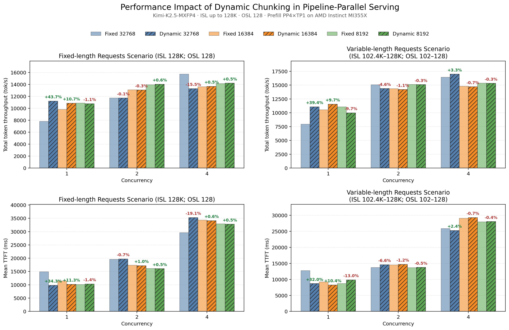
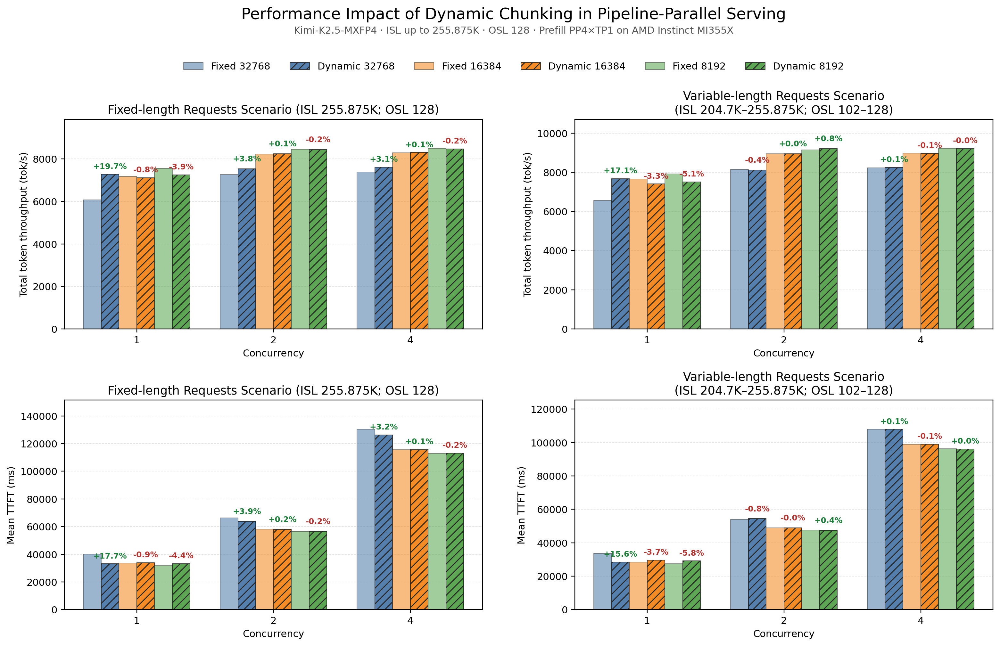

# Dynamic Chunked Pipeline Parallel

Dynamic Chunked Pipeline Parallel (Dynamic CPP) reduces Time to First Token (TTFT) for long prompts on pipeline-parallel prefill workers. It changes the prefill chunk size as the cached prefix grows so that consecutive pipeline microbatches take similar time, reducing pipeline fill, drain, and stage-misalignment bubbles.

Dynamic CPP is intended for latency-bound, low-concurrency long-context prefill. In a Prefill-Decode (PD) disaggregated deployment, enable it only on the prefill worker; ATOM turns it off with a warning on a decode instance (`kv_role: kv_consumer`) and under RapidServe, neither of which runs the prefills it would size.

## How it works

With fixed chunking, a chunk becomes slower as more tokens precede it because self-attention covers a larger area. MLA models may also rebuild cached-prefix state once per chunk. ATOM models the latency of a chunk of `x` new tokens after a cached prefix of `L` tokens as:

```text
t(L, x) = c + gamma * L + b * x + a * (2 * L * x + x^2)
```

- `L` is the cached-prefix length, `x` is the number of new tokens in the current chunk, and `t(L, x)` is the predicted chunk latency.
- `c + gamma * L` represents overhead independent of the current chunk size: `c` is the fixed per-forward overhead, while `gamma * L` captures prefix-dependent work such as rebuilding cached-prefix state in MLA models.
    - These terms remain separate because they scale differently with `L`: `c` is paid even when `L = 0`, whereas `gamma * L` is zero at `L = 0` and grows with the cached prefix. Treating both as one constant would lose this prefix-dependent behavior.
- `b * x` captures work that grows linearly with the new-token count.
- `a * (2 * L * x + x^2)` models self-attention work: `2 * L * x` represents interactions between the new chunk and its cached prefix, while `x^2` represents interactions within the new chunk.
- `a`, `b`, `c`, and `gamma` are learned automatically from measured forward latency.

The scheduler solves for the next `x` whose latency matches the initial chunk, then applies the smoothing factor, minimum chunk size, batch-token budget, and alignment to `max(KV block size, 64)`.

ATOM calibrates the model automatically:

1. At startup, attention-free dummy forwards over up to 24 chunk sizes fit the per-token and fixed overheads (`b` and `c`): one warmup forward, then the best of two per size, so at most 49 forwards. The largest size is the token count warmup already sized activations for. Each forward is timed around the model call only, the same window runtime samples use, so input staging and PP transfers stay out of both.
2. During the first few single-prefill requests, the scheduler alternates between `--max-num-batched-tokens` and one quarter of that size (but never below `--dynamic-chunking-min-chunk-size`). Real forward timings fit the attention-area, cached-prefix, and serving overhead terms.
3. Samples use non-blocking GPU events, are reduced by median per `(chunk, prefix)` shape, and must pass residual, matrix-conditioning, and prediction-uncertainty checks.
4. The accepted model is installed once and timing stops. If startup profiling has no room to run or its fit fails, calibration is unusable, or the model predicts no useful shrink, ATOM logs why and keeps fixed chunking. A dummy forward that raises during the startup sweep fails startup, as a failed warmup forward does: the other PP stages are already waiting on it, so carrying on would leave them blocked.

No offline coefficients or calibration flags are required.

## Enable

```bash
python3 -m atom.entrypoints.openai_server \
  --model <model-path> \
  --pipeline-parallel-size 4 \
  --tensor-parallel-size 1 \
  --enable_chunked_prefill \
  --max-model-len 262144 \
  --max-num-batched-tokens 32768 \
  --enable-dynamic-chunking \
  --dynamic-chunking-smooth-factor 0.75 \
  --dynamic-chunking-min-chunk-size 4096
```

`--enable_chunked_prefill` is enabled by default. Dynamic CPP additionally requires `--pipeline-parallel-size > 1`.

The main controls are:

- `--max-num-batched-tokens`: global scheduling token budget and the reference/maximum chunk size for Dynamic CPP. Start with 2-3x the best fixed chunk size, and consider 4x for very long prompts; benchmark the target workload because the optimum is model- and topology-dependent.
- `--dynamic-chunking-smooth-factor`: interpolation between the initial chunk (`0`) and the fitted equal-latency chunk (`1`). When the flag is omitted it comes from `ATOM_DYNAMIC_CHUNKING_SMOOTH_FACTOR`, default `0.75`; `0.6-0.85` is a practical tuning range.
- `--dynamic-chunking-min-chunk-size`: lower bound for solved chunks, default `4096`. It must be below `--max-num-batched-tokens`, or the two calibration chunk sizes collapse into one and ATOM keeps fixed chunking with a warning. With a small test budget (for example 512), lower it as well (for example to 128).

Use single-request warmup traffic so automatic calibration completes before measurement or production traffic.

To check that the feature acted on a run, look for `Dynamic chunking latency model installed` once calibration ends, and for the periodic `Dynamic chunking since last report` line next to the engine-status line. It counts the chunks sized from the model and by the calibration sweep, and the chunks that kept the fixed budget because no equal-latency chunk was reachable or because other prefills were present.

## Runtime behavior and limits

- Dynamic sizing is used only while one request is the pipeline's sole prefill source over the last 16 scheduler steps. With concurrent prefills, ATOM keeps the configured fixed chunk size because other requests already fill pipeline bubbles and extra chunks only add forward and cached-prefix overhead. Waiting requests that cannot prefill yet (aborted, waiting for remote KV, or permanently unschedulable) do not count as other prefills.
- A prefill that must go in one forward, such as a multimodal prompt without embedding spans, keeps the fixed budget.
- While dynamic chunking is calibrating or has a model installed, the PP head waits for the last stage to acknowledge each middle prefill chunk instead of retiring it locally. The flag travels with each batch, so every stage agrees on it; once the feature turns itself off, middle chunks retire locally again.
- The optimization targets long-prefill TTFT, not decode performance.
- The best initial chunk and smoothing factor remain model-, hardware-, prompt-, and PP-topology-dependent.
- Uneven PP layer partitions can perform better with the larger partition on a later stage, for example `15,15,15,16`.

## Performance summary

The results reported in [ATOM PR #2007](https://github.com/ROCm/ATOM/pull/2007) use Kimi-K2.5-MXFP4 on MI355X with disaggregated prefill PP4xTP1, decode TP4, OSL 128, and fixed- or variable-length 128K/256K prompts. Each pair below is throughput change / mean TTFT improvement; positive values mean Dynamic CPP wins.

### Fixed and variable-length requests up to 128K



### Fixed and variable-length requests up to 256K



- Against the best tuned fixed chunk across 8K/16K/32K, Dynamic CPP at concurrency 1 improves 128K fixed-length traffic by `+2.9% / +3.3%` and 128K variable-length traffic by `+4.3% / +4.9%`; at 256K it trails the tuned fixed baseline by about `3-4%`.
- Against the default `--max-num-batched-tokens=16384`, concurrency-1 gains at 128K are `+10.7% / +11.3%` for fixed-length and `+9.7% / +10.4%` for variable-length traffic; 256K and higher-concurrency results are mostly flat to modestly negative, with the largest regression at `-3.3% / -3.7%`.
- Against a 32K fixed chunk, concurrency-1 gains are `+43.7% / +34.3%` for 128K fixed-length, `+39.4% / +32.0%` for 128K variable-length, `+19.7% / +17.7%` for 256K fixed-length, and `+17.1% / +15.6%` for 256K variable-length traffic.
- At higher concurrency the gains are workload-dependent and can regress, including `-15.5% / -19.1%` for 128K fixed-length traffic at concurrency 4 with a 32K baseline.

Overall, Dynamic CPP primarily reduces the sensitivity of a large initial chunk to tuning for long-context, low-concurrency workloads; it does not outperform the best fixed chunk in every workload.

## Accuracy and correctness

GSM8K 3-shot on Llama-3.3-70B-Instruct-MXFP4 with PP2, an fp8 KV cache, `--max-num-batched-tokens 512` and `--dynamic-chunking-min-chunk-size 128`:

- GSM8K prompts alone are too short at this budget for calibration to measure attention growth, so it gives up and chunking stays fixed. To exercise model-sized chunks, the server first served two long prompts (5k and 8k tokens), which installed the latency model.
- Over all 1319 samples at concurrency 65, two runs with model-sized chunks (575 and 618 chunks from the latency model) scored 0.910 and 0.915 flexible exact match, against 0.915 and 0.916 for two fixed-chunking runs.
- At concurrency 1, fixed chunking is bit-reproducible. A run whose model picked the same boundaries as fixed chunking produced identical generations. A run whose model shrank first chunks moved accuracy about as much as changing the fixed budget from 512 to 384 or 256 does. Over the first 200 samples, these runs span 0.905–0.925 flexible and 0.630–0.675 strict, and the questions that flip go both ways. With an fp8 KV cache, where a prefill splits changes which tokens attend through quantized KV.

To check that a run exercised dynamic sizing, its log should show the calibration sweep and model-sized chunks in the `Dynamic chunking since last report` line.

## References

- [SGLang: Pipeline Parallelism for Long Context](https://github.com/sgl-project/sglang/blob/main/docs/docs/advanced_features/pipeline_parallelism.mdx)
- [LMSYS: Pipeline Parallelism in SGLang](https://www.lmsys.org/blog/2026-01-15-chunked-pipeline/#3-advanced-option-dynamic-chunking)
- [vLLM-Ascend Dynamic CPP design](https://docs.vllm.ai/projects/ascend/en/latest/developer_guide/Design_Documents/dynamic_chunked_pipeline_parallel.html)
- [vLLM-Ascend Dynamic CPP feature guide](https://docs.vllm.ai/projects/ascend/en/latest/user_guide/feature_guide/dynamic_chunk_pipeline_parallel.html)
