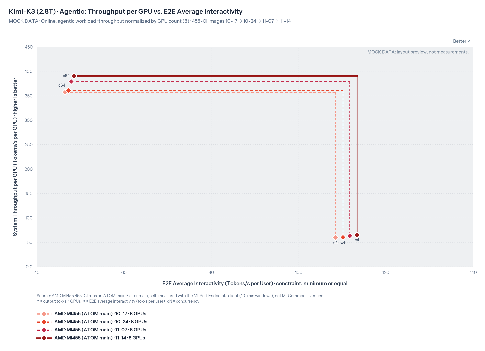
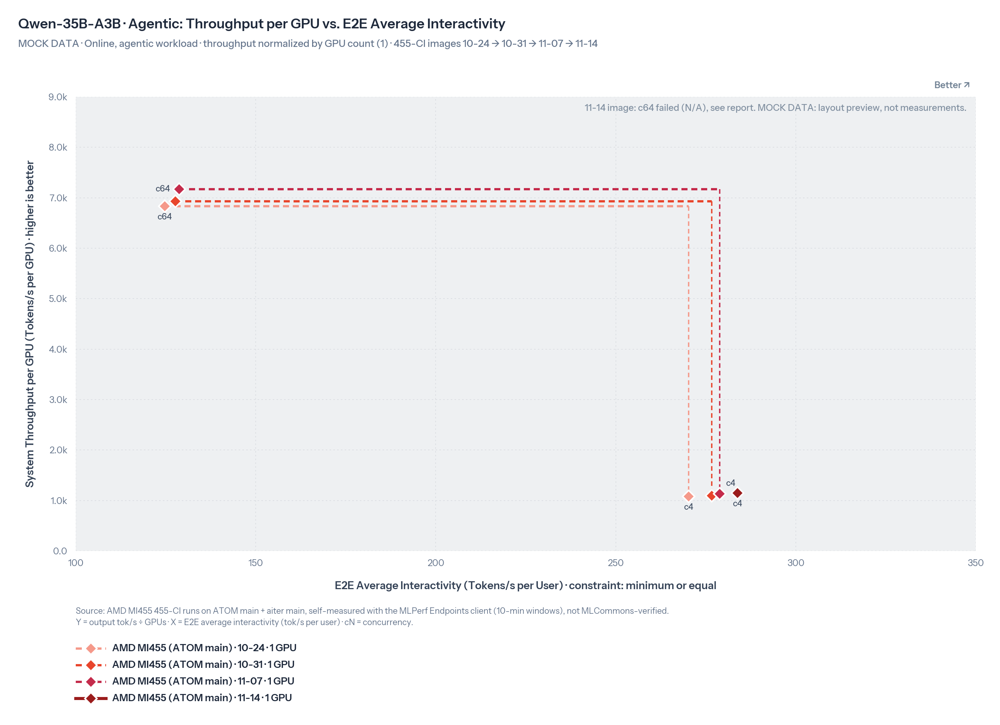
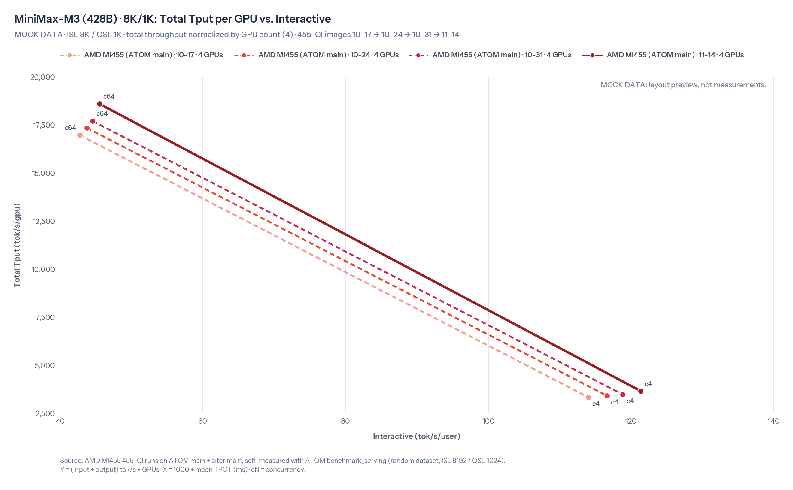
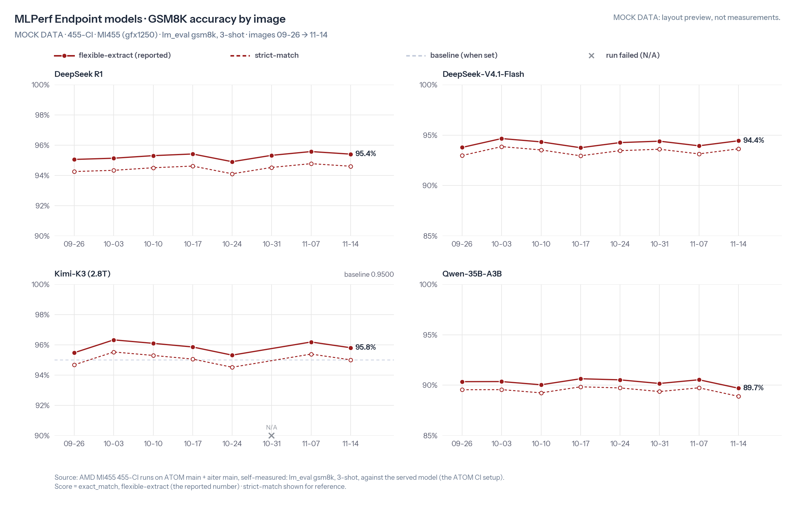
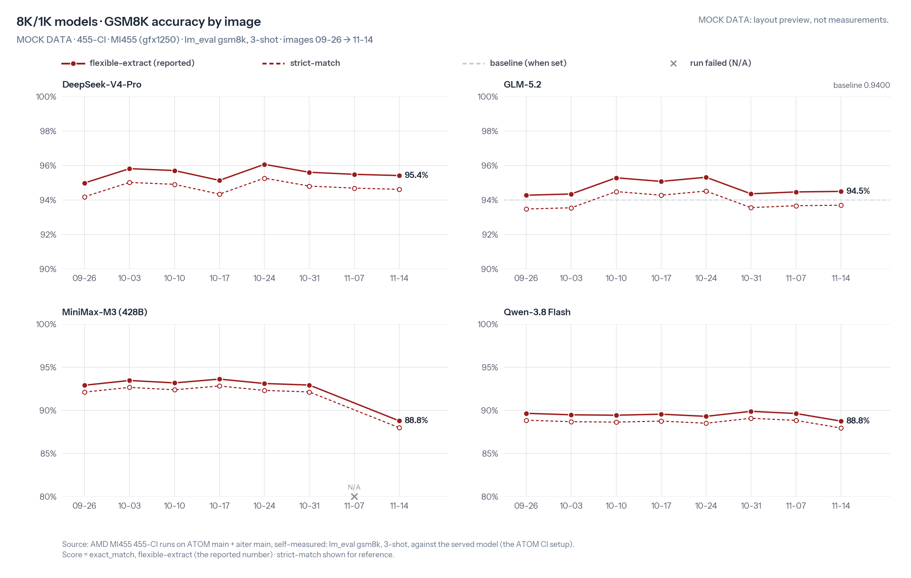

# 455-CI 出图脚本

按 [`455-CI-guide.md`](../../455-CI-guide.md) §5 的规范，从 `perf.csv` 和 `accuracy.csv` 画报告里的图。

| 文件 | 作用 |
|---|---|
| `make_charts.py` | 入口：画一个镜像的全部图 |
| `ci455_data.py` | 从两个 CSV 里选要画的数据：性能取最近 4 个镜像、精度取最近 12 个，重跑以最后一行为准，失败的点不画 |
| `ci455_charts.py` | 画图：MLPerf Endpoint 用 #246 的帕累托图，8K/1K 和精度照 ATOM benchmark dashboard |
| `endpoint_chart.py`、`fetch_fonts.py` | 原样取自 [LLM-Booster#246](https://github.com/wuhuikx/LLM-Booster/issues/246#issuecomment-6678717093)，不要改 |
| `make_examples.py` | 用模拟数据生成 `examples/` 里的样图 |
| `test_*.py` | 测试 |

## 用法

```bash
cd recipes/455-CI/tools
python3 fetch_fonts.py                              # 第一次用时下载 Instrument Sans 到 fonts/（不提交）
python3 make_charts.py --image-date 2026-11-14      # 写到 ../runs/20261114/charts/
python3 -m pytest -q                                # 改了脚本先跑测试
```

- `--image-date` 是本周镜像的日期（周六）。周末测完和周中测完各跑一次，每次连同历史数据一起重画。
- 只画一个场景就加 `--scenario endpoint` 或 `--scenario 8k1k`。
- 依赖：Python 3.10 以上、matplotlib；跑测试还要 pytest。没有字体文件也能画，会退回 DejaVu Sans。

## 样图

下面的数字都是编的，只用来看版面（图上都标了 MOCK DATA）。模拟数据里有每周的小幅提升、整次跑挂的镜像（Kimi-K3 10-31、MiniMax-M3 11-07）、本次只挂了一个并发（Qwen-35B-A3B c64）、本次精度回退（MiniMax-M3）和两条 baseline。

MLPerf Endpoint，10-31 跑挂的镜像不画：



MLPerf Endpoint，本次 c64 跑挂：



8K/1K：



GSM8K 精度：




