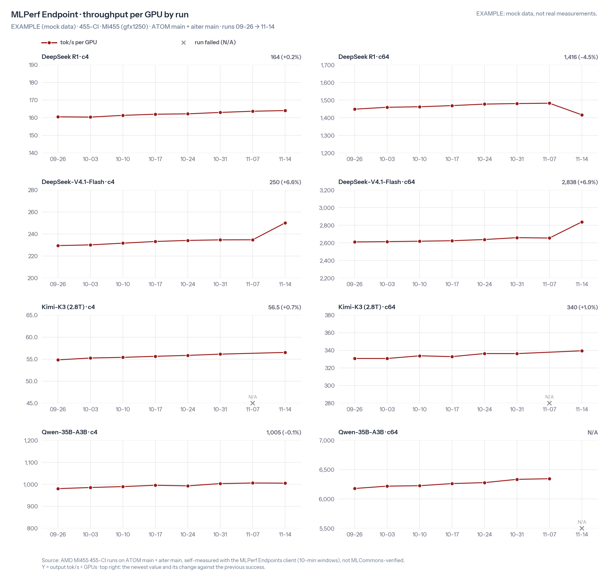

# 455-CI 图和报告的生成脚本

按 [`455-CI-guide.md`](../../455-CI-guide.md) §5，从 `perf.csv` 和 `accuracy.csv` 生成一场测试的趋势图和结果。结果是一个英文 md，`recipes/result/<YYYYMMDD>-result.md`：简短 summary、发现、详细 summary。每周两场：周六测 MLPerf Endpoint（当天构建的镜像），周三测 8K/1K（复用上一个周六的镜像）；一场一份报告，以场次日期命名。

| 文件 | 作用 |
|---|---|
| `make_charts.py` | 入口：画一场的趋势图（一张性能、一张精度） |
| `make_report.py` | 入口：写本场的结果 `../../result/<YYYYMMDD>-result.md`，打印 Highlights 草稿，最后一行是它的路径 |
| `ci455_data.py` | 从两个 CSV 里按场次取数据、和上一场成功的结果比较：重跑以最后一行为准，跑挂的点不算 |
| `ci455_report.py` | Highlights 规则（门槛见 guide §5.1）和结果的 markdown |
| `ci455_charts.py` | 趋势图，照 ATOM benchmark dashboard 的样式 |
| `endpoint_chart.py`、`fetch_fonts.py` | 原样取自 [LLM-Booster#246](https://github.com/wuhuikx/LLM-Booster/issues/246#issuecomment-6678717093)，提供字体和页面配色，不要改 |
| `make_examples.py` | 用编出来的数据生成 `examples/` 和 `../../result/example.md` |
| `test_*.py` | 测试 |

## 用法

```bash
cd recipes/455-CI/tools
python3 fetch_fonts.py                       # 第一次用时下载 Instrument Sans 到 fonts/（不提交）
python3 make_charts.py --date 2026-11-18     # 场次日期；写 ../runs/20261118/charts/
python3 make_report.py --date 2026-11-18     # 写 ../../result/20261118-result.md，最后打印它的路径
python3 -m pytest -q                         # 改了脚本先跑测试
```

- `--date` 是场次日期：周六那场或周三那场。每场测完跑一次，连同历史数据重新生成。那天跑的是哪个场景，脚本从数据里看出来。
- Highlights 里 @ 的 owner 取自 `../owners.csv`（两列：`model`、`owner`）。有消息的模型没登记 owner 时，`make_report.py` 会打警告。
- 每个问题（❌ 🔴 ⚠️）的说法取自 `../followups.csv`（guide §3.7）：接在 Highlights 那一条后面，详细 summary 里有 Follow-ups 表。还有问题没写说法时，`make_report.py` 会打 `no follow-up` 的警告。
- `../pending_fixes.csv` 登记某个模型在 main 上还在等的 PR。这个模型出了问题又没写说法时，`make_report.py` 会在警告下面列出这些 PR，并给出一行可以直接贴进 `followups.csv` 的说法。
- 依赖：Python 3.10 以上、matplotlib；跑测试还要 pytest。没有字体文件也能画，会退回 DejaVu Sans。

## 样例

`examples/` 是 **EXAMPLE（示例）**：一份编出来的数据目录，结构和 `recipes/455-CI/` 一样，数字都不是真实测试数据，结果和图上都标了 EXAMPLE。用它生成的样例结果是 [`recipes/result/example.md`](../../result/example.md)：周六 11-14 那场 MLPerf Endpoint，各种情况都有一个。Qwen-35B-A3B 的 c64 跑挂（说法是复现文档，owner 是占位名）；DeepSeek R1 回退 5%（说法是我们修好并验证的 PR）；DeepSeek-V4.1-Flash 快了 6%、GSM8K 掉了 5 个点（说法是别人正在修的 PR）；Kimi-K3 上一场跑挂、这场恢复。PR 链接是编的，指不到真实的 PR。周三 11-18 那场只用来画 8K/1K 的图。




