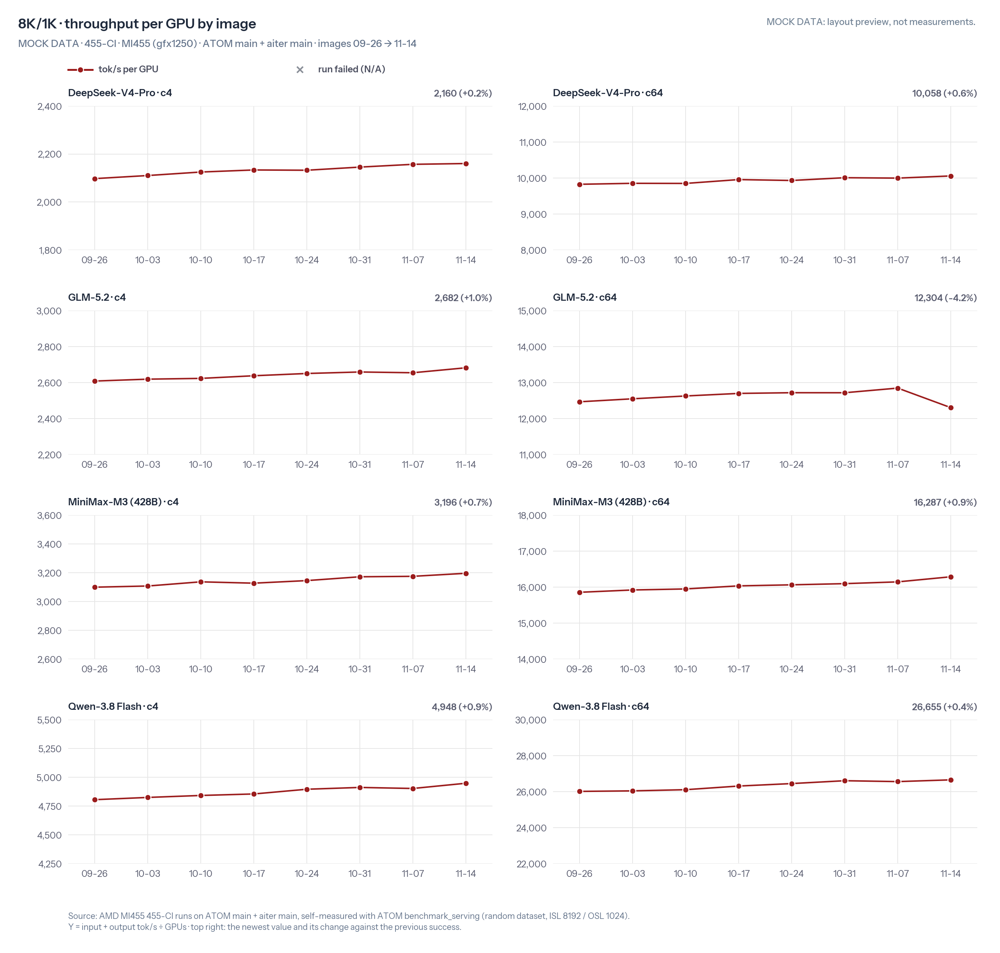
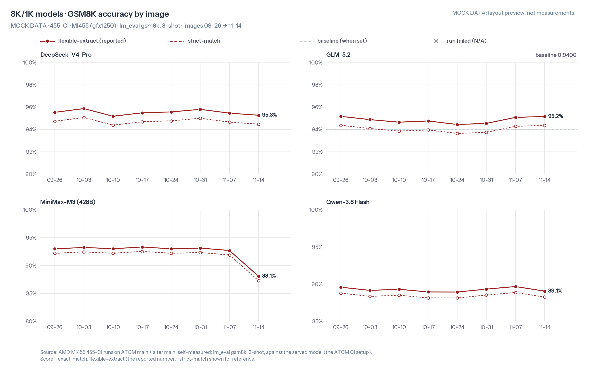

# 455-CI detailed report · 2026-11-14 · EXAMPLE

> ⚠️ **EXAMPLE**: this report only illustrates the format. All numbers are made up; they are not real test results.

[← Report](455-CI-report-20261114.md)

## Environment

| Item | Value |
|---|---|
| Test image | `rocm/fw-bringup-mlperf:gfx1250-atom-ci455-20261114` (digest `sha256:0000mock`) |
| Base image | `rocm/fw-bringup-mlperf:gfx1250-atom-20261113` |
| ATOM | `main` @ [`000000000`](https://github.com/ROCm/ATOM/commit/0000000000000000000000000000000000000000), 2026-11-14 (mock) ATOM main head |
| aiter | `main` @ [`111111111`](https://github.com/ROCm/aiter/commit/1111111111111111111111111111111111111111), 2026-11-14 (mock) aiter main head |
| Dependency changes | none |
| Test dates | MLPerf Endpoint 2026-11-14; 8K/1K 2026-11-18 (Beijing time) |

## MLPerf Endpoint

### Performance

| Model | GPUs | Concurrency | tok/s/GPU | vs previous | vs best | E2E avg interactivity (tok/s/user) | vs previous |
|---|---|---|---|---|---|---|---|
| DeepSeek R1 | 4 | 4 | 150 | −1.7% | ⚠️ −6.6% | 149 | −0.6% |
| DeepSeek R1 | 4 | 64 | 1,363 | −1.4% | ⚠️ −6.2% | 57.8 | −0.9% |
| DeepSeek-V4.1-Flash | 4 | 4 | 250 | 🟢 +6.6% | +6.6% (new best) | 209 | −0.5% |
| DeepSeek-V4.1-Flash | 4 | 64 | 2,838 | 🟢 +6.9% | +6.7% (new best) | 94.5 | +0.4% |
| Kimi-K3 (2.8T) | 8 | 4 | 56.5 | +0.7% | +0.7% (new best) | 105 | −0.7% |
| Kimi-K3 (2.8T) | 8 | 64 | 340 | +1.0% | +0.9% (new best) | 45.2 | −0.5% |
| Qwen-35B-A3B | 1 | 4 | 1,005 | −0.1% | −0.1% | 262 | +0.5% |
| Qwen-35B-A3B | 1 | 64 | N/A | N/A | N/A | N/A | — |

### Accuracy (GSM8K, 3-shot)

| Model | flexible-extract | strict-match | Previous | vs previous |
|---|---|---|---|---|
| DeepSeek R1 | 95.0% | 94.2% | 95.6% (2026-11-07) | −0.6 pts |
| DeepSeek-V4.1-Flash | 93.9% | 93.1% | 94.1% (2026-11-07) | −0.2 pts |
| Kimi-K3 (2.8T) | 96.1% | 95.3% | 96.2% (2026-10-31) | −0.1 pts |
| Qwen-35B-A3B | 90.1% | 89.3% | 90.2% (2026-11-07) | −0.1 pts |

### Trends


## 8K/1K

### Performance

| Model | GPUs | Concurrency | tok/s/GPU | vs previous | vs best | ITL P50 (ms, lower is better) | vs previous |
|---|---|---|---|---|---|---|---|
| DeepSeek-V4-Pro | 4 | 4 | 2,160 | +0.2% | +0.2% (new best) | 13.6 | +0.1% |
| DeepSeek-V4-Pro | 4 | 64 | 10,058 | +0.6% | +0.5% (new best) | 37.1 | +1.1% |
| GLM-5.2 | 4 | 4 | 2,682 | +1.0% | +0.9% (new best) | 10.7 | −0.8% |
| GLM-5.2 | 4 | 64 | 12,304 | ⚠️ −4.2% | −4.2% | 29.3 | −0.2% |
| MiniMax-M3 (428B) | 4 | 4 | 3,196 | +0.7% | +0.7% (new best) | 8.7 | −0.7% |
| MiniMax-M3 (428B) | 4 | 64 | 16,287 | +0.9% | +0.9% (new best) | 23.2 | −0.5% |
| Qwen-3.8 Flash | 1 | 4 | 4,948 | +0.9% | +0.7% (new best) | 5.8 | −1.0% |
| Qwen-3.8 Flash | 1 | 64 | 26,655 | +0.4% | +0.2% (new best) | 15.5 | +0.7% |

### Accuracy (GSM8K, 3-shot)

| Model | flexible-extract | strict-match | Previous | vs previous |
|---|---|---|---|---|
| DeepSeek-V4-Pro | 95.3% | 94.5% | 95.5% (2026-11-07) | −0.2 pts |
| GLM-5.2 | 95.2% | 94.4% | 95.1% (2026-11-07) | +0.1 pts |
| MiniMax-M3 (428B) | 88.1% | 87.3% | 92.7% (2026-11-07) | ⚠️ −4.6 pts |
| Qwen-3.8 Flash | 89.1% | 88.3% | 89.7% (2026-11-07) | −0.6 pts |

### Trends





## Failures

### Qwen-35B-A3B (MLPerf Endpoint): c64

- Error: `RuntimeError: HIP error: out of memory (mock)`
- Full excerpt: [error.log](../runs/20261114/qwen-35b-a3b/error.log)

Core error log:

```text
(mock) INFO  [model_runner] capturing CUDA graphs for batch sizes 1..64
(mock) Traceback (most recent call last):
(mock)   File "/app/ATOM/atom/model_engine/model_runner.py", line 1234, in capture_cudagraph
(mock)     self.run_model(dummy_batch)
(mock)   File "/app/ATOM/atom/model_engine/model_runner.py", line 987, in run_model
(mock)     hidden = self.model(input_ids, positions)
(mock) RuntimeError: HIP error: out of memory (mock)
----- last 30 lines -----
(mock) ERROR [engine_core] EngineCore_DP0 died, shutting down the server
```
