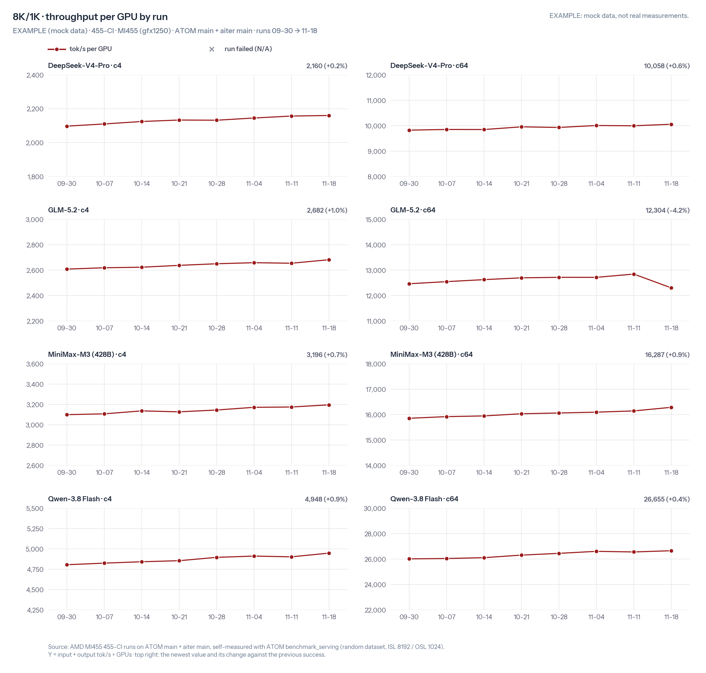
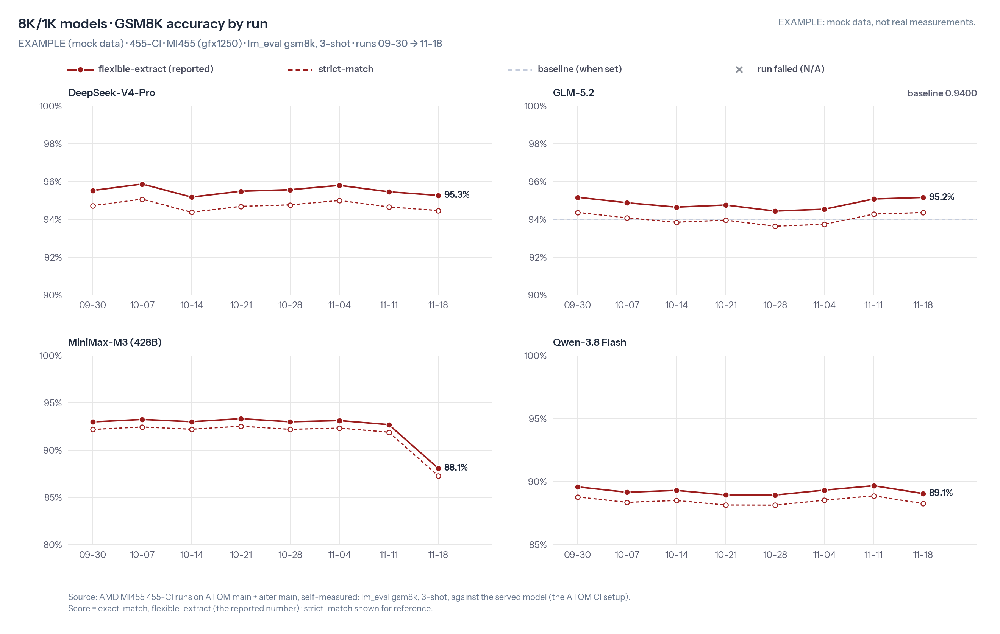

# 455-CI report · 2026-11-18 · 8K/1K · EXAMPLE

> ⚠️ **EXAMPLE**: this report only illustrates the format. All numbers are made up; they are not real test results.

Image `gfx1250-atom-ci455-20261114` · ATOM `main@000000000` · aiter `main@111111111`

## Summary

### Highlights

- ⚠️ GLM-5.2: throughput down 4.2%. Fixed by us in [ROCm/ATOM#99901](https://github.com/ROCm/ATOM/pull/99901), verified. @glm52_owner
- ⚠️ MiniMax-M3: GSM8K down 4.6 points to 88.1%. Fix in progress: [ROCm/aiter#99902](https://github.com/ROCm/aiter/pull/99902). @m3_owner

### Results

| Model | Scenario | 2026-11-11 (tok/s/GPU) | 2026-11-18 (tok/s/GPU) | Delta | GSM8K delta |
|---|---|---|---|---|---|
| DeepSeek-V4-Pro | 8K/1K | 9,998 | 10,058 | +0.6% | −0.2 pts (now 95.3%) |
| GLM-5.2 | 8K/1K | 12,846 | 12,304 | ⚠️ −4.2% | +0.1 pts (now 95.2%) |
| MiniMax-M3 (428B) | 8K/1K | 16,145 | 16,287 | +0.9% | ⚠️ −4.6 pts (now 88.1%) |
| Qwen-3.8 Flash | 8K/1K | 26,558 | 26,655 | +0.4% | −0.6 pts (now 89.1%) |

## Details

### Environment

| Item | Value |
|---|---|
| Test image | `rocm/fw-bringup-mlperf:gfx1250-atom-ci455-20261114` (digest `sha256:0000mock`) |
| ATOM | `main` @ [`000000000`](https://github.com/ROCm/ATOM/commit/0000000000000000000000000000000000000000), 2026-11-14 (mock) ATOM main head |
| aiter | `main` @ [`111111111`](https://github.com/ROCm/aiter/commit/1111111111111111111111111111111111111111), 2026-11-14 (mock) aiter main head |
| Test date | 2026-11-18 |

### Performance · 8K/1K

| Model | Parallelism | Concurrency | tok/s/GPU | vs 2026-11-11 | ITL P50 (ms, lower is better) | vs 2026-11-11 |
|---|---|---|---|---|---|---|
| DeepSeek-V4-Pro | dp4ep4 | 4 | 2,160 | +0.2% | 13.6 | +0.1% |
| DeepSeek-V4-Pro | dp4ep4 | 64 | 10,058 | +0.6% | 37.1 | +1.1% |
| GLM-5.2 | tp4 | 4 | 2,682 | +1.0% | 10.7 | −0.8% |
| GLM-5.2 | tp4 | 64 | 12,304 | ⚠️ −4.2% | 29.3 | −0.2% |
| MiniMax-M3 (428B) | tp4 | 4 | 3,196 | +0.7% | 8.7 | −0.7% |
| MiniMax-M3 (428B) | tp4 | 64 | 16,287 | +0.9% | 23.2 | −0.5% |
| Qwen-3.8 Flash | tp1 | 4 | 4,948 | +0.9% | 5.8 | −1.0% |
| Qwen-3.8 Flash | tp1 | 64 | 26,655 | +0.4% | 15.5 | +0.7% |

### Accuracy (GSM8K, 3-shot) · 8K/1K

| Model | flexible-extract | strict-match | 2026-11-11 | vs 2026-11-11 |
|---|---|---|---|---|
| DeepSeek-V4-Pro | 95.3% | 94.5% | 95.5% | −0.2 pts |
| GLM-5.2 | 95.2% | 94.4% | 95.1% | +0.1 pts |
| MiniMax-M3 (428B) | 88.1% | 87.3% | 92.7% | ⚠️ −4.6 pts |
| Qwen-3.8 Flash | 89.1% | 88.3% | 89.7% | −0.6 pts |

### Trends · 8K/1K

### Follow-ups

| Model | Next step | Owner | Note |
|---|---|---|---|
| GLM-5.2 | Fixed by us in [ROCm/ATOM#99901](https://github.com/ROCm/ATOM/pull/99901), verified. | @glm52_owner | (mock) verified on 455: c64 back to 12,830 tok/s/GPU |
| MiniMax-M3 (428B) | Fix in progress: [ROCm/aiter#99902](https://github.com/ROCm/aiter/pull/99902). | @m3_owner | (mock) the open aiter PR fixes the MoE scale rounding |

### Failures

No failures.
