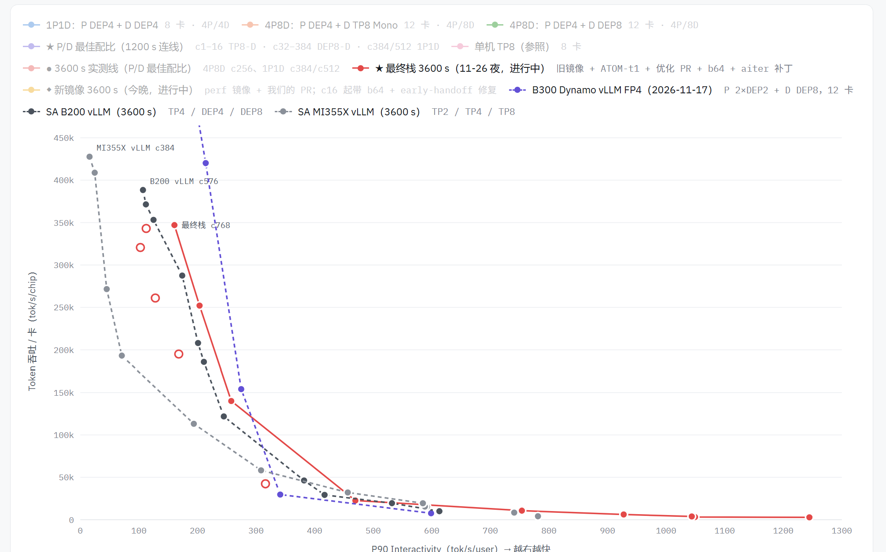

# DeepSeek V4.1-Flash 4P4D on one 8-GPU node (TTFT-optimized)

This recipe describes a single-node prefill/decode (P/D) split for
DeepSeek-V4.1-Flash-1017 on 8x MI355X running the AgentX C256 workload. The
prefill instance (P) uses GPUs 0-3 and the decode instance (D) uses GPUs 4-7.
Both run TP4 with DP attention and EP4 (DEP4). The workload uses FP8 KV, an
FP4 index plane, DSpark with five speculative tokens, prefix caching, and a
Mooncake Store as the P-side KV offload tier.

Compared with the earlier 4P4D configuration, the base of this recipe (E14a)
cuts mean TTFT from 3.74 s to 1.07-1.24 s (-67 to -71%). ITL improves from
6.91 to 6.37 ms, and output throughput rises from 6,644 to about 7,390 tok/s
(+11%).

The best configuration adds five opt-in settings on top of E14a:

- MegaMoE on D (`--moe-backend mega`).
- `ATOM_OFFLOAD_PRESTART_LOAD_WAIT_MS=20` on P.
- `ATOM_PD_EARLY_HANDOFF=1` on P.
- `ATOM_DP_IDLE_WHEN_BLOCKED=1` on P.
- Denser decode cudagraph capture sizes on D.

With these on the slower host, mean TTFT is 0.916 s (P50 0.522 s), down from
1.198 s for E14a on that host. Outside the arrival burst the mean is 0.563 s.
ITL and throughput stay flat. See [Best configuration](#best-configuration)
and [Results](#results).

The commands change only configuration, but several of the settings depend on
upstream PRs that are still open (see [Dependencies](#dependencies)).

The comparison with a single 8-GPU DEP8 instance is mixed. A fair version of
that single instance also uses MegaMoE with 16K chunks and a warm JIT cache,
and runs on the same host. Against it, this P/D config is better on TTFT mean,
P50 and P90. The single instance is still slightly better on P99 TTFT, ITL and
output throughput per GPU. See [Results](#results).

A second, two-node part of this recipe covers the **4P8D AgentX ladder
(c1-c768, 3600 s per point, 12 GPUs)**: P DEP4 on one node and D on a second
node (TP8 Mono for c1-c32, DEP8 for c256-c768). Every point's full launch
configuration and result is in
[4P8D AgentX ladder](#4p8d-agentx-ladder-c1-c768-3600-s).

## What changed relative to the earlier 4P4D config

| # | Role | Change | Effect measured on AgentX C256 |
|---|---|---|---|
| 1 | P | `--moe-backend mega` (MegaMoE; needs ATOM #3187 and aiter #7788) | Mean P forward time per step fell from 761 to 463 ms, and mean TTFT fell 36%. With `standard` MoE, 87% of a P forward went to the EP dispatch kernel. |
| 2 | P | `--max-num-batched-tokens 16384 --attn-prefill-chunk-size 16384` (was 32768) | 16K lands on MegaMoE's fused large-input route, which covers `mtpr` 8192 and 16384 only. At 32K, mega falls back to the staged route and gives no gain. |
| 3 | P | `--long-prefill-token-threshold 8192` | A long prompt takes at most 8K tokens per step and no longer blocks short prompts behind it. Time from P receiving a request to its first forward fell to 0.42-0.59 s, and P90 TTFT fell from 3.2 to 1.5 s. |
| 4 | P, D | `ATOM_ENABLE_PREFILL_DELAYER=0` | Combined with item 2 at 16K, TTFT fell from 3.74 to 2.84 s. |
| 5 | Store | Mooncake Store on the same host as P/D (optional) | About -2%, within noise. A remote Store works the same way. |
| 6 | D | `--moe-backend mega` (E19 = E14a + items 6 and 7) | ITL fell from 6.37 to 5.88 ms on Host A, and throughput rose to 7,572 tok/s. |
| 7 | P | `ATOM_OFFLOAD_PRESTART_LOAD_WAIT_MS=20` (needs ATOM #3772) | The first forward waits up to 20 ms for a Store load already in flight, instead of recomputing the prefix. |
| 8 | P | `ATOM_PD_EARLY_HANDOFF=1` (needs ATOM #3773) | P answers the router as soon as it has dispatched the request, so D allocates and pulls KV while P computes. Time from P finish to first token fell from 0.309 to 0.136 s. **Use only with a single P instance** (see [Caveats](#caveats)). |
| 9 | P | `ATOM_DP_IDLE_WHEN_BLOCKED=1` (needs the T1 PR) | A DP rank whose only work is waiting on a Store lookup or load, or on a KV send, no longer forces the group into dummy forwards. Outside the arrival burst, P queueing fell from about 0.22 s to 0.083 s. Ignored while the prefill delayer is on. |
| 10 | D | `--cudagraph-capture-sizes '[1,2,4,6,8,10,12,14,16,18,20,22,24,28,32,36,40,44,48,64,96,128]'` | D runs batch 15-20 per rank at C256. The old 16→24 step padded those batches. In a same-host A/B, a step at batch 17 was 2.67 ms faster and at batch 19 2.49 ms faster. Batches 16 and 24 changed by ±0.15 ms. Startup time and cudagraph memory (1.53 GB) were unchanged. |

Several other changes were tried and are **not** part of this recipe. Each
gave no gain or traded one metric for another:

- P chunk 8K
- long-prefill threshold 12K
- a short-request bypass in the scheduler
- asynchronous Store unpack
- early-load tuning
- a 6:2 P:D split, which MoRI's power-of-two rule blocks inside one node

## Dependencies

All measurements were taken on ATOM `cccc96a039c0936a0dfe2516245fea5e3305c346`
(an ancestor of current main) with the image's Mooncake and MoRI builds.
Base image: `rocm/pytorch:rocm7.2.4_ubuntu24.04_py3.12_pytorch_release_2.10.0`.

**P only**, until these PRs are merged:

1. **ATOM [#3187](https://github.com/ROCm/ATOM/pull/3187)**: MegaMoE picks
   small, large or staged routes from the DP-group max rows. Apply only the
   PR's own commits (`457e7b8c3..c5bfc81c2`). Do not merge the branch, because
   that brings in unrelated main commits. The diff applies cleanly with `git
   apply` to both `cccc96a03` and current main.

   ```bash
   cd <ATOM_SRC>                       # checkout used by P
   git fetch origin pull/3187/head:pr3187
   git diff 457e7b8c3 c5bfc81c2 > /tmp/pr3187.diff
   git apply -3 /tmp/pr3187.diff
   ```

2. **aiter [#7788](https://github.com/ROCm/aiter/pull/7788)**, tested at
   `454435a63e2b773ee5e175114f0ea09575e95508`. This PR is required. Without
   it, aiter has no `fused_layout_supported`, `MegaMoEV2` does not accept
   `routed=`, and #3187 fails at startup. Later heads of the PR have not been
   tested with this recipe.

   ```bash
   # On the host: copy the image's aiter checkout, then move it to the tested commit.
   docker run --rm -v <WORK>:/o --entrypoint bash <ATOM_IMAGE> -c '
     cp -a /app/aiter-test /o/aiter-P && cd /o/aiter-P &&
     git config --global --add safe.directory "*" &&
     git fetch origin pull/7788/head:pr7788 && git checkout 454435a63'
   ```

   The copy keeps the image's prebuilt `.so` modules. Bind-mount `<WORK>/aiter-P`
   at `/app/aiter-test` in the P container. D keeps the image's aiter.

**Best configuration only.** Items 7-9 are opt-in environment variables
added by open ATOM PRs:

3. **ATOM [#3772](https://github.com/ROCm/ATOM/pull/3772)**:
   `ATOM_OFFLOAD_PRESTART_LOAD_WAIT_MS`.
4. **ATOM [#3773](https://github.com/ROCm/ATOM/pull/3773)**:
   `ATOM_PD_EARLY_HANDOFF`. It applies only when P uses single-node DP and
   the router uses the legacy relay.
5. **The T1 PR**: `ATOM_DP_IDLE_WHEN_BLOCKED`, which includes the
   `BLOCKED_IDLE_SLEEP_S` GIL yield.

With a variable unset, or its PR missing, that item falls back to the E14a
behaviour. **D with MegaMoE (item 6)** needs the same #3187 tree and aiter as
P.

When P starts, its log should contain a line like:
`MegaMoEV2 mtpr=16384 experts=384 topk=6: staged route (compact), small-input capacities (256, 512), large-input route`.
Note that #3187 refuses `mega` with `-tp > 1` unless `--enable-dp-attention`
is set.

**Accuracy.** P with mega and these PRs scored 95.5% (191/200) on GSM8K-200,
against 96.0% (192/200) for `standard`. The paired difference is -0.5 pp,
with a 95% CI of [-2.2, +1.2].

## Ports and topology

| Service | Host GPUs | Ports (all < 32768) |
|---|---|---|
| Mooncake master + metadata | - | 31961 RPC, 31962 HTTP metadata, 31963 metrics |
| Mooncake Store owner (256 GiB) | - | uses an RDMA NIC that P's requesters do not use |
| P (DEP4, producer) | 0-3 | 31500 HTTP, 31502 DP master, 31510+ DP base, 31520 handshake |
| D (DEP4, consumer) | 4-7 | 31600 HTTP, 31602 DP master, 31610+ DP base, 31620 handshake |
| atomesh router | - | 31530 HTTP, 31531 Prometheus |
| Encoding ingress (AgentX entry) | - | 31540 |

**Keep every listening and handshake port below 32768.** Linux hands out
ephemeral ports from 32768 to 60999. Mooncake's transfer engine opens random
local ports in that range. During the study, handshake ports in the 5xxxx
range collided with them five times, and each time a service failed or
stopped sending requests. Use disjoint port ranges for every instance on a
host.

## Common container settings

The settings below match what was measured. `MC_GID_INDEX`, the libibverbs and
provider mounts, and `MOONCAKE_DISABLE_HIP_DMABUF` depend on your NIC and
driver; adjust them to your fabric.

```bash
export HOST_IP=<HOST_IP>                 # address P, D, router and Store bind to
export MODEL_PATH=<MODEL_PATH>           # DeepSeek-V4.1-Flash-1017 checkpoint
export ATOM_IMAGE=<ATOM_IMAGE>
export WORK=<WORK>                       # persistent host dir (caches, logs)
mkdir -p $WORK/{cache-P,cache-D}/{atom,mori} $WORK/store

DOCKER_COMMON=(--network=host --ipc=host --ulimit memlock=-1 --ulimit nofile=65536:524288
  --cap-add=IPC_LOCK --security-opt seccomp=unconfined
  --device /dev/infiniband --device /dev/kfd --device /dev/dri
  --group-add video --group-add render
  -v /etc/libibverbs.d:/etc/libibverbs.d:ro
  -v $MODEL_PATH:$MODEL_PATH:ro)

ENV_COMMON=(-e ATOM_HOST_IP=$HOST_IP -e MORI_SHMEM_HEAP_SIZE=17179869184
  -e ATOM_MONO_ENABLE=1 -e ATOM_MOONCAKE_MATCHED_RAILS=auto
  -e ATOM_DSV41_MOE_FP8_ACTIVATIONS=0 -e ATOM_DSPARK_DISABLE_COMPILE=1
  -e ATOM_DISABLE_MMAP=true -e ATOM_USE_CUSTOM_ALL_GATHER=0
  -e ATOM_FRONTEND_PREFIX_HASH=1 -e ATOM_DP_SESSION_AFFINITY=0
  -e ATOM_ENABLE_PREFILL_DELAYER=0
  -e HSA_ENABLE_IPC_MODE_LEGACY=1 -e MOONCAKE_DISABLE_HIP_DMABUF=1
  -e MC_NUM_QP_PER_EP=1 -e MC_GID_INDEX=1 -e MC_LOG_LEVEL=INFO
  -e NCCL_DEBUG=WARN -e NCCL_IB_DISABLE=0 -e PYTHONUNBUFFERED=1)
```

## 1. Mooncake Store (master + owner)

Start the Store before P. The owner must use an RDMA NIC that P's requesters
do not use. In the measured runs, P requesters used `rdma0-3` and the owner
used `rdma7`.

```bash
docker run -d --name store-master "${DOCKER_COMMON[@]}" -e MC_NUM_QP_PER_EP=1 \
  $ATOM_IMAGE mooncake_master --rpc_address=$HOST_IP --rpc_port=31961 \
  --enable_http_metadata_server=true --http_metadata_server_host=$HOST_IP \
  --http_metadata_server_port=31962 --metrics_port=31963

docker run -d --name store-owner "${DOCKER_COMMON[@]}" \
  -e MC_NUM_QP_PER_EP=1 -e MC_GID_INDEX=1 -e MC_MAX_MR_SIZE=1073741824 \
  -e MOONCAKE_DISABLE_HIP_DMABUF=1 -e GLIBC_TUNABLES=glibc.malloc.hugetlb=1 \
  $ATOM_IMAGE mooncake_client --master_server_address=$HOST_IP:31961 \
  --metadata_server=http://$HOST_IP:31962/metadata --protocol=rdma \
  --device_names=<OWNER_RDMA> --global_segment_size=256GB
```

In the measured runs, the owner was a small Python process instead of
`mooncake_client`. It called
`MooncakeDistributedStore.setup(...)` and then
`allocate_and_mount_segment(1 GiB, 'rdma', <OWNER_RDMA>)` 256 times, using
transparent huge pages and `MC_ENABLE_PARALLEL_REG_MR=0
MC_MAX_CONCURRENT_REG_MR=1`. Either form works if the total mounted capacity
is 256 GiB and a put/get round-trip succeeds before P starts. For the Store's
other deployment requirements, see the
[Mooncake Store notes](../atom/kv_transfer/offload/README.md#deployment-notes).

## 2. Prefill (P): GPUs 0-3, MegaMoE

P must use a source tree with #3187 applied and aiter #7788 mounted. Mount
persistent JIT, compile and MoRI caches so that warm-up survives restarts (see
[Warm-up](#5-warm-up-required-before-measuring)).

```bash
KV_P=$(cat <<EOF
{"kv_connector": "multi", "connectors": [
  {"kv_connector": "mooncake", "kv_role": "kv_producer", "proxy_ip": "$HOST_IP",
   "http_port": 31500, "handshake_port": 31520, "protocol": "rdma"},
  {"kv_connector": "mooncake_store", "kv_role": "offload", "kv_connector_extra_config": {
   "mooncake_store.master": "$HOST_IP:31961",
   "mooncake_store.metadata": "http://$HOST_IP:31962/metadata",
   "mooncake_store.protocol": "rdma", "mooncake_store.local_hostname": "$HOST_IP",
   "mooncake_store.rdma_devices": "rdma0,rdma1,rdma2,rdma3",
   "mooncake_store.owner_rdma_devices": "<OWNER_RDMA>",
   "mooncake_store.load_pool_mib": 1024, "mooncake_store.save_pool_mib": 1024}}]}
EOF
)

docker run -d --name atom-P "${DOCKER_COMMON[@]}" "${ENV_COMMON[@]}" \
  -e HIP_VISIBLE_DEVICES=0,1,2,3 -e OFFLOAD_LOAD_WORKERS=1 \
  -v <ATOM_SRC_WITH_PR3187>:/app/ATOM \
  -v $WORK/aiter-P:/app/aiter-test \
  -v $WORK/cache-P/aiter-jit:/app/aiter-test/aiter/jit \
  -v $WORK/cache-P/atom:/root/.cache/atom \
  -v $WORK/cache-P/mori:/root/.mori \
  $ATOM_IMAGE python3 -m atom.entrypoints.openai_server \
  --model $MODEL_PATH --trust-remote-code \
  -tp 4 --enable-dp-attention --enable-expert-parallel \
  --data-parallel-master-ip $HOST_IP --data-parallel-master-port 31502 \
  --data-parallel-base-port 31510 --server-port 31500 \
  --moe-backend mega --all2all-backend high-throughput --dp-load-balance share_cache \
  --kv_cache_dtype fp8 --index-cache-dtype fp4 \
  --gpu-memory-utilization 0.9 --max-num-seqs 128 \
  --max-num-batched-tokens 16384 --attn-prefill-chunk-size 16384 \
  --long-prefill-token-threshold 8192 \
  --enable_prefix_caching --block-size 16 --state-checkpoint-interval-tokens 8192 \
  --level 3 --cudagraph-mode FULL --cudagraph-capture-sizes '[1,2,4,8,16,24,32,48,64,96,128]' \
  --method dspark --num-speculative-tokens 5 --tool-call-parser dsml_v41 \
  --dspark-config '{"confidence_schedule":false}' \
  --kv-transfer-config "$KV_P" --disable-uvicorn-access-log \
  --spec-decode-acceptance-length 3.51
```

Seed `$WORK/cache-P/aiter-jit` once from the copied aiter checkout
(`cp -a $WORK/aiter-P/aiter/jit $WORK/cache-P/aiter-jit`). The `.so` files in
it match the image's.

## 3. Decode (D): GPUs 4-7

Start D only after P reports `/health` 200. The measured D used
`--moe-backend standard` with the image's aiter. `<ATOM_SRC_BASE>` is the
same base commit as P without #3187; D does not need the PR.

```bash
docker run -d --name atom-D "${DOCKER_COMMON[@]}" "${ENV_COMMON[@]}" \
  -e HIP_VISIBLE_DEVICES=4,5,6,7 \
  -v <ATOM_SRC_BASE>:/app/ATOM \
  -v $WORK/cache-D/aiter-jit:/app/aiter-test/aiter/jit \
  -v $WORK/cache-D/atom:/root/.cache/atom \
  $ATOM_IMAGE python3 -m atom.entrypoints.openai_server \
  --model $MODEL_PATH --trust-remote-code \
  -tp 4 --enable-dp-attention --enable-expert-parallel \
  --data-parallel-master-ip $HOST_IP --data-parallel-master-port 31602 \
  --data-parallel-base-port 31610 --server-port 31600 \
  --moe-backend standard --all2all-backend high-throughput --dp-load-balance least_requests \
  --kv_cache_dtype fp8 --index-cache-dtype fp4 \
  --gpu-memory-utilization 0.9 --max-num-seqs 128 \
  --max-num-batched-tokens 1024 --attn-prefill-chunk-size 32768 \
  --enable_prefix_caching --block-size 16 --state-checkpoint-interval-tokens 8192 \
  --level 3 --cudagraph-mode FULL --cudagraph-capture-sizes '[1,2,4,8,16,24,32,48,64,96,128]' \
  --method dspark --num-speculative-tokens 5 --tool-call-parser dsml_v41 \
  --dspark-config '{"confidence_schedule":false}' \
  --kv-transfer-config "{\"kv_connector\": \"mooncake\", \"kv_role\": \"kv_consumer\", \"proxy_ip\": \"$HOST_IP\", \"http_port\": 31600, \"handshake_port\": 31620, \"protocol\": \"rdma\"}" \
  --disable-uvicorn-access-log --spec-decode-acceptance-length 3.51
```

Seed `$WORK/cache-D/aiter-jit` from the image (`docker run --rm -v
$WORK/cache-D:/c --entrypoint cp $ATOM_IMAGE -a /app/aiter-test/aiter/jit
/c/aiter-jit`).

**Optional: MegaMoE on D.** D can also run with `--moe-backend mega` (same
source tree and aiter as P). In a measurement on a second host, this cut ITL
by 4.5% and output throughput rose 1.2%, with TTFT unchanged. **The D-side
mega path has not been accuracy-validated.** Every load run used
`--spec-decode-acceptance-length 3.51`, which forces acceptance and replaces
the generated text with synthetic output, so a non-empty response does not
show that the content is correct. Before using mega on D, restart P and D
without `--spec-decode-acceptance-length` and run GSM8K through the router.

### Best configuration

This is E14a above plus items 6-10 of the table. Every addition is a flag or
environment variable. Items 7-9 need the open PRs listed under
[Dependencies](#dependencies).

**P**: add three environment variables to the P command in section 2. Keep
`ATOM_ENABLE_PREFILL_DELAYER=0`: `ATOM_DP_IDLE_WHEN_BLOCKED` is ignored while
the delayer is on.

```bash
  -e ATOM_OFFLOAD_PRESTART_LOAD_WAIT_MS=20 \
  -e ATOM_PD_EARLY_HANDOFF=1 \
  -e ATOM_DP_IDLE_WHEN_BLOCKED=1 \
```

**D**: mount the same #3187 source tree and aiter as P, and change two flags
in the D command above.

```bash
  --moe-backend mega \
  --cudagraph-capture-sizes '[1,2,4,6,8,10,12,14,16,18,20,22,24,28,32,36,40,44,48,64,96,128]' \
```

`ATOM_PD_EARLY_HANDOFF` is for **one P instance only**. P answers the router
once it has dispatched the request, so the router's in-flight count for P
stays near zero. With several P instances, atomesh's least-loaded choice
between them then no longer sees each P's queue depth. Leave it unset when
more than one P serves a router.

## 4. Router and encoding ingress

```bash
atomesh launch --host $HOST_IP --port 31530 --prometheus-port 31531 \
  --pd-disaggregation --prefill-policy cache_aware --decode-policy cache_aware \
  --cache-threshold 1.0 --balance-abs-threshold 0 --balance-rel-threshold 1.0 \
  --atom-pd-rank-mapping-policy none --backend atom --model-path $MODEL_PATH \
  --disable-circuit-breaker --request-timeout-secs 1800 \
  --prepare-queue-timeout-ms 1200000 --prepare-timeout-ms 1800000 \
  --prepare-workers 4 --prepare-queue-capacity 16384 \
  --health-check-timeout-secs 30 --queue-size 16384 \
  --prefill http://$HOST_IP:31500 --decode http://$HOST_IP:31600
```

As in the [8P16D shared-Store recipe](DeepSeek-V4.1-6P16D-C1228-Share-Cache.md#router-and-encoding-ingress),
the measured AgentX runs sent chat requests through an encoding ingress in
front of atomesh. The ingress applies the exact V4.1 tokenizer and chat
encoding, preserves streaming, tool payloads, request IDs and cancellation,
and forwards token IDs. Its measured settings were 4 processes, 16 workers,
8192 queued requests, 8192 connections, 2048 keep-alive connections, a 600 s
keep-alive timeout and a 7200 s request timeout. That ingress is not shipped
with ATOM. If you substitute your own, validate that its encoding is
equivalent.

## 5. Warm-up (required before measuring)

**A cold FlyDSL AOT / aiter-JIT cache makes TTFT more than 30% worse.** The
MegaMoE kernels for each new shape compile at runtime, and each compile stalls
the DP4 forward for 3-10 s. In one cold run, 122 compiles inside the
measurement window raised mean TTFT from 1.198 to 1.616 s and P99 from 8.9 to
14.3 s.

1. Mount persistent cache dirs for P and D, as in the commands above.
2. Bring up Store → P → D → router → ingress, and wait for `/health` 200 on
   each.
3. Send a smoke test: 16 serial chat requests through the ingress (about 3K
   tokens each, `max_tokens` 8). Then warm every P→D rank pair directly. For
   each P rank `p` in 0..3 and D rank `d` in 0..3, post to P with
   `"data_parallel_rank": p, "max_tokens": 1,
   "kv_transfer_params": {"do_remote_decode": true}`. Then post the returned
   `kv_transfer_params` to D with `do_remote_prefill: true`,
   `remote_dp_size: 4` and `"data_parallel_rank": d`, and check that 8 tokens
   come back.
4. Run a warm-up load: the same AgentX command for at least 5 minutes of
   steady state. Repeat it until new compiles stop appearing in the P and D
   logs:
   `docker logs atom-P 2>&1 | grep -c '\[FlyDSL AOT\] built'`.
5. For a clean measurement, restart Store, P and D, keeping the cache dirs.
   Repeat step 3, then run the formal load. Check that the compile count
   inside the window is 0.

## 6. AgentX benchmark (C256, 900 s)

```bash
export AIPERF_DATASET_WEKA_LIVE_ASSISTANT_RESPONSES=0
export AIPERF_HTTP_X_DYNAMO_SESSION_ID_FROM_CORRELATION_ID=true
export AIPERF_HTTP_X_SESSION_ID_FROM_CORRELATION_ID=true
export AIPERF_DATASET_CONFIGURATION_TIMEOUT=1800
export AIPERF_SERVICE_PROFILE_CONFIGURE_TIMEOUT=1800
export AIPERF_TIMING_CANCEL_DRAIN_TIMEOUT=300
export AIPERF_HTTP_TCP_USER_TIMEOUT=900000
export TOKENIZERS_PARALLELISM=false OMP_NUM_THREADS=4
aiperf profile --scenario inferencex-agentx-mvp --url http://$HOST_IP:31540 \
  --endpoint /v1/chat/completions --endpoint-type chat --streaming \
  --model $MODEL_PATH --tokenizer $MODEL_PATH --tokenizer-trust-remote-code \
  --concurrency 256 --benchmark-duration 900 \
  --extra-inputs '{"temperature":1,"ignore_eos":true}' \
  --stats-interval 30 --random-seed 42 --failed-request-threshold 0.1 \
  --trajectory-start-min-ratio 0.25 --trajectory-start-max-ratio 0.75 \
  --warmup-requests-per-lane 1 --trace-idle-gap-cap-seconds 300 \
  --agentic-warmup-grace-period 1800 --use-server-token-count --no-gpu-telemetry \
  --num-dataset-entries 393 --slice-duration 1.0 \
  --public-dataset semianalysis_cc_traces_weka_062126 \
  --output-artifact-dir <OUTPUT_DIR> --no-server-metrics
```

## Results

Setup: AgentX C256, 900 s, 8x MI355X, FP8 KV, FP4 index, DSpark 5 with
forced acceptance 3.51, and a warm JIT cache unless noted. Every run had 0
request errors except one transient ingress 502 in a single-instance run. TTFT
is in seconds and ITL is the mean in ms. Throughput is aiperf output tok/s.

**Host A** (same host for every row):

| Config | GPUs | TTFT mean | P50 | P90 | P99 | ITL | tok/s | tok/s/GPU |
|---|---:|---:|---:|---:|---:|---:|---:|---:|
| Earlier 4P4D (standard MoE, chunk 32K, delayer on) | 8 | 3.742 | 2.941 | 6.151 | 18.80 | 6.91 | 6,644 | 830 |
| Single DEP8, standard MoE | 8 | 1.875 | 1.347 | 3.021 | 10.68 | 7.81 | 7,067 | 883 |
| Single DEP8, mega, chunk 16K | 8 | 1.268 | 0.927 | 1.963 | **8.03** | **5.97** | **7,618** | **952** |
| **E14a (items 1-5), run 1** | 8 | 1.072 | 0.818 | 1.476 | **7.44** | 6.37 | 7,393 | 924 |
| **E14a (items 1-5), run 2** | 8 | 1.243 | 0.812 | 1.478 | 11.87 | 6.36 | 7,342 | 918 |
| E14a + persistent D JIT cache | 8 | 1.199 | 0.815 | 1.419 | 14.23 | 6.26 | 7,385 | 923 |
| **E19 = E14a + D mega (6) + prestart wait (7)** | 8 | **1.037** | **0.653** | **1.370** | 12.35 | **5.88** | 7,572 | 947 |

**Host B** (a slower host; same-host pair, both with a warm cache):

| Config | GPUs | TTFT mean | P50 | P90 | P99 | ITL | tok/s | tok/s/GPU |
|---|---:|---:|---:|---:|---:|---:|---:|---:|
| Single DEP8, mega, chunk 16K | 8 | 1.454 | 1.103 | 2.318 | **7.61** | **7.32** | **7,106** | **888** |
| **E14a (items 1-5)** | 8 | 1.198 | 0.874 | 1.575 | 8.87 | 8.28 | 6,816 | 852 |
| E14a + mega on D | 8 | 1.244 | 0.899 | 1.585 | 9.78 | 7.91 | 6,896 | 862 |
| **Full stack = E19 + early handoff (8) + idle when blocked (9)** | 8 | **0.916** | **0.522** | **1.118** | 12.02 | 8.01 | 6,941 | 868 |

The full-stack and E19 runs used the earlier decode capture sizes; item 10 was
measured separately (see the table at the top). The Host A and Host B rows
cannot be compared with each other.

**Outside the arrival burst.** These are the same runs with the requests that
arrived 280-420 s into the window removed. That window holds the burst
described below.

| Config (host) | TTFT mean | P50 | P90 | P99 |
|---|---:|---:|---:|---:|
| E14a (Host A, a separate run) | 0.828 | 0.782 | 1.265 | 2.04 |
| E19 (Host A) | 0.704 | 0.617 | 1.094 | 1.99 |
| E14a + early handoff only (Host A) | 0.695 | 0.652 | 1.075 | 1.81 |
| **Full stack (Host B)** | **0.563** | **0.496** | **0.877** | **1.72** |

In the full stack, each setting has a measurable effect:

- **Early handoff (8):** time from P finish to first token was 0.18 s on
  Host B. In a same-host A/B on Host A it fell from 0.309 s to 0.136 s.
- **Idle when blocked (9):** P queueing outside the burst fell from about
  0.22 s to 0.083 s.
- ITL and throughput matched Host B's own baselines: 8.01 ms against
  7.91-8.28 ms.

The same campaign also measured a single 4-GPU DEP4 instance (standard MoE)
at C256 as a reference. It reached 2.277 / 1.476 / 3.448 / 22.94 s TTFT,
16.64 ms ITL and 5,485 tok/s (1,371 tok/s/GPU). That instance carries twice
the load per GPU, so its higher per-GPU throughput comes with 2.6x the ITL.
It is not an iso-latency comparison.

What the tables show:

- **TTFT.** Against the same-host fair single DEP8 instance, P/D is better on
  mean (-2% to -15% on Host A across two runs, -18% on Host B), P50 (-12% /
  -21%) and P90 (-25% / -32%). Prompts with more than 32K uncached tokens gain the most: 3.3-3.5 s
  versus 7.4-8.1 s.
- **P99 TTFT.** Across runs, P/D's P99 ranges from 7.4 to 14.2 s, against
  7.6-8.0 s for the single instance. The slow short requests almost all
  arrive in the 30 s after +300 s into the window. AgentX's
  `--trace-idle-gap-cap-seconds 300` makes many sessions resume at once, and
  a 4-GPU P absorbs that burst less well than 8 GPUs doing prefill. D and the
  KV transfer were not the bottleneck.
- **ITL and per-GPU throughput.** The single instance is slightly better:
  ITL is 6% better on Host A and 12% better on Host B, and tok/s per GPU is
  3-4% higher. D's 4 GPUs run batch 15-18 per rank, against 7-8 per rank for
  the single instance. Running mega on D closes about 40% of the ITL gap.
- **Very long prompts** (>256K uncached tokens) take 21-25 s on P/D, against
  about 38 s on the single instance. That time is mostly P computing chunk
  after chunk, because MegaMoE handles at most 16K tokens per forward.

## Caveats

- ATOM #3187 and aiter #7788 are open. Pin the commits listed above;
  newer heads have not been measured with this recipe. The best
  configuration also depends on ATOM #3772, #3773 and the T1 PR, which are
  open too. Each of them is off by default.
- **P99 TTFT is bound by the arrival burst.** P99 is 12.0-12.4 s with or
  without items 6-9, because the burst about 300 s into the window queues
  every request behind a 4-GPU P. Items 6-10 improve the mean, P50, P90 and
  the non-burst tail, but not this.
- **Early handoff (8) is for a single P instance.** With several P instances
  behind one router, the router stops seeing P load; see
  [Best configuration](#best-configuration). Under a burst, D also reserves
  pages for requests still queued on P. In the A/B, D's mean waiting
  requests rose from 1.1 to 7.5, with no preemption and no errors.
- **The full stack was measured once, on Host B only.** A same-host E19 run
  on Host B was not made, so the gain of items 8 and 9 over E19 is a
  cross-host estimate.
- **MegaMoE on D (6) is not accuracy-validated.** See the note in section 3.
- Every throughput run used `--spec-decode-acceptance-length 3.51`. This fixes
  the acceptance length so the workload is comparable, but it is not real
  acceptance. For production, remove the flag on both P and D, then report
  the measured acceptance and output quality.
- The P trees that were measured also carried two experimental patches that
  are off by default and were disabled in these runs
  (`OFFLOAD_ASYNC_UNPACK=0`, `ATOM_PREFILL_SHORT_BYPASS_TOKENS=0`). They are
  not needed and are not part of this recipe.
- Hosts differ. The same configuration ran about 12% slower on Host B than
  on Host A, so compare only runs from the same host.
- P:D ratios other than 4:4 inside one node are limited. MoRI's EP needs a
  power-of-two GPU count per instance, and atomesh has neither weighted
  routing nor P-instance affinity. A 6:2-style split (P DEP4 + DEP2, D DEP2)
  was measured and lost: ITL rose to 12 ms and TTFT to 2.9 s.

## 4P8D AgentX ladder (c1-c768, 3600 s)



The red solid line is this ladder (filled points are connected; hollow points are 1P1D / other P:D
shapes kept for reference). Reference curves: B300 Dynamo vLLM FP4 and B200 / MI355X vLLM from public
InferenceX data. x = 1000 / P90 ITL (tok/s/user); y = total tok/s divided by all GPUs in the deployment.

This part is a two-node P/D deployment of DeepSeek-V4.1-Flash-1017 on 12x
MI355X: one P instance (DEP4, 4 GPUs) on the P node and one D instance
(8 GPUs) on the D node. It lists, for every point on the measured
interactivity / throughput curve, the exact launch configuration and result.
All points were measured with the same software stack, the AgentX scenario,
a 3600 s benchmark duration, 10 warm-up requests per lane and seed 42.

Axes used below:

- **x = 1000 / P90 ITL** (tokens/s per user, from aiperf's per-request ITL).
- **y = total tok/s / 12 GPUs** (aiperf total token throughput, input +
  output with server token counts, divided by all 12 GPUs, P included).

### Points

| Point | Topology (12 GPUs) | D shape | x | y | TTFT mean / P50 / P90 / P99 (ms) | ITL mean / P50 / P90 / P99 (ms) | Requests |
|---|---|---|---:|---:|---|---|---:|
| c1 | P DEP4 + D TP8 Mono | `--max-num-seqs 1`, capture `[1]`, poll 4 | 1244.6 | 2,803 | 271 / 208 / 416 / 1,809 | 0.778 / 0.777 / 0.803 / 0.966 | 506 |
| c2 | P DEP4 + D TP8 Mono | `--max-num-seqs 64`, Mono capture table, poll 16 | 1049.4 | 3,133 | 261 / 228 / 427 / 1,073 | 0.852 / 0.813 / 0.953 / 1.567 | 568 |
| c4 | P DEP4 + D TP8 Mono | same as c2 | 1043.8 | 3,811 | 228 / 180 / 402 / 1,053 | 0.838 / 0.811 / 0.958 / 1.449 | 878 |
| c8 | P DEP4 + D TP8 Mono | same as c2 | 927.6 | 6,135 | 196 / 159 / 341 / 684 | 0.888 / 0.827 / 1.078 / 1.371 | 1,516 |
| c16 | P DEP4 + D TP8 Mono | same as c2 | 753.8 | 10,661 | 198 / 154 / 356 / 971 | 1.002 / 0.946 / 1.327 / 1.817 | 2,856 |
| c32 | P DEP4 + D TP8 Mono | same as c2 | 469.6 | 22,664 | 291 / 195 / 401 / 1,296 | 1.433 / 1.252 / 2.130 / 3.474 | 5,226 |
| c256 | P DEP4 + D DEP8 | MegaMoE, default DEP capture table, 1 API server | 257.7 | 140,077 | 407 / 323 / 666 / 1,942 | 3.696 / 3.713 / 3.880 / 4.443 | 43,463 |
| c512 | P DEP4 + D DEP8 | MegaMoE, fine capture table, 4 API servers | 203.6 | 252,064 | 1,170 / 689 / 2,110 / 9,448 | 4.588 / 4.604 / 4.913 / 5.639 | 81,508 |
| c768 | P DEP4 + D DEP8, **Store 1 TiB** | same as c512 | 160.7 | 347,062 | 2,707 / 1,870 / 5,885 / 14,434 | 5.667 / 5.759 / 6.222 / 6.564 | 114,129 |

Every point had 0 request errors and was not cancelled. Compiles inside the
measurement window (FlyDSL AOT / aiter JIT): 0 on P and D for c1, c2, c8 and
c256; P 3 (c4), P 8 (c16), D 4 (c32), D 1 (c512), P 1 (c768).

| Point | Total tok/s | Output tok/s | D batch / rank | Mean ISL | Mean OSL | Prefix-cache read |
|---|---:|---:|---:|---:|---:|---:|
| c1 | 33,639 | 217 | 1.00 | 239.8K | 1,557 | 98.6% |
| c2 | 37,600 | 242 | 1.03 | 238.7K | 1,549 | 98.1% |
| c4 | 45,726 | 310 | 1.06 | 187.8K | 1,284 | 97.7% |
| c8 | 73,623 | 489 | 1.22 | 175.1K | 1,171 | 98.2% |
| c16 | 127,934 | 812 | 1.42 | 161.6K | 1,032 | 98.1% |
| c32 | 271,971 | 1,575 | 2.25 | 187.8K | 1,094 | 97.9% |
| c256 | 1,680,929 | 11,248 | 5.67 | 151.0K | 1,017 | 97.0% |
| c512 | 3,024,763 | 21,598 | 13.42 | 144.8K | 1,041 | 96.5% |
| c768 | 4,164,743 | 29,823 | 22.60 | 142.4K | 1,027 | 96.7% |

Reference: public InferenceX data for B300 (Dynamo, 12 GPUs, c768) is
x 214 / y 420.2K; the c768 point here reaches 83% of that y at lower x.

### Per-point configuration summary

| Point | P node / D node | Mooncake Store | D `-tp` | D `--max-num-seqs` | D MBT | D capture sizes | D MoE backend | D API servers | D extra env |
|---|---|---|---:|---:|---:|---|---|---:|---|
| c1 | g41 / g12 | 256 GiB | 8 (TP, Mono) | 1 | 1024 | `[1]` | standard (Mono) | 1 | `ATOM_MONO_POLL_SLEEP_UNITS=4` |
| c2-c32 | g41 / g12 | 256 GiB | 8 (TP, Mono) | 64 | 1024 | `MONO_CG64` | standard (Mono) | 1 | `ATOM_MONO_POLL_SLEEP_UNITS=16` |
| c256 | g15 / g20 | 256 GiB | 8 (DEP8) | 128 | 1024 | `DEP_CG` | mega | 1 | - |
| c512 | g41 / g12 | 256 GiB | 8 (DEP8) | 128 | 1024 | `DEP_CG_FINE` | mega | 4 | - |
| c768 | g41 / g20 | **1024 GiB** | 8 (DEP8) | 128 | 1024 | `DEP_CG_FINE` | mega | 4 | - |

The P instance, router, ingress, Store and client are identical on every
point (the Store capacity aside). Common to all points:

- **EPLB off** on P and D (no `--enable-eplb`).
- **DSpark 5** (`--method dspark --num-speculative-tokens 5`) with forced
  acceptance `--spec-decode-acceptance-length 3.51` on P and D.
- **FP8 KV** (`--kv_cache_dtype fp8`), **FP4 index** (`--index-cache-dtype
  fp4`), block size 16, `--state-checkpoint-interval-tokens 8192`.
- **Early handoff on** (`ATOM_PD_EARLY_HANDOFF=1`, single P instance),
  `ATOM_OFFLOAD_PRESTART_LOAD_WAIT_MS=20`, `ATOM_DP_IDLE_WHEN_BLOCKED=1` on P.
- Prefill delayer off (`ATOM_ENABLE_PREFILL_DELAYER=0`) on P and D.
- Prompt token ids sent as base64 (`ATOM_PROMPT_IDS_B64=1` on P and D; the
  ingress sends `prompt_token_ids_b64`).
- P: 1 API server. P has no `--max-num-batched-tokens` override beyond the
  common 16384.

Capture tables:

```bash
P_CG='[1,2,4,8,16,24,32,48,64,96,128]'
MONO_CG64='[1,2,4,6,8,10,12,14,16,18,20,22,24,28,32,36,40,44,48,64]'
DEP_CG='[1,2,4,6,8,10,12,14,16,18,20,22,24,28,32,36,40,44,48,64,96,128]'
DEP_CG_FINE='[1,2,3,4,5,6,7,8,9,10,11,12,13,14,15,16,17,18,19,20,21,22,23,24,25,26,27,28,29,30,31,32,33,34,35,36,37,38,39,40,41,42,43,44,45,46,47,48,56,64,72,80,96,128]'
```

### Software stack (identical on P and D, every point)

- **Image**: `rocm/atom-dev:agentx-v41-mega-p2-t1-20261124@sha256:dfab939840610124989d4864fbf7e3e0c5a786ab16c25acfa41c74e939d25d37`.
- **ATOM**: bind-mounted at `/app/ATOM` on P and D. The tree is
  `lirzhang/agentx-v41-curves-20261124` @ `5fcdbb6ee` (MegaMoE #3187 T1
  version, #3772 prestart load wait, #3773 early handoff, T1
  idle-when-blocked) with 22 commits stacked on top (local tree
  `de7d8ec1c`): ATOM #3738, #3842 (net diff), #3838, #3839, #3840, #3647,
  #3186, #2903, #3437, #3639, #3748, #2877, #3854 (base64 prompt ids, two
  conflicts resolved by hand), and the P/D endpoint-recovery patch (not
  enabled: `ATOM_PD_ENDPOINT_RECOVERY` unset). #3164 and #3645 were not
  included.
- **aiter**: the image's aiter `7ecd46b07` plus ROCm/aiter #8547, #8636,
  #8171 and #8633, bind-mounted file by file over `/app/aiter-test` (the
  image's prebuilt `.so` modules are kept):
  - `aiter/configs/model_configs/dsv41_a8w8_blockscale_mxscale_bpreshuffle_tuned_gemm.csv`
  - `aiter/ops/flydsl/kernels/bmm_a8w8_mxscale_gfx950.py`
  - `aiter/ops/flydsl/kernels/communication_ops_utils.py`
  - `aiter/ops/flydsl/kernels/mega_moe/{gemm1,gemm_util,mega_moe_config,mega_moe_large_m,mega_moe_small_m}.py`
  - `aiter/ops/gemm_op_a8w8.py`
  - `aiter/ops/mhc.py`
- **c768 only**: P was pinned with `ROCR_VISIBLE_DEVICES=<UUIDs of GPU 0-3>`
  instead of `HIP_VISIBLE_DEVICES=0,1,2,3`, with `ATOM_GPU_UUID_ORDER=<UUIDs of
  GPU 0-7>` and a two-file local patch (`atom/utils/numa_utils.py`,
  `atom/kv_transfer/disaggregation/mooncake/mooncake_connector.py`) that maps
  a `GPU-<uuid>` entry back to its physical index for NUMA binding and the
  matched-rail NIC choice. It selects the same GPUs, NUMA nodes and NICs as
  the other points; it is not a performance setting.
- Persistent caches mounted on both nodes: aiter JIT
  (`/app/aiter-test/aiter/jit`), `/root/.cache/atom`, `/root/.mori`.

### Common environment (P and D)

```bash
ENV_COMMON=(
  -e MC_GID_INDEX=1 -e MC_DISABLE_HIP=1 -e MOONCAKE_DISABLE_HIP_DMABUF=1
  -e ATOM_MOONCAKE_MATCHED_RAILS=auto -e HSA_ENABLE_IPC_MODE_LEGACY=1
  -e NCCL_IB_DISABLE=0 -e NCCL_DEBUG=WARN -e ATOM_DISABLE_MMAP=true
  -e ATOM_MONO_ENABLE=1 -e ATOM_DSV41_MOE_FP8_ACTIVATIONS=0
  -e ATOM_DSPARK_DISABLE_COMPILE=1 -e ATOM_USE_CUSTOM_ALL_GATHER=0
  -e ATOM_FRONTEND_PREFIX_HASH=1 -e ATOM_DP_SESSION_AFFINITY=0
  -e MORI_SHMEM_HEAP_SIZE=17179869184 -e PYTHONUNBUFFERED=1
  -e TRITON_CACHE_DIR=/root/.cache/atom/triton
  -e ATOM_ENABLE_PREFILL_DELAYER=0 -e ATOM_PROMPT_IDS_B64=1
  -e MC_NUM_QP_PER_EP=1)
COMMON_ARGS=(--trust-remote-code --kv_cache_dtype fp8 --block-size 16
  --gpu-memory-utilization 0.9 --max-num-batched-tokens 16384
  --method dspark --num-speculative-tokens 5 --spec-decode-acceptance-length 3.51
  --state-checkpoint-interval-tokens 8192
  --cudagraph-mode FULL --level 3 --disable-uvicorn-access-log
  --index-cache-dtype fp4 --attn-prefill-chunk-size 16384
  --tool-call-parser dsml_v41 --dspark-config '{"confidence_schedule":false}')
```

Ports (base 30400; c512 and c768 used base 31400 with the same offsets):
P 30400 (DP master 30402, DP base 30410, handshake 30420), D 30500 (30502,
30510, 30520), router 30430 / 30431, ingress 30440, Store master 30470,
metadata 30471, metrics 30472.

### Mooncake Store (P node)

A master plus a Python owner process that mounts `CAPACITY_GIB` x 1 GiB
segments on NIC `rdma7` (`MC_NUM_QP_PER_EP=1 MC_MAX_MR_SIZE=1073741824
MC_ENABLE_PARALLEL_REG_MR=0 MC_MAX_CONCURRENT_REG_MR=1`), and checks a
put/get round-trip before P starts. `CAPACITY_GIB` was **256 for c1-c512 and
1024 for c768**. Use at least 512 GiB at c768 and above: at c768 with
256 GiB, LRU eviction after AgentX's 300 s idle gaps raised the uncached
prompt tokens per request from about 3.3K to 10-11K and P saturated. With
1 TiB, the Store held 978 of 1024 GiB at the end of the window and returned
no `OBJECT_NOT_FOUND`. Allocating 1 TiB took about 20 minutes at startup.

### P: DEP4, P node GPUs 0-3 (every point)

```bash
docker run -d --name atom-P "${DOCKER_COMMON[@]}" "${ENV_COMMON[@]}" \
  -e HIP_VISIBLE_DEVICES=0,1,2,3 -e ATOM_HOST_IP=$P_IP \
  -e ATOM_DP_MASTER_PORT=30402 -e ATOM_DP_BASE_PORT=30410 \
  -e OFFLOAD_LOAD_WORKERS=1 -e ATOM_OFFLOAD_PRESTART_LOAD_WAIT_MS=20 \
  -e ATOM_PD_EARLY_HANDOFF=1 -e ATOM_DP_IDLE_WHEN_BLOCKED=1 \
  -e ATOM_KV_OFFLOAD=mooncake_store \
  -e ATOM_KV_OFFLOAD_EXTRA_CONFIG='{"mooncake_store.local_hostname":"<P_IP>","mooncake_store.protocol":"rdma","mooncake_store.master":"<P_IP>:30470","mooncake_store.metadata":"http://<P_IP>:30471/metadata","mooncake_store.owner_rdma_devices":"rdma7"}' \
  -e MC_MAX_MR_SIZE=1073741824 -e MC_TCP_BIND_ADDRESS=$P_IP \
  <ATOM tree, aiter file and cache mounts> \
  $ATOM_IMAGE python3 -m atom.entrypoints.openai_server \
  --model $MODEL_PATH --host 0.0.0.0 "${COMMON_ARGS[@]}" \
  --server-port 30400 -tp 4 --data-parallel-master-ip $P_IP \
  --data-parallel-master-port 30402 --data-parallel-base-port 30410 \
  --max-num-seqs 128 \
  --kv-transfer-config "{\"kv_connector\": \"mooncake\", \"kv_role\": \"kv_producer\", \"proxy_ip\": \"$P_IP\", \"handshake_port\": 30420, \"protocol\": \"rdma\"}" \
  --cudagraph-capture-sizes "$P_CG" \
  --enable-dp-attention --enable-expert-parallel --moe-backend mega \
  --all2all-backend high-throughput --dp-load-balance share_cache \
  --long-prefill-token-threshold 8192
```

Expected P startup lines: `MegaMoEV2 mtpr=16384 experts=384 topk=6: staged
route (compact), small-input capacities (256, 512), large-input route` and
`[MEGA-CAPACITY] built capacity=16384, ep=4, experts/rank=96`.

### D for c1-c32: TP8 Mono, D node GPUs 0-7

```bash
docker run -d --name atom-D "${DOCKER_COMMON[@]}" "${ENV_COMMON[@]}" \
  -e HIP_VISIBLE_DEVICES=0,1,2,3,4,5,6,7 -e ATOM_HOST_IP=$D_IP \
  -e ATOM_DP_MASTER_PORT=30502 -e ATOM_DP_BASE_PORT=30510 \
  -e ATOM_DISABLE_MORI_EP=1 \
  -e ATOM_MONO_POLL_SLEEP_UNITS=$POLL \
  <ATOM tree, aiter file and cache mounts> \
  $ATOM_IMAGE python3 -m atom.entrypoints.openai_server \
  --model $MODEL_PATH --host 0.0.0.0 "${COMMON_ARGS[@]}" \
  --server-port 30500 -tp 8 --data-parallel-master-ip $D_IP \
  --data-parallel-master-port 30502 --data-parallel-base-port 30510 \
  --max-num-seqs $SEQS --max-num-batched-tokens 1024 \
  --kv-transfer-config "{\"kv_connector\": \"mooncake\", \"kv_role\": \"kv_consumer\", \"proxy_ip\": \"$D_IP\", \"handshake_port\": 30520, \"protocol\": \"rdma\"}" \
  --cudagraph-capture-sizes "$CG" \
  --moe-backend standard --all2all-backend none --gpu-memory-utilization 0.65
# c1:      SEQS=1  CG='[1]'        POLL=4
# c2-c32:  SEQS=64 CG="$MONO_CG64" POLL=16 (the default)
```

`--gpu-memory-utilization 0.65` comes after the common 0.9 and wins. Check
that the D log reports no `declined the` lines for the Mono widths.

### D for c256-c768: DEP8, D node GPUs 0-7

```bash
docker run -d --name atom-D "${DOCKER_COMMON[@]}" "${ENV_COMMON[@]}" \
  -e HIP_VISIBLE_DEVICES=0,1,2,3,4,5,6,7 -e ATOM_HOST_IP=$D_IP \
  -e ATOM_DP_MASTER_PORT=30502 -e ATOM_DP_BASE_PORT=30510 \
  <ATOM tree, aiter file and cache mounts> \
  $ATOM_IMAGE python3 -m atom.entrypoints.openai_server \
  --model $MODEL_PATH --host 0.0.0.0 "${COMMON_ARGS[@]}" \
  --server-port 30500 -tp 8 --data-parallel-master-ip $D_IP \
  --data-parallel-master-port 30502 --data-parallel-base-port 30510 \
  --max-num-seqs 128 --max-num-batched-tokens 1024 \
  --kv-transfer-config "{\"kv_connector\": \"mooncake\", \"kv_role\": \"kv_consumer\", \"proxy_ip\": \"$D_IP\", \"handshake_port\": 30520, \"protocol\": \"rdma\"}" \
  --cudagraph-capture-sizes "$CG" \
  --enable-dp-attention --enable-expert-parallel --moe-backend mega \
  --all2all-backend high-throughput --dp-load-balance least_requests \
  $API
# c256:       CG="$DEP_CG"       API=            (single API server)
# c512, c768: CG="$DEP_CG_FINE"  API='--api-server-count 4'
```

Expected D startup lines: `[MEGA-CAPACITY] built capacity=1024, ep=8,
experts/rank=48` and no `Shared expert fusion: mode=LOCAL_REPLICA`.

### Router, ingress and warm-up

The atomesh router runs on the P node with the same flags as
[section 4](#4-router-and-encoding-ingress) (`--prefill
http://<P_IP>:30400 --decode http://<D_IP>:30500`, `cache_aware` for both
policies, `--atom-pd-rank-mapping-policy none`). The encoding ingress uses
the settings in section 4 and forwards base64 prompt token ids.

Before each window: a startup gate (32 parallel then 8 serial chat requests
through the ingress, which also registers every P->D rail), then a P prefill
pre-warm (38 fresh prefixes and 18 continuations) repeated until no new
FlyDSL AOT compiles appear. The stack for c2, c8, c16 and c32 also ran a
900 s c16 AgentX pre-warm with the same trace before its first window; c1
used the P that had already served those points (only D was restarted).

### AgentX client (every point)

The command of [section 6](#6-agentx-benchmark-c256-900-s) with:

```bash
  --concurrency $CONC --benchmark-duration 3600 --warmup-requests-per-lane 10 \
  --random-seed 42
```

and the same environment, pointed at the ingress (`http://<P_IP>:30440`).

### Ladder caveats

- Forced acceptance 3.51 on every point, as in the single-node part.
- The c768 point is the only one with a 1 TiB Store; c256 and c512 ran with
  256 GiB. At c512, rerunning with at least 512 GiB has not been measured.
- c4, c16, c32, c512 and c768 had a few compiles inside the window (listed
  under [Points](#points)); the others had none.
- The low-concurrency points (c1-c32) and c512 ran on one node pair, c256
  and c768 on two other pairs; all are MI355X nodes of the same type.
