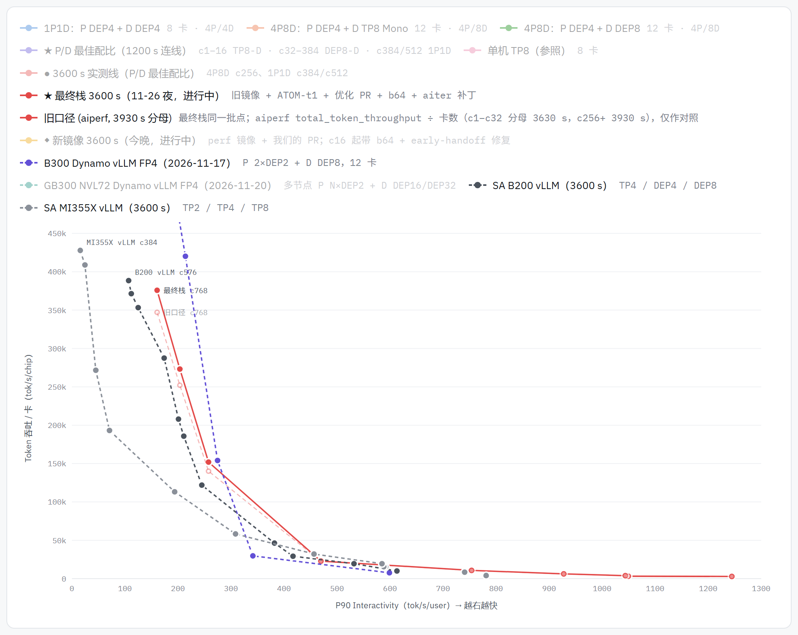

# DeepSeek V4.1-Flash P/D disaggregation on MI355X

**Naming.** `xPyD` counts instances, not GPUs: x prefill (P) instances and y
decode (D) instances. Each instance's shape and GPU count are written next to
it, for example "1P1D: P DEP4 (4 GPUs) + D DEP8 (8 GPUs), 12 GPUs" or
"2P2D: 2x P DEP4 + 2x D DEP8". Run labels inside the commands (such as
`4p8d_dep8`) and the chart's file name keep their original GPU-count names;
they are only labels.

This recipe covers two P/D deployments of DeepSeek-V4.1-Flash on MI355X:

- **1P1D on two nodes, 12 GPUs: the AgentX ladder c1-c768.** P DEP4 (4 GPUs) + D TP8 Mono (8 GPUs) at c1-c32, P DEP4 (4 GPUs) + D DEP8 (8 GPUs) at c256-c768. This is the main part below: the chart, the results, and for every point on the chart a complete, copyable launch configuration ([c1](#c1), [c2](#c2), [c4](#c4), [c8](#c8), [c16](#c16), [c32](#c32), [c256](#c256), [c512](#c512), [c768](#c768)).
- **1P1D on one node, 8 GPUs** (P DEP4 (4 GPUs) + D DEP4 (4 GPUs), TTFT-optimized for AgentX C256), in the appendix [Single-node 1P1D](#appendix-single-node-1p1d-ttft-optimized-agentx-c256).

## 1P1D AgentX ladder (c1-c768, 3600 s)



The red solid line is this ladder; every point on it is listed below and has
its own section with the full configuration. The reference curves (B300
Dynamo vLLM FP4, B200 and MI355X vLLM) are public InferenceX data. The faint
red dashed line is the same points on the earlier aiperf basis, kept for
comparison.

The deployment is one P instance (DEP4, 4 GPUs) on a P node and one D
instance (8 GPUs) on a D node, 12 MI355X GPUs in total, running
DeepSeek-V4.1-Flash-1017. All points used the same image, ATOM tree and aiter
files, the AgentX scenario, a 3600 s benchmark duration, 10 warm-up requests
per lane and seed 42.

- **x = 1000 / P90 ITL** (tokens/s per user, from aiperf's per-request ITL).
- **y = total tok/s / 12 GPUs**: sum of input + output tokens (server token
  counts) over the successful profiling records, divided by the wall-clock
  span of those records (earliest request start to latest request end), divided
  by all 12 GPUs, P included.

**y definition.** y = Σ(ISL+OSL) of successful profiling records ÷ their
wall-clock span ÷ GPUs (SemiAnalysis InferenceX formula,
`infx/results/agentic/request_metrics.py`). Earlier revisions used aiperf's
`total_token_throughput`, whose denominator includes the grace and
cancel-drain period, understating y by about 8% (3,930 s against a record span
of about 3,625 s at c256-c768; about 0.8% at c1-c32, whose aiperf window was
3,630 s). The span equals aiperf's own `benchmark_duration` on every point.
The same formula reproduces SemiAnalysis's published B300 c256 value:
(6,655,596,341 + 44,759,287) tokens ÷ 3,625.23 s ÷ 12 = 154,021 tok/s/GPU.
x is unchanged.

### Points

| Point | Topology (12 GPUs) | D shape | x | y | TTFT mean / P50 / P90 / P99 (ms) | ITL mean / P50 / P90 / P99 (ms) | Requests |
|---|---|---|---:|---:|---|---|---:|
| [c1](#c1) | P DEP4 + D TP8 Mono | `--max-num-seqs 1`, capture `[1]`, poll 4 | 1244.6 | 2,830 | 271 / 208 / 416 / 1,809 | 0.778 / 0.777 / 0.803 / 0.966 | 506 |
| [c2](#c2) | P DEP4 + D TP8 Mono | `--max-num-seqs 64`, Mono capture table, poll 16 | 1049.4 | 3,156 | 261 / 228 / 427 / 1,073 | 0.852 / 0.813 / 0.953 / 1.567 | 568 |
| [c4](#c4) | P DEP4 + D TP8 Mono | `--max-num-seqs 64`, Mono capture table, poll 16 | 1043.8 | 3,839 | 228 / 180 / 402 / 1,053 | 0.838 / 0.811 / 0.958 / 1.449 | 878 |
| [c8](#c8) | P DEP4 + D TP8 Mono | `--max-num-seqs 64`, Mono capture table, poll 16 | 927.6 | 6,189 | 196 / 159 / 341 / 684 | 0.888 / 0.827 / 1.078 / 1.371 | 1,516 |
| [c16](#c16) | P DEP4 + D TP8 Mono | `--max-num-seqs 64`, Mono capture table, poll 16 | 753.8 | 10,754 | 198 / 154 / 356 / 971 | 1.002 / 0.946 / 1.327 / 1.817 | 2,856 |
| [c32](#c32) | P DEP4 + D TP8 Mono | `--max-num-seqs 64`, Mono capture table, poll 16 | 469.6 | 22,831 | 291 / 195 / 401 / 1,296 | 1.433 / 1.252 / 2.130 / 3.474 | 5,226 |
| [c256](#c256) | P DEP4 + D DEP8 | MegaMoE, default DEP capture table, 1 API server | 257.7 | 151,919 | 407 / 323 / 666 / 1,942 | 3.696 / 3.713 / 3.880 / 4.443 | 43,463 |
| [c512](#c512) | P DEP4 + D DEP8 | MegaMoE, fine capture table, 4 API servers | 203.6 | 273,135 | 1,170 / 689 / 2,110 / 9,448 | 4.588 / 4.604 / 4.913 / 5.639 | 81,508 |
| [c768](#c768) | P DEP4 + D DEP8, **Store 1 TiB** | MegaMoE, fine capture table, 4 API servers | 160.7 | 375,861 | 2,707 / 1,870 / 5,885 / 14,434 | 5.667 / 5.759 / 6.222 / 6.564 | 114,129 |

Every point had 0 request errors and was not cancelled. Compiles inside the
measurement window (FlyDSL AOT / aiter JIT): 0 on P and D for c1, c2, c8 and
c256; P 3 (c4), P 8 (c16), D 4 (c32), D 1 (c512), P 1 (c768).

| Point | Total tok/s | Output tok/s | D batch / rank | Mean ISL | Mean OSL | Prefix-cache read |
|---|---:|---:|---:|---:|---:|---:|
| c1 | 33,960 | 219 | 1.00 | 239.8K | 1,557 | 98.6% |
| c2 | 37,877 | 244 | 1.03 | 238.7K | 1,549 | 98.1% |
| c4 | 46,067 | 312 | 1.06 | 187.8K | 1,284 | 97.7% |
| c8 | 74,269 | 493 | 1.22 | 175.1K | 1,171 | 98.2% |
| c16 | 129,047 | 819 | 1.42 | 161.6K | 1,032 | 98.1% |
| c32 | 273,976 | 1,587 | 2.25 | 187.8K | 1,094 | 97.9% |
| c256 | 1,823,027 | 12,199 | 5.67 | 151.0K | 1,017 | 97.0% |
| c512 | 3,277,621 | 23,403 | 13.42 | 144.8K | 1,041 | 96.5% |
| c768 | 4,510,333 | 32,298 | 22.60 | 142.4K | 1,027 | 96.7% |

Reference: public InferenceX data for B300 (Dynamo, 12 GPUs, c768) is
x 214 / y 420.2K; the c768 point here reaches 89% of that y at lower x (same y formula on both).

### Per-point configuration summary

Only these settings differ between points; everything else in the per-point
sections is identical.

| Point | P node / D node | Ports | Store | D `-tp` | D `--max-num-seqs` | D capture sizes | D MoE backend | D API servers | D `ATOM_MONO_POLL_SLEEP_UNITS` | P GPU selection |
|---|---|---|---:|---|---:|---|---|---:|---:|---|
| c1 | g41 / g12 | base 30400 | 256 GiB | 8 (TP, Mono) | 1 | `[1]` | standard | 1 | 4 | `HIP_VISIBLE_DEVICES=0,1,2,3` |
| c2, c4, c8, c16, c32 | g41 / g12 | base 30400 | 256 GiB | 8 (TP, Mono) | 64 | Mono table (1-64) | standard | 1 | 16 | `HIP_VISIBLE_DEVICES=0,1,2,3` |
| c256 | g15 / g20 | base 30400 | 256 GiB | 8 (DEP8) | 128 | default DEP table (1-128) | mega | 1 | - | `HIP_VISIBLE_DEVICES=0,1,2,3` |
| c512 | g41 / g12 | base 31400 | 256 GiB | 8 (DEP8) | 128 | fine table (1-48 step 1, then 56-128) | mega | 4 | - | `HIP_VISIBLE_DEVICES=0,1,2,3` |
| c768 | g41 / g20 | base 31400 | **1024 GiB** | 8 (DEP8) | 128 | fine table | mega | 4 | - | `ROCR_VISIBLE_DEVICES` by UUID (diagnostic) |

All points: EPLB off on P and D (no `--enable-eplb`); DSpark 5 with forced
acceptance `--spec-decode-acceptance-length 3.51` on P and D; FP8 KV, FP4
index, block size 16; P with MegaMoE, `--max-num-batched-tokens 16384`, chunk
16384, long-prefill threshold 8192, early handoff
(`ATOM_PD_EARLY_HANDOFF=1`), `ATOM_OFFLOAD_PRESTART_LOAD_WAIT_MS=20` and
`ATOM_DP_IDLE_WHEN_BLOCKED=1` (these three set explicitly because the
measured tree had them off by default; see
[PRs used and how to configure them](#prs-used-and-how-to-configure-them));
prefill delayer off on P and D; base64 prompt token ids
(`ATOM_PROMPT_IDS_B64=1` on P and D, the default on main since #3854 was
merged; ingress with `ATOM_FRONT_IDS_B64=1`); D `--max-num-batched-tokens 1024`; P and D each
with a single API server except the D at c512 and c768. Prefix caching is on
by default (`enable_prefix_caching: True` in the logged engine arguments; no
flag was passed).

### PRs used and how to configure them

The ladder was measured on a frozen ATOM tree, `de7d8ec1c` (see
[Software stack](#software-stack-identical-on-p-and-d-every-point)). Several
of the PRs in it have been merged or revised since. For each P/D PR the
table gives two settings: the one used when the ladder was measured, and the
one to use on main today. "Side" says where the setting goes: P (the prefill
server), D (the decode server), router (atomesh) or ingress (the encoding
ingress in front of the router). PR states are as of 2026-11-27.

| PR | What it does | State | Side | As measured (tree `de7d8ec1c`) | How to configure now | Points that used it | Notes |
|---|---|---|---|---|---|---|---|
| [#3772](https://github.com/ROCm/ATOM/pull/3772) | Store load wait: the first forward waits for a Mooncake Store load that is already in flight, instead of recomputing the prefix | open | P | Old fixed-wait version: `ATOM_OFFLOAD_PRESTART_LOAD_WAIT_MS=20`. Its default was 0 (off), so the variable was set explicitly. | Not on main yet. On the current PR head: `ATOM_OFFLOAD_LOAD_EVENT_WAIT`, on by default (`0` turns it off), so set nothing. The PR head removes `ATOM_OFFLOAD_PRESTART_LOAD_WAIT_MS`, so drop that variable. | all (c1-c768) | The wait is now event-driven: the load-completion doorbell wakes it, and the measured forward time bounds it. There is no fixed timeout. It does nothing without a Store tier. Measured at 1P1D c256: TTFT mean -20.2%, throughput +0.55%. |
| [#3773](https://github.com/ROCm/ATOM/pull/3773) | Early handoff: P answers the router at DP dispatch, so D allocates pages and pulls KV while P is still computing | open | P | `ATOM_PD_EARLY_HANDOFF=1`. Its default was 0, so the variable was set explicitly. | Not on main yet. On the current PR head it is on by default (`1`). Set `ATOM_PD_EARLY_HANDOFF=0` explicitly wherever it should be off. | all (c1-c768) | The ladder ran an older revision of this PR, with one P instance at every point. That revision had two problems. First, if a P step stalled for more than 60 s, an early request could leak a state slot, and a rank that had leaked `--max-num-seqs` slots admitted no more requests; runs at c1024 and above therefore used `0`, and they are not part of this ladder. Second, P's early answer ended the router's load charge for P, so with several P instances the router did not see the prefills still running on each P. The current PR head fixes both: (1) the leak fix is in the PR: the scheduler aborts a retired early source, and the worker releases its blocks and state slot; (2) the router keeps P's load guard, prefill tokens included, until P reports the prefill's end (line 2 of its answer), so the choice between several P instances sees each P's in-flight prefills. Early handoff is also negotiated per (P, D) pair, and a pair that cannot do it keeps the legacy relay. These fixes have CPU and router tests; the current head has not been run at c1024 and above, or with several P instances, in this recipe. |
| [#3777](https://github.com/ROCm/ATOM/pull/3777) | Idle when blocked: a DP rank whose only work is blocked (Store lookup or load, KV send) idles instead of forcing dummy forwards | merged 2026-11-27 | P | `ATOM_DP_IDLE_WHEN_BLOCKED=1`. The pre-merge default was 0, so the variable was set explicitly. | Set nothing. On main, leaving it unset turns it on for a P/D prefill (`kv_producer`) and off elsewhere. An explicit `0` or `1` applies to any role. | all (c1-c768) | Needs `ATOM_ENABLE_PREFILL_DELAYER=0`, because the prefill delayer turns this setting off. |
| [#3854](https://github.com/ROCm/ATOM/pull/3854) | Base64 prompt ids: the prompt token ids are sent as base64-packed uint32, which cuts D's ingest cost | merged 2026-11-26 | P, D, ingress | `ATOM_PROMPT_IDS_B64=1` on P and D (pre-merge default 0; merged into the tree by hand with two conflicts). Ingress: `ATOM_FRONT_IDS_B64=1 ATOM_FRONT_SPLICE_BODY=1`. | P and D: set nothing, since `ATOM_PROMPT_IDS_B64` is on (`1`) by default on main. Ingress: keep `ATOM_FRONT_IDS_B64=1 ATOM_FRONT_SPLICE_BODY=1`. | all (c1-c768) | The two `ATOM_FRONT_*` variables belong to the external ingress, not to ATOM. Without them the ingress sends JSON ids, which still work. |
| [#3873](https://github.com/ROCm/ATOM/pull/3873) | Late KV params on D: D accepts the chat request first and P's `kv_transfer_params` afterwards, on `/v1/pd/late_kv/chat/completions` | merged 2026-11-26 | D | Not in the tree and not used. | `ATOM_PD_LATE_KV=1` on D. The default is `0`, under which the route answers 404. | none | Use together with #3874. |
| [#3874](https://github.com/ROCm/ATOM/pull/3874) | Concurrent dispatch: atomesh sends the decode leg while prefill runs, instead of after it | merged 2026-11-26 | router | Not used: the ladder's frozen router relays serially. | `--atom-pd-concurrent` on the atomesh router, with `--backend atom`. Off by default. | none | Needs D with `ATOM_PD_LATE_KV=1`. A D that answers 404 gets the serial relay's request instead, and the router logs this once. Measured: D receives the request 4-11 ms earlier, with no end-to-end change. |

Our other PRs that the ladder configures were merged before the measurement
and are part of the tree's base:

| PR | What it does | Side | As measured | How to configure now |
|---|---|---|---|---|
| [#3097](https://github.com/ROCm/ATOM/pull/3097) (merged) | Shared Mooncake Store: `share_cache` DP routing and early tier load | P | `--dp-load-balance share_cache`, Store as `ATOM_KV_OFFLOAD=mooncake_store` | Unchanged. The default DP routing is `least_requests`, so pass `share_cache` explicitly. |
| [#3350](https://github.com/ROCm/ATOM/pull/3350) (merged) | Mono mailbox polling backoff | D (Mono, c1-c32) | `ATOM_MONO_POLL_SLEEP_UNITS=4` at c1, `16` at c2-c32 | Unchanged. When unset, the value is 4, or 16 next to a KV transfer or offload connector. c1 sets 4 explicitly. |

Also in the tree, with nothing to configure: P/D support for V4.1 (#2666),
prefix-spread routing (#2755), delayed P/D completion reporting (#3105), and
the Store restore fixes (#3217, #3323, #3324), all merged. The Store opt-ins
#3475 (`ATOM_STORE_SAVE_BATCH_CHUNKS`) and #3533 (`ATOM_STORE_ASYNC_RENEW`) are
merged but were not set. The tree's top commit is a P/D endpoint-recovery
patch that was not enabled (`ATOM_PD_ENDPOINT_RECOVERY` unset); it has no PR.
#3781 (open) is not in the tree.

Other authors' PRs in the measured tree need no P/D-specific setting beyond
the commands in each point's section:
- MegaMoE route selection [#3187](https://github.com/ROCm/ATOM/pull/3187): T1 version, merged 2026-11-25, enabled with `--moe-backend mega`.
- Merged: #3738, #3842 (net diff), #3186 (EPLB is off in the ladder), #3437 and #2877.
- Open: #3838, #3839, #3840, #3647, #2903, #3639 and #3748.

The combination that was measured is the reproduction branch
`lirzhang/agentx-v41-recipe-de7d8ec1c`. PRs merged since then may differ
from their versions in that branch.

### High-concurrency notes (c768 and above)

These come from runs at and beyond the top of the ladder. Except where stated,
they were not part of the measured points.

- **`MC_TRANSFER_TIMEOUT=300` on P and D.** Mooncake's sync-write timeout is
  30 s when unset; raise it for c768 and above. The ladder points did not
  set it.
- **Store placement.** Keep each Store owner at 1024 GiB or less per node,
  and do not put it on a node that runs P or D. On one NIC, the Store's
  registration plus the KV registrations of several ranks above about 2 TiB
  fails with `EINVAL`, which surfaces as empty responses. As measured, the
  c768 point ran a 1 TiB Store on the P node without a failure; that is the
  only co-located 1 TiB data point.
- **Pre-warm every rail before the window.** The first transfer on a new
  P-rank x D-rank rail takes 35-60 s to set up, while P's lookup times out at
  60 s (`PREFILL_LOOKUP_TIMEOUT`). Before timing, drive enough traffic that
  every P rank has transferred to every D rank.
- **Early handoff.** The measured revision of #3773 was run only up to c768;
  c1024 and above used `ATOM_PD_EARLY_HANDOFF=0` because of a state-slot leak
  that the current PR head fixes (see #3773 above). On the current PR head it
  is on by default; `0` on P turns it off.

### Software stack (identical on P and D, every point)

- **Image**: `rocm/atom-dev:agentx-v41-mega-p2-t1-20261124@sha256:dfab939840610124989d4864fbf7e3e0c5a786ab16c25acfa41c74e939d25d37`.
- **ATOM**: bind-mounted at `/app/ATOM` on P and D (`$ATOM_TREE` below). The
  tree is `lirzhang/agentx-v41-curves-20261124` @ `5fcdbb6ee` (MegaMoE #3187
  T1 version, #3772 prestart load wait, #3773 early handoff, T1
  idle-when-blocked) with 22 commits stacked on top (local tree
  `de7d8ec1c`): ATOM #3738, #3842 (net diff), #3838, #3839, #3840, #3647,
  #3186, #2903, #3437, #3639, #3748, #2877, #3854 (base64 prompt ids, two
  conflicts resolved by hand), and the P/D endpoint-recovery patch (not
  enabled: `ATOM_PD_ENDPOINT_RECOVERY` unset). #3164 and #3645 were not
  included. **To reproduce**, check out the ROCm/ATOM branch
  [`lirzhang/agentx-v41-recipe-de7d8ec1c`](https://github.com/ROCm/ATOM/tree/lirzhang/agentx-v41-recipe-de7d8ec1c)
  (head `de7d8ec1c`), which is exactly this tree, and use it as
  `$ATOM_TREE`. How each P/D PR is configured, then and on current main, is
  in [PRs used and how to configure them](#prs-used-and-how-to-configure-them).
- **aiter**: the image's aiter `7ecd46b07` plus ROCm/aiter #8547, #8636,
  #8171 and #8633, bind-mounted file by file over `/app/aiter-test` (the
  image's prebuilt `.so` modules are kept). The ten files are listed in every
  P and D command (`$AITER_FILES/...`).
- **c768 only**: a two-file local patch for UUID-based GPU selection, used
  for a diagnostic run; see [c768](#c768).
- **Router, encoding ingress and AgentX client**: an atomesh router binary, an
  exact-tokenizer encoding ingress and an aiperf client image. None of them
  ships with ATOM. The ingress applies the exact V4.1 tokenizer and chat
  encoding, preserves streaming, tool payloads, request IDs and cancellation,
  and forwards base64 token ids. If you substitute your own, validate that its
  encoding is equivalent. The aiperf version inside the client image was not
  recorded.

### Setup (once per node pair)

Variables and port constants used by every command below. Every service on a
node listens on a port below 32768 (ephemeral ports start at 32768 and
Mooncake opens random local ports there). c512 and c768 were measured with
every port 1000 higher (base 31400); the commands use the constants below.

```bash
# Hosts (IP addresses the services bind to)
P_HOST=<P node IP>     # P, Mooncake Store, router, ingress and AgentX client
D_HOST=<D node IP>     # D
# Images
ATOM_IMAGE=rocm/atom-dev:agentx-v41-mega-p2-t1-20261124@sha256:dfab939840610124989d4864fbf7e3e0c5a786ab16c25acfa41c74e939d25d37
ROUTER_IMAGE=<atomesh router image>
INGRESS_IMAGE=<encoding ingress image>
AIPERF_IMAGE=<AgentX aiperf client image>
# Model: path inside every container, and the host directories mounted there.
MODEL=/models/deepseek-ai/DeepSeek-V4.1-Flash-1017
MODEL_VIEW=<host dir with the checkpoint's config and tokenizer files; its weight files link into /model-weights>
MODEL_WEIGHTS=<host dir with the DeepSeek-V4.1-Flash-1017 safetensors>
TOKENIZER_VIEW=<host dir with the same checkpoint's config and tokenizer files, for router and ingress>
# Source trees and caches (same paths on both nodes)
ATOM_TREE=<ATOM checkout of branch lirzhang/agentx-v41-recipe-de7d8ec1c (de7d8ec1c), see Software stack>
AITER_FILES=<aiter checkout at 7ecd46b07 + aiter #8547 #8636 #8171 #8633>
DIAG_PATCH=<dir with the two diagnostic files, c768 only>
CACHE=<persistent cache dir: aiter-jit, atom, mori>
STORE_DIR=<P node dir for the Mooncake Store side files>
SCRIPTS=<P node dir with gate.py and prewarm.py>
ATOMESH_BIN=<atomesh binary>
INGRESS_SRC=<ingress source dir with the base64 prompt-id build>
INGRESS_WORKSPACE=<tokenizer source dir>
INGRESS_DEPS=<ingress python deps>
INGRESS_INDUCTOR=<ingress inductor cache>
FASTOKENS_DEPS=<fast tokenizer deps>
CLIENT_CACHE=<aiperf cache dir>
CLIENT_HF=<Hugging Face cache with the AgentX dataset>
OUT=<aiperf output dir>
# Ports (base 30400)
P_PORT=30400 P_DP_MASTER_PORT=30402 P_DP_BASE_PORT=30410 P_HS_PORT=30420
D_PORT=30500 D_DP_MASTER_PORT=30502 D_DP_BASE_PORT=30510 D_HS_PORT=30520
ROUTER_PORT=30430 ROUTER_PROM_PORT=30431 INGRESS_PORT=30440
STORE_MASTER_PORT=30470 STORE_META_PORT=30471 STORE_METRICS_PORT=30472
```

In the measured runs `$MODEL_VIEW` was a metadata directory whose weight
files point into `/model-weights`. With a plain checkpoint directory, mount
it at `$MODEL` and drop the `/model-weights` mount. The RDMA library mounts
(`libibverbs`, `libionic`), `MC_GID_INDEX=1` and
`MOONCAKE_DISABLE_HIP_DMABUF=1` match the measured AMD Pensando (ionic)
fabric; adjust them to your NIC and driver.

Seed the persistent caches on both nodes once. The aiter JIT directory starts
as a copy of the image's, so its `.so` files match:

```bash
mkdir -p $CACHE/atom $CACHE/mori $CACHE/aiter-jit
docker run --rm --entrypoint bash -v $CACHE/aiter-jit:/seed $ATOM_IMAGE \
  -c "cp -a /app/aiter-test/aiter/jit/. /seed/"
```

The caches were kept across points, so every point started with the kernels
earlier runs on that node had compiled.

Mooncake Store side files (P node). The owner mounts the capacity as 1 GiB
segments on NIC `rdma7` (a NIC P's requesters do not use), backed by
transparent huge pages collapsed by a small preload library, and checks a
put/get round-trip before it writes `ready.json`. Each point fills in the
placeholders (IP, ports, NIC, capacity) with `sed`.

```bash
mkdir -p $STORE_DIR/tpl
cat > $STORE_DIR/tpl/master.py <<'EOF'
import subprocess,signal,threading,pathlib
r=pathlib.Path('/side'); stop=threading.Event(); signal.signal(signal.SIGTERM,lambda *_:stop.set()); signal.signal(signal.SIGINT,lambda *_:stop.set())
f=(r/'master.log').open('w'); p=subprocess.Popen(['mooncake_master','--rpc_address=OWNER_IP','--rpc_port=MPORT','--enable_http_metadata_server=true','--http_metadata_server_host=OWNER_IP','--http_metadata_server_port=HPORT','--metrics_port=XPORT'],stdout=f,stderr=subprocess.STDOUT)
try:
 while not stop.wait(2):
  if p.poll() is not None: raise RuntimeError('master exited '+str(p.returncode))
finally:p.terminate();p.wait(timeout=20)
EOF
cat > $STORE_DIR/tpl/owner.py <<'EOF'
import json,pathlib,signal,threading,time,hashlib,os
from mooncake.store import MooncakeDistributedStore
r=pathlib.Path('/side');stop=threading.Event();signal.signal(signal.SIGTERM,lambda *_:stop.set());signal.signal(signal.SIGINT,lambda *_:stop.set());s=MooncakeDistributedStore(); allocated=0
try:
 assert s.setup('OWNER_IP','http://OWNER_IP:HPORT/metadata',0,16*1024**2,'PROTO','OWNER_NIC','OWNER_IP:MPORT')==0
 for i in range(CAPACITY_GIB):
  if stop.is_set():raise RuntimeError('stopped allocation')
  result=s.allocate_and_mount_segment(1024**3,'PROTO','OWNER_NIC');assert result['ret']==0 and result['allocated_size']==1024**3,result
  allocated+=1;(r/'progress.json').write_text(json.dumps({'allocated_gib':allocated,'target_gib':CAPACITY_GIB,'owner':'OWNER_HOST','utc':time.time()}))
 payload=b'LC-STORE-'+b'OWNER_HOST'+bytes(range(256))*16384;key='native-readiness-OWNER_HOST-lc';assert s.put(key,payload)==0;got=s.get(key);assert got==payload
 (r/'ready.json').write_text(json.dumps({'allocated_gib':allocated,'cpu_roundtrip':True,'sha256':hashlib.sha256(got).hexdigest(),'pid':os.getpid(),'master':'OWNER_IP:MPORT','owner':'OWNER_HOST','device':'OWNER_NIC'}))
 while not stop.wait(10):assert s.get(key)==payload
finally:(r/'ready.json').unlink(missing_ok=True);s.close()
EOF
cat > $STORE_DIR/tpl/store_collapse.c <<'EOF'
#define _GNU_SOURCE
#include <dlfcn.h>
#include <sys/mman.h>
#include <stdlib.h>
#include <string.h>
#include <stdio.h>
#include <errno.h>
#include <unistd.h>
#ifndef MADV_COLLAPSE
#define MADV_COLLAPSE 25
#endif
void *aligned_alloc(size_t alignment, size_t size) {
    void *(*allocate)(size_t,size_t)=dlsym(RTLD_NEXT,"aligned_alloc");
    if (!allocate) abort();
    void *p=allocate(alignment,size);
    if (p && alignment>=2097152 && size>=1073741824 && size%2097152==0) {
        if (madvise(p,size,MADV_HUGEPAGE)) {free(p);return NULL;}
        memset(p,0,size);
        int rc=madvise(p,size,MADV_COLLAPSE);
        int saved_errno=errno;
        if (rc) {
            rc=0;
            for (size_t offset=0; offset<size; offset+=2097152) {
                int page_rc=-1;
                for (int attempt=0; attempt<5; ++attempt) {
                    page_rc=madvise((char*)p+offset,2097152,MADV_COLLAPSE);
                    if (!page_rc) break;
                    saved_errno=errno;
                    usleep(100000);
                }
                if (page_rc) {rc=-1;break;}
            }
        }
        fprintf(stderr,"STORE_COLLAPSE bytes=%zu result=%d errno=%d\n",size,rc,rc?saved_errno:0);
        if (rc) {free(p);return NULL;}
    }
    return p;
}
EOF
cat > $STORE_DIR/tpl/boot.py <<'EOF'
import subprocess,os
subprocess.run(['gcc','-shared','-fPIC','-O2','/side/store_collapse.c','-ldl','-o','/side/store_collapse.so'],check=True)
os.environ['LD_PRELOAD']='/side/store_collapse.so';os.execvp('python3',['python3','-u','/side/owner.py'])
EOF
```

Warm-up scripts (P node). `gate.py` is the startup gate: 32 parallel then 8
serial chat requests through the ingress (about 3K tokens, `max_tokens` 8),
which also registers every P->D rail. `prewarm.py` drives fresh prefixes of
300 to 250,000 tokens and cached-prefix continuations through the ingress so
that P compiles its prefill shapes before the window.

```bash
mkdir -p $SCRIPTS
cat > $SCRIPTS/gate.py <<'EOF'
# usage: gate.py INGRESS_URL SEG
import concurrent.futures, json, sys, time, urllib.request, uuid
F, SEG = sys.argv[1], sys.argv[2]; M = '/models/deepseek-ai/DeepSeek-V4.1-Flash-1017'
def call(i):
    body = {'model': M, 'messages': [{'role': 'user', 'content': 'LC startup probe %d %s ' % (i, SEG) + ('cache probe sentence. ' * 512)}],
            'max_tokens': 8, 'ignore_eos': True, 'temperature': 1, 'stream': False}
    req = urllib.request.Request(F + '/v1/chat/completions', data=json.dumps(body).encode(),
                                 headers={'Content-Type': 'application/json', 'X-Request-ID': 'lc-gate-%s-%d-%s' % (SEG, i, uuid.uuid4().hex[:6])})
    t = time.monotonic()
    try:
        with urllib.request.urlopen(req, timeout=900) as q: return q.status, round(time.monotonic() - t, 2)
    except Exception as e: return repr(e)[:300], round(time.monotonic() - t, 2)
with concurrent.futures.ThreadPoolExecutor(32) as p: b = list(p.map(call, range(8, 40)))
with concurrent.futures.ThreadPoolExecutor(1) as p: a = list(p.map(call, range(8)))
ok = all(s == 200 for s, _ in a + b); print('gate', ok, [t for _, t in a]); sys.exit(0 if ok else 1)
EOF
cat > $SCRIPTS/prewarm.py <<'EOF'
# usage: prewarm.py INGRESS_URL
import json,sys,time,uuid,concurrent.futures,urllib.request
F=sys.argv[1]; M='/models/deepseek-ai/DeepSeek-V4.1-Flash-1017'; S='cache probe sentence. '
def call(text,mt=8):
    body={'model':M,'messages':[{'role':'user','content':text}],'max_tokens':mt,'ignore_eos':True,'temperature':1,'stream':False}
    req=urllib.request.Request(F+'/v1/chat/completions',data=json.dumps(body).encode(),headers={'Content-Type':'application/json','X-Request-ID':'prewarm-'+uuid.uuid4().hex[:8]})
    t=time.time()
    try:
        with urllib.request.urlopen(req,timeout=900) as q: r=json.loads(q.read()); return r['usage']['prompt_tokens'],time.time()-t,None
    except Exception as e: return 0,time.time()-t,repr(e)[:120]
n0,_,e=call('prewarm calib %s '%uuid.uuid4().hex+S*200); tps=max(n0/200.0,1.0) if n0 else 4.0
print('tokens per sentence %.2f (err %s)'%(tps,e),flush=True)
targets=[300,700,1500,2500,4096,6000,8192,10000,12288,16384,20000,24576,32768,49152,65536,98304,131072,180000,250000]
base={}
def mk(t):
    salt='prewarm %s '%uuid.uuid4().hex; base[t]=salt+S*int(t/tps); return base[t]
jobs=[mk(t) for t in targets for _ in range(2)]
with concurrent.futures.ThreadPoolExecutor(8) as p: res=list(p.map(call,jobs))
print('round1 fresh prefixes: n=%d errors=%d max_s=%.1f'%(len(res),sum(1 for r in res if r[2]),max(r[1] for r in res)),flush=True)
cont=[base[t]+S*int(x/tps) for t in (2500,8192,16384,49152,131072,250000) for x in (300,1200,3000)]
with concurrent.futures.ThreadPoolExecutor(8) as p: res2=list(p.map(call,cont))
print('round2 continuations: n=%d errors=%d max_s=%.1f'%(len(res2),sum(1 for r in res2 if r[2]),max(r[1] for r in res2)),flush=True)
sys.exit(1 if any(r[2] for r in res+res2) else 0)
EOF
```

The AgentX client ran in `$AIPERF_IMAGE` with `--network=host` on the P
node. Its wrapper also loaded an internal replay-asset hook
(`ATOM_NATIVE_REPLAY_FIXED_BID=0e58de821439`,
`ATOM_NATIVE_REPLAY_ASSET_DIR=<output dir>/replay-assets`) and polled each
server's `/metrics` every 10 s. The hook's source is not part of this recipe;
the aiperf command and its environment are given in full for every point.

Per point, the order is: Store, then P (wait for its four
`Mooncake KV registration complete` lines), then D (wait for both
`/health`), then router and ingress, then the warm-up, then the client.

### c1

**Result.** x = 1244.6 tok/s/user, y = 2,830 tok/s/GPU (total 33,960 tok/s over 12 GPUs, output 219 tok/s; span of the records 3,595.7 s). TTFT mean / P50 / P90 / P99 = 271 / 208 / 416 / 1,809 ms. ITL mean / P50 / P90 / P99 = 0.778 / 0.777 / 0.803 / 0.966 ms. 506 requests, 0 errors. Window 2026-11-25 22:29:09 - 23:29:39 UTC (3,630 s). Compiles inside the window: P 0, D 0. D batch per rank 1.00.

**Nodes and GPUs.** P node `g41`: P (DEP4) on GPUs 0-3, plus the Mooncake Store, router, ingress and AgentX client. D node `g12`: D (TP8 Mono, `--max-num-seqs 1`, poll 4, 1 API server) on GPUs 0-7. Mooncake Store 256 GiB. 12 GPUs. Ports as defined above (base 30400). Driver segment name: `4p8d_tp8s1-poll4`.

**Mooncake Store.**

```bash
# On the P node. Owner NIC rdma7, capacity 256 GiB.
for m in master owner; do
  mkdir -p $STORE_DIR/$m
  for f in master.py owner.py store_collapse.c boot.py; do
    sed -e "s/OWNER_NIC/rdma7/g; s/OWNER_IP/$P_HOST/g; s/OWNER_HOST/p-node/g; s/CAPACITY_GIB/256/g" \
        -e "s/PROTO/rdma/g; s/HPORT/$STORE_META_PORT/g; s/MPORT/$STORE_MASTER_PORT/g; s/XPORT/$STORE_METRICS_PORT/g" \
        $STORE_DIR/tpl/$f > $STORE_DIR/$m/$f
  done
done

docker run -d --name store-master --network=host --ipc=host --ulimit memlock=-1 \
  --ulimit nofile=65536:524288 --cap-add=IPC_LOCK --security-opt=seccomp=unconfined \
  --device /dev/infiniband -v /etc/libibverbs.d:/etc/libibverbs.d:ro \
  -v /usr/lib/x86_64-linux-gnu/libibverbs.so.1.14.39.0:/usr/lib/x86_64-linux-gnu/libibverbs.so.1:ro \
  -v /usr/lib/x86_64-linux-gnu/libionic.so.1.1.54.0-187:/usr/lib/x86_64-linux-gnu/libibverbs/libionic-rdmav34.so:ro \
  -v /usr/lib/x86_64-linux-gnu/libionic.so.1.1.54.0-187:/usr/lib/x86_64-linux-gnu/libionic.so.1.1.54.0-187:ro \
  -v $STORE_DIR/master:/side \
  -e PYTHONUNBUFFERED=1 -e MC_GID_INDEX=1 -e MC_DISABLE_HIP=1 -e MC_NUM_QP_PER_EP=1 \
  -e MC_MAX_MR_SIZE=1073741824 -e MC_ENABLE_PARALLEL_REG_MR=0 -e MC_MAX_CONCURRENT_REG_MR=1 \
  -e MOONCAKE_DISABLE_HIP_DMABUF=1 \
  --entrypoint python3 $ATOM_IMAGE -u /side/master.py
sleep 6
docker run -d --name store-owner --network=host --ipc=host --ulimit memlock=-1 \
  --ulimit nofile=65536:524288 --cap-add=IPC_LOCK --security-opt=seccomp=unconfined \
  --device /dev/infiniband -v /etc/libibverbs.d:/etc/libibverbs.d:ro \
  -v /usr/lib/x86_64-linux-gnu/libibverbs.so.1.14.39.0:/usr/lib/x86_64-linux-gnu/libibverbs.so.1:ro \
  -v /usr/lib/x86_64-linux-gnu/libionic.so.1.1.54.0-187:/usr/lib/x86_64-linux-gnu/libibverbs/libionic-rdmav34.so:ro \
  -v /usr/lib/x86_64-linux-gnu/libionic.so.1.1.54.0-187:/usr/lib/x86_64-linux-gnu/libionic.so.1.1.54.0-187:ro \
  -v $STORE_DIR/owner:/side \
  -e PYTHONUNBUFFERED=1 -e MC_GID_INDEX=1 -e MC_DISABLE_HIP=1 -e MC_NUM_QP_PER_EP=1 \
  -e MC_MAX_MR_SIZE=1073741824 -e MC_ENABLE_PARALLEL_REG_MR=0 -e MC_MAX_CONCURRENT_REG_MR=1 \
  -e MOONCAKE_DISABLE_HIP_DMABUF=1 \
  --entrypoint python3 $ATOM_IMAGE -u /side/boot.py
# Wait until all 256 x 1 GiB segments are mounted and the put/get check passed.
until [ -f $STORE_DIR/owner/ready.json ]; do sleep 5; done; cat $STORE_DIR/owner/ready.json
```

**P (P node).** Start after the Store is ready, then wait for the four KV registrations.

```bash
docker run -d --name atom-P --network=host --ipc=host --ulimit memlock=-1 \
  --ulimit nofile=65536:524288 --cap-add=IPC_LOCK --security-opt=seccomp=unconfined \
  --device /dev/kfd --device /dev/dri --group-add video --group-add render \
  --device /dev/infiniband -v /etc/libibverbs.d:/etc/libibverbs.d:ro \
  -v /usr/lib/x86_64-linux-gnu/libibverbs.so.1.14.39.0:/usr/lib/x86_64-linux-gnu/libibverbs.so.1:ro \
  -v /usr/lib/x86_64-linux-gnu/libionic.so.1.1.54.0-187:/usr/lib/x86_64-linux-gnu/libibverbs/libionic-rdmav34.so:ro \
  -v /usr/lib/x86_64-linux-gnu/libionic.so.1.1.54.0-187:/usr/lib/x86_64-linux-gnu/libionic.so.1.1.54.0-187:ro \
  -v $MODEL_VIEW:$MODEL:ro -v $MODEL_WEIGHTS:/model-weights:ro \
  -v $ATOM_TREE:/app/ATOM \
  -v $CACHE/aiter-jit:/app/aiter-test/aiter/jit -v $CACHE/atom:/root/.cache/atom -v $CACHE/mori:/root/.mori \
  -v $AITER_FILES/aiter/configs/model_configs/dsv41_a8w8_blockscale_mxscale_bpreshuffle_tuned_gemm.csv:/app/aiter-test/aiter/configs/model_configs/dsv41_a8w8_blockscale_mxscale_bpreshuffle_tuned_gemm.csv:ro \
  -v $AITER_FILES/aiter/ops/flydsl/kernels/bmm_a8w8_mxscale_gfx950.py:/app/aiter-test/aiter/ops/flydsl/kernels/bmm_a8w8_mxscale_gfx950.py:ro \
  -v $AITER_FILES/aiter/ops/flydsl/kernels/communication_ops_utils.py:/app/aiter-test/aiter/ops/flydsl/kernels/communication_ops_utils.py:ro \
  -v $AITER_FILES/aiter/ops/flydsl/kernels/mega_moe/gemm1.py:/app/aiter-test/aiter/ops/flydsl/kernels/mega_moe/gemm1.py:ro \
  -v $AITER_FILES/aiter/ops/flydsl/kernels/mega_moe/gemm_util.py:/app/aiter-test/aiter/ops/flydsl/kernels/mega_moe/gemm_util.py:ro \
  -v $AITER_FILES/aiter/ops/flydsl/kernels/mega_moe/mega_moe_config.py:/app/aiter-test/aiter/ops/flydsl/kernels/mega_moe/mega_moe_config.py:ro \
  -v $AITER_FILES/aiter/ops/flydsl/kernels/mega_moe/mega_moe_large_m.py:/app/aiter-test/aiter/ops/flydsl/kernels/mega_moe/mega_moe_large_m.py:ro \
  -v $AITER_FILES/aiter/ops/flydsl/kernels/mega_moe/mega_moe_small_m.py:/app/aiter-test/aiter/ops/flydsl/kernels/mega_moe/mega_moe_small_m.py:ro \
  -v $AITER_FILES/aiter/ops/gemm_op_a8w8.py:/app/aiter-test/aiter/ops/gemm_op_a8w8.py:ro \
  -v $AITER_FILES/aiter/ops/mhc.py:/app/aiter-test/aiter/ops/mhc.py:ro \
  -e MC_GID_INDEX=1 -e MC_DISABLE_HIP=1 -e MOONCAKE_DISABLE_HIP_DMABUF=1 \
  -e ATOM_MOONCAKE_MATCHED_RAILS=auto -e HSA_ENABLE_IPC_MODE_LEGACY=1 -e NCCL_IB_DISABLE=0 \
  -e ATOM_DISABLE_MMAP=true -e ATOM_MONO_ENABLE=1 -e ATOM_DSV41_MOE_FP8_ACTIVATIONS=0 \
  -e ATOM_DSPARK_DISABLE_COMPILE=1 -e ATOM_USE_CUSTOM_ALL_GATHER=0 -e ATOM_FRONTEND_PREFIX_HASH=1 \
  -e ATOM_DP_SESSION_AFFINITY=0 -e MORI_SHMEM_HEAP_SIZE=17179869184 -e PYTHONUNBUFFERED=1 \
  -e TRITON_CACHE_DIR=/root/.cache/atom/triton -e NCCL_DEBUG=WARN -e OFFLOAD_LOAD_WORKERS=1 \
  -e ATOM_OFFLOAD_PRESTART_LOAD_WAIT_MS=20 -e ATOM_PD_EARLY_HANDOFF=1 -e ATOM_ENABLE_PREFILL_DELAYER=0 \
  -e ATOM_DP_IDLE_WHEN_BLOCKED=1 -e ATOM_KV_OFFLOAD=mooncake_store \
  -e ATOM_KV_OFFLOAD_EXTRA_CONFIG="{\"mooncake_store.local_hostname\":\"$P_HOST\",\"mooncake_store.protocol\":\"rdma\",\"mooncake_store.master\":\"$P_HOST:$STORE_MASTER_PORT\",\"mooncake_store.metadata\":\"http://$P_HOST:$STORE_META_PORT/metadata\",\"mooncake_store.owner_rdma_devices\":\"rdma7\"}" \
  -e MC_NUM_QP_PER_EP=1 -e MC_MAX_MR_SIZE=1073741824 -e MC_TCP_BIND_ADDRESS=$P_HOST \
  -e ATOM_PROMPT_IDS_B64=1 -e HIP_VISIBLE_DEVICES=0,1,2,3 -e ATOM_HOST_IP=$P_HOST \
  -e ATOM_DP_MASTER_PORT=$P_DP_MASTER_PORT -e ATOM_DP_BASE_PORT=$P_DP_BASE_PORT \
  $ATOM_IMAGE python3 -m atom.entrypoints.openai_server \
  --model $MODEL --host 0.0.0.0 --trust-remote-code --kv_cache_dtype fp8 --block-size 16 \
  --gpu-memory-utilization 0.9 --max-num-batched-tokens 16384 \
  --method dspark --num-speculative-tokens 5 --spec-decode-acceptance-length 3.51 \
  --state-checkpoint-interval-tokens 8192 \
  --server-port $P_PORT -tp 4 --data-parallel-master-ip $P_HOST \
  --data-parallel-master-port $P_DP_MASTER_PORT --data-parallel-base-port $P_DP_BASE_PORT \
  --max-num-seqs 128 \
  --kv-transfer-config "{\"kv_connector\": \"mooncake\", \"kv_role\": \"kv_producer\", \"proxy_ip\": \"$P_HOST\", \"handshake_port\": $P_HS_PORT, \"protocol\": \"rdma\"}" \
  --cudagraph-capture-sizes '[1,2,4,8,16,24,32,48,64,96,128]' \
  --cudagraph-mode FULL --level 3 --disable-uvicorn-access-log \
  --index-cache-dtype fp4 --attn-prefill-chunk-size 16384 --tool-call-parser dsml_v41 \
  --dspark-config '{"confidence_schedule":false}' \
  --enable-dp-attention --enable-expert-parallel --moe-backend mega \
  --all2all-backend high-throughput --dp-load-balance share_cache \
  --long-prefill-token-threshold 8192
until [ "$(docker logs atom-P 2>&1 | grep -c 'Mooncake KV registration complete')" -ge 4 ]; do sleep 5; done
```

**D (D node).** Check that the D log has no `declined the` lines (every Mono width built). `--max-num-batched-tokens 1024` and `--gpu-memory-utilization 0.65` come after the shared 16384 and 0.9 and win.

```bash
docker run -d --name atom-D --network=host --ipc=host --ulimit memlock=-1 \
  --ulimit nofile=65536:524288 --cap-add=IPC_LOCK --security-opt=seccomp=unconfined \
  --device /dev/kfd --device /dev/dri --group-add video --group-add render \
  --device /dev/infiniband -v /etc/libibverbs.d:/etc/libibverbs.d:ro \
  -v /usr/lib/x86_64-linux-gnu/libibverbs.so.1.14.39.0:/usr/lib/x86_64-linux-gnu/libibverbs.so.1:ro \
  -v /usr/lib/x86_64-linux-gnu/libionic.so.1.1.54.0-187:/usr/lib/x86_64-linux-gnu/libibverbs/libionic-rdmav34.so:ro \
  -v /usr/lib/x86_64-linux-gnu/libionic.so.1.1.54.0-187:/usr/lib/x86_64-linux-gnu/libionic.so.1.1.54.0-187:ro \
  -v $MODEL_VIEW:$MODEL:ro -v $MODEL_WEIGHTS:/model-weights:ro \
  -v $ATOM_TREE:/app/ATOM \
  -v $CACHE/aiter-jit:/app/aiter-test/aiter/jit -v $CACHE/atom:/root/.cache/atom -v $CACHE/mori:/root/.mori \
  -v $AITER_FILES/aiter/configs/model_configs/dsv41_a8w8_blockscale_mxscale_bpreshuffle_tuned_gemm.csv:/app/aiter-test/aiter/configs/model_configs/dsv41_a8w8_blockscale_mxscale_bpreshuffle_tuned_gemm.csv:ro \
  -v $AITER_FILES/aiter/ops/flydsl/kernels/bmm_a8w8_mxscale_gfx950.py:/app/aiter-test/aiter/ops/flydsl/kernels/bmm_a8w8_mxscale_gfx950.py:ro \
  -v $AITER_FILES/aiter/ops/flydsl/kernels/communication_ops_utils.py:/app/aiter-test/aiter/ops/flydsl/kernels/communication_ops_utils.py:ro \
  -v $AITER_FILES/aiter/ops/flydsl/kernels/mega_moe/gemm1.py:/app/aiter-test/aiter/ops/flydsl/kernels/mega_moe/gemm1.py:ro \
  -v $AITER_FILES/aiter/ops/flydsl/kernels/mega_moe/gemm_util.py:/app/aiter-test/aiter/ops/flydsl/kernels/mega_moe/gemm_util.py:ro \
  -v $AITER_FILES/aiter/ops/flydsl/kernels/mega_moe/mega_moe_config.py:/app/aiter-test/aiter/ops/flydsl/kernels/mega_moe/mega_moe_config.py:ro \
  -v $AITER_FILES/aiter/ops/flydsl/kernels/mega_moe/mega_moe_large_m.py:/app/aiter-test/aiter/ops/flydsl/kernels/mega_moe/mega_moe_large_m.py:ro \
  -v $AITER_FILES/aiter/ops/flydsl/kernels/mega_moe/mega_moe_small_m.py:/app/aiter-test/aiter/ops/flydsl/kernels/mega_moe/mega_moe_small_m.py:ro \
  -v $AITER_FILES/aiter/ops/gemm_op_a8w8.py:/app/aiter-test/aiter/ops/gemm_op_a8w8.py:ro \
  -v $AITER_FILES/aiter/ops/mhc.py:/app/aiter-test/aiter/ops/mhc.py:ro \
  -e MC_GID_INDEX=1 -e MC_DISABLE_HIP=1 -e MOONCAKE_DISABLE_HIP_DMABUF=1 \
  -e ATOM_MOONCAKE_MATCHED_RAILS=auto -e HSA_ENABLE_IPC_MODE_LEGACY=1 -e NCCL_IB_DISABLE=0 \
  -e ATOM_DISABLE_MMAP=true -e ATOM_MONO_ENABLE=1 -e ATOM_DSV41_MOE_FP8_ACTIVATIONS=0 \
  -e ATOM_DSPARK_DISABLE_COMPILE=1 -e ATOM_USE_CUSTOM_ALL_GATHER=0 -e ATOM_FRONTEND_PREFIX_HASH=1 \
  -e ATOM_DP_SESSION_AFFINITY=0 -e MORI_SHMEM_HEAP_SIZE=17179869184 -e PYTHONUNBUFFERED=1 \
  -e TRITON_CACHE_DIR=/root/.cache/atom/triton -e NCCL_DEBUG=WARN -e ATOM_DISABLE_MORI_EP=1 \
  -e ATOM_ENABLE_PREFILL_DELAYER=0 -e ATOM_MONO_POLL_SLEEP_UNITS=4 -e ATOM_PROMPT_IDS_B64=1 \
  -e MC_NUM_QP_PER_EP=1 -e HIP_VISIBLE_DEVICES=0,1,2,3,4,5,6,7 -e ATOM_HOST_IP=$D_HOST \
  -e ATOM_DP_MASTER_PORT=$D_DP_MASTER_PORT -e ATOM_DP_BASE_PORT=$D_DP_BASE_PORT \
  $ATOM_IMAGE python3 -m atom.entrypoints.openai_server \
  --model $MODEL --host 0.0.0.0 --trust-remote-code --kv_cache_dtype fp8 --block-size 16 \
  --gpu-memory-utilization 0.9 --max-num-batched-tokens 16384 \
  --method dspark --num-speculative-tokens 5 --spec-decode-acceptance-length 3.51 \
  --state-checkpoint-interval-tokens 8192 \
  --server-port $D_PORT -tp 8 --data-parallel-master-ip $D_HOST \
  --data-parallel-master-port $D_DP_MASTER_PORT --data-parallel-base-port $D_DP_BASE_PORT \
  --max-num-seqs 1 --max-num-batched-tokens 1024 \
  --kv-transfer-config "{\"kv_connector\": \"mooncake\", \"kv_role\": \"kv_consumer\", \"proxy_ip\": \"$D_HOST\", \"handshake_port\": $D_HS_PORT, \"protocol\": \"rdma\"}" \
  --cudagraph-capture-sizes '[1]' \
  --cudagraph-mode FULL --level 3 --disable-uvicorn-access-log \
  --index-cache-dtype fp4 --attn-prefill-chunk-size 16384 --tool-call-parser dsml_v41 \
  --dspark-config '{"confidence_schedule":false}' \
  --moe-backend standard --all2all-backend none --gpu-memory-utilization 0.65
# On the P node: wait for both servers.
until curl -sf http://$P_HOST:$P_PORT/health && curl -sf http://$D_HOST:$D_PORT/health; do sleep 5; done
```

**Router and encoding ingress (P node).** As measured, the ingress was first started without the two `ATOM_FRONT_*` variables, the gate below ran through it, and it was then replaced by the command below, which served the pre-warm and the window.

```bash
docker run -d --name atomesh-router --network=host --ipc=host --ulimit nofile=65536:524288 \
  -v $ATOMESH_BIN:/router/atomesh:ro -v $TOKENIZER_VIEW:$MODEL:ro -v $MODEL_WEIGHTS:/model-weights:ro \
  -e LD_LIBRARY_PATH=/opt/venv/lib/python3.12/site-packages/_rocm_sdk_devel/lib \
  $ROUTER_IMAGE /router/atomesh launch --host $P_HOST --pd-disaggregation \
  --prefill-policy cache_aware --decode-policy cache_aware \
  --cache-threshold 1.0 --balance-abs-threshold 0 --balance-rel-threshold 1.0 \
  --atom-pd-rank-mapping-policy none --backend atom --model-path $MODEL \
  --disable-circuit-breaker --request-timeout-secs 1800 \
  --port $ROUTER_PORT --prometheus-port $ROUTER_PROM_PORT \
  --prepare-queue-timeout-ms 1200000 --prepare-timeout-ms 1800000 --prepare-workers 4 \
  --prepare-queue-capacity 16384 --health-check-timeout-secs 30 --queue-size 16384 \
  --prefill http://$P_HOST:$P_PORT --decode http://$D_HOST:$D_PORT

docker run -d --name ingress --network=host --ipc=host --ulimit nofile=65536:524288 \
  -v $INGRESS_SRC:/recipe:ro -v $INGRESS_SRC:/front:ro -v $INGRESS_WORKSPACE:/workspace:ro \
  -v $INGRESS_DEPS:/deps:ro -v $INGRESS_INDUCTOR:/inductor:ro -v $TOKENIZER_VIEW:$MODEL:ro \
  -v $FASTOKENS_DEPS:/fastokensdeps:ro -v $MODEL_WEIGHTS:/model-weights:ro \
  -e PYTHONPATH=/fastokensdeps:/deps:/inductor:/workspace:/recipe:/front -e LD_LIBRARY_PATH=/opt/rocm/lib \
  -e PATH=/root/.cargo/bin:/usr/local/go/bin:/opt/venv/bin:/opt/rocm/bin:/usr/local/sbin:/usr/local/bin:/usr/sbin:/usr/bin:/sbin:/bin \
  -e ATOM_FRONT_IDS_B64=1 -e ATOM_FRONT_SPLICE_BODY=1 \
  $INGRESS_IMAGE python /front/exact_tokenizer_ingress_multiprocess_candidate.py \
  --model $MODEL --backend http://$P_HOST:$ROUTER_PORT --host $P_HOST --port $INGRESS_PORT \
  --processes 4 --workers 16 --queued 8192 --max-connections 8192 \
  --max-keepalive-connections 2048 --timeout-keep-alive 600 --request-timeout 7200
until curl -sf http://$P_HOST:$INGRESS_PORT/health; do sleep 5; done
```

**Warm-up.**

```bash
python3 $SCRIPTS/gate.py http://$P_HOST:$INGRESS_PORT 4p8d_tp8s1-poll4   # startup gate: 32 parallel + 8 serial
```

As measured, c1 ran last on the P / Store stack that had served c16, c8, c2
and c32 (see those sections). Only D was replaced: `atom-D`, `atomesh-router`
and `ingress` were removed, D was started with the command above, then the
router and ingress were started again and the startup gate was run. There was
no AgentX pre-warm for c1. The D startup log warns that
`ATOM_MONO_POLL_SLEEP_UNITS=4` is below 16 beside a KV connector; with this
setup it ran the full window without a stall. An earlier c1 window on a
separately started stack (2026-11-25 14:56 UTC) gave x 1245.1, y 2,789 and
TTFT 319 / 239 / 445 / 2,103 ms, with 19 P compiles inside the window; the
point on the chart is this rerun.

**AgentX client.**

```bash
# Inside the AgentX client container ($AIPERF_IMAGE, --network=host, ulimit nofile 65536:524288,
# the tokenizer view mounted read-only at $MODEL), started on the P node.
export AIPERF_TIMING_CANCEL_DRAIN_TIMEOUT=300 AIPERF_HTTP_TCP_USER_TIMEOUT=900000 \
  AIPERF_DATASET_WEKA_LIVE_ASSISTANT_RESPONSES=0 AIPERF_DATASET_CONFIGURATION_TIMEOUT=1800 \
  AIPERF_SERVICE_PROFILE_CONFIGURE_TIMEOUT=1800 \
  AIPERF_HTTP_X_DYNAMO_SESSION_ID_FROM_CORRELATION_ID=true \
  AIPERF_HTTP_X_SESSION_ID_FROM_CORRELATION_ID=true \
  TOKENIZERS_PARALLELISM=false OMP_NUM_THREADS=4 \
  AIPERF_DATASET_MMAP_CACHE_DIR=$CLIENT_CACHE/dataset_mmap XDG_CACHE_HOME=$CLIENT_CACHE \
  HF_HUB_CACHE=$CLIENT_HF/hub HF_DATASETS_CACHE=$CLIENT_CACHE/datasets
aiperf profile --scenario inferencex-agentx-mvp --url http://$P_HOST:$INGRESS_PORT \
  --endpoint /v1/chat/completions --endpoint-type chat --streaming \
  --model $MODEL --tokenizer $MODEL --tokenizer-trust-remote-code \
  --concurrency 1 --benchmark-duration 3600 \
  --extra-inputs '{"temperature":1,"ignore_eos":true}' --stats-interval 30 --random-seed 42 \
  --failed-request-threshold 0.1 --trajectory-start-min-ratio 0.25 --trajectory-start-max-ratio 0.75 \
  --warmup-requests-per-lane 10 --trace-idle-gap-cap-seconds 300 --agentic-warmup-grace-period 1800 \
  --use-server-token-count --no-gpu-telemetry --num-dataset-entries 393 --slice-duration 1.0 \
  --public-dataset semianalysis_cc_traces_weka_062126 \
  --output-artifact-dir $OUT/c1 --no-server-metrics
```

### c2

**Result.** x = 1049.4 tok/s/user, y = 3,156 tok/s/GPU (total 37,877 tok/s over 12 GPUs, output 244 tok/s; span of the records 3,603.4 s). TTFT mean / P50 / P90 / P99 = 261 / 228 / 427 / 1,073 ms. ITL mean / P50 / P90 / P99 = 0.852 / 0.813 / 0.953 / 1.567 ms. 568 requests, 0 errors. Window 2026-11-25 20:22:31 - 21:23:01 UTC (3,630 s). Compiles inside the window: P 0, D 0. D batch per rank 1.03.

**Nodes and GPUs.** P node `g41`: P (DEP4) on GPUs 0-3, plus the Mooncake Store, router, ingress and AgentX client. D node `g12`: D (TP8 Mono, `--max-num-seqs 64`, poll 16, 1 API server) on GPUs 0-7. Mooncake Store 256 GiB. 12 GPUs. Ports as defined above (base 30400). Driver segment name: `4p8d_tp8s1-poll4`.

**Mooncake Store.**

```bash
# On the P node. Owner NIC rdma7, capacity 256 GiB.
for m in master owner; do
  mkdir -p $STORE_DIR/$m
  for f in master.py owner.py store_collapse.c boot.py; do
    sed -e "s/OWNER_NIC/rdma7/g; s/OWNER_IP/$P_HOST/g; s/OWNER_HOST/p-node/g; s/CAPACITY_GIB/256/g" \
        -e "s/PROTO/rdma/g; s/HPORT/$STORE_META_PORT/g; s/MPORT/$STORE_MASTER_PORT/g; s/XPORT/$STORE_METRICS_PORT/g" \
        $STORE_DIR/tpl/$f > $STORE_DIR/$m/$f
  done
done

docker run -d --name store-master --network=host --ipc=host --ulimit memlock=-1 \
  --ulimit nofile=65536:524288 --cap-add=IPC_LOCK --security-opt=seccomp=unconfined \
  --device /dev/infiniband -v /etc/libibverbs.d:/etc/libibverbs.d:ro \
  -v /usr/lib/x86_64-linux-gnu/libibverbs.so.1.14.39.0:/usr/lib/x86_64-linux-gnu/libibverbs.so.1:ro \
  -v /usr/lib/x86_64-linux-gnu/libionic.so.1.1.54.0-187:/usr/lib/x86_64-linux-gnu/libibverbs/libionic-rdmav34.so:ro \
  -v /usr/lib/x86_64-linux-gnu/libionic.so.1.1.54.0-187:/usr/lib/x86_64-linux-gnu/libionic.so.1.1.54.0-187:ro \
  -v $STORE_DIR/master:/side \
  -e PYTHONUNBUFFERED=1 -e MC_GID_INDEX=1 -e MC_DISABLE_HIP=1 -e MC_NUM_QP_PER_EP=1 \
  -e MC_MAX_MR_SIZE=1073741824 -e MC_ENABLE_PARALLEL_REG_MR=0 -e MC_MAX_CONCURRENT_REG_MR=1 \
  -e MOONCAKE_DISABLE_HIP_DMABUF=1 \
  --entrypoint python3 $ATOM_IMAGE -u /side/master.py
sleep 6
docker run -d --name store-owner --network=host --ipc=host --ulimit memlock=-1 \
  --ulimit nofile=65536:524288 --cap-add=IPC_LOCK --security-opt=seccomp=unconfined \
  --device /dev/infiniband -v /etc/libibverbs.d:/etc/libibverbs.d:ro \
  -v /usr/lib/x86_64-linux-gnu/libibverbs.so.1.14.39.0:/usr/lib/x86_64-linux-gnu/libibverbs.so.1:ro \
  -v /usr/lib/x86_64-linux-gnu/libionic.so.1.1.54.0-187:/usr/lib/x86_64-linux-gnu/libibverbs/libionic-rdmav34.so:ro \
  -v /usr/lib/x86_64-linux-gnu/libionic.so.1.1.54.0-187:/usr/lib/x86_64-linux-gnu/libionic.so.1.1.54.0-187:ro \
  -v $STORE_DIR/owner:/side \
  -e PYTHONUNBUFFERED=1 -e MC_GID_INDEX=1 -e MC_DISABLE_HIP=1 -e MC_NUM_QP_PER_EP=1 \
  -e MC_MAX_MR_SIZE=1073741824 -e MC_ENABLE_PARALLEL_REG_MR=0 -e MC_MAX_CONCURRENT_REG_MR=1 \
  -e MOONCAKE_DISABLE_HIP_DMABUF=1 \
  --entrypoint python3 $ATOM_IMAGE -u /side/boot.py
# Wait until all 256 x 1 GiB segments are mounted and the put/get check passed.
until [ -f $STORE_DIR/owner/ready.json ]; do sleep 5; done; cat $STORE_DIR/owner/ready.json
```

**P (P node).** Start after the Store is ready, then wait for the four KV registrations.

```bash
docker run -d --name atom-P --network=host --ipc=host --ulimit memlock=-1 \
  --ulimit nofile=65536:524288 --cap-add=IPC_LOCK --security-opt=seccomp=unconfined \
  --device /dev/kfd --device /dev/dri --group-add video --group-add render \
  --device /dev/infiniband -v /etc/libibverbs.d:/etc/libibverbs.d:ro \
  -v /usr/lib/x86_64-linux-gnu/libibverbs.so.1.14.39.0:/usr/lib/x86_64-linux-gnu/libibverbs.so.1:ro \
  -v /usr/lib/x86_64-linux-gnu/libionic.so.1.1.54.0-187:/usr/lib/x86_64-linux-gnu/libibverbs/libionic-rdmav34.so:ro \
  -v /usr/lib/x86_64-linux-gnu/libionic.so.1.1.54.0-187:/usr/lib/x86_64-linux-gnu/libionic.so.1.1.54.0-187:ro \
  -v $MODEL_VIEW:$MODEL:ro -v $MODEL_WEIGHTS:/model-weights:ro \
  -v $ATOM_TREE:/app/ATOM \
  -v $CACHE/aiter-jit:/app/aiter-test/aiter/jit -v $CACHE/atom:/root/.cache/atom -v $CACHE/mori:/root/.mori \
  -v $AITER_FILES/aiter/configs/model_configs/dsv41_a8w8_blockscale_mxscale_bpreshuffle_tuned_gemm.csv:/app/aiter-test/aiter/configs/model_configs/dsv41_a8w8_blockscale_mxscale_bpreshuffle_tuned_gemm.csv:ro \
  -v $AITER_FILES/aiter/ops/flydsl/kernels/bmm_a8w8_mxscale_gfx950.py:/app/aiter-test/aiter/ops/flydsl/kernels/bmm_a8w8_mxscale_gfx950.py:ro \
  -v $AITER_FILES/aiter/ops/flydsl/kernels/communication_ops_utils.py:/app/aiter-test/aiter/ops/flydsl/kernels/communication_ops_utils.py:ro \
  -v $AITER_FILES/aiter/ops/flydsl/kernels/mega_moe/gemm1.py:/app/aiter-test/aiter/ops/flydsl/kernels/mega_moe/gemm1.py:ro \
  -v $AITER_FILES/aiter/ops/flydsl/kernels/mega_moe/gemm_util.py:/app/aiter-test/aiter/ops/flydsl/kernels/mega_moe/gemm_util.py:ro \
  -v $AITER_FILES/aiter/ops/flydsl/kernels/mega_moe/mega_moe_config.py:/app/aiter-test/aiter/ops/flydsl/kernels/mega_moe/mega_moe_config.py:ro \
  -v $AITER_FILES/aiter/ops/flydsl/kernels/mega_moe/mega_moe_large_m.py:/app/aiter-test/aiter/ops/flydsl/kernels/mega_moe/mega_moe_large_m.py:ro \
  -v $AITER_FILES/aiter/ops/flydsl/kernels/mega_moe/mega_moe_small_m.py:/app/aiter-test/aiter/ops/flydsl/kernels/mega_moe/mega_moe_small_m.py:ro \
  -v $AITER_FILES/aiter/ops/gemm_op_a8w8.py:/app/aiter-test/aiter/ops/gemm_op_a8w8.py:ro \
  -v $AITER_FILES/aiter/ops/mhc.py:/app/aiter-test/aiter/ops/mhc.py:ro \
  -e MC_GID_INDEX=1 -e MC_DISABLE_HIP=1 -e MOONCAKE_DISABLE_HIP_DMABUF=1 \
  -e ATOM_MOONCAKE_MATCHED_RAILS=auto -e HSA_ENABLE_IPC_MODE_LEGACY=1 -e NCCL_IB_DISABLE=0 \
  -e ATOM_DISABLE_MMAP=true -e ATOM_MONO_ENABLE=1 -e ATOM_DSV41_MOE_FP8_ACTIVATIONS=0 \
  -e ATOM_DSPARK_DISABLE_COMPILE=1 -e ATOM_USE_CUSTOM_ALL_GATHER=0 -e ATOM_FRONTEND_PREFIX_HASH=1 \
  -e ATOM_DP_SESSION_AFFINITY=0 -e MORI_SHMEM_HEAP_SIZE=17179869184 -e PYTHONUNBUFFERED=1 \
  -e TRITON_CACHE_DIR=/root/.cache/atom/triton -e NCCL_DEBUG=WARN -e OFFLOAD_LOAD_WORKERS=1 \
  -e ATOM_OFFLOAD_PRESTART_LOAD_WAIT_MS=20 -e ATOM_PD_EARLY_HANDOFF=1 -e ATOM_ENABLE_PREFILL_DELAYER=0 \
  -e ATOM_DP_IDLE_WHEN_BLOCKED=1 -e ATOM_KV_OFFLOAD=mooncake_store \
  -e ATOM_KV_OFFLOAD_EXTRA_CONFIG="{\"mooncake_store.local_hostname\":\"$P_HOST\",\"mooncake_store.protocol\":\"rdma\",\"mooncake_store.master\":\"$P_HOST:$STORE_MASTER_PORT\",\"mooncake_store.metadata\":\"http://$P_HOST:$STORE_META_PORT/metadata\",\"mooncake_store.owner_rdma_devices\":\"rdma7\"}" \
  -e MC_NUM_QP_PER_EP=1 -e MC_MAX_MR_SIZE=1073741824 -e MC_TCP_BIND_ADDRESS=$P_HOST \
  -e ATOM_PROMPT_IDS_B64=1 -e HIP_VISIBLE_DEVICES=0,1,2,3 -e ATOM_HOST_IP=$P_HOST \
  -e ATOM_DP_MASTER_PORT=$P_DP_MASTER_PORT -e ATOM_DP_BASE_PORT=$P_DP_BASE_PORT \
  $ATOM_IMAGE python3 -m atom.entrypoints.openai_server \
  --model $MODEL --host 0.0.0.0 --trust-remote-code --kv_cache_dtype fp8 --block-size 16 \
  --gpu-memory-utilization 0.9 --max-num-batched-tokens 16384 \
  --method dspark --num-speculative-tokens 5 --spec-decode-acceptance-length 3.51 \
  --state-checkpoint-interval-tokens 8192 \
  --server-port $P_PORT -tp 4 --data-parallel-master-ip $P_HOST \
  --data-parallel-master-port $P_DP_MASTER_PORT --data-parallel-base-port $P_DP_BASE_PORT \
  --max-num-seqs 128 \
  --kv-transfer-config "{\"kv_connector\": \"mooncake\", \"kv_role\": \"kv_producer\", \"proxy_ip\": \"$P_HOST\", \"handshake_port\": $P_HS_PORT, \"protocol\": \"rdma\"}" \
  --cudagraph-capture-sizes '[1,2,4,8,16,24,32,48,64,96,128]' \
  --cudagraph-mode FULL --level 3 --disable-uvicorn-access-log \
  --index-cache-dtype fp4 --attn-prefill-chunk-size 16384 --tool-call-parser dsml_v41 \
  --dspark-config '{"confidence_schedule":false}' \
  --enable-dp-attention --enable-expert-parallel --moe-backend mega \
  --all2all-backend high-throughput --dp-load-balance share_cache \
  --long-prefill-token-threshold 8192
until [ "$(docker logs atom-P 2>&1 | grep -c 'Mooncake KV registration complete')" -ge 4 ]; do sleep 5; done
```

**D (D node).** Check that the D log has no `declined the` lines (every Mono width built). `--max-num-batched-tokens 1024` and `--gpu-memory-utilization 0.65` come after the shared 16384 and 0.9 and win.

```bash
docker run -d --name atom-D --network=host --ipc=host --ulimit memlock=-1 \
  --ulimit nofile=65536:524288 --cap-add=IPC_LOCK --security-opt=seccomp=unconfined \
  --device /dev/kfd --device /dev/dri --group-add video --group-add render \
  --device /dev/infiniband -v /etc/libibverbs.d:/etc/libibverbs.d:ro \
  -v /usr/lib/x86_64-linux-gnu/libibverbs.so.1.14.39.0:/usr/lib/x86_64-linux-gnu/libibverbs.so.1:ro \
  -v /usr/lib/x86_64-linux-gnu/libionic.so.1.1.54.0-187:/usr/lib/x86_64-linux-gnu/libibverbs/libionic-rdmav34.so:ro \
  -v /usr/lib/x86_64-linux-gnu/libionic.so.1.1.54.0-187:/usr/lib/x86_64-linux-gnu/libionic.so.1.1.54.0-187:ro \
  -v $MODEL_VIEW:$MODEL:ro -v $MODEL_WEIGHTS:/model-weights:ro \
  -v $ATOM_TREE:/app/ATOM \
  -v $CACHE/aiter-jit:/app/aiter-test/aiter/jit -v $CACHE/atom:/root/.cache/atom -v $CACHE/mori:/root/.mori \
  -v $AITER_FILES/aiter/configs/model_configs/dsv41_a8w8_blockscale_mxscale_bpreshuffle_tuned_gemm.csv:/app/aiter-test/aiter/configs/model_configs/dsv41_a8w8_blockscale_mxscale_bpreshuffle_tuned_gemm.csv:ro \
  -v $AITER_FILES/aiter/ops/flydsl/kernels/bmm_a8w8_mxscale_gfx950.py:/app/aiter-test/aiter/ops/flydsl/kernels/bmm_a8w8_mxscale_gfx950.py:ro \
  -v $AITER_FILES/aiter/ops/flydsl/kernels/communication_ops_utils.py:/app/aiter-test/aiter/ops/flydsl/kernels/communication_ops_utils.py:ro \
  -v $AITER_FILES/aiter/ops/flydsl/kernels/mega_moe/gemm1.py:/app/aiter-test/aiter/ops/flydsl/kernels/mega_moe/gemm1.py:ro \
  -v $AITER_FILES/aiter/ops/flydsl/kernels/mega_moe/gemm_util.py:/app/aiter-test/aiter/ops/flydsl/kernels/mega_moe/gemm_util.py:ro \
  -v $AITER_FILES/aiter/ops/flydsl/kernels/mega_moe/mega_moe_config.py:/app/aiter-test/aiter/ops/flydsl/kernels/mega_moe/mega_moe_config.py:ro \
  -v $AITER_FILES/aiter/ops/flydsl/kernels/mega_moe/mega_moe_large_m.py:/app/aiter-test/aiter/ops/flydsl/kernels/mega_moe/mega_moe_large_m.py:ro \
  -v $AITER_FILES/aiter/ops/flydsl/kernels/mega_moe/mega_moe_small_m.py:/app/aiter-test/aiter/ops/flydsl/kernels/mega_moe/mega_moe_small_m.py:ro \
  -v $AITER_FILES/aiter/ops/gemm_op_a8w8.py:/app/aiter-test/aiter/ops/gemm_op_a8w8.py:ro \
  -v $AITER_FILES/aiter/ops/mhc.py:/app/aiter-test/aiter/ops/mhc.py:ro \
  -e MC_GID_INDEX=1 -e MC_DISABLE_HIP=1 -e MOONCAKE_DISABLE_HIP_DMABUF=1 \
  -e ATOM_MOONCAKE_MATCHED_RAILS=auto -e HSA_ENABLE_IPC_MODE_LEGACY=1 -e NCCL_IB_DISABLE=0 \
  -e ATOM_DISABLE_MMAP=true -e ATOM_MONO_ENABLE=1 -e ATOM_DSV41_MOE_FP8_ACTIVATIONS=0 \
  -e ATOM_DSPARK_DISABLE_COMPILE=1 -e ATOM_USE_CUSTOM_ALL_GATHER=0 -e ATOM_FRONTEND_PREFIX_HASH=1 \
  -e ATOM_DP_SESSION_AFFINITY=0 -e MORI_SHMEM_HEAP_SIZE=17179869184 -e PYTHONUNBUFFERED=1 \
  -e TRITON_CACHE_DIR=/root/.cache/atom/triton -e NCCL_DEBUG=WARN -e ATOM_DISABLE_MORI_EP=1 \
  -e ATOM_ENABLE_PREFILL_DELAYER=0 -e ATOM_MONO_POLL_SLEEP_UNITS=16 -e ATOM_PROMPT_IDS_B64=1 \
  -e MC_NUM_QP_PER_EP=1 -e HIP_VISIBLE_DEVICES=0,1,2,3,4,5,6,7 -e ATOM_HOST_IP=$D_HOST \
  -e ATOM_DP_MASTER_PORT=$D_DP_MASTER_PORT -e ATOM_DP_BASE_PORT=$D_DP_BASE_PORT \
  $ATOM_IMAGE python3 -m atom.entrypoints.openai_server \
  --model $MODEL --host 0.0.0.0 --trust-remote-code --kv_cache_dtype fp8 --block-size 16 \
  --gpu-memory-utilization 0.9 --max-num-batched-tokens 16384 \
  --method dspark --num-speculative-tokens 5 --spec-decode-acceptance-length 3.51 \
  --state-checkpoint-interval-tokens 8192 \
  --server-port $D_PORT -tp 8 --data-parallel-master-ip $D_HOST \
  --data-parallel-master-port $D_DP_MASTER_PORT --data-parallel-base-port $D_DP_BASE_PORT \
  --max-num-seqs 64 --max-num-batched-tokens 1024 \
  --kv-transfer-config "{\"kv_connector\": \"mooncake\", \"kv_role\": \"kv_consumer\", \"proxy_ip\": \"$D_HOST\", \"handshake_port\": $D_HS_PORT, \"protocol\": \"rdma\"}" \
  --cudagraph-capture-sizes '[1,2,4,6,8,10,12,14,16,18,20,22,24,28,32,36,40,44,48,64]' \
  --cudagraph-mode FULL --level 3 --disable-uvicorn-access-log \
  --index-cache-dtype fp4 --attn-prefill-chunk-size 16384 --tool-call-parser dsml_v41 \
  --dspark-config '{"confidence_schedule":false}' \
  --moe-backend standard --all2all-backend none --gpu-memory-utilization 0.65
# On the P node: wait for both servers.
until curl -sf http://$P_HOST:$P_PORT/health && curl -sf http://$D_HOST:$D_PORT/health; do sleep 5; done
```

**Router and encoding ingress (P node).** As measured, the ingress was first started without the two `ATOM_FRONT_*` variables, the gate below ran through it, and it was then replaced by the command below, which served the pre-warm and the window.

```bash
docker run -d --name atomesh-router --network=host --ipc=host --ulimit nofile=65536:524288 \
  -v $ATOMESH_BIN:/router/atomesh:ro -v $TOKENIZER_VIEW:$MODEL:ro -v $MODEL_WEIGHTS:/model-weights:ro \
  -e LD_LIBRARY_PATH=/opt/venv/lib/python3.12/site-packages/_rocm_sdk_devel/lib \
  $ROUTER_IMAGE /router/atomesh launch --host $P_HOST --pd-disaggregation \
  --prefill-policy cache_aware --decode-policy cache_aware \
  --cache-threshold 1.0 --balance-abs-threshold 0 --balance-rel-threshold 1.0 \
  --atom-pd-rank-mapping-policy none --backend atom --model-path $MODEL \
  --disable-circuit-breaker --request-timeout-secs 1800 \
  --port $ROUTER_PORT --prometheus-port $ROUTER_PROM_PORT \
  --prepare-queue-timeout-ms 1200000 --prepare-timeout-ms 1800000 --prepare-workers 4 \
  --prepare-queue-capacity 16384 --health-check-timeout-secs 30 --queue-size 16384 \
  --prefill http://$P_HOST:$P_PORT --decode http://$D_HOST:$D_PORT

docker run -d --name ingress --network=host --ipc=host --ulimit nofile=65536:524288 \
  -v $INGRESS_SRC:/recipe:ro -v $INGRESS_SRC:/front:ro -v $INGRESS_WORKSPACE:/workspace:ro \
  -v $INGRESS_DEPS:/deps:ro -v $INGRESS_INDUCTOR:/inductor:ro -v $TOKENIZER_VIEW:$MODEL:ro \
  -v $FASTOKENS_DEPS:/fastokensdeps:ro -v $MODEL_WEIGHTS:/model-weights:ro \
  -e PYTHONPATH=/fastokensdeps:/deps:/inductor:/workspace:/recipe:/front -e LD_LIBRARY_PATH=/opt/rocm/lib \
  -e PATH=/root/.cargo/bin:/usr/local/go/bin:/opt/venv/bin:/opt/rocm/bin:/usr/local/sbin:/usr/local/bin:/usr/sbin:/usr/bin:/sbin:/bin \
  -e ATOM_FRONT_IDS_B64=1 -e ATOM_FRONT_SPLICE_BODY=1 \
  $INGRESS_IMAGE python /front/exact_tokenizer_ingress_multiprocess_candidate.py \
  --model $MODEL --backend http://$P_HOST:$ROUTER_PORT --host $P_HOST --port $INGRESS_PORT \
  --processes 4 --workers 16 --queued 8192 --max-connections 8192 \
  --max-keepalive-connections 2048 --timeout-keep-alive 600 --request-timeout 7200
until curl -sf http://$P_HOST:$INGRESS_PORT/health; do sleep 5; done
```

**Warm-up.**

```bash
python3 $SCRIPTS/gate.py http://$P_HOST:$INGRESS_PORT 4p8d_tp8s1-poll4   # startup gate: 32 parallel + 8 serial
```

As measured, c2 ran on the stack brought up for c16 (2026-11-25 17:43 UTC),
directly after the c16 and c8 windows, without restarting anything and
without another pre-warm.

**AgentX client.**

```bash
# Inside the AgentX client container ($AIPERF_IMAGE, --network=host, ulimit nofile 65536:524288,
# the tokenizer view mounted read-only at $MODEL), started on the P node.
export AIPERF_TIMING_CANCEL_DRAIN_TIMEOUT=300 AIPERF_HTTP_TCP_USER_TIMEOUT=900000 \
  AIPERF_DATASET_WEKA_LIVE_ASSISTANT_RESPONSES=0 AIPERF_DATASET_CONFIGURATION_TIMEOUT=1800 \
  AIPERF_SERVICE_PROFILE_CONFIGURE_TIMEOUT=1800 \
  AIPERF_HTTP_X_DYNAMO_SESSION_ID_FROM_CORRELATION_ID=true \
  AIPERF_HTTP_X_SESSION_ID_FROM_CORRELATION_ID=true \
  TOKENIZERS_PARALLELISM=false OMP_NUM_THREADS=4 \
  AIPERF_DATASET_MMAP_CACHE_DIR=$CLIENT_CACHE/dataset_mmap XDG_CACHE_HOME=$CLIENT_CACHE \
  HF_HUB_CACHE=$CLIENT_HF/hub HF_DATASETS_CACHE=$CLIENT_CACHE/datasets
aiperf profile --scenario inferencex-agentx-mvp --url http://$P_HOST:$INGRESS_PORT \
  --endpoint /v1/chat/completions --endpoint-type chat --streaming \
  --model $MODEL --tokenizer $MODEL --tokenizer-trust-remote-code \
  --concurrency 2 --benchmark-duration 3600 \
  --extra-inputs '{"temperature":1,"ignore_eos":true}' --stats-interval 30 --random-seed 42 \
  --failed-request-threshold 0.1 --trajectory-start-min-ratio 0.25 --trajectory-start-max-ratio 0.75 \
  --warmup-requests-per-lane 10 --trace-idle-gap-cap-seconds 300 --agentic-warmup-grace-period 1800 \
  --use-server-token-count --no-gpu-telemetry --num-dataset-entries 393 --slice-duration 1.0 \
  --public-dataset semianalysis_cc_traces_weka_062126 \
  --output-artifact-dir $OUT/c2 --no-server-metrics
```

### c4

**Result.** x = 1043.8 tok/s/user, y = 3,839 tok/s/GPU (total 46,067 tok/s over 12 GPUs, output 312 tok/s; span of the records 3,603.2 s). TTFT mean / P50 / P90 / P99 = 228 / 180 / 402 / 1,053 ms. ITL mean / P50 / P90 / P99 = 0.838 / 0.811 / 0.958 / 1.449 ms. 878 requests, 0 errors. Window 2026-11-25 16:05:02 - 17:05:32 UTC (3,630 s). Compiles inside the window: P 3, D 0. D batch per rank 1.06.

**Nodes and GPUs.** P node `g41`: P (DEP4) on GPUs 0-3, plus the Mooncake Store, router, ingress and AgentX client. D node `g12`: D (TP8 Mono, `--max-num-seqs 64`, poll 16, 1 API server) on GPUs 0-7. Mooncake Store 256 GiB. 12 GPUs. Ports as defined above (base 30400). Driver segment name: `4p8d_tp8s1-poll4`.

**Mooncake Store.**

```bash
# On the P node. Owner NIC rdma7, capacity 256 GiB.
for m in master owner; do
  mkdir -p $STORE_DIR/$m
  for f in master.py owner.py store_collapse.c boot.py; do
    sed -e "s/OWNER_NIC/rdma7/g; s/OWNER_IP/$P_HOST/g; s/OWNER_HOST/p-node/g; s/CAPACITY_GIB/256/g" \
        -e "s/PROTO/rdma/g; s/HPORT/$STORE_META_PORT/g; s/MPORT/$STORE_MASTER_PORT/g; s/XPORT/$STORE_METRICS_PORT/g" \
        $STORE_DIR/tpl/$f > $STORE_DIR/$m/$f
  done
done

docker run -d --name store-master --network=host --ipc=host --ulimit memlock=-1 \
  --ulimit nofile=65536:524288 --cap-add=IPC_LOCK --security-opt=seccomp=unconfined \
  --device /dev/infiniband -v /etc/libibverbs.d:/etc/libibverbs.d:ro \
  -v /usr/lib/x86_64-linux-gnu/libibverbs.so.1.14.39.0:/usr/lib/x86_64-linux-gnu/libibverbs.so.1:ro \
  -v /usr/lib/x86_64-linux-gnu/libionic.so.1.1.54.0-187:/usr/lib/x86_64-linux-gnu/libibverbs/libionic-rdmav34.so:ro \
  -v /usr/lib/x86_64-linux-gnu/libionic.so.1.1.54.0-187:/usr/lib/x86_64-linux-gnu/libionic.so.1.1.54.0-187:ro \
  -v $STORE_DIR/master:/side \
  -e PYTHONUNBUFFERED=1 -e MC_GID_INDEX=1 -e MC_DISABLE_HIP=1 -e MC_NUM_QP_PER_EP=1 \
  -e MC_MAX_MR_SIZE=1073741824 -e MC_ENABLE_PARALLEL_REG_MR=0 -e MC_MAX_CONCURRENT_REG_MR=1 \
  -e MOONCAKE_DISABLE_HIP_DMABUF=1 \
  --entrypoint python3 $ATOM_IMAGE -u /side/master.py
sleep 6
docker run -d --name store-owner --network=host --ipc=host --ulimit memlock=-1 \
  --ulimit nofile=65536:524288 --cap-add=IPC_LOCK --security-opt=seccomp=unconfined \
  --device /dev/infiniband -v /etc/libibverbs.d:/etc/libibverbs.d:ro \
  -v /usr/lib/x86_64-linux-gnu/libibverbs.so.1.14.39.0:/usr/lib/x86_64-linux-gnu/libibverbs.so.1:ro \
  -v /usr/lib/x86_64-linux-gnu/libionic.so.1.1.54.0-187:/usr/lib/x86_64-linux-gnu/libibverbs/libionic-rdmav34.so:ro \
  -v /usr/lib/x86_64-linux-gnu/libionic.so.1.1.54.0-187:/usr/lib/x86_64-linux-gnu/libionic.so.1.1.54.0-187:ro \
  -v $STORE_DIR/owner:/side \
  -e PYTHONUNBUFFERED=1 -e MC_GID_INDEX=1 -e MC_DISABLE_HIP=1 -e MC_NUM_QP_PER_EP=1 \
  -e MC_MAX_MR_SIZE=1073741824 -e MC_ENABLE_PARALLEL_REG_MR=0 -e MC_MAX_CONCURRENT_REG_MR=1 \
  -e MOONCAKE_DISABLE_HIP_DMABUF=1 \
  --entrypoint python3 $ATOM_IMAGE -u /side/boot.py
# Wait until all 256 x 1 GiB segments are mounted and the put/get check passed.
until [ -f $STORE_DIR/owner/ready.json ]; do sleep 5; done; cat $STORE_DIR/owner/ready.json
```

**P (P node).** Start after the Store is ready, then wait for the four KV registrations.

```bash
docker run -d --name atom-P --network=host --ipc=host --ulimit memlock=-1 \
  --ulimit nofile=65536:524288 --cap-add=IPC_LOCK --security-opt=seccomp=unconfined \
  --device /dev/kfd --device /dev/dri --group-add video --group-add render \
  --device /dev/infiniband -v /etc/libibverbs.d:/etc/libibverbs.d:ro \
  -v /usr/lib/x86_64-linux-gnu/libibverbs.so.1.14.39.0:/usr/lib/x86_64-linux-gnu/libibverbs.so.1:ro \
  -v /usr/lib/x86_64-linux-gnu/libionic.so.1.1.54.0-187:/usr/lib/x86_64-linux-gnu/libibverbs/libionic-rdmav34.so:ro \
  -v /usr/lib/x86_64-linux-gnu/libionic.so.1.1.54.0-187:/usr/lib/x86_64-linux-gnu/libionic.so.1.1.54.0-187:ro \
  -v $MODEL_VIEW:$MODEL:ro -v $MODEL_WEIGHTS:/model-weights:ro \
  -v $ATOM_TREE:/app/ATOM \
  -v $CACHE/aiter-jit:/app/aiter-test/aiter/jit -v $CACHE/atom:/root/.cache/atom -v $CACHE/mori:/root/.mori \
  -v $AITER_FILES/aiter/configs/model_configs/dsv41_a8w8_blockscale_mxscale_bpreshuffle_tuned_gemm.csv:/app/aiter-test/aiter/configs/model_configs/dsv41_a8w8_blockscale_mxscale_bpreshuffle_tuned_gemm.csv:ro \
  -v $AITER_FILES/aiter/ops/flydsl/kernels/bmm_a8w8_mxscale_gfx950.py:/app/aiter-test/aiter/ops/flydsl/kernels/bmm_a8w8_mxscale_gfx950.py:ro \
  -v $AITER_FILES/aiter/ops/flydsl/kernels/communication_ops_utils.py:/app/aiter-test/aiter/ops/flydsl/kernels/communication_ops_utils.py:ro \
  -v $AITER_FILES/aiter/ops/flydsl/kernels/mega_moe/gemm1.py:/app/aiter-test/aiter/ops/flydsl/kernels/mega_moe/gemm1.py:ro \
  -v $AITER_FILES/aiter/ops/flydsl/kernels/mega_moe/gemm_util.py:/app/aiter-test/aiter/ops/flydsl/kernels/mega_moe/gemm_util.py:ro \
  -v $AITER_FILES/aiter/ops/flydsl/kernels/mega_moe/mega_moe_config.py:/app/aiter-test/aiter/ops/flydsl/kernels/mega_moe/mega_moe_config.py:ro \
  -v $AITER_FILES/aiter/ops/flydsl/kernels/mega_moe/mega_moe_large_m.py:/app/aiter-test/aiter/ops/flydsl/kernels/mega_moe/mega_moe_large_m.py:ro \
  -v $AITER_FILES/aiter/ops/flydsl/kernels/mega_moe/mega_moe_small_m.py:/app/aiter-test/aiter/ops/flydsl/kernels/mega_moe/mega_moe_small_m.py:ro \
  -v $AITER_FILES/aiter/ops/gemm_op_a8w8.py:/app/aiter-test/aiter/ops/gemm_op_a8w8.py:ro \
  -v $AITER_FILES/aiter/ops/mhc.py:/app/aiter-test/aiter/ops/mhc.py:ro \
  -e MC_GID_INDEX=1 -e MC_DISABLE_HIP=1 -e MOONCAKE_DISABLE_HIP_DMABUF=1 \
  -e ATOM_MOONCAKE_MATCHED_RAILS=auto -e HSA_ENABLE_IPC_MODE_LEGACY=1 -e NCCL_IB_DISABLE=0 \
  -e ATOM_DISABLE_MMAP=true -e ATOM_MONO_ENABLE=1 -e ATOM_DSV41_MOE_FP8_ACTIVATIONS=0 \
  -e ATOM_DSPARK_DISABLE_COMPILE=1 -e ATOM_USE_CUSTOM_ALL_GATHER=0 -e ATOM_FRONTEND_PREFIX_HASH=1 \
  -e ATOM_DP_SESSION_AFFINITY=0 -e MORI_SHMEM_HEAP_SIZE=17179869184 -e PYTHONUNBUFFERED=1 \
  -e TRITON_CACHE_DIR=/root/.cache/atom/triton -e NCCL_DEBUG=WARN -e OFFLOAD_LOAD_WORKERS=1 \
  -e ATOM_OFFLOAD_PRESTART_LOAD_WAIT_MS=20 -e ATOM_PD_EARLY_HANDOFF=1 -e ATOM_ENABLE_PREFILL_DELAYER=0 \
  -e ATOM_DP_IDLE_WHEN_BLOCKED=1 -e ATOM_KV_OFFLOAD=mooncake_store \
  -e ATOM_KV_OFFLOAD_EXTRA_CONFIG="{\"mooncake_store.local_hostname\":\"$P_HOST\",\"mooncake_store.protocol\":\"rdma\",\"mooncake_store.master\":\"$P_HOST:$STORE_MASTER_PORT\",\"mooncake_store.metadata\":\"http://$P_HOST:$STORE_META_PORT/metadata\",\"mooncake_store.owner_rdma_devices\":\"rdma7\"}" \
  -e MC_NUM_QP_PER_EP=1 -e MC_MAX_MR_SIZE=1073741824 -e MC_TCP_BIND_ADDRESS=$P_HOST \
  -e ATOM_PROMPT_IDS_B64=1 -e HIP_VISIBLE_DEVICES=0,1,2,3 -e ATOM_HOST_IP=$P_HOST \
  -e ATOM_DP_MASTER_PORT=$P_DP_MASTER_PORT -e ATOM_DP_BASE_PORT=$P_DP_BASE_PORT \
  $ATOM_IMAGE python3 -m atom.entrypoints.openai_server \
  --model $MODEL --host 0.0.0.0 --trust-remote-code --kv_cache_dtype fp8 --block-size 16 \
  --gpu-memory-utilization 0.9 --max-num-batched-tokens 16384 \
  --method dspark --num-speculative-tokens 5 --spec-decode-acceptance-length 3.51 \
  --state-checkpoint-interval-tokens 8192 \
  --server-port $P_PORT -tp 4 --data-parallel-master-ip $P_HOST \
  --data-parallel-master-port $P_DP_MASTER_PORT --data-parallel-base-port $P_DP_BASE_PORT \
  --max-num-seqs 128 \
  --kv-transfer-config "{\"kv_connector\": \"mooncake\", \"kv_role\": \"kv_producer\", \"proxy_ip\": \"$P_HOST\", \"handshake_port\": $P_HS_PORT, \"protocol\": \"rdma\"}" \
  --cudagraph-capture-sizes '[1,2,4,8,16,24,32,48,64,96,128]' \
  --cudagraph-mode FULL --level 3 --disable-uvicorn-access-log \
  --index-cache-dtype fp4 --attn-prefill-chunk-size 16384 --tool-call-parser dsml_v41 \
  --dspark-config '{"confidence_schedule":false}' \
  --enable-dp-attention --enable-expert-parallel --moe-backend mega \
  --all2all-backend high-throughput --dp-load-balance share_cache \
  --long-prefill-token-threshold 8192
until [ "$(docker logs atom-P 2>&1 | grep -c 'Mooncake KV registration complete')" -ge 4 ]; do sleep 5; done
```

**D (D node).** Check that the D log has no `declined the` lines (every Mono width built). `--max-num-batched-tokens 1024` and `--gpu-memory-utilization 0.65` come after the shared 16384 and 0.9 and win.

```bash
docker run -d --name atom-D --network=host --ipc=host --ulimit memlock=-1 \
  --ulimit nofile=65536:524288 --cap-add=IPC_LOCK --security-opt=seccomp=unconfined \
  --device /dev/kfd --device /dev/dri --group-add video --group-add render \
  --device /dev/infiniband -v /etc/libibverbs.d:/etc/libibverbs.d:ro \
  -v /usr/lib/x86_64-linux-gnu/libibverbs.so.1.14.39.0:/usr/lib/x86_64-linux-gnu/libibverbs.so.1:ro \
  -v /usr/lib/x86_64-linux-gnu/libionic.so.1.1.54.0-187:/usr/lib/x86_64-linux-gnu/libibverbs/libionic-rdmav34.so:ro \
  -v /usr/lib/x86_64-linux-gnu/libionic.so.1.1.54.0-187:/usr/lib/x86_64-linux-gnu/libionic.so.1.1.54.0-187:ro \
  -v $MODEL_VIEW:$MODEL:ro -v $MODEL_WEIGHTS:/model-weights:ro \
  -v $ATOM_TREE:/app/ATOM \
  -v $CACHE/aiter-jit:/app/aiter-test/aiter/jit -v $CACHE/atom:/root/.cache/atom -v $CACHE/mori:/root/.mori \
  -v $AITER_FILES/aiter/configs/model_configs/dsv41_a8w8_blockscale_mxscale_bpreshuffle_tuned_gemm.csv:/app/aiter-test/aiter/configs/model_configs/dsv41_a8w8_blockscale_mxscale_bpreshuffle_tuned_gemm.csv:ro \
  -v $AITER_FILES/aiter/ops/flydsl/kernels/bmm_a8w8_mxscale_gfx950.py:/app/aiter-test/aiter/ops/flydsl/kernels/bmm_a8w8_mxscale_gfx950.py:ro \
  -v $AITER_FILES/aiter/ops/flydsl/kernels/communication_ops_utils.py:/app/aiter-test/aiter/ops/flydsl/kernels/communication_ops_utils.py:ro \
  -v $AITER_FILES/aiter/ops/flydsl/kernels/mega_moe/gemm1.py:/app/aiter-test/aiter/ops/flydsl/kernels/mega_moe/gemm1.py:ro \
  -v $AITER_FILES/aiter/ops/flydsl/kernels/mega_moe/gemm_util.py:/app/aiter-test/aiter/ops/flydsl/kernels/mega_moe/gemm_util.py:ro \
  -v $AITER_FILES/aiter/ops/flydsl/kernels/mega_moe/mega_moe_config.py:/app/aiter-test/aiter/ops/flydsl/kernels/mega_moe/mega_moe_config.py:ro \
  -v $AITER_FILES/aiter/ops/flydsl/kernels/mega_moe/mega_moe_large_m.py:/app/aiter-test/aiter/ops/flydsl/kernels/mega_moe/mega_moe_large_m.py:ro \
  -v $AITER_FILES/aiter/ops/flydsl/kernels/mega_moe/mega_moe_small_m.py:/app/aiter-test/aiter/ops/flydsl/kernels/mega_moe/mega_moe_small_m.py:ro \
  -v $AITER_FILES/aiter/ops/gemm_op_a8w8.py:/app/aiter-test/aiter/ops/gemm_op_a8w8.py:ro \
  -v $AITER_FILES/aiter/ops/mhc.py:/app/aiter-test/aiter/ops/mhc.py:ro \
  -e MC_GID_INDEX=1 -e MC_DISABLE_HIP=1 -e MOONCAKE_DISABLE_HIP_DMABUF=1 \
  -e ATOM_MOONCAKE_MATCHED_RAILS=auto -e HSA_ENABLE_IPC_MODE_LEGACY=1 -e NCCL_IB_DISABLE=0 \
  -e ATOM_DISABLE_MMAP=true -e ATOM_MONO_ENABLE=1 -e ATOM_DSV41_MOE_FP8_ACTIVATIONS=0 \
  -e ATOM_DSPARK_DISABLE_COMPILE=1 -e ATOM_USE_CUSTOM_ALL_GATHER=0 -e ATOM_FRONTEND_PREFIX_HASH=1 \
  -e ATOM_DP_SESSION_AFFINITY=0 -e MORI_SHMEM_HEAP_SIZE=17179869184 -e PYTHONUNBUFFERED=1 \
  -e TRITON_CACHE_DIR=/root/.cache/atom/triton -e NCCL_DEBUG=WARN -e ATOM_DISABLE_MORI_EP=1 \
  -e ATOM_ENABLE_PREFILL_DELAYER=0 -e ATOM_MONO_POLL_SLEEP_UNITS=16 -e ATOM_PROMPT_IDS_B64=1 \
  -e MC_NUM_QP_PER_EP=1 -e HIP_VISIBLE_DEVICES=0,1,2,3,4,5,6,7 -e ATOM_HOST_IP=$D_HOST \
  -e ATOM_DP_MASTER_PORT=$D_DP_MASTER_PORT -e ATOM_DP_BASE_PORT=$D_DP_BASE_PORT \
  $ATOM_IMAGE python3 -m atom.entrypoints.openai_server \
  --model $MODEL --host 0.0.0.0 --trust-remote-code --kv_cache_dtype fp8 --block-size 16 \
  --gpu-memory-utilization 0.9 --max-num-batched-tokens 16384 \
  --method dspark --num-speculative-tokens 5 --spec-decode-acceptance-length 3.51 \
  --state-checkpoint-interval-tokens 8192 \
  --server-port $D_PORT -tp 8 --data-parallel-master-ip $D_HOST \
  --data-parallel-master-port $D_DP_MASTER_PORT --data-parallel-base-port $D_DP_BASE_PORT \
  --max-num-seqs 64 --max-num-batched-tokens 1024 \
  --kv-transfer-config "{\"kv_connector\": \"mooncake\", \"kv_role\": \"kv_consumer\", \"proxy_ip\": \"$D_HOST\", \"handshake_port\": $D_HS_PORT, \"protocol\": \"rdma\"}" \
  --cudagraph-capture-sizes '[1,2,4,6,8,10,12,14,16,18,20,22,24,28,32,36,40,44,48,64]' \
  --cudagraph-mode FULL --level 3 --disable-uvicorn-access-log \
  --index-cache-dtype fp4 --attn-prefill-chunk-size 16384 --tool-call-parser dsml_v41 \
  --dspark-config '{"confidence_schedule":false}' \
  --moe-backend standard --all2all-backend none --gpu-memory-utilization 0.65
# On the P node: wait for both servers.
until curl -sf http://$P_HOST:$P_PORT/health && curl -sf http://$D_HOST:$D_PORT/health; do sleep 5; done
```

**Router and encoding ingress (P node).** As measured, the ingress was first started without the two `ATOM_FRONT_*` variables, the gate below ran through it, and it was then replaced by the command below, which served the pre-warm and the window.

```bash
docker run -d --name atomesh-router --network=host --ipc=host --ulimit nofile=65536:524288 \
  -v $ATOMESH_BIN:/router/atomesh:ro -v $TOKENIZER_VIEW:$MODEL:ro -v $MODEL_WEIGHTS:/model-weights:ro \
  -e LD_LIBRARY_PATH=/opt/venv/lib/python3.12/site-packages/_rocm_sdk_devel/lib \
  $ROUTER_IMAGE /router/atomesh launch --host $P_HOST --pd-disaggregation \
  --prefill-policy cache_aware --decode-policy cache_aware \
  --cache-threshold 1.0 --balance-abs-threshold 0 --balance-rel-threshold 1.0 \
  --atom-pd-rank-mapping-policy none --backend atom --model-path $MODEL \
  --disable-circuit-breaker --request-timeout-secs 1800 \
  --port $ROUTER_PORT --prometheus-port $ROUTER_PROM_PORT \
  --prepare-queue-timeout-ms 1200000 --prepare-timeout-ms 1800000 --prepare-workers 4 \
  --prepare-queue-capacity 16384 --health-check-timeout-secs 30 --queue-size 16384 \
  --prefill http://$P_HOST:$P_PORT --decode http://$D_HOST:$D_PORT

docker run -d --name ingress --network=host --ipc=host --ulimit nofile=65536:524288 \
  -v $INGRESS_SRC:/recipe:ro -v $INGRESS_SRC:/front:ro -v $INGRESS_WORKSPACE:/workspace:ro \
  -v $INGRESS_DEPS:/deps:ro -v $INGRESS_INDUCTOR:/inductor:ro -v $TOKENIZER_VIEW:$MODEL:ro \
  -v $FASTOKENS_DEPS:/fastokensdeps:ro -v $MODEL_WEIGHTS:/model-weights:ro \
  -e PYTHONPATH=/fastokensdeps:/deps:/inductor:/workspace:/recipe:/front -e LD_LIBRARY_PATH=/opt/rocm/lib \
  -e PATH=/root/.cargo/bin:/usr/local/go/bin:/opt/venv/bin:/opt/rocm/bin:/usr/local/sbin:/usr/local/bin:/usr/sbin:/usr/bin:/sbin:/bin \
  -e ATOM_FRONT_IDS_B64=1 -e ATOM_FRONT_SPLICE_BODY=1 \
  $INGRESS_IMAGE python /front/exact_tokenizer_ingress_multiprocess_candidate.py \
  --model $MODEL --backend http://$P_HOST:$ROUTER_PORT --host $P_HOST --port $INGRESS_PORT \
  --processes 4 --workers 16 --queued 8192 --max-connections 8192 \
  --max-keepalive-connections 2048 --timeout-keep-alive 600 --request-timeout 7200
until curl -sf http://$P_HOST:$INGRESS_PORT/health; do sleep 5; done
```

**Warm-up.**

```bash
python3 $SCRIPTS/gate.py http://$P_HOST:$INGRESS_PORT 4p8d_tp8s1-poll4   # startup gate: 32 parallel + 8 serial
```

As measured, c4 ran on a stack brought up at 2026-11-25 14:32 UTC. That stack
first ran the startup gate with a D of `--max-num-seqs 64` (to register the
P->D rails), then swapped D to the c1 shape (`--max-num-seqs 1`, capture
`[1]`, poll 4) for the first 3600 s c1 window. D was then swapped back to the
command above (P and Store kept), the router and ingress were restarted, the
gate was run, and the c4 window started. There was no AgentX pre-warm; P
compiled 3 new prefill shapes inside the window.

**AgentX client.**

```bash
# Inside the AgentX client container ($AIPERF_IMAGE, --network=host, ulimit nofile 65536:524288,
# the tokenizer view mounted read-only at $MODEL), started on the P node.
export AIPERF_TIMING_CANCEL_DRAIN_TIMEOUT=300 AIPERF_HTTP_TCP_USER_TIMEOUT=900000 \
  AIPERF_DATASET_WEKA_LIVE_ASSISTANT_RESPONSES=0 AIPERF_DATASET_CONFIGURATION_TIMEOUT=1800 \
  AIPERF_SERVICE_PROFILE_CONFIGURE_TIMEOUT=1800 \
  AIPERF_HTTP_X_DYNAMO_SESSION_ID_FROM_CORRELATION_ID=true \
  AIPERF_HTTP_X_SESSION_ID_FROM_CORRELATION_ID=true \
  TOKENIZERS_PARALLELISM=false OMP_NUM_THREADS=4 \
  AIPERF_DATASET_MMAP_CACHE_DIR=$CLIENT_CACHE/dataset_mmap XDG_CACHE_HOME=$CLIENT_CACHE \
  HF_HUB_CACHE=$CLIENT_HF/hub HF_DATASETS_CACHE=$CLIENT_CACHE/datasets
aiperf profile --scenario inferencex-agentx-mvp --url http://$P_HOST:$INGRESS_PORT \
  --endpoint /v1/chat/completions --endpoint-type chat --streaming \
  --model $MODEL --tokenizer $MODEL --tokenizer-trust-remote-code \
  --concurrency 4 --benchmark-duration 3600 \
  --extra-inputs '{"temperature":1,"ignore_eos":true}' --stats-interval 30 --random-seed 42 \
  --failed-request-threshold 0.1 --trajectory-start-min-ratio 0.25 --trajectory-start-max-ratio 0.75 \
  --warmup-requests-per-lane 10 --trace-idle-gap-cap-seconds 300 --agentic-warmup-grace-period 1800 \
  --use-server-token-count --no-gpu-telemetry --num-dataset-entries 393 --slice-duration 1.0 \
  --public-dataset semianalysis_cc_traces_weka_062126 \
  --output-artifact-dir $OUT/c4 --no-server-metrics
```

### c8

**Result.** x = 927.6 tok/s/user, y = 6,189 tok/s/GPU (total 74,269 tok/s over 12 GPUs, output 493 tok/s; span of the records 3,598.4 s). TTFT mean / P50 / P90 / P99 = 196 / 159 / 341 / 684 ms. ITL mean / P50 / P90 / P99 = 0.888 / 0.827 / 1.078 / 1.371 ms. 1,516 requests, 0 errors. Window 2026-11-25 19:21:35 - 20:22:05 UTC (3,630 s). Compiles inside the window: P 0, D 0. D batch per rank 1.22.

**Nodes and GPUs.** P node `g41`: P (DEP4) on GPUs 0-3, plus the Mooncake Store, router, ingress and AgentX client. D node `g12`: D (TP8 Mono, `--max-num-seqs 64`, poll 16, 1 API server) on GPUs 0-7. Mooncake Store 256 GiB. 12 GPUs. Ports as defined above (base 30400). Driver segment name: `4p8d_tp8s1-poll4`.

**Mooncake Store.**

```bash
# On the P node. Owner NIC rdma7, capacity 256 GiB.
for m in master owner; do
  mkdir -p $STORE_DIR/$m
  for f in master.py owner.py store_collapse.c boot.py; do
    sed -e "s/OWNER_NIC/rdma7/g; s/OWNER_IP/$P_HOST/g; s/OWNER_HOST/p-node/g; s/CAPACITY_GIB/256/g" \
        -e "s/PROTO/rdma/g; s/HPORT/$STORE_META_PORT/g; s/MPORT/$STORE_MASTER_PORT/g; s/XPORT/$STORE_METRICS_PORT/g" \
        $STORE_DIR/tpl/$f > $STORE_DIR/$m/$f
  done
done

docker run -d --name store-master --network=host --ipc=host --ulimit memlock=-1 \
  --ulimit nofile=65536:524288 --cap-add=IPC_LOCK --security-opt=seccomp=unconfined \
  --device /dev/infiniband -v /etc/libibverbs.d:/etc/libibverbs.d:ro \
  -v /usr/lib/x86_64-linux-gnu/libibverbs.so.1.14.39.0:/usr/lib/x86_64-linux-gnu/libibverbs.so.1:ro \
  -v /usr/lib/x86_64-linux-gnu/libionic.so.1.1.54.0-187:/usr/lib/x86_64-linux-gnu/libibverbs/libionic-rdmav34.so:ro \
  -v /usr/lib/x86_64-linux-gnu/libionic.so.1.1.54.0-187:/usr/lib/x86_64-linux-gnu/libionic.so.1.1.54.0-187:ro \
  -v $STORE_DIR/master:/side \
  -e PYTHONUNBUFFERED=1 -e MC_GID_INDEX=1 -e MC_DISABLE_HIP=1 -e MC_NUM_QP_PER_EP=1 \
  -e MC_MAX_MR_SIZE=1073741824 -e MC_ENABLE_PARALLEL_REG_MR=0 -e MC_MAX_CONCURRENT_REG_MR=1 \
  -e MOONCAKE_DISABLE_HIP_DMABUF=1 \
  --entrypoint python3 $ATOM_IMAGE -u /side/master.py
sleep 6
docker run -d --name store-owner --network=host --ipc=host --ulimit memlock=-1 \
  --ulimit nofile=65536:524288 --cap-add=IPC_LOCK --security-opt=seccomp=unconfined \
  --device /dev/infiniband -v /etc/libibverbs.d:/etc/libibverbs.d:ro \
  -v /usr/lib/x86_64-linux-gnu/libibverbs.so.1.14.39.0:/usr/lib/x86_64-linux-gnu/libibverbs.so.1:ro \
  -v /usr/lib/x86_64-linux-gnu/libionic.so.1.1.54.0-187:/usr/lib/x86_64-linux-gnu/libibverbs/libionic-rdmav34.so:ro \
  -v /usr/lib/x86_64-linux-gnu/libionic.so.1.1.54.0-187:/usr/lib/x86_64-linux-gnu/libionic.so.1.1.54.0-187:ro \
  -v $STORE_DIR/owner:/side \
  -e PYTHONUNBUFFERED=1 -e MC_GID_INDEX=1 -e MC_DISABLE_HIP=1 -e MC_NUM_QP_PER_EP=1 \
  -e MC_MAX_MR_SIZE=1073741824 -e MC_ENABLE_PARALLEL_REG_MR=0 -e MC_MAX_CONCURRENT_REG_MR=1 \
  -e MOONCAKE_DISABLE_HIP_DMABUF=1 \
  --entrypoint python3 $ATOM_IMAGE -u /side/boot.py
# Wait until all 256 x 1 GiB segments are mounted and the put/get check passed.
until [ -f $STORE_DIR/owner/ready.json ]; do sleep 5; done; cat $STORE_DIR/owner/ready.json
```

**P (P node).** Start after the Store is ready, then wait for the four KV registrations.

```bash
docker run -d --name atom-P --network=host --ipc=host --ulimit memlock=-1 \
  --ulimit nofile=65536:524288 --cap-add=IPC_LOCK --security-opt=seccomp=unconfined \
  --device /dev/kfd --device /dev/dri --group-add video --group-add render \
  --device /dev/infiniband -v /etc/libibverbs.d:/etc/libibverbs.d:ro \
  -v /usr/lib/x86_64-linux-gnu/libibverbs.so.1.14.39.0:/usr/lib/x86_64-linux-gnu/libibverbs.so.1:ro \
  -v /usr/lib/x86_64-linux-gnu/libionic.so.1.1.54.0-187:/usr/lib/x86_64-linux-gnu/libibverbs/libionic-rdmav34.so:ro \
  -v /usr/lib/x86_64-linux-gnu/libionic.so.1.1.54.0-187:/usr/lib/x86_64-linux-gnu/libionic.so.1.1.54.0-187:ro \
  -v $MODEL_VIEW:$MODEL:ro -v $MODEL_WEIGHTS:/model-weights:ro \
  -v $ATOM_TREE:/app/ATOM \
  -v $CACHE/aiter-jit:/app/aiter-test/aiter/jit -v $CACHE/atom:/root/.cache/atom -v $CACHE/mori:/root/.mori \
  -v $AITER_FILES/aiter/configs/model_configs/dsv41_a8w8_blockscale_mxscale_bpreshuffle_tuned_gemm.csv:/app/aiter-test/aiter/configs/model_configs/dsv41_a8w8_blockscale_mxscale_bpreshuffle_tuned_gemm.csv:ro \
  -v $AITER_FILES/aiter/ops/flydsl/kernels/bmm_a8w8_mxscale_gfx950.py:/app/aiter-test/aiter/ops/flydsl/kernels/bmm_a8w8_mxscale_gfx950.py:ro \
  -v $AITER_FILES/aiter/ops/flydsl/kernels/communication_ops_utils.py:/app/aiter-test/aiter/ops/flydsl/kernels/communication_ops_utils.py:ro \
  -v $AITER_FILES/aiter/ops/flydsl/kernels/mega_moe/gemm1.py:/app/aiter-test/aiter/ops/flydsl/kernels/mega_moe/gemm1.py:ro \
  -v $AITER_FILES/aiter/ops/flydsl/kernels/mega_moe/gemm_util.py:/app/aiter-test/aiter/ops/flydsl/kernels/mega_moe/gemm_util.py:ro \
  -v $AITER_FILES/aiter/ops/flydsl/kernels/mega_moe/mega_moe_config.py:/app/aiter-test/aiter/ops/flydsl/kernels/mega_moe/mega_moe_config.py:ro \
  -v $AITER_FILES/aiter/ops/flydsl/kernels/mega_moe/mega_moe_large_m.py:/app/aiter-test/aiter/ops/flydsl/kernels/mega_moe/mega_moe_large_m.py:ro \
  -v $AITER_FILES/aiter/ops/flydsl/kernels/mega_moe/mega_moe_small_m.py:/app/aiter-test/aiter/ops/flydsl/kernels/mega_moe/mega_moe_small_m.py:ro \
  -v $AITER_FILES/aiter/ops/gemm_op_a8w8.py:/app/aiter-test/aiter/ops/gemm_op_a8w8.py:ro \
  -v $AITER_FILES/aiter/ops/mhc.py:/app/aiter-test/aiter/ops/mhc.py:ro \
  -e MC_GID_INDEX=1 -e MC_DISABLE_HIP=1 -e MOONCAKE_DISABLE_HIP_DMABUF=1 \
  -e ATOM_MOONCAKE_MATCHED_RAILS=auto -e HSA_ENABLE_IPC_MODE_LEGACY=1 -e NCCL_IB_DISABLE=0 \
  -e ATOM_DISABLE_MMAP=true -e ATOM_MONO_ENABLE=1 -e ATOM_DSV41_MOE_FP8_ACTIVATIONS=0 \
  -e ATOM_DSPARK_DISABLE_COMPILE=1 -e ATOM_USE_CUSTOM_ALL_GATHER=0 -e ATOM_FRONTEND_PREFIX_HASH=1 \
  -e ATOM_DP_SESSION_AFFINITY=0 -e MORI_SHMEM_HEAP_SIZE=17179869184 -e PYTHONUNBUFFERED=1 \
  -e TRITON_CACHE_DIR=/root/.cache/atom/triton -e NCCL_DEBUG=WARN -e OFFLOAD_LOAD_WORKERS=1 \
  -e ATOM_OFFLOAD_PRESTART_LOAD_WAIT_MS=20 -e ATOM_PD_EARLY_HANDOFF=1 -e ATOM_ENABLE_PREFILL_DELAYER=0 \
  -e ATOM_DP_IDLE_WHEN_BLOCKED=1 -e ATOM_KV_OFFLOAD=mooncake_store \
  -e ATOM_KV_OFFLOAD_EXTRA_CONFIG="{\"mooncake_store.local_hostname\":\"$P_HOST\",\"mooncake_store.protocol\":\"rdma\",\"mooncake_store.master\":\"$P_HOST:$STORE_MASTER_PORT\",\"mooncake_store.metadata\":\"http://$P_HOST:$STORE_META_PORT/metadata\",\"mooncake_store.owner_rdma_devices\":\"rdma7\"}" \
  -e MC_NUM_QP_PER_EP=1 -e MC_MAX_MR_SIZE=1073741824 -e MC_TCP_BIND_ADDRESS=$P_HOST \
  -e ATOM_PROMPT_IDS_B64=1 -e HIP_VISIBLE_DEVICES=0,1,2,3 -e ATOM_HOST_IP=$P_HOST \
  -e ATOM_DP_MASTER_PORT=$P_DP_MASTER_PORT -e ATOM_DP_BASE_PORT=$P_DP_BASE_PORT \
  $ATOM_IMAGE python3 -m atom.entrypoints.openai_server \
  --model $MODEL --host 0.0.0.0 --trust-remote-code --kv_cache_dtype fp8 --block-size 16 \
  --gpu-memory-utilization 0.9 --max-num-batched-tokens 16384 \
  --method dspark --num-speculative-tokens 5 --spec-decode-acceptance-length 3.51 \
  --state-checkpoint-interval-tokens 8192 \
  --server-port $P_PORT -tp 4 --data-parallel-master-ip $P_HOST \
  --data-parallel-master-port $P_DP_MASTER_PORT --data-parallel-base-port $P_DP_BASE_PORT \
  --max-num-seqs 128 \
  --kv-transfer-config "{\"kv_connector\": \"mooncake\", \"kv_role\": \"kv_producer\", \"proxy_ip\": \"$P_HOST\", \"handshake_port\": $P_HS_PORT, \"protocol\": \"rdma\"}" \
  --cudagraph-capture-sizes '[1,2,4,8,16,24,32,48,64,96,128]' \
  --cudagraph-mode FULL --level 3 --disable-uvicorn-access-log \
  --index-cache-dtype fp4 --attn-prefill-chunk-size 16384 --tool-call-parser dsml_v41 \
  --dspark-config '{"confidence_schedule":false}' \
  --enable-dp-attention --enable-expert-parallel --moe-backend mega \
  --all2all-backend high-throughput --dp-load-balance share_cache \
  --long-prefill-token-threshold 8192
until [ "$(docker logs atom-P 2>&1 | grep -c 'Mooncake KV registration complete')" -ge 4 ]; do sleep 5; done
```

**D (D node).** Check that the D log has no `declined the` lines (every Mono width built). `--max-num-batched-tokens 1024` and `--gpu-memory-utilization 0.65` come after the shared 16384 and 0.9 and win.

```bash
docker run -d --name atom-D --network=host --ipc=host --ulimit memlock=-1 \
  --ulimit nofile=65536:524288 --cap-add=IPC_LOCK --security-opt=seccomp=unconfined \
  --device /dev/kfd --device /dev/dri --group-add video --group-add render \
  --device /dev/infiniband -v /etc/libibverbs.d:/etc/libibverbs.d:ro \
  -v /usr/lib/x86_64-linux-gnu/libibverbs.so.1.14.39.0:/usr/lib/x86_64-linux-gnu/libibverbs.so.1:ro \
  -v /usr/lib/x86_64-linux-gnu/libionic.so.1.1.54.0-187:/usr/lib/x86_64-linux-gnu/libibverbs/libionic-rdmav34.so:ro \
  -v /usr/lib/x86_64-linux-gnu/libionic.so.1.1.54.0-187:/usr/lib/x86_64-linux-gnu/libionic.so.1.1.54.0-187:ro \
  -v $MODEL_VIEW:$MODEL:ro -v $MODEL_WEIGHTS:/model-weights:ro \
  -v $ATOM_TREE:/app/ATOM \
  -v $CACHE/aiter-jit:/app/aiter-test/aiter/jit -v $CACHE/atom:/root/.cache/atom -v $CACHE/mori:/root/.mori \
  -v $AITER_FILES/aiter/configs/model_configs/dsv41_a8w8_blockscale_mxscale_bpreshuffle_tuned_gemm.csv:/app/aiter-test/aiter/configs/model_configs/dsv41_a8w8_blockscale_mxscale_bpreshuffle_tuned_gemm.csv:ro \
  -v $AITER_FILES/aiter/ops/flydsl/kernels/bmm_a8w8_mxscale_gfx950.py:/app/aiter-test/aiter/ops/flydsl/kernels/bmm_a8w8_mxscale_gfx950.py:ro \
  -v $AITER_FILES/aiter/ops/flydsl/kernels/communication_ops_utils.py:/app/aiter-test/aiter/ops/flydsl/kernels/communication_ops_utils.py:ro \
  -v $AITER_FILES/aiter/ops/flydsl/kernels/mega_moe/gemm1.py:/app/aiter-test/aiter/ops/flydsl/kernels/mega_moe/gemm1.py:ro \
  -v $AITER_FILES/aiter/ops/flydsl/kernels/mega_moe/gemm_util.py:/app/aiter-test/aiter/ops/flydsl/kernels/mega_moe/gemm_util.py:ro \
  -v $AITER_FILES/aiter/ops/flydsl/kernels/mega_moe/mega_moe_config.py:/app/aiter-test/aiter/ops/flydsl/kernels/mega_moe/mega_moe_config.py:ro \
  -v $AITER_FILES/aiter/ops/flydsl/kernels/mega_moe/mega_moe_large_m.py:/app/aiter-test/aiter/ops/flydsl/kernels/mega_moe/mega_moe_large_m.py:ro \
  -v $AITER_FILES/aiter/ops/flydsl/kernels/mega_moe/mega_moe_small_m.py:/app/aiter-test/aiter/ops/flydsl/kernels/mega_moe/mega_moe_small_m.py:ro \
  -v $AITER_FILES/aiter/ops/gemm_op_a8w8.py:/app/aiter-test/aiter/ops/gemm_op_a8w8.py:ro \
  -v $AITER_FILES/aiter/ops/mhc.py:/app/aiter-test/aiter/ops/mhc.py:ro \
  -e MC_GID_INDEX=1 -e MC_DISABLE_HIP=1 -e MOONCAKE_DISABLE_HIP_DMABUF=1 \
  -e ATOM_MOONCAKE_MATCHED_RAILS=auto -e HSA_ENABLE_IPC_MODE_LEGACY=1 -e NCCL_IB_DISABLE=0 \
  -e ATOM_DISABLE_MMAP=true -e ATOM_MONO_ENABLE=1 -e ATOM_DSV41_MOE_FP8_ACTIVATIONS=0 \
  -e ATOM_DSPARK_DISABLE_COMPILE=1 -e ATOM_USE_CUSTOM_ALL_GATHER=0 -e ATOM_FRONTEND_PREFIX_HASH=1 \
  -e ATOM_DP_SESSION_AFFINITY=0 -e MORI_SHMEM_HEAP_SIZE=17179869184 -e PYTHONUNBUFFERED=1 \
  -e TRITON_CACHE_DIR=/root/.cache/atom/triton -e NCCL_DEBUG=WARN -e ATOM_DISABLE_MORI_EP=1 \
  -e ATOM_ENABLE_PREFILL_DELAYER=0 -e ATOM_MONO_POLL_SLEEP_UNITS=16 -e ATOM_PROMPT_IDS_B64=1 \
  -e MC_NUM_QP_PER_EP=1 -e HIP_VISIBLE_DEVICES=0,1,2,3,4,5,6,7 -e ATOM_HOST_IP=$D_HOST \
  -e ATOM_DP_MASTER_PORT=$D_DP_MASTER_PORT -e ATOM_DP_BASE_PORT=$D_DP_BASE_PORT \
  $ATOM_IMAGE python3 -m atom.entrypoints.openai_server \
  --model $MODEL --host 0.0.0.0 --trust-remote-code --kv_cache_dtype fp8 --block-size 16 \
  --gpu-memory-utilization 0.9 --max-num-batched-tokens 16384 \
  --method dspark --num-speculative-tokens 5 --spec-decode-acceptance-length 3.51 \
  --state-checkpoint-interval-tokens 8192 \
  --server-port $D_PORT -tp 8 --data-parallel-master-ip $D_HOST \
  --data-parallel-master-port $D_DP_MASTER_PORT --data-parallel-base-port $D_DP_BASE_PORT \
  --max-num-seqs 64 --max-num-batched-tokens 1024 \
  --kv-transfer-config "{\"kv_connector\": \"mooncake\", \"kv_role\": \"kv_consumer\", \"proxy_ip\": \"$D_HOST\", \"handshake_port\": $D_HS_PORT, \"protocol\": \"rdma\"}" \
  --cudagraph-capture-sizes '[1,2,4,6,8,10,12,14,16,18,20,22,24,28,32,36,40,44,48,64]' \
  --cudagraph-mode FULL --level 3 --disable-uvicorn-access-log \
  --index-cache-dtype fp4 --attn-prefill-chunk-size 16384 --tool-call-parser dsml_v41 \
  --dspark-config '{"confidence_schedule":false}' \
  --moe-backend standard --all2all-backend none --gpu-memory-utilization 0.65
# On the P node: wait for both servers.
until curl -sf http://$P_HOST:$P_PORT/health && curl -sf http://$D_HOST:$D_PORT/health; do sleep 5; done
```

**Router and encoding ingress (P node).** As measured, the ingress was first started without the two `ATOM_FRONT_*` variables, the gate below ran through it, and it was then replaced by the command below, which served the pre-warm and the window.

```bash
docker run -d --name atomesh-router --network=host --ipc=host --ulimit nofile=65536:524288 \
  -v $ATOMESH_BIN:/router/atomesh:ro -v $TOKENIZER_VIEW:$MODEL:ro -v $MODEL_WEIGHTS:/model-weights:ro \
  -e LD_LIBRARY_PATH=/opt/venv/lib/python3.12/site-packages/_rocm_sdk_devel/lib \
  $ROUTER_IMAGE /router/atomesh launch --host $P_HOST --pd-disaggregation \
  --prefill-policy cache_aware --decode-policy cache_aware \
  --cache-threshold 1.0 --balance-abs-threshold 0 --balance-rel-threshold 1.0 \
  --atom-pd-rank-mapping-policy none --backend atom --model-path $MODEL \
  --disable-circuit-breaker --request-timeout-secs 1800 \
  --port $ROUTER_PORT --prometheus-port $ROUTER_PROM_PORT \
  --prepare-queue-timeout-ms 1200000 --prepare-timeout-ms 1800000 --prepare-workers 4 \
  --prepare-queue-capacity 16384 --health-check-timeout-secs 30 --queue-size 16384 \
  --prefill http://$P_HOST:$P_PORT --decode http://$D_HOST:$D_PORT

docker run -d --name ingress --network=host --ipc=host --ulimit nofile=65536:524288 \
  -v $INGRESS_SRC:/recipe:ro -v $INGRESS_SRC:/front:ro -v $INGRESS_WORKSPACE:/workspace:ro \
  -v $INGRESS_DEPS:/deps:ro -v $INGRESS_INDUCTOR:/inductor:ro -v $TOKENIZER_VIEW:$MODEL:ro \
  -v $FASTOKENS_DEPS:/fastokensdeps:ro -v $MODEL_WEIGHTS:/model-weights:ro \
  -e PYTHONPATH=/fastokensdeps:/deps:/inductor:/workspace:/recipe:/front -e LD_LIBRARY_PATH=/opt/rocm/lib \
  -e PATH=/root/.cargo/bin:/usr/local/go/bin:/opt/venv/bin:/opt/rocm/bin:/usr/local/sbin:/usr/local/bin:/usr/sbin:/usr/bin:/sbin:/bin \
  -e ATOM_FRONT_IDS_B64=1 -e ATOM_FRONT_SPLICE_BODY=1 \
  $INGRESS_IMAGE python /front/exact_tokenizer_ingress_multiprocess_candidate.py \
  --model $MODEL --backend http://$P_HOST:$ROUTER_PORT --host $P_HOST --port $INGRESS_PORT \
  --processes 4 --workers 16 --queued 8192 --max-connections 8192 \
  --max-keepalive-connections 2048 --timeout-keep-alive 600 --request-timeout 7200
until curl -sf http://$P_HOST:$INGRESS_PORT/health; do sleep 5; done
```

**Warm-up.**

```bash
python3 $SCRIPTS/gate.py http://$P_HOST:$INGRESS_PORT 4p8d_tp8s1-poll4   # startup gate: 32 parallel + 8 serial
```

As measured, c8 ran on the stack brought up for c16, directly after the c16
window, without restarting anything and without another pre-warm.

**AgentX client.**

```bash
# Inside the AgentX client container ($AIPERF_IMAGE, --network=host, ulimit nofile 65536:524288,
# the tokenizer view mounted read-only at $MODEL), started on the P node.
export AIPERF_TIMING_CANCEL_DRAIN_TIMEOUT=300 AIPERF_HTTP_TCP_USER_TIMEOUT=900000 \
  AIPERF_DATASET_WEKA_LIVE_ASSISTANT_RESPONSES=0 AIPERF_DATASET_CONFIGURATION_TIMEOUT=1800 \
  AIPERF_SERVICE_PROFILE_CONFIGURE_TIMEOUT=1800 \
  AIPERF_HTTP_X_DYNAMO_SESSION_ID_FROM_CORRELATION_ID=true \
  AIPERF_HTTP_X_SESSION_ID_FROM_CORRELATION_ID=true \
  TOKENIZERS_PARALLELISM=false OMP_NUM_THREADS=4 \
  AIPERF_DATASET_MMAP_CACHE_DIR=$CLIENT_CACHE/dataset_mmap XDG_CACHE_HOME=$CLIENT_CACHE \
  HF_HUB_CACHE=$CLIENT_HF/hub HF_DATASETS_CACHE=$CLIENT_CACHE/datasets
aiperf profile --scenario inferencex-agentx-mvp --url http://$P_HOST:$INGRESS_PORT \
  --endpoint /v1/chat/completions --endpoint-type chat --streaming \
  --model $MODEL --tokenizer $MODEL --tokenizer-trust-remote-code \
  --concurrency 8 --benchmark-duration 3600 \
  --extra-inputs '{"temperature":1,"ignore_eos":true}' --stats-interval 30 --random-seed 42 \
  --failed-request-threshold 0.1 --trajectory-start-min-ratio 0.25 --trajectory-start-max-ratio 0.75 \
  --warmup-requests-per-lane 10 --trace-idle-gap-cap-seconds 300 --agentic-warmup-grace-period 1800 \
  --use-server-token-count --no-gpu-telemetry --num-dataset-entries 393 --slice-duration 1.0 \
  --public-dataset semianalysis_cc_traces_weka_062126 \
  --output-artifact-dir $OUT/c8 --no-server-metrics
```

### c16

**Result.** x = 753.8 tok/s/user, y = 10,754 tok/s/GPU (total 129,047 tok/s over 12 GPUs, output 819 tok/s; span of the records 3,598.7 s). TTFT mean / P50 / P90 / P99 = 198 / 154 / 356 / 971 ms. ITL mean / P50 / P90 / P99 = 1.002 / 0.946 / 1.327 / 1.817 ms. 2,856 requests, 0 errors. Window 2026-11-25 18:20:38 - 19:21:08 UTC (3,630 s). Compiles inside the window: P 8, D 0. D batch per rank 1.42.

**Nodes and GPUs.** P node `g41`: P (DEP4) on GPUs 0-3, plus the Mooncake Store, router, ingress and AgentX client. D node `g12`: D (TP8 Mono, `--max-num-seqs 64`, poll 16, 1 API server) on GPUs 0-7. Mooncake Store 256 GiB. 12 GPUs. Ports as defined above (base 30400). Driver segment name: `4p8d_tp8s1-poll4`.

**Mooncake Store.**

```bash
# On the P node. Owner NIC rdma7, capacity 256 GiB.
for m in master owner; do
  mkdir -p $STORE_DIR/$m
  for f in master.py owner.py store_collapse.c boot.py; do
    sed -e "s/OWNER_NIC/rdma7/g; s/OWNER_IP/$P_HOST/g; s/OWNER_HOST/p-node/g; s/CAPACITY_GIB/256/g" \
        -e "s/PROTO/rdma/g; s/HPORT/$STORE_META_PORT/g; s/MPORT/$STORE_MASTER_PORT/g; s/XPORT/$STORE_METRICS_PORT/g" \
        $STORE_DIR/tpl/$f > $STORE_DIR/$m/$f
  done
done

docker run -d --name store-master --network=host --ipc=host --ulimit memlock=-1 \
  --ulimit nofile=65536:524288 --cap-add=IPC_LOCK --security-opt=seccomp=unconfined \
  --device /dev/infiniband -v /etc/libibverbs.d:/etc/libibverbs.d:ro \
  -v /usr/lib/x86_64-linux-gnu/libibverbs.so.1.14.39.0:/usr/lib/x86_64-linux-gnu/libibverbs.so.1:ro \
  -v /usr/lib/x86_64-linux-gnu/libionic.so.1.1.54.0-187:/usr/lib/x86_64-linux-gnu/libibverbs/libionic-rdmav34.so:ro \
  -v /usr/lib/x86_64-linux-gnu/libionic.so.1.1.54.0-187:/usr/lib/x86_64-linux-gnu/libionic.so.1.1.54.0-187:ro \
  -v $STORE_DIR/master:/side \
  -e PYTHONUNBUFFERED=1 -e MC_GID_INDEX=1 -e MC_DISABLE_HIP=1 -e MC_NUM_QP_PER_EP=1 \
  -e MC_MAX_MR_SIZE=1073741824 -e MC_ENABLE_PARALLEL_REG_MR=0 -e MC_MAX_CONCURRENT_REG_MR=1 \
  -e MOONCAKE_DISABLE_HIP_DMABUF=1 \
  --entrypoint python3 $ATOM_IMAGE -u /side/master.py
sleep 6
docker run -d --name store-owner --network=host --ipc=host --ulimit memlock=-1 \
  --ulimit nofile=65536:524288 --cap-add=IPC_LOCK --security-opt=seccomp=unconfined \
  --device /dev/infiniband -v /etc/libibverbs.d:/etc/libibverbs.d:ro \
  -v /usr/lib/x86_64-linux-gnu/libibverbs.so.1.14.39.0:/usr/lib/x86_64-linux-gnu/libibverbs.so.1:ro \
  -v /usr/lib/x86_64-linux-gnu/libionic.so.1.1.54.0-187:/usr/lib/x86_64-linux-gnu/libibverbs/libionic-rdmav34.so:ro \
  -v /usr/lib/x86_64-linux-gnu/libionic.so.1.1.54.0-187:/usr/lib/x86_64-linux-gnu/libionic.so.1.1.54.0-187:ro \
  -v $STORE_DIR/owner:/side \
  -e PYTHONUNBUFFERED=1 -e MC_GID_INDEX=1 -e MC_DISABLE_HIP=1 -e MC_NUM_QP_PER_EP=1 \
  -e MC_MAX_MR_SIZE=1073741824 -e MC_ENABLE_PARALLEL_REG_MR=0 -e MC_MAX_CONCURRENT_REG_MR=1 \
  -e MOONCAKE_DISABLE_HIP_DMABUF=1 \
  --entrypoint python3 $ATOM_IMAGE -u /side/boot.py
# Wait until all 256 x 1 GiB segments are mounted and the put/get check passed.
until [ -f $STORE_DIR/owner/ready.json ]; do sleep 5; done; cat $STORE_DIR/owner/ready.json
```

**P (P node).** Start after the Store is ready, then wait for the four KV registrations.

```bash
docker run -d --name atom-P --network=host --ipc=host --ulimit memlock=-1 \
  --ulimit nofile=65536:524288 --cap-add=IPC_LOCK --security-opt=seccomp=unconfined \
  --device /dev/kfd --device /dev/dri --group-add video --group-add render \
  --device /dev/infiniband -v /etc/libibverbs.d:/etc/libibverbs.d:ro \
  -v /usr/lib/x86_64-linux-gnu/libibverbs.so.1.14.39.0:/usr/lib/x86_64-linux-gnu/libibverbs.so.1:ro \
  -v /usr/lib/x86_64-linux-gnu/libionic.so.1.1.54.0-187:/usr/lib/x86_64-linux-gnu/libibverbs/libionic-rdmav34.so:ro \
  -v /usr/lib/x86_64-linux-gnu/libionic.so.1.1.54.0-187:/usr/lib/x86_64-linux-gnu/libionic.so.1.1.54.0-187:ro \
  -v $MODEL_VIEW:$MODEL:ro -v $MODEL_WEIGHTS:/model-weights:ro \
  -v $ATOM_TREE:/app/ATOM \
  -v $CACHE/aiter-jit:/app/aiter-test/aiter/jit -v $CACHE/atom:/root/.cache/atom -v $CACHE/mori:/root/.mori \
  -v $AITER_FILES/aiter/configs/model_configs/dsv41_a8w8_blockscale_mxscale_bpreshuffle_tuned_gemm.csv:/app/aiter-test/aiter/configs/model_configs/dsv41_a8w8_blockscale_mxscale_bpreshuffle_tuned_gemm.csv:ro \
  -v $AITER_FILES/aiter/ops/flydsl/kernels/bmm_a8w8_mxscale_gfx950.py:/app/aiter-test/aiter/ops/flydsl/kernels/bmm_a8w8_mxscale_gfx950.py:ro \
  -v $AITER_FILES/aiter/ops/flydsl/kernels/communication_ops_utils.py:/app/aiter-test/aiter/ops/flydsl/kernels/communication_ops_utils.py:ro \
  -v $AITER_FILES/aiter/ops/flydsl/kernels/mega_moe/gemm1.py:/app/aiter-test/aiter/ops/flydsl/kernels/mega_moe/gemm1.py:ro \
  -v $AITER_FILES/aiter/ops/flydsl/kernels/mega_moe/gemm_util.py:/app/aiter-test/aiter/ops/flydsl/kernels/mega_moe/gemm_util.py:ro \
  -v $AITER_FILES/aiter/ops/flydsl/kernels/mega_moe/mega_moe_config.py:/app/aiter-test/aiter/ops/flydsl/kernels/mega_moe/mega_moe_config.py:ro \
  -v $AITER_FILES/aiter/ops/flydsl/kernels/mega_moe/mega_moe_large_m.py:/app/aiter-test/aiter/ops/flydsl/kernels/mega_moe/mega_moe_large_m.py:ro \
  -v $AITER_FILES/aiter/ops/flydsl/kernels/mega_moe/mega_moe_small_m.py:/app/aiter-test/aiter/ops/flydsl/kernels/mega_moe/mega_moe_small_m.py:ro \
  -v $AITER_FILES/aiter/ops/gemm_op_a8w8.py:/app/aiter-test/aiter/ops/gemm_op_a8w8.py:ro \
  -v $AITER_FILES/aiter/ops/mhc.py:/app/aiter-test/aiter/ops/mhc.py:ro \
  -e MC_GID_INDEX=1 -e MC_DISABLE_HIP=1 -e MOONCAKE_DISABLE_HIP_DMABUF=1 \
  -e ATOM_MOONCAKE_MATCHED_RAILS=auto -e HSA_ENABLE_IPC_MODE_LEGACY=1 -e NCCL_IB_DISABLE=0 \
  -e ATOM_DISABLE_MMAP=true -e ATOM_MONO_ENABLE=1 -e ATOM_DSV41_MOE_FP8_ACTIVATIONS=0 \
  -e ATOM_DSPARK_DISABLE_COMPILE=1 -e ATOM_USE_CUSTOM_ALL_GATHER=0 -e ATOM_FRONTEND_PREFIX_HASH=1 \
  -e ATOM_DP_SESSION_AFFINITY=0 -e MORI_SHMEM_HEAP_SIZE=17179869184 -e PYTHONUNBUFFERED=1 \
  -e TRITON_CACHE_DIR=/root/.cache/atom/triton -e NCCL_DEBUG=WARN -e OFFLOAD_LOAD_WORKERS=1 \
  -e ATOM_OFFLOAD_PRESTART_LOAD_WAIT_MS=20 -e ATOM_PD_EARLY_HANDOFF=1 -e ATOM_ENABLE_PREFILL_DELAYER=0 \
  -e ATOM_DP_IDLE_WHEN_BLOCKED=1 -e ATOM_KV_OFFLOAD=mooncake_store \
  -e ATOM_KV_OFFLOAD_EXTRA_CONFIG="{\"mooncake_store.local_hostname\":\"$P_HOST\",\"mooncake_store.protocol\":\"rdma\",\"mooncake_store.master\":\"$P_HOST:$STORE_MASTER_PORT\",\"mooncake_store.metadata\":\"http://$P_HOST:$STORE_META_PORT/metadata\",\"mooncake_store.owner_rdma_devices\":\"rdma7\"}" \
  -e MC_NUM_QP_PER_EP=1 -e MC_MAX_MR_SIZE=1073741824 -e MC_TCP_BIND_ADDRESS=$P_HOST \
  -e ATOM_PROMPT_IDS_B64=1 -e HIP_VISIBLE_DEVICES=0,1,2,3 -e ATOM_HOST_IP=$P_HOST \
  -e ATOM_DP_MASTER_PORT=$P_DP_MASTER_PORT -e ATOM_DP_BASE_PORT=$P_DP_BASE_PORT \
  $ATOM_IMAGE python3 -m atom.entrypoints.openai_server \
  --model $MODEL --host 0.0.0.0 --trust-remote-code --kv_cache_dtype fp8 --block-size 16 \
  --gpu-memory-utilization 0.9 --max-num-batched-tokens 16384 \
  --method dspark --num-speculative-tokens 5 --spec-decode-acceptance-length 3.51 \
  --state-checkpoint-interval-tokens 8192 \
  --server-port $P_PORT -tp 4 --data-parallel-master-ip $P_HOST \
  --data-parallel-master-port $P_DP_MASTER_PORT --data-parallel-base-port $P_DP_BASE_PORT \
  --max-num-seqs 128 \
  --kv-transfer-config "{\"kv_connector\": \"mooncake\", \"kv_role\": \"kv_producer\", \"proxy_ip\": \"$P_HOST\", \"handshake_port\": $P_HS_PORT, \"protocol\": \"rdma\"}" \
  --cudagraph-capture-sizes '[1,2,4,8,16,24,32,48,64,96,128]' \
  --cudagraph-mode FULL --level 3 --disable-uvicorn-access-log \
  --index-cache-dtype fp4 --attn-prefill-chunk-size 16384 --tool-call-parser dsml_v41 \
  --dspark-config '{"confidence_schedule":false}' \
  --enable-dp-attention --enable-expert-parallel --moe-backend mega \
  --all2all-backend high-throughput --dp-load-balance share_cache \
  --long-prefill-token-threshold 8192
until [ "$(docker logs atom-P 2>&1 | grep -c 'Mooncake KV registration complete')" -ge 4 ]; do sleep 5; done
```

**D (D node).** Check that the D log has no `declined the` lines (every Mono width built). `--max-num-batched-tokens 1024` and `--gpu-memory-utilization 0.65` come after the shared 16384 and 0.9 and win.

```bash
docker run -d --name atom-D --network=host --ipc=host --ulimit memlock=-1 \
  --ulimit nofile=65536:524288 --cap-add=IPC_LOCK --security-opt=seccomp=unconfined \
  --device /dev/kfd --device /dev/dri --group-add video --group-add render \
  --device /dev/infiniband -v /etc/libibverbs.d:/etc/libibverbs.d:ro \
  -v /usr/lib/x86_64-linux-gnu/libibverbs.so.1.14.39.0:/usr/lib/x86_64-linux-gnu/libibverbs.so.1:ro \
  -v /usr/lib/x86_64-linux-gnu/libionic.so.1.1.54.0-187:/usr/lib/x86_64-linux-gnu/libibverbs/libionic-rdmav34.so:ro \
  -v /usr/lib/x86_64-linux-gnu/libionic.so.1.1.54.0-187:/usr/lib/x86_64-linux-gnu/libionic.so.1.1.54.0-187:ro \
  -v $MODEL_VIEW:$MODEL:ro -v $MODEL_WEIGHTS:/model-weights:ro \
  -v $ATOM_TREE:/app/ATOM \
  -v $CACHE/aiter-jit:/app/aiter-test/aiter/jit -v $CACHE/atom:/root/.cache/atom -v $CACHE/mori:/root/.mori \
  -v $AITER_FILES/aiter/configs/model_configs/dsv41_a8w8_blockscale_mxscale_bpreshuffle_tuned_gemm.csv:/app/aiter-test/aiter/configs/model_configs/dsv41_a8w8_blockscale_mxscale_bpreshuffle_tuned_gemm.csv:ro \
  -v $AITER_FILES/aiter/ops/flydsl/kernels/bmm_a8w8_mxscale_gfx950.py:/app/aiter-test/aiter/ops/flydsl/kernels/bmm_a8w8_mxscale_gfx950.py:ro \
  -v $AITER_FILES/aiter/ops/flydsl/kernels/communication_ops_utils.py:/app/aiter-test/aiter/ops/flydsl/kernels/communication_ops_utils.py:ro \
  -v $AITER_FILES/aiter/ops/flydsl/kernels/mega_moe/gemm1.py:/app/aiter-test/aiter/ops/flydsl/kernels/mega_moe/gemm1.py:ro \
  -v $AITER_FILES/aiter/ops/flydsl/kernels/mega_moe/gemm_util.py:/app/aiter-test/aiter/ops/flydsl/kernels/mega_moe/gemm_util.py:ro \
  -v $AITER_FILES/aiter/ops/flydsl/kernels/mega_moe/mega_moe_config.py:/app/aiter-test/aiter/ops/flydsl/kernels/mega_moe/mega_moe_config.py:ro \
  -v $AITER_FILES/aiter/ops/flydsl/kernels/mega_moe/mega_moe_large_m.py:/app/aiter-test/aiter/ops/flydsl/kernels/mega_moe/mega_moe_large_m.py:ro \
  -v $AITER_FILES/aiter/ops/flydsl/kernels/mega_moe/mega_moe_small_m.py:/app/aiter-test/aiter/ops/flydsl/kernels/mega_moe/mega_moe_small_m.py:ro \
  -v $AITER_FILES/aiter/ops/gemm_op_a8w8.py:/app/aiter-test/aiter/ops/gemm_op_a8w8.py:ro \
  -v $AITER_FILES/aiter/ops/mhc.py:/app/aiter-test/aiter/ops/mhc.py:ro \
  -e MC_GID_INDEX=1 -e MC_DISABLE_HIP=1 -e MOONCAKE_DISABLE_HIP_DMABUF=1 \
  -e ATOM_MOONCAKE_MATCHED_RAILS=auto -e HSA_ENABLE_IPC_MODE_LEGACY=1 -e NCCL_IB_DISABLE=0 \
  -e ATOM_DISABLE_MMAP=true -e ATOM_MONO_ENABLE=1 -e ATOM_DSV41_MOE_FP8_ACTIVATIONS=0 \
  -e ATOM_DSPARK_DISABLE_COMPILE=1 -e ATOM_USE_CUSTOM_ALL_GATHER=0 -e ATOM_FRONTEND_PREFIX_HASH=1 \
  -e ATOM_DP_SESSION_AFFINITY=0 -e MORI_SHMEM_HEAP_SIZE=17179869184 -e PYTHONUNBUFFERED=1 \
  -e TRITON_CACHE_DIR=/root/.cache/atom/triton -e NCCL_DEBUG=WARN -e ATOM_DISABLE_MORI_EP=1 \
  -e ATOM_ENABLE_PREFILL_DELAYER=0 -e ATOM_MONO_POLL_SLEEP_UNITS=16 -e ATOM_PROMPT_IDS_B64=1 \
  -e MC_NUM_QP_PER_EP=1 -e HIP_VISIBLE_DEVICES=0,1,2,3,4,5,6,7 -e ATOM_HOST_IP=$D_HOST \
  -e ATOM_DP_MASTER_PORT=$D_DP_MASTER_PORT -e ATOM_DP_BASE_PORT=$D_DP_BASE_PORT \
  $ATOM_IMAGE python3 -m atom.entrypoints.openai_server \
  --model $MODEL --host 0.0.0.0 --trust-remote-code --kv_cache_dtype fp8 --block-size 16 \
  --gpu-memory-utilization 0.9 --max-num-batched-tokens 16384 \
  --method dspark --num-speculative-tokens 5 --spec-decode-acceptance-length 3.51 \
  --state-checkpoint-interval-tokens 8192 \
  --server-port $D_PORT -tp 8 --data-parallel-master-ip $D_HOST \
  --data-parallel-master-port $D_DP_MASTER_PORT --data-parallel-base-port $D_DP_BASE_PORT \
  --max-num-seqs 64 --max-num-batched-tokens 1024 \
  --kv-transfer-config "{\"kv_connector\": \"mooncake\", \"kv_role\": \"kv_consumer\", \"proxy_ip\": \"$D_HOST\", \"handshake_port\": $D_HS_PORT, \"protocol\": \"rdma\"}" \
  --cudagraph-capture-sizes '[1,2,4,6,8,10,12,14,16,18,20,22,24,28,32,36,40,44,48,64]' \
  --cudagraph-mode FULL --level 3 --disable-uvicorn-access-log \
  --index-cache-dtype fp4 --attn-prefill-chunk-size 16384 --tool-call-parser dsml_v41 \
  --dspark-config '{"confidence_schedule":false}' \
  --moe-backend standard --all2all-backend none --gpu-memory-utilization 0.65
# On the P node: wait for both servers.
until curl -sf http://$P_HOST:$P_PORT/health && curl -sf http://$D_HOST:$D_PORT/health; do sleep 5; done
```

**Router and encoding ingress (P node).** As measured, the ingress was first started without the two `ATOM_FRONT_*` variables, the gate below ran through it, and it was then replaced by the command below, which served the pre-warm and the window.

```bash
docker run -d --name atomesh-router --network=host --ipc=host --ulimit nofile=65536:524288 \
  -v $ATOMESH_BIN:/router/atomesh:ro -v $TOKENIZER_VIEW:$MODEL:ro -v $MODEL_WEIGHTS:/model-weights:ro \
  -e LD_LIBRARY_PATH=/opt/venv/lib/python3.12/site-packages/_rocm_sdk_devel/lib \
  $ROUTER_IMAGE /router/atomesh launch --host $P_HOST --pd-disaggregation \
  --prefill-policy cache_aware --decode-policy cache_aware \
  --cache-threshold 1.0 --balance-abs-threshold 0 --balance-rel-threshold 1.0 \
  --atom-pd-rank-mapping-policy none --backend atom --model-path $MODEL \
  --disable-circuit-breaker --request-timeout-secs 1800 \
  --port $ROUTER_PORT --prometheus-port $ROUTER_PROM_PORT \
  --prepare-queue-timeout-ms 1200000 --prepare-timeout-ms 1800000 --prepare-workers 4 \
  --prepare-queue-capacity 16384 --health-check-timeout-secs 30 --queue-size 16384 \
  --prefill http://$P_HOST:$P_PORT --decode http://$D_HOST:$D_PORT

docker run -d --name ingress --network=host --ipc=host --ulimit nofile=65536:524288 \
  -v $INGRESS_SRC:/recipe:ro -v $INGRESS_SRC:/front:ro -v $INGRESS_WORKSPACE:/workspace:ro \
  -v $INGRESS_DEPS:/deps:ro -v $INGRESS_INDUCTOR:/inductor:ro -v $TOKENIZER_VIEW:$MODEL:ro \
  -v $FASTOKENS_DEPS:/fastokensdeps:ro -v $MODEL_WEIGHTS:/model-weights:ro \
  -e PYTHONPATH=/fastokensdeps:/deps:/inductor:/workspace:/recipe:/front -e LD_LIBRARY_PATH=/opt/rocm/lib \
  -e PATH=/root/.cargo/bin:/usr/local/go/bin:/opt/venv/bin:/opt/rocm/bin:/usr/local/sbin:/usr/local/bin:/usr/sbin:/usr/bin:/sbin:/bin \
  -e ATOM_FRONT_IDS_B64=1 -e ATOM_FRONT_SPLICE_BODY=1 \
  $INGRESS_IMAGE python /front/exact_tokenizer_ingress_multiprocess_candidate.py \
  --model $MODEL --backend http://$P_HOST:$ROUTER_PORT --host $P_HOST --port $INGRESS_PORT \
  --processes 4 --workers 16 --queued 8192 --max-connections 8192 \
  --max-keepalive-connections 2048 --timeout-keep-alive 600 --request-timeout 7200
until curl -sf http://$P_HOST:$INGRESS_PORT/health; do sleep 5; done
```

**Warm-up.**

```bash
python3 $SCRIPTS/gate.py http://$P_HOST:$INGRESS_PORT 4p8d_tp8s1-poll4   # startup gate: 32 parallel + 8 serial
# 900 s AgentX pre-warm with the same trace and seed (output discarded):
# run the client command below with --concurrency 16 --benchmark-duration 900
# and --output-artifact-dir $OUT/c16-prewarm
```

As measured, the stack was brought up at 2026-11-25 17:43 UTC and gated. A
first pre-warm attempt of 720 s failed at once (the AgentX scenario needs at
least 900 s) and a c16 client that started without pre-warm was stopped after
about 3 minutes and discarded. The 900 s c16 pre-warm below then ran (P
compiled 23 shapes during it), and the c16 window followed. P still compiled
8 prefill shapes inside the window. The same stack then served c8, c2, c32
and (with D replaced) c1.

**AgentX client.**

```bash
# Inside the AgentX client container ($AIPERF_IMAGE, --network=host, ulimit nofile 65536:524288,
# the tokenizer view mounted read-only at $MODEL), started on the P node.
export AIPERF_TIMING_CANCEL_DRAIN_TIMEOUT=300 AIPERF_HTTP_TCP_USER_TIMEOUT=900000 \
  AIPERF_DATASET_WEKA_LIVE_ASSISTANT_RESPONSES=0 AIPERF_DATASET_CONFIGURATION_TIMEOUT=1800 \
  AIPERF_SERVICE_PROFILE_CONFIGURE_TIMEOUT=1800 \
  AIPERF_HTTP_X_DYNAMO_SESSION_ID_FROM_CORRELATION_ID=true \
  AIPERF_HTTP_X_SESSION_ID_FROM_CORRELATION_ID=true \
  TOKENIZERS_PARALLELISM=false OMP_NUM_THREADS=4 \
  AIPERF_DATASET_MMAP_CACHE_DIR=$CLIENT_CACHE/dataset_mmap XDG_CACHE_HOME=$CLIENT_CACHE \
  HF_HUB_CACHE=$CLIENT_HF/hub HF_DATASETS_CACHE=$CLIENT_CACHE/datasets
aiperf profile --scenario inferencex-agentx-mvp --url http://$P_HOST:$INGRESS_PORT \
  --endpoint /v1/chat/completions --endpoint-type chat --streaming \
  --model $MODEL --tokenizer $MODEL --tokenizer-trust-remote-code \
  --concurrency 16 --benchmark-duration 3600 \
  --extra-inputs '{"temperature":1,"ignore_eos":true}' --stats-interval 30 --random-seed 42 \
  --failed-request-threshold 0.1 --trajectory-start-min-ratio 0.25 --trajectory-start-max-ratio 0.75 \
  --warmup-requests-per-lane 10 --trace-idle-gap-cap-seconds 300 --agentic-warmup-grace-period 1800 \
  --use-server-token-count --no-gpu-telemetry --num-dataset-entries 393 --slice-duration 1.0 \
  --public-dataset semianalysis_cc_traces_weka_062126 \
  --output-artifact-dir $OUT/c16 --no-server-metrics
```

### c32

**Result.** x = 469.6 tok/s/user, y = 22,831 tok/s/GPU (total 273,976 tok/s over 12 GPUs, output 1,587 tok/s; span of the records 3,603.4 s). TTFT mean / P50 / P90 / P99 = 291 / 195 / 401 / 1,296 ms. ITL mean / P50 / P90 / P99 = 1.433 / 1.252 / 2.130 / 3.474 ms. 5,226 requests, 0 errors. Window 2026-11-25 21:24:02 - 22:24:32 UTC (3,630 s). Compiles inside the window: P 0, D 4. D batch per rank 2.25.

**Nodes and GPUs.** P node `g41`: P (DEP4) on GPUs 0-3, plus the Mooncake Store, router, ingress and AgentX client. D node `g12`: D (TP8 Mono, `--max-num-seqs 64`, poll 16, 1 API server) on GPUs 0-7. Mooncake Store 256 GiB. 12 GPUs. Ports as defined above (base 30400). Driver segment name: `4p8d_tp8s1-poll4`.

**Mooncake Store.**

```bash
# On the P node. Owner NIC rdma7, capacity 256 GiB.
for m in master owner; do
  mkdir -p $STORE_DIR/$m
  for f in master.py owner.py store_collapse.c boot.py; do
    sed -e "s/OWNER_NIC/rdma7/g; s/OWNER_IP/$P_HOST/g; s/OWNER_HOST/p-node/g; s/CAPACITY_GIB/256/g" \
        -e "s/PROTO/rdma/g; s/HPORT/$STORE_META_PORT/g; s/MPORT/$STORE_MASTER_PORT/g; s/XPORT/$STORE_METRICS_PORT/g" \
        $STORE_DIR/tpl/$f > $STORE_DIR/$m/$f
  done
done

docker run -d --name store-master --network=host --ipc=host --ulimit memlock=-1 \
  --ulimit nofile=65536:524288 --cap-add=IPC_LOCK --security-opt=seccomp=unconfined \
  --device /dev/infiniband -v /etc/libibverbs.d:/etc/libibverbs.d:ro \
  -v /usr/lib/x86_64-linux-gnu/libibverbs.so.1.14.39.0:/usr/lib/x86_64-linux-gnu/libibverbs.so.1:ro \
  -v /usr/lib/x86_64-linux-gnu/libionic.so.1.1.54.0-187:/usr/lib/x86_64-linux-gnu/libibverbs/libionic-rdmav34.so:ro \
  -v /usr/lib/x86_64-linux-gnu/libionic.so.1.1.54.0-187:/usr/lib/x86_64-linux-gnu/libionic.so.1.1.54.0-187:ro \
  -v $STORE_DIR/master:/side \
  -e PYTHONUNBUFFERED=1 -e MC_GID_INDEX=1 -e MC_DISABLE_HIP=1 -e MC_NUM_QP_PER_EP=1 \
  -e MC_MAX_MR_SIZE=1073741824 -e MC_ENABLE_PARALLEL_REG_MR=0 -e MC_MAX_CONCURRENT_REG_MR=1 \
  -e MOONCAKE_DISABLE_HIP_DMABUF=1 \
  --entrypoint python3 $ATOM_IMAGE -u /side/master.py
sleep 6
docker run -d --name store-owner --network=host --ipc=host --ulimit memlock=-1 \
  --ulimit nofile=65536:524288 --cap-add=IPC_LOCK --security-opt=seccomp=unconfined \
  --device /dev/infiniband -v /etc/libibverbs.d:/etc/libibverbs.d:ro \
  -v /usr/lib/x86_64-linux-gnu/libibverbs.so.1.14.39.0:/usr/lib/x86_64-linux-gnu/libibverbs.so.1:ro \
  -v /usr/lib/x86_64-linux-gnu/libionic.so.1.1.54.0-187:/usr/lib/x86_64-linux-gnu/libibverbs/libionic-rdmav34.so:ro \
  -v /usr/lib/x86_64-linux-gnu/libionic.so.1.1.54.0-187:/usr/lib/x86_64-linux-gnu/libionic.so.1.1.54.0-187:ro \
  -v $STORE_DIR/owner:/side \
  -e PYTHONUNBUFFERED=1 -e MC_GID_INDEX=1 -e MC_DISABLE_HIP=1 -e MC_NUM_QP_PER_EP=1 \
  -e MC_MAX_MR_SIZE=1073741824 -e MC_ENABLE_PARALLEL_REG_MR=0 -e MC_MAX_CONCURRENT_REG_MR=1 \
  -e MOONCAKE_DISABLE_HIP_DMABUF=1 \
  --entrypoint python3 $ATOM_IMAGE -u /side/boot.py
# Wait until all 256 x 1 GiB segments are mounted and the put/get check passed.
until [ -f $STORE_DIR/owner/ready.json ]; do sleep 5; done; cat $STORE_DIR/owner/ready.json
```

**P (P node).** Start after the Store is ready, then wait for the four KV registrations.

```bash
docker run -d --name atom-P --network=host --ipc=host --ulimit memlock=-1 \
  --ulimit nofile=65536:524288 --cap-add=IPC_LOCK --security-opt=seccomp=unconfined \
  --device /dev/kfd --device /dev/dri --group-add video --group-add render \
  --device /dev/infiniband -v /etc/libibverbs.d:/etc/libibverbs.d:ro \
  -v /usr/lib/x86_64-linux-gnu/libibverbs.so.1.14.39.0:/usr/lib/x86_64-linux-gnu/libibverbs.so.1:ro \
  -v /usr/lib/x86_64-linux-gnu/libionic.so.1.1.54.0-187:/usr/lib/x86_64-linux-gnu/libibverbs/libionic-rdmav34.so:ro \
  -v /usr/lib/x86_64-linux-gnu/libionic.so.1.1.54.0-187:/usr/lib/x86_64-linux-gnu/libionic.so.1.1.54.0-187:ro \
  -v $MODEL_VIEW:$MODEL:ro -v $MODEL_WEIGHTS:/model-weights:ro \
  -v $ATOM_TREE:/app/ATOM \
  -v $CACHE/aiter-jit:/app/aiter-test/aiter/jit -v $CACHE/atom:/root/.cache/atom -v $CACHE/mori:/root/.mori \
  -v $AITER_FILES/aiter/configs/model_configs/dsv41_a8w8_blockscale_mxscale_bpreshuffle_tuned_gemm.csv:/app/aiter-test/aiter/configs/model_configs/dsv41_a8w8_blockscale_mxscale_bpreshuffle_tuned_gemm.csv:ro \
  -v $AITER_FILES/aiter/ops/flydsl/kernels/bmm_a8w8_mxscale_gfx950.py:/app/aiter-test/aiter/ops/flydsl/kernels/bmm_a8w8_mxscale_gfx950.py:ro \
  -v $AITER_FILES/aiter/ops/flydsl/kernels/communication_ops_utils.py:/app/aiter-test/aiter/ops/flydsl/kernels/communication_ops_utils.py:ro \
  -v $AITER_FILES/aiter/ops/flydsl/kernels/mega_moe/gemm1.py:/app/aiter-test/aiter/ops/flydsl/kernels/mega_moe/gemm1.py:ro \
  -v $AITER_FILES/aiter/ops/flydsl/kernels/mega_moe/gemm_util.py:/app/aiter-test/aiter/ops/flydsl/kernels/mega_moe/gemm_util.py:ro \
  -v $AITER_FILES/aiter/ops/flydsl/kernels/mega_moe/mega_moe_config.py:/app/aiter-test/aiter/ops/flydsl/kernels/mega_moe/mega_moe_config.py:ro \
  -v $AITER_FILES/aiter/ops/flydsl/kernels/mega_moe/mega_moe_large_m.py:/app/aiter-test/aiter/ops/flydsl/kernels/mega_moe/mega_moe_large_m.py:ro \
  -v $AITER_FILES/aiter/ops/flydsl/kernels/mega_moe/mega_moe_small_m.py:/app/aiter-test/aiter/ops/flydsl/kernels/mega_moe/mega_moe_small_m.py:ro \
  -v $AITER_FILES/aiter/ops/gemm_op_a8w8.py:/app/aiter-test/aiter/ops/gemm_op_a8w8.py:ro \
  -v $AITER_FILES/aiter/ops/mhc.py:/app/aiter-test/aiter/ops/mhc.py:ro \
  -e MC_GID_INDEX=1 -e MC_DISABLE_HIP=1 -e MOONCAKE_DISABLE_HIP_DMABUF=1 \
  -e ATOM_MOONCAKE_MATCHED_RAILS=auto -e HSA_ENABLE_IPC_MODE_LEGACY=1 -e NCCL_IB_DISABLE=0 \
  -e ATOM_DISABLE_MMAP=true -e ATOM_MONO_ENABLE=1 -e ATOM_DSV41_MOE_FP8_ACTIVATIONS=0 \
  -e ATOM_DSPARK_DISABLE_COMPILE=1 -e ATOM_USE_CUSTOM_ALL_GATHER=0 -e ATOM_FRONTEND_PREFIX_HASH=1 \
  -e ATOM_DP_SESSION_AFFINITY=0 -e MORI_SHMEM_HEAP_SIZE=17179869184 -e PYTHONUNBUFFERED=1 \
  -e TRITON_CACHE_DIR=/root/.cache/atom/triton -e NCCL_DEBUG=WARN -e OFFLOAD_LOAD_WORKERS=1 \
  -e ATOM_OFFLOAD_PRESTART_LOAD_WAIT_MS=20 -e ATOM_PD_EARLY_HANDOFF=1 -e ATOM_ENABLE_PREFILL_DELAYER=0 \
  -e ATOM_DP_IDLE_WHEN_BLOCKED=1 -e ATOM_KV_OFFLOAD=mooncake_store \
  -e ATOM_KV_OFFLOAD_EXTRA_CONFIG="{\"mooncake_store.local_hostname\":\"$P_HOST\",\"mooncake_store.protocol\":\"rdma\",\"mooncake_store.master\":\"$P_HOST:$STORE_MASTER_PORT\",\"mooncake_store.metadata\":\"http://$P_HOST:$STORE_META_PORT/metadata\",\"mooncake_store.owner_rdma_devices\":\"rdma7\"}" \
  -e MC_NUM_QP_PER_EP=1 -e MC_MAX_MR_SIZE=1073741824 -e MC_TCP_BIND_ADDRESS=$P_HOST \
  -e ATOM_PROMPT_IDS_B64=1 -e HIP_VISIBLE_DEVICES=0,1,2,3 -e ATOM_HOST_IP=$P_HOST \
  -e ATOM_DP_MASTER_PORT=$P_DP_MASTER_PORT -e ATOM_DP_BASE_PORT=$P_DP_BASE_PORT \
  $ATOM_IMAGE python3 -m atom.entrypoints.openai_server \
  --model $MODEL --host 0.0.0.0 --trust-remote-code --kv_cache_dtype fp8 --block-size 16 \
  --gpu-memory-utilization 0.9 --max-num-batched-tokens 16384 \
  --method dspark --num-speculative-tokens 5 --spec-decode-acceptance-length 3.51 \
  --state-checkpoint-interval-tokens 8192 \
  --server-port $P_PORT -tp 4 --data-parallel-master-ip $P_HOST \
  --data-parallel-master-port $P_DP_MASTER_PORT --data-parallel-base-port $P_DP_BASE_PORT \
  --max-num-seqs 128 \
  --kv-transfer-config "{\"kv_connector\": \"mooncake\", \"kv_role\": \"kv_producer\", \"proxy_ip\": \"$P_HOST\", \"handshake_port\": $P_HS_PORT, \"protocol\": \"rdma\"}" \
  --cudagraph-capture-sizes '[1,2,4,8,16,24,32,48,64,96,128]' \
  --cudagraph-mode FULL --level 3 --disable-uvicorn-access-log \
  --index-cache-dtype fp4 --attn-prefill-chunk-size 16384 --tool-call-parser dsml_v41 \
  --dspark-config '{"confidence_schedule":false}' \
  --enable-dp-attention --enable-expert-parallel --moe-backend mega \
  --all2all-backend high-throughput --dp-load-balance share_cache \
  --long-prefill-token-threshold 8192
until [ "$(docker logs atom-P 2>&1 | grep -c 'Mooncake KV registration complete')" -ge 4 ]; do sleep 5; done
```

**D (D node).** Check that the D log has no `declined the` lines (every Mono width built). `--max-num-batched-tokens 1024` and `--gpu-memory-utilization 0.65` come after the shared 16384 and 0.9 and win.

```bash
docker run -d --name atom-D --network=host --ipc=host --ulimit memlock=-1 \
  --ulimit nofile=65536:524288 --cap-add=IPC_LOCK --security-opt=seccomp=unconfined \
  --device /dev/kfd --device /dev/dri --group-add video --group-add render \
  --device /dev/infiniband -v /etc/libibverbs.d:/etc/libibverbs.d:ro \
  -v /usr/lib/x86_64-linux-gnu/libibverbs.so.1.14.39.0:/usr/lib/x86_64-linux-gnu/libibverbs.so.1:ro \
  -v /usr/lib/x86_64-linux-gnu/libionic.so.1.1.54.0-187:/usr/lib/x86_64-linux-gnu/libibverbs/libionic-rdmav34.so:ro \
  -v /usr/lib/x86_64-linux-gnu/libionic.so.1.1.54.0-187:/usr/lib/x86_64-linux-gnu/libionic.so.1.1.54.0-187:ro \
  -v $MODEL_VIEW:$MODEL:ro -v $MODEL_WEIGHTS:/model-weights:ro \
  -v $ATOM_TREE:/app/ATOM \
  -v $CACHE/aiter-jit:/app/aiter-test/aiter/jit -v $CACHE/atom:/root/.cache/atom -v $CACHE/mori:/root/.mori \
  -v $AITER_FILES/aiter/configs/model_configs/dsv41_a8w8_blockscale_mxscale_bpreshuffle_tuned_gemm.csv:/app/aiter-test/aiter/configs/model_configs/dsv41_a8w8_blockscale_mxscale_bpreshuffle_tuned_gemm.csv:ro \
  -v $AITER_FILES/aiter/ops/flydsl/kernels/bmm_a8w8_mxscale_gfx950.py:/app/aiter-test/aiter/ops/flydsl/kernels/bmm_a8w8_mxscale_gfx950.py:ro \
  -v $AITER_FILES/aiter/ops/flydsl/kernels/communication_ops_utils.py:/app/aiter-test/aiter/ops/flydsl/kernels/communication_ops_utils.py:ro \
  -v $AITER_FILES/aiter/ops/flydsl/kernels/mega_moe/gemm1.py:/app/aiter-test/aiter/ops/flydsl/kernels/mega_moe/gemm1.py:ro \
  -v $AITER_FILES/aiter/ops/flydsl/kernels/mega_moe/gemm_util.py:/app/aiter-test/aiter/ops/flydsl/kernels/mega_moe/gemm_util.py:ro \
  -v $AITER_FILES/aiter/ops/flydsl/kernels/mega_moe/mega_moe_config.py:/app/aiter-test/aiter/ops/flydsl/kernels/mega_moe/mega_moe_config.py:ro \
  -v $AITER_FILES/aiter/ops/flydsl/kernels/mega_moe/mega_moe_large_m.py:/app/aiter-test/aiter/ops/flydsl/kernels/mega_moe/mega_moe_large_m.py:ro \
  -v $AITER_FILES/aiter/ops/flydsl/kernels/mega_moe/mega_moe_small_m.py:/app/aiter-test/aiter/ops/flydsl/kernels/mega_moe/mega_moe_small_m.py:ro \
  -v $AITER_FILES/aiter/ops/gemm_op_a8w8.py:/app/aiter-test/aiter/ops/gemm_op_a8w8.py:ro \
  -v $AITER_FILES/aiter/ops/mhc.py:/app/aiter-test/aiter/ops/mhc.py:ro \
  -e MC_GID_INDEX=1 -e MC_DISABLE_HIP=1 -e MOONCAKE_DISABLE_HIP_DMABUF=1 \
  -e ATOM_MOONCAKE_MATCHED_RAILS=auto -e HSA_ENABLE_IPC_MODE_LEGACY=1 -e NCCL_IB_DISABLE=0 \
  -e ATOM_DISABLE_MMAP=true -e ATOM_MONO_ENABLE=1 -e ATOM_DSV41_MOE_FP8_ACTIVATIONS=0 \
  -e ATOM_DSPARK_DISABLE_COMPILE=1 -e ATOM_USE_CUSTOM_ALL_GATHER=0 -e ATOM_FRONTEND_PREFIX_HASH=1 \
  -e ATOM_DP_SESSION_AFFINITY=0 -e MORI_SHMEM_HEAP_SIZE=17179869184 -e PYTHONUNBUFFERED=1 \
  -e TRITON_CACHE_DIR=/root/.cache/atom/triton -e NCCL_DEBUG=WARN -e ATOM_DISABLE_MORI_EP=1 \
  -e ATOM_ENABLE_PREFILL_DELAYER=0 -e ATOM_MONO_POLL_SLEEP_UNITS=16 -e ATOM_PROMPT_IDS_B64=1 \
  -e MC_NUM_QP_PER_EP=1 -e HIP_VISIBLE_DEVICES=0,1,2,3,4,5,6,7 -e ATOM_HOST_IP=$D_HOST \
  -e ATOM_DP_MASTER_PORT=$D_DP_MASTER_PORT -e ATOM_DP_BASE_PORT=$D_DP_BASE_PORT \
  $ATOM_IMAGE python3 -m atom.entrypoints.openai_server \
  --model $MODEL --host 0.0.0.0 --trust-remote-code --kv_cache_dtype fp8 --block-size 16 \
  --gpu-memory-utilization 0.9 --max-num-batched-tokens 16384 \
  --method dspark --num-speculative-tokens 5 --spec-decode-acceptance-length 3.51 \
  --state-checkpoint-interval-tokens 8192 \
  --server-port $D_PORT -tp 8 --data-parallel-master-ip $D_HOST \
  --data-parallel-master-port $D_DP_MASTER_PORT --data-parallel-base-port $D_DP_BASE_PORT \
  --max-num-seqs 64 --max-num-batched-tokens 1024 \
  --kv-transfer-config "{\"kv_connector\": \"mooncake\", \"kv_role\": \"kv_consumer\", \"proxy_ip\": \"$D_HOST\", \"handshake_port\": $D_HS_PORT, \"protocol\": \"rdma\"}" \
  --cudagraph-capture-sizes '[1,2,4,6,8,10,12,14,16,18,20,22,24,28,32,36,40,44,48,64]' \
  --cudagraph-mode FULL --level 3 --disable-uvicorn-access-log \
  --index-cache-dtype fp4 --attn-prefill-chunk-size 16384 --tool-call-parser dsml_v41 \
  --dspark-config '{"confidence_schedule":false}' \
  --moe-backend standard --all2all-backend none --gpu-memory-utilization 0.65
# On the P node: wait for both servers.
until curl -sf http://$P_HOST:$P_PORT/health && curl -sf http://$D_HOST:$D_PORT/health; do sleep 5; done
```

**Router and encoding ingress (P node).** As measured, the ingress was first started without the two `ATOM_FRONT_*` variables, the gate below ran through it, and it was then replaced by the command below, which served the pre-warm and the window.

```bash
docker run -d --name atomesh-router --network=host --ipc=host --ulimit nofile=65536:524288 \
  -v $ATOMESH_BIN:/router/atomesh:ro -v $TOKENIZER_VIEW:$MODEL:ro -v $MODEL_WEIGHTS:/model-weights:ro \
  -e LD_LIBRARY_PATH=/opt/venv/lib/python3.12/site-packages/_rocm_sdk_devel/lib \
  $ROUTER_IMAGE /router/atomesh launch --host $P_HOST --pd-disaggregation \
  --prefill-policy cache_aware --decode-policy cache_aware \
  --cache-threshold 1.0 --balance-abs-threshold 0 --balance-rel-threshold 1.0 \
  --atom-pd-rank-mapping-policy none --backend atom --model-path $MODEL \
  --disable-circuit-breaker --request-timeout-secs 1800 \
  --port $ROUTER_PORT --prometheus-port $ROUTER_PROM_PORT \
  --prepare-queue-timeout-ms 1200000 --prepare-timeout-ms 1800000 --prepare-workers 4 \
  --prepare-queue-capacity 16384 --health-check-timeout-secs 30 --queue-size 16384 \
  --prefill http://$P_HOST:$P_PORT --decode http://$D_HOST:$D_PORT

docker run -d --name ingress --network=host --ipc=host --ulimit nofile=65536:524288 \
  -v $INGRESS_SRC:/recipe:ro -v $INGRESS_SRC:/front:ro -v $INGRESS_WORKSPACE:/workspace:ro \
  -v $INGRESS_DEPS:/deps:ro -v $INGRESS_INDUCTOR:/inductor:ro -v $TOKENIZER_VIEW:$MODEL:ro \
  -v $FASTOKENS_DEPS:/fastokensdeps:ro -v $MODEL_WEIGHTS:/model-weights:ro \
  -e PYTHONPATH=/fastokensdeps:/deps:/inductor:/workspace:/recipe:/front -e LD_LIBRARY_PATH=/opt/rocm/lib \
  -e PATH=/root/.cargo/bin:/usr/local/go/bin:/opt/venv/bin:/opt/rocm/bin:/usr/local/sbin:/usr/local/bin:/usr/sbin:/usr/bin:/sbin:/bin \
  -e ATOM_FRONT_IDS_B64=1 -e ATOM_FRONT_SPLICE_BODY=1 \
  $INGRESS_IMAGE python /front/exact_tokenizer_ingress_multiprocess_candidate.py \
  --model $MODEL --backend http://$P_HOST:$ROUTER_PORT --host $P_HOST --port $INGRESS_PORT \
  --processes 4 --workers 16 --queued 8192 --max-connections 8192 \
  --max-keepalive-connections 2048 --timeout-keep-alive 600 --request-timeout 7200
until curl -sf http://$P_HOST:$INGRESS_PORT/health; do sleep 5; done
```

**Warm-up.**

```bash
python3 $SCRIPTS/gate.py http://$P_HOST:$INGRESS_PORT 4p8d_tp8s1-poll4   # startup gate: 32 parallel + 8 serial
```

As measured, c32 ran on the stack brought up for c16, directly after the c16,
c8 and c2 windows, without restarting anything and without another pre-warm.
D compiled 4 shapes inside the window (the first time D ran batches above 2
per step); minutes 4-5 of the window have a mean TTFT of 3.2 s and 1.0 s
(single requests up to 18.6 s), the other minutes stay at 0.1-0.7 s.

**AgentX client.**

```bash
# Inside the AgentX client container ($AIPERF_IMAGE, --network=host, ulimit nofile 65536:524288,
# the tokenizer view mounted read-only at $MODEL), started on the P node.
export AIPERF_TIMING_CANCEL_DRAIN_TIMEOUT=300 AIPERF_HTTP_TCP_USER_TIMEOUT=900000 \
  AIPERF_DATASET_WEKA_LIVE_ASSISTANT_RESPONSES=0 AIPERF_DATASET_CONFIGURATION_TIMEOUT=1800 \
  AIPERF_SERVICE_PROFILE_CONFIGURE_TIMEOUT=1800 \
  AIPERF_HTTP_X_DYNAMO_SESSION_ID_FROM_CORRELATION_ID=true \
  AIPERF_HTTP_X_SESSION_ID_FROM_CORRELATION_ID=true \
  TOKENIZERS_PARALLELISM=false OMP_NUM_THREADS=4 \
  AIPERF_DATASET_MMAP_CACHE_DIR=$CLIENT_CACHE/dataset_mmap XDG_CACHE_HOME=$CLIENT_CACHE \
  HF_HUB_CACHE=$CLIENT_HF/hub HF_DATASETS_CACHE=$CLIENT_CACHE/datasets
aiperf profile --scenario inferencex-agentx-mvp --url http://$P_HOST:$INGRESS_PORT \
  --endpoint /v1/chat/completions --endpoint-type chat --streaming \
  --model $MODEL --tokenizer $MODEL --tokenizer-trust-remote-code \
  --concurrency 32 --benchmark-duration 3600 \
  --extra-inputs '{"temperature":1,"ignore_eos":true}' --stats-interval 30 --random-seed 42 \
  --failed-request-threshold 0.1 --trajectory-start-min-ratio 0.25 --trajectory-start-max-ratio 0.75 \
  --warmup-requests-per-lane 10 --trace-idle-gap-cap-seconds 300 --agentic-warmup-grace-period 1800 \
  --use-server-token-count --no-gpu-telemetry --num-dataset-entries 393 --slice-duration 1.0 \
  --public-dataset semianalysis_cc_traces_weka_062126 \
  --output-artifact-dir $OUT/c32 --no-server-metrics
```

### c256

**Result.** x = 257.7 tok/s/user, y = 151,919 tok/s/GPU (total 1,823,027 tok/s over 12 GPUs, output 12,199 tok/s; span of the records 3,623.7 s). TTFT mean / P50 / P90 / P99 = 407 / 323 / 666 / 1,942 ms. ITL mean / P50 / P90 / P99 = 3.696 / 3.713 / 3.880 / 4.443 ms. 43,463 requests, 0 errors. Window 2026-11-25 20:01:55 - 21:07:25 UTC (3,930 s). Compiles inside the window: P 0, D 0. D batch per rank 5.67.

**Nodes and GPUs.** P node `g15`: P (DEP4) on GPUs 0-3, plus the Mooncake Store, router, ingress and AgentX client. D node `g20`: D (DEP8 MegaMoE, `--max-num-seqs 128`, 1 API server) on GPUs 0-7. Mooncake Store 256 GiB. 12 GPUs. Ports as defined above (base 30400). Driver segment name: `4p8d_dep8`.

**Mooncake Store.**

```bash
# On the P node. Owner NIC rdma7, capacity 256 GiB.
for m in master owner; do
  mkdir -p $STORE_DIR/$m
  for f in master.py owner.py store_collapse.c boot.py; do
    sed -e "s/OWNER_NIC/rdma7/g; s/OWNER_IP/$P_HOST/g; s/OWNER_HOST/p-node/g; s/CAPACITY_GIB/256/g" \
        -e "s/PROTO/rdma/g; s/HPORT/$STORE_META_PORT/g; s/MPORT/$STORE_MASTER_PORT/g; s/XPORT/$STORE_METRICS_PORT/g" \
        $STORE_DIR/tpl/$f > $STORE_DIR/$m/$f
  done
done

docker run -d --name store-master --network=host --ipc=host --ulimit memlock=-1 \
  --ulimit nofile=65536:524288 --cap-add=IPC_LOCK --security-opt=seccomp=unconfined \
  --device /dev/infiniband -v /etc/libibverbs.d:/etc/libibverbs.d:ro \
  -v /usr/lib/x86_64-linux-gnu/libibverbs.so.1.14.39.0:/usr/lib/x86_64-linux-gnu/libibverbs.so.1:ro \
  -v /usr/lib/x86_64-linux-gnu/libionic.so.1.1.54.0-187:/usr/lib/x86_64-linux-gnu/libibverbs/libionic-rdmav34.so:ro \
  -v /usr/lib/x86_64-linux-gnu/libionic.so.1.1.54.0-187:/usr/lib/x86_64-linux-gnu/libionic.so.1.1.54.0-187:ro \
  -v $STORE_DIR/master:/side \
  -e PYTHONUNBUFFERED=1 -e MC_GID_INDEX=1 -e MC_DISABLE_HIP=1 -e MC_NUM_QP_PER_EP=1 \
  -e MC_MAX_MR_SIZE=1073741824 -e MC_ENABLE_PARALLEL_REG_MR=0 -e MC_MAX_CONCURRENT_REG_MR=1 \
  -e MOONCAKE_DISABLE_HIP_DMABUF=1 \
  --entrypoint python3 $ATOM_IMAGE -u /side/master.py
sleep 6
docker run -d --name store-owner --network=host --ipc=host --ulimit memlock=-1 \
  --ulimit nofile=65536:524288 --cap-add=IPC_LOCK --security-opt=seccomp=unconfined \
  --device /dev/infiniband -v /etc/libibverbs.d:/etc/libibverbs.d:ro \
  -v /usr/lib/x86_64-linux-gnu/libibverbs.so.1.14.39.0:/usr/lib/x86_64-linux-gnu/libibverbs.so.1:ro \
  -v /usr/lib/x86_64-linux-gnu/libionic.so.1.1.54.0-187:/usr/lib/x86_64-linux-gnu/libibverbs/libionic-rdmav34.so:ro \
  -v /usr/lib/x86_64-linux-gnu/libionic.so.1.1.54.0-187:/usr/lib/x86_64-linux-gnu/libionic.so.1.1.54.0-187:ro \
  -v $STORE_DIR/owner:/side \
  -e PYTHONUNBUFFERED=1 -e MC_GID_INDEX=1 -e MC_DISABLE_HIP=1 -e MC_NUM_QP_PER_EP=1 \
  -e MC_MAX_MR_SIZE=1073741824 -e MC_ENABLE_PARALLEL_REG_MR=0 -e MC_MAX_CONCURRENT_REG_MR=1 \
  -e MOONCAKE_DISABLE_HIP_DMABUF=1 \
  --entrypoint python3 $ATOM_IMAGE -u /side/boot.py
# Wait until all 256 x 1 GiB segments are mounted and the put/get check passed.
until [ -f $STORE_DIR/owner/ready.json ]; do sleep 5; done; cat $STORE_DIR/owner/ready.json
```

**P (P node).** Start after the Store is ready, then wait for the four KV registrations.

```bash
docker run -d --name atom-P --network=host --ipc=host --ulimit memlock=-1 \
  --ulimit nofile=65536:524288 --cap-add=IPC_LOCK --security-opt=seccomp=unconfined \
  --device /dev/kfd --device /dev/dri --group-add video --group-add render \
  --device /dev/infiniband -v /etc/libibverbs.d:/etc/libibverbs.d:ro \
  -v /usr/lib/x86_64-linux-gnu/libibverbs.so.1.14.39.0:/usr/lib/x86_64-linux-gnu/libibverbs.so.1:ro \
  -v /usr/lib/x86_64-linux-gnu/libionic.so.1.1.54.0-187:/usr/lib/x86_64-linux-gnu/libibverbs/libionic-rdmav34.so:ro \
  -v /usr/lib/x86_64-linux-gnu/libionic.so.1.1.54.0-187:/usr/lib/x86_64-linux-gnu/libionic.so.1.1.54.0-187:ro \
  -v $MODEL_VIEW:$MODEL:ro -v $MODEL_WEIGHTS:/model-weights:ro \
  -v $ATOM_TREE:/app/ATOM \
  -v $CACHE/aiter-jit:/app/aiter-test/aiter/jit -v $CACHE/atom:/root/.cache/atom -v $CACHE/mori:/root/.mori \
  -v $AITER_FILES/aiter/configs/model_configs/dsv41_a8w8_blockscale_mxscale_bpreshuffle_tuned_gemm.csv:/app/aiter-test/aiter/configs/model_configs/dsv41_a8w8_blockscale_mxscale_bpreshuffle_tuned_gemm.csv:ro \
  -v $AITER_FILES/aiter/ops/flydsl/kernels/bmm_a8w8_mxscale_gfx950.py:/app/aiter-test/aiter/ops/flydsl/kernels/bmm_a8w8_mxscale_gfx950.py:ro \
  -v $AITER_FILES/aiter/ops/flydsl/kernels/communication_ops_utils.py:/app/aiter-test/aiter/ops/flydsl/kernels/communication_ops_utils.py:ro \
  -v $AITER_FILES/aiter/ops/flydsl/kernels/mega_moe/gemm1.py:/app/aiter-test/aiter/ops/flydsl/kernels/mega_moe/gemm1.py:ro \
  -v $AITER_FILES/aiter/ops/flydsl/kernels/mega_moe/gemm_util.py:/app/aiter-test/aiter/ops/flydsl/kernels/mega_moe/gemm_util.py:ro \
  -v $AITER_FILES/aiter/ops/flydsl/kernels/mega_moe/mega_moe_config.py:/app/aiter-test/aiter/ops/flydsl/kernels/mega_moe/mega_moe_config.py:ro \
  -v $AITER_FILES/aiter/ops/flydsl/kernels/mega_moe/mega_moe_large_m.py:/app/aiter-test/aiter/ops/flydsl/kernels/mega_moe/mega_moe_large_m.py:ro \
  -v $AITER_FILES/aiter/ops/flydsl/kernels/mega_moe/mega_moe_small_m.py:/app/aiter-test/aiter/ops/flydsl/kernels/mega_moe/mega_moe_small_m.py:ro \
  -v $AITER_FILES/aiter/ops/gemm_op_a8w8.py:/app/aiter-test/aiter/ops/gemm_op_a8w8.py:ro \
  -v $AITER_FILES/aiter/ops/mhc.py:/app/aiter-test/aiter/ops/mhc.py:ro \
  -e MC_GID_INDEX=1 -e MC_DISABLE_HIP=1 -e MOONCAKE_DISABLE_HIP_DMABUF=1 \
  -e ATOM_MOONCAKE_MATCHED_RAILS=auto -e HSA_ENABLE_IPC_MODE_LEGACY=1 -e NCCL_IB_DISABLE=0 \
  -e ATOM_DISABLE_MMAP=true -e ATOM_MONO_ENABLE=1 -e ATOM_DSV41_MOE_FP8_ACTIVATIONS=0 \
  -e ATOM_DSPARK_DISABLE_COMPILE=1 -e ATOM_USE_CUSTOM_ALL_GATHER=0 -e ATOM_FRONTEND_PREFIX_HASH=1 \
  -e ATOM_DP_SESSION_AFFINITY=0 -e MORI_SHMEM_HEAP_SIZE=17179869184 -e PYTHONUNBUFFERED=1 \
  -e TRITON_CACHE_DIR=/root/.cache/atom/triton -e NCCL_DEBUG=WARN -e OFFLOAD_LOAD_WORKERS=1 \
  -e ATOM_OFFLOAD_PRESTART_LOAD_WAIT_MS=20 -e ATOM_PD_EARLY_HANDOFF=1 -e ATOM_ENABLE_PREFILL_DELAYER=0 \
  -e ATOM_DP_IDLE_WHEN_BLOCKED=1 -e ATOM_KV_OFFLOAD=mooncake_store \
  -e ATOM_KV_OFFLOAD_EXTRA_CONFIG="{\"mooncake_store.local_hostname\":\"$P_HOST\",\"mooncake_store.protocol\":\"rdma\",\"mooncake_store.master\":\"$P_HOST:$STORE_MASTER_PORT\",\"mooncake_store.metadata\":\"http://$P_HOST:$STORE_META_PORT/metadata\",\"mooncake_store.owner_rdma_devices\":\"rdma7\"}" \
  -e MC_NUM_QP_PER_EP=1 -e MC_MAX_MR_SIZE=1073741824 -e MC_TCP_BIND_ADDRESS=$P_HOST \
  -e ATOM_PROMPT_IDS_B64=1 -e HIP_VISIBLE_DEVICES=0,1,2,3 -e ATOM_HOST_IP=$P_HOST \
  -e ATOM_DP_MASTER_PORT=$P_DP_MASTER_PORT -e ATOM_DP_BASE_PORT=$P_DP_BASE_PORT \
  $ATOM_IMAGE python3 -m atom.entrypoints.openai_server \
  --model $MODEL --host 0.0.0.0 --trust-remote-code --kv_cache_dtype fp8 --block-size 16 \
  --gpu-memory-utilization 0.9 --max-num-batched-tokens 16384 \
  --method dspark --num-speculative-tokens 5 --spec-decode-acceptance-length 3.51 \
  --state-checkpoint-interval-tokens 8192 \
  --server-port $P_PORT -tp 4 --data-parallel-master-ip $P_HOST \
  --data-parallel-master-port $P_DP_MASTER_PORT --data-parallel-base-port $P_DP_BASE_PORT \
  --max-num-seqs 128 \
  --kv-transfer-config "{\"kv_connector\": \"mooncake\", \"kv_role\": \"kv_producer\", \"proxy_ip\": \"$P_HOST\", \"handshake_port\": $P_HS_PORT, \"protocol\": \"rdma\"}" \
  --cudagraph-capture-sizes '[1,2,4,8,16,24,32,48,64,96,128]' \
  --cudagraph-mode FULL --level 3 --disable-uvicorn-access-log \
  --index-cache-dtype fp4 --attn-prefill-chunk-size 16384 --tool-call-parser dsml_v41 \
  --dspark-config '{"confidence_schedule":false}' \
  --enable-dp-attention --enable-expert-parallel --moe-backend mega \
  --all2all-backend high-throughput --dp-load-balance share_cache \
  --long-prefill-token-threshold 8192
until [ "$(docker logs atom-P 2>&1 | grep -c 'Mooncake KV registration complete')" -ge 4 ]; do sleep 5; done
```

**D (D node).** Expected D startup lines: `[MEGA-CAPACITY] built capacity=1024, ep=8, experts/rank=48` and no `Shared expert fusion: mode=LOCAL_REPLICA`. `--max-num-batched-tokens 1024` comes after the shared 16384 and wins.

```bash
docker run -d --name atom-D --network=host --ipc=host --ulimit memlock=-1 \
  --ulimit nofile=65536:524288 --cap-add=IPC_LOCK --security-opt=seccomp=unconfined \
  --device /dev/kfd --device /dev/dri --group-add video --group-add render \
  --device /dev/infiniband -v /etc/libibverbs.d:/etc/libibverbs.d:ro \
  -v /usr/lib/x86_64-linux-gnu/libibverbs.so.1.14.39.0:/usr/lib/x86_64-linux-gnu/libibverbs.so.1:ro \
  -v /usr/lib/x86_64-linux-gnu/libionic.so.1.1.54.0-187:/usr/lib/x86_64-linux-gnu/libibverbs/libionic-rdmav34.so:ro \
  -v /usr/lib/x86_64-linux-gnu/libionic.so.1.1.54.0-187:/usr/lib/x86_64-linux-gnu/libionic.so.1.1.54.0-187:ro \
  -v $MODEL_VIEW:$MODEL:ro -v $MODEL_WEIGHTS:/model-weights:ro \
  -v $ATOM_TREE:/app/ATOM \
  -v $CACHE/aiter-jit:/app/aiter-test/aiter/jit -v $CACHE/atom:/root/.cache/atom -v $CACHE/mori:/root/.mori \
  -v $AITER_FILES/aiter/configs/model_configs/dsv41_a8w8_blockscale_mxscale_bpreshuffle_tuned_gemm.csv:/app/aiter-test/aiter/configs/model_configs/dsv41_a8w8_blockscale_mxscale_bpreshuffle_tuned_gemm.csv:ro \
  -v $AITER_FILES/aiter/ops/flydsl/kernels/bmm_a8w8_mxscale_gfx950.py:/app/aiter-test/aiter/ops/flydsl/kernels/bmm_a8w8_mxscale_gfx950.py:ro \
  -v $AITER_FILES/aiter/ops/flydsl/kernels/communication_ops_utils.py:/app/aiter-test/aiter/ops/flydsl/kernels/communication_ops_utils.py:ro \
  -v $AITER_FILES/aiter/ops/flydsl/kernels/mega_moe/gemm1.py:/app/aiter-test/aiter/ops/flydsl/kernels/mega_moe/gemm1.py:ro \
  -v $AITER_FILES/aiter/ops/flydsl/kernels/mega_moe/gemm_util.py:/app/aiter-test/aiter/ops/flydsl/kernels/mega_moe/gemm_util.py:ro \
  -v $AITER_FILES/aiter/ops/flydsl/kernels/mega_moe/mega_moe_config.py:/app/aiter-test/aiter/ops/flydsl/kernels/mega_moe/mega_moe_config.py:ro \
  -v $AITER_FILES/aiter/ops/flydsl/kernels/mega_moe/mega_moe_large_m.py:/app/aiter-test/aiter/ops/flydsl/kernels/mega_moe/mega_moe_large_m.py:ro \
  -v $AITER_FILES/aiter/ops/flydsl/kernels/mega_moe/mega_moe_small_m.py:/app/aiter-test/aiter/ops/flydsl/kernels/mega_moe/mega_moe_small_m.py:ro \
  -v $AITER_FILES/aiter/ops/gemm_op_a8w8.py:/app/aiter-test/aiter/ops/gemm_op_a8w8.py:ro \
  -v $AITER_FILES/aiter/ops/mhc.py:/app/aiter-test/aiter/ops/mhc.py:ro \
  -e MC_GID_INDEX=1 -e MC_DISABLE_HIP=1 -e MOONCAKE_DISABLE_HIP_DMABUF=1 \
  -e ATOM_MOONCAKE_MATCHED_RAILS=auto -e HSA_ENABLE_IPC_MODE_LEGACY=1 -e NCCL_IB_DISABLE=0 \
  -e ATOM_DISABLE_MMAP=true -e ATOM_MONO_ENABLE=1 -e ATOM_DSV41_MOE_FP8_ACTIVATIONS=0 \
  -e ATOM_DSPARK_DISABLE_COMPILE=1 -e ATOM_USE_CUSTOM_ALL_GATHER=0 -e ATOM_FRONTEND_PREFIX_HASH=1 \
  -e ATOM_DP_SESSION_AFFINITY=0 -e MORI_SHMEM_HEAP_SIZE=17179869184 -e PYTHONUNBUFFERED=1 \
  -e TRITON_CACHE_DIR=/root/.cache/atom/triton -e NCCL_DEBUG=WARN -e ATOM_ENABLE_PREFILL_DELAYER=0 \
  -e ATOM_PROMPT_IDS_B64=1 -e MC_NUM_QP_PER_EP=1 -e HIP_VISIBLE_DEVICES=0,1,2,3,4,5,6,7 \
  -e ATOM_HOST_IP=$D_HOST -e ATOM_DP_MASTER_PORT=$D_DP_MASTER_PORT -e ATOM_DP_BASE_PORT=$D_DP_BASE_PORT \
  $ATOM_IMAGE python3 -m atom.entrypoints.openai_server \
  --model $MODEL --host 0.0.0.0 --trust-remote-code --kv_cache_dtype fp8 --block-size 16 \
  --gpu-memory-utilization 0.9 --max-num-batched-tokens 16384 \
  --method dspark --num-speculative-tokens 5 --spec-decode-acceptance-length 3.51 \
  --state-checkpoint-interval-tokens 8192 \
  --server-port $D_PORT -tp 8 --data-parallel-master-ip $D_HOST \
  --data-parallel-master-port $D_DP_MASTER_PORT --data-parallel-base-port $D_DP_BASE_PORT \
  --max-num-seqs 128 --max-num-batched-tokens 1024 \
  --kv-transfer-config "{\"kv_connector\": \"mooncake\", \"kv_role\": \"kv_consumer\", \"proxy_ip\": \"$D_HOST\", \"handshake_port\": $D_HS_PORT, \"protocol\": \"rdma\"}" \
  --cudagraph-capture-sizes '[1,2,4,6,8,10,12,14,16,18,20,22,24,28,32,36,40,44,48,64,96,128]' \
  --cudagraph-mode FULL --level 3 --disable-uvicorn-access-log \
  --index-cache-dtype fp4 --attn-prefill-chunk-size 16384 --tool-call-parser dsml_v41 \
  --dspark-config '{"confidence_schedule":false}' \
  --enable-dp-attention --enable-expert-parallel --moe-backend mega \
  --all2all-backend high-throughput --dp-load-balance least_requests
# On the P node: wait for both servers.
until curl -sf http://$P_HOST:$P_PORT/health && curl -sf http://$D_HOST:$D_PORT/health; do sleep 5; done
```

**Router and encoding ingress (P node).** As measured, the ingress was first started without the two `ATOM_FRONT_*` variables, the gate below ran through it, and it was then replaced by the command below, which served the pre-warm and the window.

```bash
docker run -d --name atomesh-router --network=host --ipc=host --ulimit nofile=65536:524288 \
  -v $ATOMESH_BIN:/router/atomesh:ro -v $TOKENIZER_VIEW:$MODEL:ro -v $MODEL_WEIGHTS:/model-weights:ro \
  -e LD_LIBRARY_PATH=/opt/venv/lib/python3.12/site-packages/_rocm_sdk_devel/lib \
  $ROUTER_IMAGE /router/atomesh launch --host $P_HOST --pd-disaggregation \
  --prefill-policy cache_aware --decode-policy cache_aware \
  --cache-threshold 1.0 --balance-abs-threshold 0 --balance-rel-threshold 1.0 \
  --atom-pd-rank-mapping-policy none --backend atom --model-path $MODEL \
  --disable-circuit-breaker --request-timeout-secs 1800 \
  --port $ROUTER_PORT --prometheus-port $ROUTER_PROM_PORT \
  --prepare-queue-timeout-ms 1200000 --prepare-timeout-ms 1800000 --prepare-workers 4 \
  --prepare-queue-capacity 16384 --health-check-timeout-secs 30 --queue-size 16384 \
  --prefill http://$P_HOST:$P_PORT --decode http://$D_HOST:$D_PORT

docker run -d --name ingress --network=host --ipc=host --ulimit nofile=65536:524288 \
  -v $INGRESS_SRC:/recipe:ro -v $INGRESS_SRC:/front:ro -v $INGRESS_WORKSPACE:/workspace:ro \
  -v $INGRESS_DEPS:/deps:ro -v $INGRESS_INDUCTOR:/inductor:ro -v $TOKENIZER_VIEW:$MODEL:ro \
  -v $FASTOKENS_DEPS:/fastokensdeps:ro -v $MODEL_WEIGHTS:/model-weights:ro \
  -e PYTHONPATH=/fastokensdeps:/deps:/inductor:/workspace:/recipe:/front -e LD_LIBRARY_PATH=/opt/rocm/lib \
  -e PATH=/root/.cargo/bin:/usr/local/go/bin:/opt/venv/bin:/opt/rocm/bin:/usr/local/sbin:/usr/local/bin:/usr/sbin:/usr/bin:/sbin:/bin \
  -e ATOM_FRONT_IDS_B64=1 -e ATOM_FRONT_SPLICE_BODY=1 \
  $INGRESS_IMAGE python /front/exact_tokenizer_ingress_multiprocess_candidate.py \
  --model $MODEL --backend http://$P_HOST:$ROUTER_PORT --host $P_HOST --port $INGRESS_PORT \
  --processes 4 --workers 16 --queued 8192 --max-connections 8192 \
  --max-keepalive-connections 2048 --timeout-keep-alive 600 --request-timeout 7200
until curl -sf http://$P_HOST:$INGRESS_PORT/health; do sleep 5; done
```

**Warm-up.**

```bash
python3 $SCRIPTS/gate.py http://$P_HOST:$INGRESS_PORT 4p8d_dep8   # startup gate: 32 parallel + 8 serial
# P prefill pre-warm, repeated until a pass adds no FlyDSL / aiter compiles on P and D
cnt() { docker logs $1 2>&1 | grep -a -c -E 'FlyDSL AOT\] built|finish build'; }
python3 $SCRIPTS/prewarm.py http://$P_HOST:$INGRESS_PORT; cnt atom-P   # (and cnt atom-D on the D node)
```

As measured, the whole stack was started fresh for this point
(2026-11-25 19:28 UTC) on nodes whose persistent cache directories already
held the kernels from earlier runs; one pre-warm pass gave 0 new compiles on P
and D. D used the default single API server; the capture table above is the
one D reported in its `Engine kwargs` line.

**AgentX client.**

```bash
# Inside the AgentX client container ($AIPERF_IMAGE, --network=host, ulimit nofile 65536:524288,
# the tokenizer view mounted read-only at $MODEL), started on the P node.
export AIPERF_TIMING_CANCEL_DRAIN_TIMEOUT=300 AIPERF_HTTP_TCP_USER_TIMEOUT=900000 \
  AIPERF_DATASET_WEKA_LIVE_ASSISTANT_RESPONSES=0 AIPERF_DATASET_CONFIGURATION_TIMEOUT=1800 \
  AIPERF_SERVICE_PROFILE_CONFIGURE_TIMEOUT=1800 \
  AIPERF_HTTP_X_DYNAMO_SESSION_ID_FROM_CORRELATION_ID=true \
  AIPERF_HTTP_X_SESSION_ID_FROM_CORRELATION_ID=true \
  TOKENIZERS_PARALLELISM=false OMP_NUM_THREADS=4 \
  AIPERF_DATASET_MMAP_CACHE_DIR=$CLIENT_CACHE/dataset_mmap XDG_CACHE_HOME=$CLIENT_CACHE \
  HF_HUB_CACHE=$CLIENT_HF/hub HF_DATASETS_CACHE=$CLIENT_CACHE/datasets
aiperf profile --scenario inferencex-agentx-mvp --url http://$P_HOST:$INGRESS_PORT \
  --endpoint /v1/chat/completions --endpoint-type chat --streaming \
  --model $MODEL --tokenizer $MODEL --tokenizer-trust-remote-code \
  --concurrency 256 --benchmark-duration 3600 \
  --extra-inputs '{"temperature":1,"ignore_eos":true}' --stats-interval 30 --random-seed 42 \
  --failed-request-threshold 0.1 --trajectory-start-min-ratio 0.25 --trajectory-start-max-ratio 0.75 \
  --warmup-requests-per-lane 10 --trace-idle-gap-cap-seconds 300 --agentic-warmup-grace-period 1800 \
  --use-server-token-count --no-gpu-telemetry --num-dataset-entries 393 --slice-duration 1.0 \
  --public-dataset semianalysis_cc_traces_weka_062126 \
  --output-artifact-dir $OUT/c256 --no-server-metrics
```

### c512

**Result.** x = 203.6 tok/s/user, y = 273,135 tok/s/GPU (total 3,277,621 tok/s over 12 GPUs, output 23,403 tok/s; span of the records 3,626.8 s). TTFT mean / P50 / P90 / P99 = 1,170 / 689 / 2,110 / 9,448 ms. ITL mean / P50 / P90 / P99 = 4.588 / 4.604 / 4.913 / 5.639 ms. 81,508 requests, 0 errors. Window 2026-11-26 02:59:44 - 04:05:14 UTC (3,930 s). Compiles inside the window: P 0, D 1. D batch per rank 13.42.

**Nodes and GPUs.** P node `g41`: P (DEP4) on GPUs 0-3, plus the Mooncake Store, router, ingress and AgentX client. D node `g12`: D (DEP8 MegaMoE, `--max-num-seqs 128`, 4 API servers) on GPUs 0-7. Mooncake Store 256 GiB. 12 GPUs. Measured with ports +1000 (base 31400). Driver segment name: `4p8d_dep8`.

**Mooncake Store.**

```bash
# On the P node. Owner NIC rdma7, capacity 256 GiB.
for m in master owner; do
  mkdir -p $STORE_DIR/$m
  for f in master.py owner.py store_collapse.c boot.py; do
    sed -e "s/OWNER_NIC/rdma7/g; s/OWNER_IP/$P_HOST/g; s/OWNER_HOST/p-node/g; s/CAPACITY_GIB/256/g" \
        -e "s/PROTO/rdma/g; s/HPORT/$STORE_META_PORT/g; s/MPORT/$STORE_MASTER_PORT/g; s/XPORT/$STORE_METRICS_PORT/g" \
        $STORE_DIR/tpl/$f > $STORE_DIR/$m/$f
  done
done

docker run -d --name store-master --network=host --ipc=host --ulimit memlock=-1 \
  --ulimit nofile=65536:524288 --cap-add=IPC_LOCK --security-opt=seccomp=unconfined \
  --device /dev/infiniband -v /etc/libibverbs.d:/etc/libibverbs.d:ro \
  -v /usr/lib/x86_64-linux-gnu/libibverbs.so.1.14.39.0:/usr/lib/x86_64-linux-gnu/libibverbs.so.1:ro \
  -v /usr/lib/x86_64-linux-gnu/libionic.so.1.1.54.0-187:/usr/lib/x86_64-linux-gnu/libibverbs/libionic-rdmav34.so:ro \
  -v /usr/lib/x86_64-linux-gnu/libionic.so.1.1.54.0-187:/usr/lib/x86_64-linux-gnu/libionic.so.1.1.54.0-187:ro \
  -v $STORE_DIR/master:/side \
  -e PYTHONUNBUFFERED=1 -e MC_GID_INDEX=1 -e MC_DISABLE_HIP=1 -e MC_NUM_QP_PER_EP=1 \
  -e MC_MAX_MR_SIZE=1073741824 -e MC_ENABLE_PARALLEL_REG_MR=0 -e MC_MAX_CONCURRENT_REG_MR=1 \
  -e MOONCAKE_DISABLE_HIP_DMABUF=1 \
  --entrypoint python3 $ATOM_IMAGE -u /side/master.py
sleep 6
docker run -d --name store-owner --network=host --ipc=host --ulimit memlock=-1 \
  --ulimit nofile=65536:524288 --cap-add=IPC_LOCK --security-opt=seccomp=unconfined \
  --device /dev/infiniband -v /etc/libibverbs.d:/etc/libibverbs.d:ro \
  -v /usr/lib/x86_64-linux-gnu/libibverbs.so.1.14.39.0:/usr/lib/x86_64-linux-gnu/libibverbs.so.1:ro \
  -v /usr/lib/x86_64-linux-gnu/libionic.so.1.1.54.0-187:/usr/lib/x86_64-linux-gnu/libibverbs/libionic-rdmav34.so:ro \
  -v /usr/lib/x86_64-linux-gnu/libionic.so.1.1.54.0-187:/usr/lib/x86_64-linux-gnu/libionic.so.1.1.54.0-187:ro \
  -v $STORE_DIR/owner:/side \
  -e PYTHONUNBUFFERED=1 -e MC_GID_INDEX=1 -e MC_DISABLE_HIP=1 -e MC_NUM_QP_PER_EP=1 \
  -e MC_MAX_MR_SIZE=1073741824 -e MC_ENABLE_PARALLEL_REG_MR=0 -e MC_MAX_CONCURRENT_REG_MR=1 \
  -e MOONCAKE_DISABLE_HIP_DMABUF=1 \
  --entrypoint python3 $ATOM_IMAGE -u /side/boot.py
# Wait until all 256 x 1 GiB segments are mounted and the put/get check passed.
until [ -f $STORE_DIR/owner/ready.json ]; do sleep 5; done; cat $STORE_DIR/owner/ready.json
```

**P (P node).** Start after the Store is ready, then wait for the four KV registrations.

```bash
docker run -d --name atom-P --network=host --ipc=host --ulimit memlock=-1 \
  --ulimit nofile=65536:524288 --cap-add=IPC_LOCK --security-opt=seccomp=unconfined \
  --device /dev/kfd --device /dev/dri --group-add video --group-add render \
  --device /dev/infiniband -v /etc/libibverbs.d:/etc/libibverbs.d:ro \
  -v /usr/lib/x86_64-linux-gnu/libibverbs.so.1.14.39.0:/usr/lib/x86_64-linux-gnu/libibverbs.so.1:ro \
  -v /usr/lib/x86_64-linux-gnu/libionic.so.1.1.54.0-187:/usr/lib/x86_64-linux-gnu/libibverbs/libionic-rdmav34.so:ro \
  -v /usr/lib/x86_64-linux-gnu/libionic.so.1.1.54.0-187:/usr/lib/x86_64-linux-gnu/libionic.so.1.1.54.0-187:ro \
  -v $MODEL_VIEW:$MODEL:ro -v $MODEL_WEIGHTS:/model-weights:ro \
  -v $ATOM_TREE:/app/ATOM \
  -v $CACHE/aiter-jit:/app/aiter-test/aiter/jit -v $CACHE/atom:/root/.cache/atom -v $CACHE/mori:/root/.mori \
  -v $AITER_FILES/aiter/configs/model_configs/dsv41_a8w8_blockscale_mxscale_bpreshuffle_tuned_gemm.csv:/app/aiter-test/aiter/configs/model_configs/dsv41_a8w8_blockscale_mxscale_bpreshuffle_tuned_gemm.csv:ro \
  -v $AITER_FILES/aiter/ops/flydsl/kernels/bmm_a8w8_mxscale_gfx950.py:/app/aiter-test/aiter/ops/flydsl/kernels/bmm_a8w8_mxscale_gfx950.py:ro \
  -v $AITER_FILES/aiter/ops/flydsl/kernels/communication_ops_utils.py:/app/aiter-test/aiter/ops/flydsl/kernels/communication_ops_utils.py:ro \
  -v $AITER_FILES/aiter/ops/flydsl/kernels/mega_moe/gemm1.py:/app/aiter-test/aiter/ops/flydsl/kernels/mega_moe/gemm1.py:ro \
  -v $AITER_FILES/aiter/ops/flydsl/kernels/mega_moe/gemm_util.py:/app/aiter-test/aiter/ops/flydsl/kernels/mega_moe/gemm_util.py:ro \
  -v $AITER_FILES/aiter/ops/flydsl/kernels/mega_moe/mega_moe_config.py:/app/aiter-test/aiter/ops/flydsl/kernels/mega_moe/mega_moe_config.py:ro \
  -v $AITER_FILES/aiter/ops/flydsl/kernels/mega_moe/mega_moe_large_m.py:/app/aiter-test/aiter/ops/flydsl/kernels/mega_moe/mega_moe_large_m.py:ro \
  -v $AITER_FILES/aiter/ops/flydsl/kernels/mega_moe/mega_moe_small_m.py:/app/aiter-test/aiter/ops/flydsl/kernels/mega_moe/mega_moe_small_m.py:ro \
  -v $AITER_FILES/aiter/ops/gemm_op_a8w8.py:/app/aiter-test/aiter/ops/gemm_op_a8w8.py:ro \
  -v $AITER_FILES/aiter/ops/mhc.py:/app/aiter-test/aiter/ops/mhc.py:ro \
  -e MC_GID_INDEX=1 -e MC_DISABLE_HIP=1 -e MOONCAKE_DISABLE_HIP_DMABUF=1 \
  -e ATOM_MOONCAKE_MATCHED_RAILS=auto -e HSA_ENABLE_IPC_MODE_LEGACY=1 -e NCCL_IB_DISABLE=0 \
  -e ATOM_DISABLE_MMAP=true -e ATOM_MONO_ENABLE=1 -e ATOM_DSV41_MOE_FP8_ACTIVATIONS=0 \
  -e ATOM_DSPARK_DISABLE_COMPILE=1 -e ATOM_USE_CUSTOM_ALL_GATHER=0 -e ATOM_FRONTEND_PREFIX_HASH=1 \
  -e ATOM_DP_SESSION_AFFINITY=0 -e MORI_SHMEM_HEAP_SIZE=17179869184 -e PYTHONUNBUFFERED=1 \
  -e TRITON_CACHE_DIR=/root/.cache/atom/triton -e NCCL_DEBUG=WARN -e OFFLOAD_LOAD_WORKERS=1 \
  -e ATOM_OFFLOAD_PRESTART_LOAD_WAIT_MS=20 -e ATOM_PD_EARLY_HANDOFF=1 -e ATOM_ENABLE_PREFILL_DELAYER=0 \
  -e ATOM_DP_IDLE_WHEN_BLOCKED=1 -e ATOM_KV_OFFLOAD=mooncake_store \
  -e ATOM_KV_OFFLOAD_EXTRA_CONFIG="{\"mooncake_store.local_hostname\":\"$P_HOST\",\"mooncake_store.protocol\":\"rdma\",\"mooncake_store.master\":\"$P_HOST:$STORE_MASTER_PORT\",\"mooncake_store.metadata\":\"http://$P_HOST:$STORE_META_PORT/metadata\",\"mooncake_store.owner_rdma_devices\":\"rdma7\"}" \
  -e MC_NUM_QP_PER_EP=1 -e MC_MAX_MR_SIZE=1073741824 -e MC_TCP_BIND_ADDRESS=$P_HOST \
  -e ATOM_PROMPT_IDS_B64=1 -e HIP_VISIBLE_DEVICES=0,1,2,3 -e ATOM_HOST_IP=$P_HOST \
  -e ATOM_DP_MASTER_PORT=$P_DP_MASTER_PORT -e ATOM_DP_BASE_PORT=$P_DP_BASE_PORT \
  $ATOM_IMAGE python3 -m atom.entrypoints.openai_server \
  --model $MODEL --host 0.0.0.0 --trust-remote-code --kv_cache_dtype fp8 --block-size 16 \
  --gpu-memory-utilization 0.9 --max-num-batched-tokens 16384 \
  --method dspark --num-speculative-tokens 5 --spec-decode-acceptance-length 3.51 \
  --state-checkpoint-interval-tokens 8192 \
  --server-port $P_PORT -tp 4 --data-parallel-master-ip $P_HOST \
  --data-parallel-master-port $P_DP_MASTER_PORT --data-parallel-base-port $P_DP_BASE_PORT \
  --max-num-seqs 128 \
  --kv-transfer-config "{\"kv_connector\": \"mooncake\", \"kv_role\": \"kv_producer\", \"proxy_ip\": \"$P_HOST\", \"handshake_port\": $P_HS_PORT, \"protocol\": \"rdma\"}" \
  --cudagraph-capture-sizes '[1,2,4,8,16,24,32,48,64,96,128]' \
  --cudagraph-mode FULL --level 3 --disable-uvicorn-access-log \
  --index-cache-dtype fp4 --attn-prefill-chunk-size 16384 --tool-call-parser dsml_v41 \
  --dspark-config '{"confidence_schedule":false}' \
  --enable-dp-attention --enable-expert-parallel --moe-backend mega \
  --all2all-backend high-throughput --dp-load-balance share_cache \
  --long-prefill-token-threshold 8192
until [ "$(docker logs atom-P 2>&1 | grep -c 'Mooncake KV registration complete')" -ge 4 ]; do sleep 5; done
```

**D (D node).** Expected D startup lines: `[MEGA-CAPACITY] built capacity=1024, ep=8, experts/rank=48` and no `Shared expert fusion: mode=LOCAL_REPLICA`. `--max-num-batched-tokens 1024` comes after the shared 16384 and wins.

```bash
docker run -d --name atom-D --network=host --ipc=host --ulimit memlock=-1 \
  --ulimit nofile=65536:524288 --cap-add=IPC_LOCK --security-opt=seccomp=unconfined \
  --device /dev/kfd --device /dev/dri --group-add video --group-add render \
  --device /dev/infiniband -v /etc/libibverbs.d:/etc/libibverbs.d:ro \
  -v /usr/lib/x86_64-linux-gnu/libibverbs.so.1.14.39.0:/usr/lib/x86_64-linux-gnu/libibverbs.so.1:ro \
  -v /usr/lib/x86_64-linux-gnu/libionic.so.1.1.54.0-187:/usr/lib/x86_64-linux-gnu/libibverbs/libionic-rdmav34.so:ro \
  -v /usr/lib/x86_64-linux-gnu/libionic.so.1.1.54.0-187:/usr/lib/x86_64-linux-gnu/libionic.so.1.1.54.0-187:ro \
  -v $MODEL_VIEW:$MODEL:ro -v $MODEL_WEIGHTS:/model-weights:ro \
  -v $ATOM_TREE:/app/ATOM \
  -v $CACHE/aiter-jit:/app/aiter-test/aiter/jit -v $CACHE/atom:/root/.cache/atom -v $CACHE/mori:/root/.mori \
  -v $AITER_FILES/aiter/configs/model_configs/dsv41_a8w8_blockscale_mxscale_bpreshuffle_tuned_gemm.csv:/app/aiter-test/aiter/configs/model_configs/dsv41_a8w8_blockscale_mxscale_bpreshuffle_tuned_gemm.csv:ro \
  -v $AITER_FILES/aiter/ops/flydsl/kernels/bmm_a8w8_mxscale_gfx950.py:/app/aiter-test/aiter/ops/flydsl/kernels/bmm_a8w8_mxscale_gfx950.py:ro \
  -v $AITER_FILES/aiter/ops/flydsl/kernels/communication_ops_utils.py:/app/aiter-test/aiter/ops/flydsl/kernels/communication_ops_utils.py:ro \
  -v $AITER_FILES/aiter/ops/flydsl/kernels/mega_moe/gemm1.py:/app/aiter-test/aiter/ops/flydsl/kernels/mega_moe/gemm1.py:ro \
  -v $AITER_FILES/aiter/ops/flydsl/kernels/mega_moe/gemm_util.py:/app/aiter-test/aiter/ops/flydsl/kernels/mega_moe/gemm_util.py:ro \
  -v $AITER_FILES/aiter/ops/flydsl/kernels/mega_moe/mega_moe_config.py:/app/aiter-test/aiter/ops/flydsl/kernels/mega_moe/mega_moe_config.py:ro \
  -v $AITER_FILES/aiter/ops/flydsl/kernels/mega_moe/mega_moe_large_m.py:/app/aiter-test/aiter/ops/flydsl/kernels/mega_moe/mega_moe_large_m.py:ro \
  -v $AITER_FILES/aiter/ops/flydsl/kernels/mega_moe/mega_moe_small_m.py:/app/aiter-test/aiter/ops/flydsl/kernels/mega_moe/mega_moe_small_m.py:ro \
  -v $AITER_FILES/aiter/ops/gemm_op_a8w8.py:/app/aiter-test/aiter/ops/gemm_op_a8w8.py:ro \
  -v $AITER_FILES/aiter/ops/mhc.py:/app/aiter-test/aiter/ops/mhc.py:ro \
  -e MC_GID_INDEX=1 -e MC_DISABLE_HIP=1 -e MOONCAKE_DISABLE_HIP_DMABUF=1 \
  -e ATOM_MOONCAKE_MATCHED_RAILS=auto -e HSA_ENABLE_IPC_MODE_LEGACY=1 -e NCCL_IB_DISABLE=0 \
  -e ATOM_DISABLE_MMAP=true -e ATOM_MONO_ENABLE=1 -e ATOM_DSV41_MOE_FP8_ACTIVATIONS=0 \
  -e ATOM_DSPARK_DISABLE_COMPILE=1 -e ATOM_USE_CUSTOM_ALL_GATHER=0 -e ATOM_FRONTEND_PREFIX_HASH=1 \
  -e ATOM_DP_SESSION_AFFINITY=0 -e MORI_SHMEM_HEAP_SIZE=17179869184 -e PYTHONUNBUFFERED=1 \
  -e TRITON_CACHE_DIR=/root/.cache/atom/triton -e NCCL_DEBUG=WARN -e ATOM_ENABLE_PREFILL_DELAYER=0 \
  -e ATOM_PROMPT_IDS_B64=1 -e MC_NUM_QP_PER_EP=1 -e HIP_VISIBLE_DEVICES=0,1,2,3,4,5,6,7 \
  -e ATOM_HOST_IP=$D_HOST -e ATOM_DP_MASTER_PORT=$D_DP_MASTER_PORT -e ATOM_DP_BASE_PORT=$D_DP_BASE_PORT \
  $ATOM_IMAGE python3 -m atom.entrypoints.openai_server \
  --model $MODEL --host 0.0.0.0 --trust-remote-code --kv_cache_dtype fp8 --block-size 16 \
  --gpu-memory-utilization 0.9 --max-num-batched-tokens 16384 \
  --method dspark --num-speculative-tokens 5 --spec-decode-acceptance-length 3.51 \
  --state-checkpoint-interval-tokens 8192 \
  --server-port $D_PORT -tp 8 --data-parallel-master-ip $D_HOST \
  --data-parallel-master-port $D_DP_MASTER_PORT --data-parallel-base-port $D_DP_BASE_PORT \
  --max-num-seqs 128 --max-num-batched-tokens 1024 \
  --kv-transfer-config "{\"kv_connector\": \"mooncake\", \"kv_role\": \"kv_consumer\", \"proxy_ip\": \"$D_HOST\", \"handshake_port\": $D_HS_PORT, \"protocol\": \"rdma\"}" \
  --cudagraph-capture-sizes '[1,2,3,4,5,6,7,8,9,10,11,12,13,14,15,16,17,18,19,20,21,22,23,24,25,26,27,28,29,30,31,32,33,34,35,36,37,38,39,40,41,42,43,44,45,46,47,48,56,64,72,80,96,128]' \
  --cudagraph-mode FULL --level 3 --disable-uvicorn-access-log \
  --index-cache-dtype fp4 --attn-prefill-chunk-size 16384 --tool-call-parser dsml_v41 \
  --dspark-config '{"confidence_schedule":false}' \
  --enable-dp-attention --enable-expert-parallel --moe-backend mega \
  --all2all-backend high-throughput --dp-load-balance least_requests \
  --api-server-count 4
# On the P node: wait for both servers.
until curl -sf http://$P_HOST:$P_PORT/health && curl -sf http://$D_HOST:$D_PORT/health; do sleep 5; done
```

**Router and encoding ingress (P node).** As measured, the ingress was first started without the two `ATOM_FRONT_*` variables, the gate below ran through it, and it was then replaced by the command below, which served the pre-warm and the window.

```bash
docker run -d --name atomesh-router --network=host --ipc=host --ulimit nofile=65536:524288 \
  -v $ATOMESH_BIN:/router/atomesh:ro -v $TOKENIZER_VIEW:$MODEL:ro -v $MODEL_WEIGHTS:/model-weights:ro \
  -e LD_LIBRARY_PATH=/opt/venv/lib/python3.12/site-packages/_rocm_sdk_devel/lib \
  $ROUTER_IMAGE /router/atomesh launch --host $P_HOST --pd-disaggregation \
  --prefill-policy cache_aware --decode-policy cache_aware \
  --cache-threshold 1.0 --balance-abs-threshold 0 --balance-rel-threshold 1.0 \
  --atom-pd-rank-mapping-policy none --backend atom --model-path $MODEL \
  --disable-circuit-breaker --request-timeout-secs 1800 \
  --port $ROUTER_PORT --prometheus-port $ROUTER_PROM_PORT \
  --prepare-queue-timeout-ms 1200000 --prepare-timeout-ms 1800000 --prepare-workers 4 \
  --prepare-queue-capacity 16384 --health-check-timeout-secs 30 --queue-size 16384 \
  --prefill http://$P_HOST:$P_PORT --decode http://$D_HOST:$D_PORT

docker run -d --name ingress --network=host --ipc=host --ulimit nofile=65536:524288 \
  -v $INGRESS_SRC:/recipe:ro -v $INGRESS_SRC:/front:ro -v $INGRESS_WORKSPACE:/workspace:ro \
  -v $INGRESS_DEPS:/deps:ro -v $INGRESS_INDUCTOR:/inductor:ro -v $TOKENIZER_VIEW:$MODEL:ro \
  -v $FASTOKENS_DEPS:/fastokensdeps:ro -v $MODEL_WEIGHTS:/model-weights:ro \
  -e PYTHONPATH=/fastokensdeps:/deps:/inductor:/workspace:/recipe:/front -e LD_LIBRARY_PATH=/opt/rocm/lib \
  -e PATH=/root/.cargo/bin:/usr/local/go/bin:/opt/venv/bin:/opt/rocm/bin:/usr/local/sbin:/usr/local/bin:/usr/sbin:/usr/bin:/sbin:/bin \
  -e ATOM_FRONT_IDS_B64=1 -e ATOM_FRONT_SPLICE_BODY=1 \
  $INGRESS_IMAGE python /front/exact_tokenizer_ingress_multiprocess_candidate.py \
  --model $MODEL --backend http://$P_HOST:$ROUTER_PORT --host $P_HOST --port $INGRESS_PORT \
  --processes 4 --workers 16 --queued 8192 --max-connections 8192 \
  --max-keepalive-connections 2048 --timeout-keep-alive 600 --request-timeout 7200
until curl -sf http://$P_HOST:$INGRESS_PORT/health; do sleep 5; done
```

**Warm-up.**

```bash
python3 $SCRIPTS/gate.py http://$P_HOST:$INGRESS_PORT 4p8d_dep8   # startup gate: 32 parallel + 8 serial
# P prefill pre-warm, repeated until a pass adds no FlyDSL / aiter compiles on P and D
cnt() { docker logs $1 2>&1 | grep -a -c -E 'FlyDSL AOT\] built|finish build'; }
python3 $SCRIPTS/prewarm.py http://$P_HOST:$INGRESS_PORT; cnt atom-P   # (and cnt atom-D on the D node)
```

As measured, the whole stack was started fresh for this point
(2026-11-26 02:24 UTC) with every port constant 1000 higher than defined at
the top (P 31400, D 31500, router 31430 / 31431, ingress 31440, Store 31470 /
31471 / 31472). One pre-warm pass gave 0 new compiles on P and D. Store
capacity was 256 GiB; a run with at least 512 GiB at c512 has not been
measured.

**AgentX client.**

```bash
# Inside the AgentX client container ($AIPERF_IMAGE, --network=host, ulimit nofile 65536:524288,
# the tokenizer view mounted read-only at $MODEL), started on the P node.
export AIPERF_TIMING_CANCEL_DRAIN_TIMEOUT=300 AIPERF_HTTP_TCP_USER_TIMEOUT=900000 \
  AIPERF_DATASET_WEKA_LIVE_ASSISTANT_RESPONSES=0 AIPERF_DATASET_CONFIGURATION_TIMEOUT=1800 \
  AIPERF_SERVICE_PROFILE_CONFIGURE_TIMEOUT=1800 \
  AIPERF_HTTP_X_DYNAMO_SESSION_ID_FROM_CORRELATION_ID=true \
  AIPERF_HTTP_X_SESSION_ID_FROM_CORRELATION_ID=true \
  TOKENIZERS_PARALLELISM=false OMP_NUM_THREADS=4 \
  AIPERF_DATASET_MMAP_CACHE_DIR=$CLIENT_CACHE/dataset_mmap XDG_CACHE_HOME=$CLIENT_CACHE \
  HF_HUB_CACHE=$CLIENT_HF/hub HF_DATASETS_CACHE=$CLIENT_CACHE/datasets
aiperf profile --scenario inferencex-agentx-mvp --url http://$P_HOST:$INGRESS_PORT \
  --endpoint /v1/chat/completions --endpoint-type chat --streaming \
  --model $MODEL --tokenizer $MODEL --tokenizer-trust-remote-code \
  --concurrency 512 --benchmark-duration 3600 \
  --extra-inputs '{"temperature":1,"ignore_eos":true}' --stats-interval 30 --random-seed 42 \
  --failed-request-threshold 0.1 --trajectory-start-min-ratio 0.25 --trajectory-start-max-ratio 0.75 \
  --warmup-requests-per-lane 10 --trace-idle-gap-cap-seconds 300 --agentic-warmup-grace-period 1800 \
  --use-server-token-count --no-gpu-telemetry --num-dataset-entries 393 --slice-duration 1.0 \
  --public-dataset semianalysis_cc_traces_weka_062126 \
  --output-artifact-dir $OUT/c512 --no-server-metrics
```

### c768

**Result.** x = 160.7 tok/s/user, y = 375,861 tok/s/GPU (total 4,510,333 tok/s over 12 GPUs, output 32,298 tok/s; span of the records 3,628.9 s). TTFT mean / P50 / P90 / P99 = 2,707 / 1,870 / 5,885 / 14,434 ms. ITL mean / P50 / P90 / P99 = 5.667 / 5.759 / 6.222 / 6.564 ms. 114,129 requests, 0 errors. Window 2026-11-26 12:41:57 - 13:47:27 UTC (3,930 s). Compiles inside the window: P 1, D 0. D batch per rank 22.60.

**Nodes and GPUs.** P node `g41`: P (DEP4) on GPUs 0-3, selected by UUID (see the note below), plus the Mooncake Store, router, ingress and AgentX client. D node `g20`: D (DEP8 MegaMoE, `--max-num-seqs 128`, 4 API servers) on GPUs 0-7. Mooncake Store 1024 GiB. 12 GPUs. Measured with ports +1000 (base 31400). Driver segment name: `4p8d_dep8`.

**c768 GPU selection (diagnostic, not a performance setting).** At c768 P was
pinned with `ROCR_VISIBLE_DEVICES=$P_GPU_UUIDS` (the UUIDs of GPUs 0-3)
instead of `HIP_VISIBLE_DEVICES=0,1,2,3`, with
`ATOM_GPU_UUID_ORDER=$GPU_UUID_ORDER` (the UUIDs of GPUs 0-7 in index order)
and a local two-file patch, mounted on P and D, that maps a `GPU-<uuid>`
entry back to its physical index for NUMA binding and the matched-rail NIC
choice (`atom/utils/numa_utils.py`,
`atom/kv_transfer/disaggregation/mooncake/mooncake_connector.py`). It was
added for a diagnostic run and selects the same GPUs, NUMA nodes and NICs as
`HIP_VISIBLE_DEVICES=0,1,2,3`. The patch is not part of any PR. Without it,
use `HIP_VISIBLE_DEVICES=0,1,2,3` and drop the two `DIAG_PATCH` mounts and
the two UUID variables; that variant was not measured at c768.
```bash
# On the P node: GPU UUIDs in index order, as the driver computed them.
GPU_UUID_ORDER=$(python3 -c "import subprocess,re; o=subprocess.check_output(['rocm-smi','--showuniqueid']).decode(); u={int(m.group(1)):'GPU-%016x'%int(m.group(2),16) for m in re.finditer(r'GPU\[(\d+)\]\s*:\s*Unique ID: 0x([0-9a-f]+)',o)}; print(','.join(u[i] for i in sorted(u)))")
P_GPU_UUIDS=$(echo $GPU_UUID_ORDER | cut -d, -f1-4)
```

**Mooncake Store.**

```bash
# On the P node. Owner NIC rdma7, capacity 1024 GiB.
for m in master owner; do
  mkdir -p $STORE_DIR/$m
  for f in master.py owner.py store_collapse.c boot.py; do
    sed -e "s/OWNER_NIC/rdma7/g; s/OWNER_IP/$P_HOST/g; s/OWNER_HOST/p-node/g; s/CAPACITY_GIB/1024/g" \
        -e "s/PROTO/rdma/g; s/HPORT/$STORE_META_PORT/g; s/MPORT/$STORE_MASTER_PORT/g; s/XPORT/$STORE_METRICS_PORT/g" \
        $STORE_DIR/tpl/$f > $STORE_DIR/$m/$f
  done
done

docker run -d --name store-master --network=host --ipc=host --ulimit memlock=-1 \
  --ulimit nofile=65536:524288 --cap-add=IPC_LOCK --security-opt=seccomp=unconfined \
  --device /dev/infiniband -v /etc/libibverbs.d:/etc/libibverbs.d:ro \
  -v /usr/lib/x86_64-linux-gnu/libibverbs.so.1.14.39.0:/usr/lib/x86_64-linux-gnu/libibverbs.so.1:ro \
  -v /usr/lib/x86_64-linux-gnu/libionic.so.1.1.54.0-187:/usr/lib/x86_64-linux-gnu/libibverbs/libionic-rdmav34.so:ro \
  -v /usr/lib/x86_64-linux-gnu/libionic.so.1.1.54.0-187:/usr/lib/x86_64-linux-gnu/libionic.so.1.1.54.0-187:ro \
  -v $STORE_DIR/master:/side \
  -e PYTHONUNBUFFERED=1 -e MC_GID_INDEX=1 -e MC_DISABLE_HIP=1 -e MC_NUM_QP_PER_EP=1 \
  -e MC_MAX_MR_SIZE=1073741824 -e MC_ENABLE_PARALLEL_REG_MR=0 -e MC_MAX_CONCURRENT_REG_MR=1 \
  -e MOONCAKE_DISABLE_HIP_DMABUF=1 \
  --entrypoint python3 $ATOM_IMAGE -u /side/master.py
sleep 6
docker run -d --name store-owner --network=host --ipc=host --ulimit memlock=-1 \
  --ulimit nofile=65536:524288 --cap-add=IPC_LOCK --security-opt=seccomp=unconfined \
  --device /dev/infiniband -v /etc/libibverbs.d:/etc/libibverbs.d:ro \
  -v /usr/lib/x86_64-linux-gnu/libibverbs.so.1.14.39.0:/usr/lib/x86_64-linux-gnu/libibverbs.so.1:ro \
  -v /usr/lib/x86_64-linux-gnu/libionic.so.1.1.54.0-187:/usr/lib/x86_64-linux-gnu/libibverbs/libionic-rdmav34.so:ro \
  -v /usr/lib/x86_64-linux-gnu/libionic.so.1.1.54.0-187:/usr/lib/x86_64-linux-gnu/libionic.so.1.1.54.0-187:ro \
  -v $STORE_DIR/owner:/side \
  -e PYTHONUNBUFFERED=1 -e MC_GID_INDEX=1 -e MC_DISABLE_HIP=1 -e MC_NUM_QP_PER_EP=1 \
  -e MC_MAX_MR_SIZE=1073741824 -e MC_ENABLE_PARALLEL_REG_MR=0 -e MC_MAX_CONCURRENT_REG_MR=1 \
  -e MOONCAKE_DISABLE_HIP_DMABUF=1 \
  --entrypoint python3 $ATOM_IMAGE -u /side/boot.py
# Wait until all 1024 x 1 GiB segments are mounted and the put/get check passed.
until [ -f $STORE_DIR/owner/ready.json ]; do sleep 5; done; cat $STORE_DIR/owner/ready.json
```

**P (P node).** Start after the Store is ready, then wait for the four KV registrations.

```bash
docker run -d --name atom-P --network=host --ipc=host --ulimit memlock=-1 \
  --ulimit nofile=65536:524288 --cap-add=IPC_LOCK --security-opt=seccomp=unconfined \
  --device /dev/kfd --device /dev/dri --group-add video --group-add render \
  --device /dev/infiniband -v /etc/libibverbs.d:/etc/libibverbs.d:ro \
  -v /usr/lib/x86_64-linux-gnu/libibverbs.so.1.14.39.0:/usr/lib/x86_64-linux-gnu/libibverbs.so.1:ro \
  -v /usr/lib/x86_64-linux-gnu/libionic.so.1.1.54.0-187:/usr/lib/x86_64-linux-gnu/libibverbs/libionic-rdmav34.so:ro \
  -v /usr/lib/x86_64-linux-gnu/libionic.so.1.1.54.0-187:/usr/lib/x86_64-linux-gnu/libionic.so.1.1.54.0-187:ro \
  -v $MODEL_VIEW:$MODEL:ro -v $MODEL_WEIGHTS:/model-weights:ro \
  -v $ATOM_TREE:/app/ATOM \
  -v $CACHE/aiter-jit:/app/aiter-test/aiter/jit -v $CACHE/atom:/root/.cache/atom -v $CACHE/mori:/root/.mori \
  -v $AITER_FILES/aiter/configs/model_configs/dsv41_a8w8_blockscale_mxscale_bpreshuffle_tuned_gemm.csv:/app/aiter-test/aiter/configs/model_configs/dsv41_a8w8_blockscale_mxscale_bpreshuffle_tuned_gemm.csv:ro \
  -v $AITER_FILES/aiter/ops/flydsl/kernels/bmm_a8w8_mxscale_gfx950.py:/app/aiter-test/aiter/ops/flydsl/kernels/bmm_a8w8_mxscale_gfx950.py:ro \
  -v $AITER_FILES/aiter/ops/flydsl/kernels/communication_ops_utils.py:/app/aiter-test/aiter/ops/flydsl/kernels/communication_ops_utils.py:ro \
  -v $AITER_FILES/aiter/ops/flydsl/kernels/mega_moe/gemm1.py:/app/aiter-test/aiter/ops/flydsl/kernels/mega_moe/gemm1.py:ro \
  -v $AITER_FILES/aiter/ops/flydsl/kernels/mega_moe/gemm_util.py:/app/aiter-test/aiter/ops/flydsl/kernels/mega_moe/gemm_util.py:ro \
  -v $AITER_FILES/aiter/ops/flydsl/kernels/mega_moe/mega_moe_config.py:/app/aiter-test/aiter/ops/flydsl/kernels/mega_moe/mega_moe_config.py:ro \
  -v $AITER_FILES/aiter/ops/flydsl/kernels/mega_moe/mega_moe_large_m.py:/app/aiter-test/aiter/ops/flydsl/kernels/mega_moe/mega_moe_large_m.py:ro \
  -v $AITER_FILES/aiter/ops/flydsl/kernels/mega_moe/mega_moe_small_m.py:/app/aiter-test/aiter/ops/flydsl/kernels/mega_moe/mega_moe_small_m.py:ro \
  -v $AITER_FILES/aiter/ops/gemm_op_a8w8.py:/app/aiter-test/aiter/ops/gemm_op_a8w8.py:ro \
  -v $AITER_FILES/aiter/ops/mhc.py:/app/aiter-test/aiter/ops/mhc.py:ro \
  -v $DIAG_PATCH/mooncake_connector.py:/app/ATOM/atom/kv_transfer/disaggregation/mooncake/mooncake_connector.py:ro \
  -v $DIAG_PATCH/numa_utils.py:/app/ATOM/atom/utils/numa_utils.py:ro \
  -e MC_GID_INDEX=1 -e MC_DISABLE_HIP=1 -e MOONCAKE_DISABLE_HIP_DMABUF=1 \
  -e ATOM_MOONCAKE_MATCHED_RAILS=auto -e HSA_ENABLE_IPC_MODE_LEGACY=1 -e NCCL_IB_DISABLE=0 \
  -e ATOM_DISABLE_MMAP=true -e ATOM_MONO_ENABLE=1 -e ATOM_DSV41_MOE_FP8_ACTIVATIONS=0 \
  -e ATOM_DSPARK_DISABLE_COMPILE=1 -e ATOM_USE_CUSTOM_ALL_GATHER=0 -e ATOM_FRONTEND_PREFIX_HASH=1 \
  -e ATOM_DP_SESSION_AFFINITY=0 -e MORI_SHMEM_HEAP_SIZE=17179869184 -e PYTHONUNBUFFERED=1 \
  -e TRITON_CACHE_DIR=/root/.cache/atom/triton -e NCCL_DEBUG=WARN -e OFFLOAD_LOAD_WORKERS=1 \
  -e ATOM_OFFLOAD_PRESTART_LOAD_WAIT_MS=20 -e ATOM_PD_EARLY_HANDOFF=1 -e ATOM_ENABLE_PREFILL_DELAYER=0 \
  -e ATOM_DP_IDLE_WHEN_BLOCKED=1 -e ATOM_KV_OFFLOAD=mooncake_store \
  -e ATOM_KV_OFFLOAD_EXTRA_CONFIG="{\"mooncake_store.local_hostname\":\"$P_HOST\",\"mooncake_store.protocol\":\"rdma\",\"mooncake_store.master\":\"$P_HOST:$STORE_MASTER_PORT\",\"mooncake_store.metadata\":\"http://$P_HOST:$STORE_META_PORT/metadata\",\"mooncake_store.owner_rdma_devices\":\"rdma7\"}" \
  -e MC_NUM_QP_PER_EP=1 -e MC_MAX_MR_SIZE=1073741824 -e MC_TCP_BIND_ADDRESS=$P_HOST \
  -e ATOM_PROMPT_IDS_B64=1 -e ATOM_GPU_UUID_ORDER=$GPU_UUID_ORDER -e ROCR_VISIBLE_DEVICES=$P_GPU_UUIDS \
  -e ATOM_HOST_IP=$P_HOST -e ATOM_DP_MASTER_PORT=$P_DP_MASTER_PORT -e ATOM_DP_BASE_PORT=$P_DP_BASE_PORT \
  $ATOM_IMAGE python3 -m atom.entrypoints.openai_server \
  --model $MODEL --host 0.0.0.0 --trust-remote-code --kv_cache_dtype fp8 --block-size 16 \
  --gpu-memory-utilization 0.9 --max-num-batched-tokens 16384 \
  --method dspark --num-speculative-tokens 5 --spec-decode-acceptance-length 3.51 \
  --state-checkpoint-interval-tokens 8192 \
  --server-port $P_PORT -tp 4 --data-parallel-master-ip $P_HOST \
  --data-parallel-master-port $P_DP_MASTER_PORT --data-parallel-base-port $P_DP_BASE_PORT \
  --max-num-seqs 128 \
  --kv-transfer-config "{\"kv_connector\": \"mooncake\", \"kv_role\": \"kv_producer\", \"proxy_ip\": \"$P_HOST\", \"handshake_port\": $P_HS_PORT, \"protocol\": \"rdma\"}" \
  --cudagraph-capture-sizes '[1,2,4,8,16,24,32,48,64,96,128]' \
  --cudagraph-mode FULL --level 3 --disable-uvicorn-access-log \
  --index-cache-dtype fp4 --attn-prefill-chunk-size 16384 --tool-call-parser dsml_v41 \
  --dspark-config '{"confidence_schedule":false}' \
  --enable-dp-attention --enable-expert-parallel --moe-backend mega \
  --all2all-backend high-throughput --dp-load-balance share_cache \
  --long-prefill-token-threshold 8192
until [ "$(docker logs atom-P 2>&1 | grep -c 'Mooncake KV registration complete')" -ge 4 ]; do sleep 5; done
```

**D (D node).** Expected D startup lines: `[MEGA-CAPACITY] built capacity=1024, ep=8, experts/rank=48` and no `Shared expert fusion: mode=LOCAL_REPLICA`. `--max-num-batched-tokens 1024` comes after the shared 16384 and wins.

```bash
docker run -d --name atom-D --network=host --ipc=host --ulimit memlock=-1 \
  --ulimit nofile=65536:524288 --cap-add=IPC_LOCK --security-opt=seccomp=unconfined \
  --device /dev/kfd --device /dev/dri --group-add video --group-add render \
  --device /dev/infiniband -v /etc/libibverbs.d:/etc/libibverbs.d:ro \
  -v /usr/lib/x86_64-linux-gnu/libibverbs.so.1.14.39.0:/usr/lib/x86_64-linux-gnu/libibverbs.so.1:ro \
  -v /usr/lib/x86_64-linux-gnu/libionic.so.1.1.54.0-187:/usr/lib/x86_64-linux-gnu/libibverbs/libionic-rdmav34.so:ro \
  -v /usr/lib/x86_64-linux-gnu/libionic.so.1.1.54.0-187:/usr/lib/x86_64-linux-gnu/libionic.so.1.1.54.0-187:ro \
  -v $MODEL_VIEW:$MODEL:ro -v $MODEL_WEIGHTS:/model-weights:ro \
  -v $ATOM_TREE:/app/ATOM \
  -v $CACHE/aiter-jit:/app/aiter-test/aiter/jit -v $CACHE/atom:/root/.cache/atom -v $CACHE/mori:/root/.mori \
  -v $AITER_FILES/aiter/configs/model_configs/dsv41_a8w8_blockscale_mxscale_bpreshuffle_tuned_gemm.csv:/app/aiter-test/aiter/configs/model_configs/dsv41_a8w8_blockscale_mxscale_bpreshuffle_tuned_gemm.csv:ro \
  -v $AITER_FILES/aiter/ops/flydsl/kernels/bmm_a8w8_mxscale_gfx950.py:/app/aiter-test/aiter/ops/flydsl/kernels/bmm_a8w8_mxscale_gfx950.py:ro \
  -v $AITER_FILES/aiter/ops/flydsl/kernels/communication_ops_utils.py:/app/aiter-test/aiter/ops/flydsl/kernels/communication_ops_utils.py:ro \
  -v $AITER_FILES/aiter/ops/flydsl/kernels/mega_moe/gemm1.py:/app/aiter-test/aiter/ops/flydsl/kernels/mega_moe/gemm1.py:ro \
  -v $AITER_FILES/aiter/ops/flydsl/kernels/mega_moe/gemm_util.py:/app/aiter-test/aiter/ops/flydsl/kernels/mega_moe/gemm_util.py:ro \
  -v $AITER_FILES/aiter/ops/flydsl/kernels/mega_moe/mega_moe_config.py:/app/aiter-test/aiter/ops/flydsl/kernels/mega_moe/mega_moe_config.py:ro \
  -v $AITER_FILES/aiter/ops/flydsl/kernels/mega_moe/mega_moe_large_m.py:/app/aiter-test/aiter/ops/flydsl/kernels/mega_moe/mega_moe_large_m.py:ro \
  -v $AITER_FILES/aiter/ops/flydsl/kernels/mega_moe/mega_moe_small_m.py:/app/aiter-test/aiter/ops/flydsl/kernels/mega_moe/mega_moe_small_m.py:ro \
  -v $AITER_FILES/aiter/ops/gemm_op_a8w8.py:/app/aiter-test/aiter/ops/gemm_op_a8w8.py:ro \
  -v $AITER_FILES/aiter/ops/mhc.py:/app/aiter-test/aiter/ops/mhc.py:ro \
  -v $DIAG_PATCH/mooncake_connector.py:/app/ATOM/atom/kv_transfer/disaggregation/mooncake/mooncake_connector.py:ro \
  -v $DIAG_PATCH/numa_utils.py:/app/ATOM/atom/utils/numa_utils.py:ro \
  -e MC_GID_INDEX=1 -e MC_DISABLE_HIP=1 -e MOONCAKE_DISABLE_HIP_DMABUF=1 \
  -e ATOM_MOONCAKE_MATCHED_RAILS=auto -e HSA_ENABLE_IPC_MODE_LEGACY=1 -e NCCL_IB_DISABLE=0 \
  -e ATOM_DISABLE_MMAP=true -e ATOM_MONO_ENABLE=1 -e ATOM_DSV41_MOE_FP8_ACTIVATIONS=0 \
  -e ATOM_DSPARK_DISABLE_COMPILE=1 -e ATOM_USE_CUSTOM_ALL_GATHER=0 -e ATOM_FRONTEND_PREFIX_HASH=1 \
  -e ATOM_DP_SESSION_AFFINITY=0 -e MORI_SHMEM_HEAP_SIZE=17179869184 -e PYTHONUNBUFFERED=1 \
  -e TRITON_CACHE_DIR=/root/.cache/atom/triton -e NCCL_DEBUG=WARN -e ATOM_ENABLE_PREFILL_DELAYER=0 \
  -e ATOM_PROMPT_IDS_B64=1 -e MC_NUM_QP_PER_EP=1 -e HIP_VISIBLE_DEVICES=0,1,2,3,4,5,6,7 \
  -e ATOM_HOST_IP=$D_HOST -e ATOM_DP_MASTER_PORT=$D_DP_MASTER_PORT -e ATOM_DP_BASE_PORT=$D_DP_BASE_PORT \
  $ATOM_IMAGE python3 -m atom.entrypoints.openai_server \
  --model $MODEL --host 0.0.0.0 --trust-remote-code --kv_cache_dtype fp8 --block-size 16 \
  --gpu-memory-utilization 0.9 --max-num-batched-tokens 16384 \
  --method dspark --num-speculative-tokens 5 --spec-decode-acceptance-length 3.51 \
  --state-checkpoint-interval-tokens 8192 \
  --server-port $D_PORT -tp 8 --data-parallel-master-ip $D_HOST \
  --data-parallel-master-port $D_DP_MASTER_PORT --data-parallel-base-port $D_DP_BASE_PORT \
  --max-num-seqs 128 --max-num-batched-tokens 1024 \
  --kv-transfer-config "{\"kv_connector\": \"mooncake\", \"kv_role\": \"kv_consumer\", \"proxy_ip\": \"$D_HOST\", \"handshake_port\": $D_HS_PORT, \"protocol\": \"rdma\"}" \
  --cudagraph-capture-sizes '[1,2,3,4,5,6,7,8,9,10,11,12,13,14,15,16,17,18,19,20,21,22,23,24,25,26,27,28,29,30,31,32,33,34,35,36,37,38,39,40,41,42,43,44,45,46,47,48,56,64,72,80,96,128]' \
  --cudagraph-mode FULL --level 3 --disable-uvicorn-access-log \
  --index-cache-dtype fp4 --attn-prefill-chunk-size 16384 --tool-call-parser dsml_v41 \
  --dspark-config '{"confidence_schedule":false}' \
  --enable-dp-attention --enable-expert-parallel --moe-backend mega \
  --all2all-backend high-throughput --dp-load-balance least_requests \
  --api-server-count 4
# On the P node: wait for both servers.
until curl -sf http://$P_HOST:$P_PORT/health && curl -sf http://$D_HOST:$D_PORT/health; do sleep 5; done
```

**Router and encoding ingress (P node).** As measured, the ingress was first started without the two `ATOM_FRONT_*` variables, the gate below ran through it, and it was then replaced by the command below, which served the pre-warm and the window.

```bash
docker run -d --name atomesh-router --network=host --ipc=host --ulimit nofile=65536:524288 \
  -v $ATOMESH_BIN:/router/atomesh:ro -v $TOKENIZER_VIEW:$MODEL:ro -v $MODEL_WEIGHTS:/model-weights:ro \
  -e LD_LIBRARY_PATH=/opt/venv/lib/python3.12/site-packages/_rocm_sdk_devel/lib \
  $ROUTER_IMAGE /router/atomesh launch --host $P_HOST --pd-disaggregation \
  --prefill-policy cache_aware --decode-policy cache_aware \
  --cache-threshold 1.0 --balance-abs-threshold 0 --balance-rel-threshold 1.0 \
  --atom-pd-rank-mapping-policy none --backend atom --model-path $MODEL \
  --disable-circuit-breaker --request-timeout-secs 1800 \
  --port $ROUTER_PORT --prometheus-port $ROUTER_PROM_PORT \
  --prepare-queue-timeout-ms 1200000 --prepare-timeout-ms 1800000 --prepare-workers 4 \
  --prepare-queue-capacity 16384 --health-check-timeout-secs 30 --queue-size 16384 \
  --prefill http://$P_HOST:$P_PORT --decode http://$D_HOST:$D_PORT

docker run -d --name ingress --network=host --ipc=host --ulimit nofile=65536:524288 \
  -v $INGRESS_SRC:/recipe:ro -v $INGRESS_SRC:/front:ro -v $INGRESS_WORKSPACE:/workspace:ro \
  -v $INGRESS_DEPS:/deps:ro -v $INGRESS_INDUCTOR:/inductor:ro -v $TOKENIZER_VIEW:$MODEL:ro \
  -v $FASTOKENS_DEPS:/fastokensdeps:ro -v $MODEL_WEIGHTS:/model-weights:ro \
  -e PYTHONPATH=/fastokensdeps:/deps:/inductor:/workspace:/recipe:/front -e LD_LIBRARY_PATH=/opt/rocm/lib \
  -e PATH=/root/.cargo/bin:/usr/local/go/bin:/opt/venv/bin:/opt/rocm/bin:/usr/local/sbin:/usr/local/bin:/usr/sbin:/usr/bin:/sbin:/bin \
  -e ATOM_FRONT_IDS_B64=1 -e ATOM_FRONT_SPLICE_BODY=1 \
  $INGRESS_IMAGE python /front/exact_tokenizer_ingress_multiprocess_candidate.py \
  --model $MODEL --backend http://$P_HOST:$ROUTER_PORT --host $P_HOST --port $INGRESS_PORT \
  --processes 4 --workers 16 --queued 8192 --max-connections 8192 \
  --max-keepalive-connections 2048 --timeout-keep-alive 600 --request-timeout 7200
until curl -sf http://$P_HOST:$INGRESS_PORT/health; do sleep 5; done
```

**Warm-up.**

```bash
python3 $SCRIPTS/gate.py http://$P_HOST:$INGRESS_PORT 4p8d_dep8   # startup gate: 32 parallel + 8 serial
# P prefill pre-warm, repeated until a pass adds no FlyDSL / aiter compiles on P and D
cnt() { docker logs $1 2>&1 | grep -a -c -E 'FlyDSL AOT\] built|finish build'; }
python3 $SCRIPTS/prewarm.py http://$P_HOST:$INGRESS_PORT; cnt atom-P   # (and cnt atom-D on the D node)
```

As measured, the whole stack was started fresh for this point
(2026-11-26 11:42 UTC) with every port constant 1000 higher than defined at
the top (P 31400, D 31500, router 31430 / 31431, ingress 31440, Store 31470 /
31471 / 31472). Allocating the 1 TiB Store took about 20 minutes. One
pre-warm pass gave 0 new compiles on P and D. At the end of the window the
Store held 978 of 1024 GiB and returned no `OBJECT_NOT_FOUND`.

**AgentX client.**

```bash
# Inside the AgentX client container ($AIPERF_IMAGE, --network=host, ulimit nofile 65536:524288,
# the tokenizer view mounted read-only at $MODEL), started on the P node.
export AIPERF_TIMING_CANCEL_DRAIN_TIMEOUT=300 AIPERF_HTTP_TCP_USER_TIMEOUT=900000 \
  AIPERF_DATASET_WEKA_LIVE_ASSISTANT_RESPONSES=0 AIPERF_DATASET_CONFIGURATION_TIMEOUT=1800 \
  AIPERF_SERVICE_PROFILE_CONFIGURE_TIMEOUT=1800 \
  AIPERF_HTTP_X_DYNAMO_SESSION_ID_FROM_CORRELATION_ID=true \
  AIPERF_HTTP_X_SESSION_ID_FROM_CORRELATION_ID=true \
  TOKENIZERS_PARALLELISM=false OMP_NUM_THREADS=4 \
  AIPERF_DATASET_MMAP_CACHE_DIR=$CLIENT_CACHE/dataset_mmap XDG_CACHE_HOME=$CLIENT_CACHE \
  HF_HUB_CACHE=$CLIENT_HF/hub HF_DATASETS_CACHE=$CLIENT_CACHE/datasets
aiperf profile --scenario inferencex-agentx-mvp --url http://$P_HOST:$INGRESS_PORT \
  --endpoint /v1/chat/completions --endpoint-type chat --streaming \
  --model $MODEL --tokenizer $MODEL --tokenizer-trust-remote-code \
  --concurrency 768 --benchmark-duration 3600 \
  --extra-inputs '{"temperature":1,"ignore_eos":true}' --stats-interval 30 --random-seed 42 \
  --failed-request-threshold 0.1 --trajectory-start-min-ratio 0.25 --trajectory-start-max-ratio 0.75 \
  --warmup-requests-per-lane 10 --trace-idle-gap-cap-seconds 300 --agentic-warmup-grace-period 1800 \
  --use-server-token-count --no-gpu-telemetry --num-dataset-entries 393 --slice-duration 1.0 \
  --public-dataset semianalysis_cc_traces_weka_062126 \
  --output-artifact-dir $OUT/c768 --no-server-metrics
```

### Ladder caveats

- Forced acceptance 3.51 on every point, on P and D. It fixes the
  acceptance length so the workload is comparable, but it is not real
  acceptance, and the generated text is synthetic. For production, remove
  `--spec-decode-acceptance-length` on both P and D and report the measured
  acceptance and output quality.
- The low-concurrency points did not each run on a fresh stack. c16, c8, c2,
  c32 and then c1 (with D replaced) ran in that order on one P / Store stack;
  c4 ran on an earlier stack after a c1 window. c256, c512 and c768 each ran
  on a freshly started stack. Each point's section says what ran before it.
- The c768 point is the only one with a 1 TiB Store; c256 and c512 ran with
  256 GiB. At c768 with 256 GiB, LRU eviction after AgentX's 300 s idle gaps
  raised the uncached prompt tokens per request from about 3.3K to 10-11K and
  P saturated. Use at least 512 GiB at c768 and above. At c512, a run with at
  least 512 GiB has not been measured.
- c4, c16, c32, c512 and c768 had a few compiles inside the window (listed
  under [Points](#points)); the others had none.
- The low-concurrency points (c1-c32) and c512 ran on one node pair, c256
  and c768 on two other pairs; all are MI355X nodes of the same type.
- The c768 P used UUID-based GPU selection with a local diagnostic patch
  (see [c768](#c768)); the other points used `HIP_VISIBLE_DEVICES=0,1,2,3`.

## Appendix: Single-node 1P1D (TTFT-optimized, AgentX C256)

This appendix describes a single-node prefill/decode (P/D) split for
DeepSeek-V4.1-Flash-1017 on 8x MI355X running the AgentX C256 workload. The
prefill instance (P) uses GPUs 0-3 and the decode instance (D) uses GPUs 4-7.
Both run TP4 with DP attention and EP4 (DEP4). The workload uses FP8 KV, an
FP4 index plane, DSpark with five speculative tokens, prefix caching, and a
Mooncake Store as the P-side KV offload tier.

Compared with the earlier single-node 1P1D configuration, the base of this recipe (E14a)
cuts mean TTFT from 3.74 s to 1.07-1.24 s (-67 to -71%). ITL improves from
6.91 to 6.37 ms, and output throughput rises from 6,644 to about 7,390 tok/s
(+11%).

The best configuration adds five opt-in settings on top of E14a:

- MegaMoE on D (`--moe-backend mega`).
- `ATOM_OFFLOAD_PRESTART_LOAD_WAIT_MS=20` on P.
- `ATOM_PD_EARLY_HANDOFF=1` on P.
- `ATOM_DP_IDLE_WHEN_BLOCKED=1` on P.
- Denser decode cudagraph capture sizes on D.

With these on the slower host, mean TTFT is 0.916 s (P50 0.522 s), down from
1.198 s for E14a on that host. Outside the arrival burst the mean is 0.563 s.
ITL and throughput stay flat. See [Best configuration](#best-configuration)
and [Results](#results).

The commands change only configuration, but several of the settings depend on
upstream PRs that are still open (see [Dependencies](#dependencies)).

The comparison with a single 8-GPU DEP8 instance is mixed. A fair version of
that single instance also uses MegaMoE with 16K chunks and a warm JIT cache,
and runs on the same host. Against it, this P/D config is better on TTFT mean,
P50 and P90. The single instance is still slightly better on P99 TTFT, ITL and
output throughput per GPU. See [Results](#results).

The two-node 1P1D AgentX ladder (c1-c768, P DEP4 + D TP8 Mono or D DEP8,
12 GPUs) is the main part of this recipe; see
[1P1D AgentX ladder](#1p1d-agentx-ladder-c1-c768-3600-s).

### What changed relative to the earlier 1P1D config

| # | Role | Change | Effect measured on AgentX C256 |
|---|---|---|---|
| 1 | P | `--moe-backend mega` (MegaMoE; needs ATOM #3187 and aiter #7788) | Mean P forward time per step fell from 761 to 463 ms, and mean TTFT fell 36%. With `standard` MoE, 87% of a P forward went to the EP dispatch kernel. |
| 2 | P | `--max-num-batched-tokens 16384 --attn-prefill-chunk-size 16384` (was 32768) | 16K lands on MegaMoE's fused large-input route, which covers `mtpr` 8192 and 16384 only. At 32K, mega falls back to the staged route and gives no gain. |
| 3 | P | `--long-prefill-token-threshold 8192` | A long prompt takes at most 8K tokens per step and no longer blocks short prompts behind it. Time from P receiving a request to its first forward fell to 0.42-0.59 s, and P90 TTFT fell from 3.2 to 1.5 s. |
| 4 | P, D | `ATOM_ENABLE_PREFILL_DELAYER=0` | Combined with item 2 at 16K, TTFT fell from 3.74 to 2.84 s. |
| 5 | Store | Mooncake Store on the same host as P/D (optional) | About -2%, within noise. A remote Store works the same way. |
| 6 | D | `--moe-backend mega` (E19 = E14a + items 6 and 7) | ITL fell from 6.37 to 5.88 ms on Host A, and throughput rose to 7,572 tok/s. |
| 7 | P | `ATOM_OFFLOAD_PRESTART_LOAD_WAIT_MS=20` (needs ATOM #3772) | The first forward waits up to 20 ms for a Store load already in flight, instead of recomputing the prefix. |
| 8 | P | `ATOM_PD_EARLY_HANDOFF=1` (needs ATOM #3773) | P answers the router as soon as it has dispatched the request, so D allocates and pulls KV while P computes. Time from P finish to first token fell from 0.309 to 0.136 s. Measured with a single P instance. On the current PR head the router keeps P charged until P's prefill ends, so several P instances are balanced by their in-flight prefills (covered by router tests, not measured here; see [Caveats](#caveats)). |
| 9 | P | `ATOM_DP_IDLE_WHEN_BLOCKED=1` (ATOM #3777, merged; on by default on a P/D prefill on main) | A DP rank whose only work is waiting on a Store lookup or load, or on a KV send, no longer forces the group into dummy forwards. Outside the arrival burst, P queueing fell from about 0.22 s to 0.083 s. Ignored while the prefill delayer is on. |
| 10 | D | `--cudagraph-capture-sizes '[1,2,4,6,8,10,12,14,16,18,20,22,24,28,32,36,40,44,48,64,96,128]'` | D runs batch 15-20 per rank at C256. The old 16→24 step padded those batches. In a same-host A/B, a step at batch 17 was 2.67 ms faster and at batch 19 2.49 ms faster. Batches 16 and 24 changed by ±0.15 ms. Startup time and cudagraph memory (1.53 GB) were unchanged. |

Several other changes were tried and are **not** part of this recipe. Each
gave no gain or traded one metric for another:

- P chunk 8K
- long-prefill threshold 12K
- a short-request bypass in the scheduler
- asynchronous Store unpack
- early-load tuning
- a 6:2 P:D GPU split, which MoRI's power-of-two rule blocks inside one node

### Dependencies

All measurements were taken on ATOM `cccc96a039c0936a0dfe2516245fea5e3305c346`
(an ancestor of current main) with the image's Mooncake and MoRI builds.
Base image: `rocm/pytorch:rocm7.2.4_ubuntu24.04_py3.12_pytorch_release_2.10.0`.

**P only**, until these PRs are merged:

1. **ATOM [#3187](https://github.com/ROCm/ATOM/pull/3187)**: MegaMoE picks
   small, large or staged routes from the DP-group max rows. Apply only the
   PR's own commits (`457e7b8c3..c5bfc81c2`). Do not merge the branch, because
   that brings in unrelated main commits. The diff applies cleanly with `git
   apply` to both `cccc96a03` and current main.

   ```bash
   cd <ATOM_SRC>                       # checkout used by P
   git fetch origin pull/3187/head:pr3187
   git diff 457e7b8c3 c5bfc81c2 > /tmp/pr3187.diff
   git apply -3 /tmp/pr3187.diff
   ```

2. **aiter [#7788](https://github.com/ROCm/aiter/pull/7788)**, tested at
   `454435a63e2b773ee5e175114f0ea09575e95508`. This PR is required. Without
   it, aiter has no `fused_layout_supported`, `MegaMoEV2` does not accept
   `routed=`, and #3187 fails at startup. Later heads of the PR have not been
   tested with this recipe.

   ```bash
   # On the host: copy the image's aiter checkout, then move it to the tested commit.
   docker run --rm -v <WORK>:/o --entrypoint bash <ATOM_IMAGE> -c '
     cp -a /app/aiter-test /o/aiter-P && cd /o/aiter-P &&
     git config --global --add safe.directory "*" &&
     git fetch origin pull/7788/head:pr7788 && git checkout 454435a63'
   ```

   The copy keeps the image's prebuilt `.so` modules. Bind-mount `<WORK>/aiter-P`
   at `/app/aiter-test` in the P container. D keeps the image's aiter.

**Best configuration only.** Items 7-9 are environment variables added by
these ATOM PRs (they were off by default in the measured trees, so the
commands set them; see
[PRs used and how to configure them](#prs-used-and-how-to-configure-them)
for their current defaults):

3. **ATOM [#3772](https://github.com/ROCm/ATOM/pull/3772)** (open):
   `ATOM_OFFLOAD_PRESTART_LOAD_WAIT_MS` as measured. The current PR head
   replaces it with `ATOM_OFFLOAD_LOAD_EVENT_WAIT` (on by default).
4. **ATOM [#3773](https://github.com/ROCm/ATOM/pull/3773)** (open):
   `ATOM_PD_EARLY_HANDOFF`. On the current PR head it is on by default and
   negotiated per (P, D) pair: P offers it only with single-node DP and
   without router-chunked mode, the router asks for it only when D can take
   the chunked receive, and every other pair keeps the legacy relay.
5. **ATOM [#3777](https://github.com/ROCm/ATOM/pull/3777)** (merged):
   `ATOM_DP_IDLE_WHEN_BLOCKED`, which includes the `BLOCKED_IDLE_SLEEP_S`
   GIL yield. On main it is on by default on a P/D prefill.

With a variable unset, or its PR missing, that item falls back to the E14a
behaviour. **D with MegaMoE (item 6)** needs the same #3187 tree and aiter as
P.

When P starts, its log should contain a line like:
`MegaMoEV2 mtpr=16384 experts=384 topk=6: staged route (compact), small-input capacities (256, 512), large-input route`.
Note that #3187 refuses `mega` with `-tp > 1` unless `--enable-dp-attention`
is set.

**Accuracy.** P with mega and these PRs scored 95.5% (191/200) on GSM8K-200,
against 96.0% (192/200) for `standard`. The paired difference is -0.5 pp,
with a 95% CI of [-2.2, +1.2].

### Ports and topology

| Service | Host GPUs | Ports (all < 32768) |
|---|---|---|
| Mooncake master + metadata | - | 31961 RPC, 31962 HTTP metadata, 31963 metrics |
| Mooncake Store owner (256 GiB) | - | uses an RDMA NIC that P's requesters do not use |
| P (DEP4, producer) | 0-3 | 31500 HTTP, 31502 DP master, 31510+ DP base, 31520 handshake |
| D (DEP4, consumer) | 4-7 | 31600 HTTP, 31602 DP master, 31610+ DP base, 31620 handshake |
| atomesh router | - | 31530 HTTP, 31531 Prometheus |
| Encoding ingress (AgentX entry) | - | 31540 |

**Keep every listening and handshake port below 32768.** Linux hands out
ephemeral ports from 32768 to 60999. Mooncake's transfer engine opens random
local ports in that range. During the study, handshake ports in the 5xxxx
range collided with them five times, and each time a service failed or
stopped sending requests. Use disjoint port ranges for every instance on a
host.

### Common container settings

The settings below match what was measured. `MC_GID_INDEX`, the libibverbs and
provider mounts, and `MOONCAKE_DISABLE_HIP_DMABUF` depend on your NIC and
driver; adjust them to your fabric.

```bash
export HOST_IP=<HOST_IP>                 # address P, D, router and Store bind to
export MODEL_PATH=<MODEL_PATH>           # DeepSeek-V4.1-Flash-1017 checkpoint
export ATOM_IMAGE=<ATOM_IMAGE>
export WORK=<WORK>                       # persistent host dir (caches, logs)
mkdir -p $WORK/{cache-P,cache-D}/{atom,mori} $WORK/store

DOCKER_COMMON=(--network=host --ipc=host --ulimit memlock=-1 --ulimit nofile=65536:524288
  --cap-add=IPC_LOCK --security-opt seccomp=unconfined
  --device /dev/infiniband --device /dev/kfd --device /dev/dri
  --group-add video --group-add render
  -v /etc/libibverbs.d:/etc/libibverbs.d:ro
  -v $MODEL_PATH:$MODEL_PATH:ro)

ENV_COMMON=(-e ATOM_HOST_IP=$HOST_IP -e MORI_SHMEM_HEAP_SIZE=17179869184
  -e ATOM_MONO_ENABLE=1 -e ATOM_MOONCAKE_MATCHED_RAILS=auto
  -e ATOM_DSV41_MOE_FP8_ACTIVATIONS=0 -e ATOM_DSPARK_DISABLE_COMPILE=1
  -e ATOM_DISABLE_MMAP=true -e ATOM_USE_CUSTOM_ALL_GATHER=0
  -e ATOM_FRONTEND_PREFIX_HASH=1 -e ATOM_DP_SESSION_AFFINITY=0
  -e ATOM_ENABLE_PREFILL_DELAYER=0
  -e HSA_ENABLE_IPC_MODE_LEGACY=1 -e MOONCAKE_DISABLE_HIP_DMABUF=1
  -e MC_NUM_QP_PER_EP=1 -e MC_GID_INDEX=1 -e MC_LOG_LEVEL=INFO
  -e NCCL_DEBUG=WARN -e NCCL_IB_DISABLE=0 -e PYTHONUNBUFFERED=1)
```

### 1. Mooncake Store (master + owner)

Start the Store before P. The owner must use an RDMA NIC that P's requesters
do not use. In the measured runs, P requesters used `rdma0-3` and the owner
used `rdma7`.

```bash
docker run -d --name store-master "${DOCKER_COMMON[@]}" -e MC_NUM_QP_PER_EP=1 \
  $ATOM_IMAGE mooncake_master --rpc_address=$HOST_IP --rpc_port=31961 \
  --enable_http_metadata_server=true --http_metadata_server_host=$HOST_IP \
  --http_metadata_server_port=31962 --metrics_port=31963

docker run -d --name store-owner "${DOCKER_COMMON[@]}" \
  -e MC_NUM_QP_PER_EP=1 -e MC_GID_INDEX=1 -e MC_MAX_MR_SIZE=1073741824 \
  -e MOONCAKE_DISABLE_HIP_DMABUF=1 -e GLIBC_TUNABLES=glibc.malloc.hugetlb=1 \
  $ATOM_IMAGE mooncake_client --master_server_address=$HOST_IP:31961 \
  --metadata_server=http://$HOST_IP:31962/metadata --protocol=rdma \
  --device_names=<OWNER_RDMA> --global_segment_size=256GB
```

In the measured runs, the owner was a small Python process instead of
`mooncake_client`. It called
`MooncakeDistributedStore.setup(...)` and then
`allocate_and_mount_segment(1 GiB, 'rdma', <OWNER_RDMA>)` 256 times, using
transparent huge pages and `MC_ENABLE_PARALLEL_REG_MR=0
MC_MAX_CONCURRENT_REG_MR=1`. Either form works if the total mounted capacity
is 256 GiB and a put/get round-trip succeeds before P starts. For the Store's
other deployment requirements, see the
[Mooncake Store notes](../atom/kv_transfer/offload/README.md#deployment-notes).

### 2. Prefill (P): GPUs 0-3, MegaMoE

P must use a source tree with #3187 applied and aiter #7788 mounted. Mount
persistent JIT, compile and MoRI caches so that warm-up survives restarts (see
[Warm-up](#5-warm-up-required-before-measuring)).

```bash
KV_P=$(cat <<EOF
{"kv_connector": "multi", "connectors": [
  {"kv_connector": "mooncake", "kv_role": "kv_producer", "proxy_ip": "$HOST_IP",
   "http_port": 31500, "handshake_port": 31520, "protocol": "rdma"},
  {"kv_connector": "mooncake_store", "kv_role": "offload", "kv_connector_extra_config": {
   "mooncake_store.master": "$HOST_IP:31961",
   "mooncake_store.metadata": "http://$HOST_IP:31962/metadata",
   "mooncake_store.protocol": "rdma", "mooncake_store.local_hostname": "$HOST_IP",
   "mooncake_store.rdma_devices": "rdma0,rdma1,rdma2,rdma3",
   "mooncake_store.owner_rdma_devices": "<OWNER_RDMA>",
   "mooncake_store.load_pool_mib": 1024, "mooncake_store.save_pool_mib": 1024}}]}
EOF
)

docker run -d --name atom-P "${DOCKER_COMMON[@]}" "${ENV_COMMON[@]}" \
  -e HIP_VISIBLE_DEVICES=0,1,2,3 -e OFFLOAD_LOAD_WORKERS=1 \
  -v <ATOM_SRC_WITH_PR3187>:/app/ATOM \
  -v $WORK/aiter-P:/app/aiter-test \
  -v $WORK/cache-P/aiter-jit:/app/aiter-test/aiter/jit \
  -v $WORK/cache-P/atom:/root/.cache/atom \
  -v $WORK/cache-P/mori:/root/.mori \
  $ATOM_IMAGE python3 -m atom.entrypoints.openai_server \
  --model $MODEL_PATH --trust-remote-code \
  -tp 4 --enable-dp-attention --enable-expert-parallel \
  --data-parallel-master-ip $HOST_IP --data-parallel-master-port 31502 \
  --data-parallel-base-port 31510 --server-port 31500 \
  --moe-backend mega --all2all-backend high-throughput --dp-load-balance share_cache \
  --kv_cache_dtype fp8 --index-cache-dtype fp4 \
  --gpu-memory-utilization 0.9 --max-num-seqs 128 \
  --max-num-batched-tokens 16384 --attn-prefill-chunk-size 16384 \
  --long-prefill-token-threshold 8192 \
  --enable_prefix_caching --block-size 16 --state-checkpoint-interval-tokens 8192 \
  --level 3 --cudagraph-mode FULL --cudagraph-capture-sizes '[1,2,4,8,16,24,32,48,64,96,128]' \
  --method dspark --num-speculative-tokens 5 --tool-call-parser dsml_v41 \
  --dspark-config '{"confidence_schedule":false}' \
  --kv-transfer-config "$KV_P" --disable-uvicorn-access-log \
  --spec-decode-acceptance-length 3.51
```

Seed `$WORK/cache-P/aiter-jit` once from the copied aiter checkout
(`cp -a $WORK/aiter-P/aiter/jit $WORK/cache-P/aiter-jit`). The `.so` files in
it match the image's.

### 3. Decode (D): GPUs 4-7

Start D only after P reports `/health` 200. The measured D used
`--moe-backend standard` with the image's aiter. `<ATOM_SRC_BASE>` is the
same base commit as P without #3187; D does not need the PR.

```bash
docker run -d --name atom-D "${DOCKER_COMMON[@]}" "${ENV_COMMON[@]}" \
  -e HIP_VISIBLE_DEVICES=4,5,6,7 \
  -v <ATOM_SRC_BASE>:/app/ATOM \
  -v $WORK/cache-D/aiter-jit:/app/aiter-test/aiter/jit \
  -v $WORK/cache-D/atom:/root/.cache/atom \
  $ATOM_IMAGE python3 -m atom.entrypoints.openai_server \
  --model $MODEL_PATH --trust-remote-code \
  -tp 4 --enable-dp-attention --enable-expert-parallel \
  --data-parallel-master-ip $HOST_IP --data-parallel-master-port 31602 \
  --data-parallel-base-port 31610 --server-port 31600 \
  --moe-backend standard --all2all-backend high-throughput --dp-load-balance least_requests \
  --kv_cache_dtype fp8 --index-cache-dtype fp4 \
  --gpu-memory-utilization 0.9 --max-num-seqs 128 \
  --max-num-batched-tokens 1024 --attn-prefill-chunk-size 32768 \
  --enable_prefix_caching --block-size 16 --state-checkpoint-interval-tokens 8192 \
  --level 3 --cudagraph-mode FULL --cudagraph-capture-sizes '[1,2,4,8,16,24,32,48,64,96,128]' \
  --method dspark --num-speculative-tokens 5 --tool-call-parser dsml_v41 \
  --dspark-config '{"confidence_schedule":false}' \
  --kv-transfer-config "{\"kv_connector\": \"mooncake\", \"kv_role\": \"kv_consumer\", \"proxy_ip\": \"$HOST_IP\", \"http_port\": 31600, \"handshake_port\": 31620, \"protocol\": \"rdma\"}" \
  --disable-uvicorn-access-log --spec-decode-acceptance-length 3.51
```

Seed `$WORK/cache-D/aiter-jit` from the image (`docker run --rm -v
$WORK/cache-D:/c --entrypoint cp $ATOM_IMAGE -a /app/aiter-test/aiter/jit
/c/aiter-jit`).

**Optional: MegaMoE on D.** D can also run with `--moe-backend mega` (same
source tree and aiter as P). In a measurement on a second host, this cut ITL
by 4.5% and output throughput rose 1.2%, with TTFT unchanged. **The D-side
mega path has not been accuracy-validated.** Every load run used
`--spec-decode-acceptance-length 3.51`, which forces acceptance and replaces
the generated text with synthetic output, so a non-empty response does not
show that the content is correct. Before using mega on D, restart P and D
without `--spec-decode-acceptance-length` and run GSM8K through the router.

#### Best configuration

This is E14a above plus items 6-10 of the table. Every addition is a flag or
environment variable. Items 7-9 need the open PRs listed under
[Dependencies](#dependencies).

**P**: add three environment variables to the P command in section 2. Keep
`ATOM_ENABLE_PREFILL_DELAYER=0`: `ATOM_DP_IDLE_WHEN_BLOCKED` is ignored while
the delayer is on.

```bash
  -e ATOM_OFFLOAD_PRESTART_LOAD_WAIT_MS=20 \
  -e ATOM_PD_EARLY_HANDOFF=1 \
  -e ATOM_DP_IDLE_WHEN_BLOCKED=1 \
```

**D**: mount the same #3187 source tree and aiter as P, and change two flags
in the D command above.

```bash
  --moe-backend mega \
  --cudagraph-capture-sizes '[1,2,4,6,8,10,12,14,16,18,20,22,24,28,32,36,40,44,48,64,96,128]' \
```

`ATOM_PD_EARLY_HANDOFF` was measured with one P instance. In the measured
revision, P's answer at dispatch also ended the router's load charge for P,
so with several P instances atomesh's least-loaded choice no longer saw each
P's queue depth. The current PR head keeps P's load, prefill tokens
included, until P reports the prefill's end (line 2 of its answer), so the
choice between several P instances sees the prefills still running. Router
tests cover this; no multi-P run has been made with this recipe. On the
current head it is on by default; set `ATOM_PD_EARLY_HANDOFF=0` on P to turn
it off.

### 4. Router and encoding ingress

```bash
atomesh launch --host $HOST_IP --port 31530 --prometheus-port 31531 \
  --pd-disaggregation --prefill-policy cache_aware --decode-policy cache_aware \
  --cache-threshold 1.0 --balance-abs-threshold 0 --balance-rel-threshold 1.0 \
  --atom-pd-rank-mapping-policy none --backend atom --model-path $MODEL_PATH \
  --disable-circuit-breaker --request-timeout-secs 1800 \
  --prepare-queue-timeout-ms 1200000 --prepare-timeout-ms 1800000 \
  --prepare-workers 4 --prepare-queue-capacity 16384 \
  --health-check-timeout-secs 30 --queue-size 16384 \
  --prefill http://$HOST_IP:31500 --decode http://$HOST_IP:31600
```

As in the [4P4D shared-Store recipe (4x P EP2 + 4x D TP4, 24 GPUs)](DeepSeek-V4.1-6P16D-C1228-Share-Cache.md#router-and-encoding-ingress),
the measured AgentX runs sent chat requests through an encoding ingress in
front of atomesh. The ingress applies the exact V4.1 tokenizer and chat
encoding, preserves streaming, tool payloads, request IDs and cancellation,
and forwards token IDs. Its measured settings were 4 processes, 16 workers,
8192 queued requests, 8192 connections, 2048 keep-alive connections, a 600 s
keep-alive timeout and a 7200 s request timeout. That ingress is not shipped
with ATOM. If you substitute your own, validate that its encoding is
equivalent.

### 5. Warm-up (required before measuring)

**A cold FlyDSL AOT / aiter-JIT cache makes TTFT more than 30% worse.** The
MegaMoE kernels for each new shape compile at runtime, and each compile stalls
the DP4 forward for 3-10 s. In one cold run, 122 compiles inside the
measurement window raised mean TTFT from 1.198 to 1.616 s and P99 from 8.9 to
14.3 s.

1. Mount persistent cache dirs for P and D, as in the commands above.
2. Bring up Store → P → D → router → ingress, and wait for `/health` 200 on
   each.
3. Send a smoke test: 16 serial chat requests through the ingress (about 3K
   tokens each, `max_tokens` 8). Then warm every P→D rank pair directly. For
   each P rank `p` in 0..3 and D rank `d` in 0..3, post to P with
   `"data_parallel_rank": p, "max_tokens": 1,
   "kv_transfer_params": {"do_remote_decode": true}`. Then post the returned
   `kv_transfer_params` to D with `do_remote_prefill: true`,
   `remote_dp_size: 4` and `"data_parallel_rank": d`, and check that 8 tokens
   come back.
4. Run a warm-up load: the same AgentX command for at least 5 minutes of
   steady state. Repeat it until new compiles stop appearing in the P and D
   logs:
   `docker logs atom-P 2>&1 | grep -c '\[FlyDSL AOT\] built'`.
5. For a clean measurement, restart Store, P and D, keeping the cache dirs.
   Repeat step 3, then run the formal load. Check that the compile count
   inside the window is 0.

### 6. AgentX benchmark (C256, 900 s)

```bash
export AIPERF_DATASET_WEKA_LIVE_ASSISTANT_RESPONSES=0
export AIPERF_HTTP_X_DYNAMO_SESSION_ID_FROM_CORRELATION_ID=true
export AIPERF_HTTP_X_SESSION_ID_FROM_CORRELATION_ID=true
export AIPERF_DATASET_CONFIGURATION_TIMEOUT=1800
export AIPERF_SERVICE_PROFILE_CONFIGURE_TIMEOUT=1800
export AIPERF_TIMING_CANCEL_DRAIN_TIMEOUT=300
export AIPERF_HTTP_TCP_USER_TIMEOUT=900000
export TOKENIZERS_PARALLELISM=false OMP_NUM_THREADS=4
aiperf profile --scenario inferencex-agentx-mvp --url http://$HOST_IP:31540 \
  --endpoint /v1/chat/completions --endpoint-type chat --streaming \
  --model $MODEL_PATH --tokenizer $MODEL_PATH --tokenizer-trust-remote-code \
  --concurrency 256 --benchmark-duration 900 \
  --extra-inputs '{"temperature":1,"ignore_eos":true}' \
  --stats-interval 30 --random-seed 42 --failed-request-threshold 0.1 \
  --trajectory-start-min-ratio 0.25 --trajectory-start-max-ratio 0.75 \
  --warmup-requests-per-lane 1 --trace-idle-gap-cap-seconds 300 \
  --agentic-warmup-grace-period 1800 --use-server-token-count --no-gpu-telemetry \
  --num-dataset-entries 393 --slice-duration 1.0 \
  --public-dataset semianalysis_cc_traces_weka_062126 \
  --output-artifact-dir <OUTPUT_DIR> --no-server-metrics
```

### Results

Setup: AgentX C256, 900 s, 8x MI355X, FP8 KV, FP4 index, DSpark 5 with
forced acceptance 3.51, and a warm JIT cache unless noted. Every run had 0
request errors except one transient ingress 502 in a single-instance run. TTFT
is in seconds and ITL is the mean in ms. Throughput is aiperf output tok/s.

**Host A** (same host for every row):

| Config | GPUs | TTFT mean | P50 | P90 | P99 | ITL | tok/s | tok/s/GPU |
|---|---:|---:|---:|---:|---:|---:|---:|---:|
| Earlier 1P1D, P DEP4 + D DEP4 (standard MoE, chunk 32K, delayer on) | 8 | 3.742 | 2.941 | 6.151 | 18.80 | 6.91 | 6,644 | 830 |
| Single DEP8, standard MoE | 8 | 1.875 | 1.347 | 3.021 | 10.68 | 7.81 | 7,067 | 883 |
| Single DEP8, mega, chunk 16K | 8 | 1.268 | 0.927 | 1.963 | **8.03** | **5.97** | **7,618** | **952** |
| **E14a (items 1-5), run 1** | 8 | 1.072 | 0.818 | 1.476 | **7.44** | 6.37 | 7,393 | 924 |
| **E14a (items 1-5), run 2** | 8 | 1.243 | 0.812 | 1.478 | 11.87 | 6.36 | 7,342 | 918 |
| E14a + persistent D JIT cache | 8 | 1.199 | 0.815 | 1.419 | 14.23 | 6.26 | 7,385 | 923 |
| **E19 = E14a + D mega (6) + prestart wait (7)** | 8 | **1.037** | **0.653** | **1.370** | 12.35 | **5.88** | 7,572 | 947 |

**Host B** (a slower host; same-host pair, both with a warm cache):

| Config | GPUs | TTFT mean | P50 | P90 | P99 | ITL | tok/s | tok/s/GPU |
|---|---:|---:|---:|---:|---:|---:|---:|---:|
| Single DEP8, mega, chunk 16K | 8 | 1.454 | 1.103 | 2.318 | **7.61** | **7.32** | **7,106** | **888** |
| **E14a (items 1-5)** | 8 | 1.198 | 0.874 | 1.575 | 8.87 | 8.28 | 6,816 | 852 |
| E14a + mega on D | 8 | 1.244 | 0.899 | 1.585 | 9.78 | 7.91 | 6,896 | 862 |
| **Full stack = E19 + early handoff (8) + idle when blocked (9)** | 8 | **0.916** | **0.522** | **1.118** | 12.02 | 8.01 | 6,941 | 868 |

The full-stack and E19 runs used the earlier decode capture sizes; item 10 was
measured separately (see the table at the top). The Host A and Host B rows
cannot be compared with each other.

**Outside the arrival burst.** These are the same runs with the requests that
arrived 280-420 s into the window removed. That window holds the burst
described below.

| Config (host) | TTFT mean | P50 | P90 | P99 |
|---|---:|---:|---:|---:|
| E14a (Host A, a separate run) | 0.828 | 0.782 | 1.265 | 2.04 |
| E19 (Host A) | 0.704 | 0.617 | 1.094 | 1.99 |
| E14a + early handoff only (Host A) | 0.695 | 0.652 | 1.075 | 1.81 |
| **Full stack (Host B)** | **0.563** | **0.496** | **0.877** | **1.72** |

In the full stack, each setting has a measurable effect:

- **Early handoff (8):** time from P finish to first token was 0.18 s on
  Host B. In a same-host A/B on Host A it fell from 0.309 s to 0.136 s.
- **Idle when blocked (9):** P queueing outside the burst fell from about
  0.22 s to 0.083 s.
- ITL and throughput matched Host B's own baselines: 8.01 ms against
  7.91-8.28 ms.

The same campaign also measured a single 4-GPU DEP4 instance (standard MoE)
at C256 as a reference. It reached 2.277 / 1.476 / 3.448 / 22.94 s TTFT,
16.64 ms ITL and 5,485 tok/s (1,371 tok/s/GPU). That instance carries twice
the load per GPU, so its higher per-GPU throughput comes with 2.6x the ITL.
It is not an iso-latency comparison.

What the tables show:

- **TTFT.** Against the same-host fair single DEP8 instance, P/D is better on
  mean (-2% to -15% on Host A across two runs, -18% on Host B), P50 (-12% /
  -21%) and P90 (-25% / -32%). Prompts with more than 32K uncached tokens gain the most: 3.3-3.5 s
  versus 7.4-8.1 s.
- **P99 TTFT.** Across runs, P/D's P99 ranges from 7.4 to 14.2 s, against
  7.6-8.0 s for the single instance. The slow short requests almost all
  arrive in the 30 s after +300 s into the window. AgentX's
  `--trace-idle-gap-cap-seconds 300` makes many sessions resume at once, and
  a 4-GPU P absorbs that burst less well than 8 GPUs doing prefill. D and the
  KV transfer were not the bottleneck.
- **ITL and per-GPU throughput.** The single instance is slightly better:
  ITL is 6% better on Host A and 12% better on Host B, and tok/s per GPU is
  3-4% higher. D's 4 GPUs run batch 15-18 per rank, against 7-8 per rank for
  the single instance. Running mega on D closes about 40% of the ITL gap.
- **Very long prompts** (>256K uncached tokens) take 21-25 s on P/D, against
  about 38 s on the single instance. That time is mostly P computing chunk
  after chunk, because MegaMoE handles at most 16K tokens per forward.

### Caveats

- ATOM #3187 and aiter #7788 were open when this was measured; both have
  since been merged. The commits listed above are the ones measured; the
  merged versions have not been measured with this appendix. The best
  configuration also depends on ATOM #3772 and #3773 (open) and #3777
  (merged); their defaults have changed since, see
  [PRs used and how to configure them](#prs-used-and-how-to-configure-them).
- **P99 TTFT is bound by the arrival burst.** P99 is 12.0-12.4 s with or
  without items 6-9, because the burst about 300 s into the window queues
  every request behind a 4-GPU P. Items 6-10 improve the mean, P50, P90 and
  the non-burst tail, but not this.
- **Early handoff (8) was measured with a single P instance.** In the measured
  revision, the router stopped seeing P load once P answered early, so
  several P instances were not balanced; the current PR head keeps P charged
  until its prefill ends, see [Best configuration](#best-configuration).
  Under a burst, D also reserves
  pages for requests still queued on P. In the A/B, D's mean waiting
  requests rose from 1.1 to 7.5, with no preemption and no errors.
- **The full stack was measured once, on Host B only.** A same-host E19 run
  on Host B was not made, so the gain of items 8 and 9 over E19 is a
  cross-host estimate.
- **MegaMoE on D (6) is not accuracy-validated.** See the note in section 3.
- Every throughput run used `--spec-decode-acceptance-length 3.51`. This fixes
  the acceptance length so the workload is comparable, but it is not real
  acceptance. For production, remove the flag on both P and D, then report
  the measured acceptance and output quality.
- The P trees that were measured also carried two experimental patches that
  are off by default and were disabled in these runs
  (`OFFLOAD_ASYNC_UNPACK=0`, `ATOM_PREFILL_SHORT_BYPASS_TOKENS=0`). They are
  not needed and are not part of this recipe.
- Hosts differ. The same configuration ran about 12% slower on Host B than
  on Host A, so compare only runs from the same host.
- P:D GPU splits other than 4:4 inside one node are limited. MoRI's EP needs a
  power-of-two GPU count per instance, and atomesh has neither weighted
  routing nor P-instance affinity. A 6:2 GPU split, 2P1D (P DEP4 + P DEP2 +
  D DEP2, 8 GPUs), was measured and lost: ITL rose to 12 ms and TTFT to 2.9 s.
