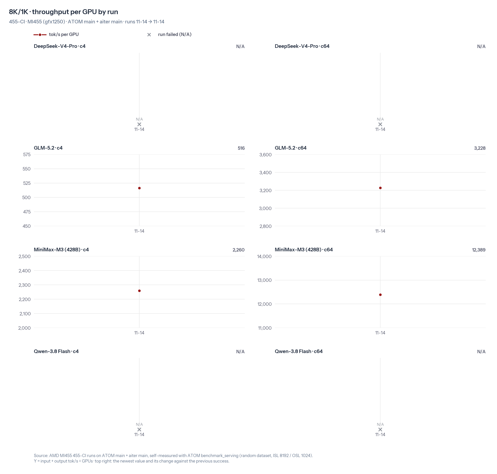
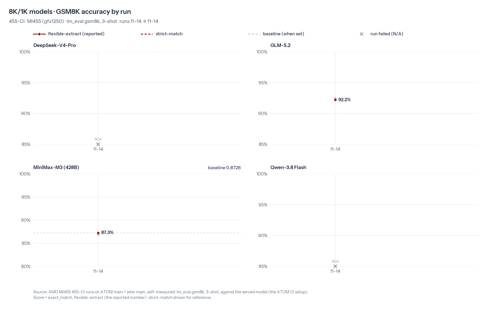

# 455-CI result · 2026-11-14 · 8K/1K

- Image: `rocm/fw-bringup-mlperf:gfx1250-atom-ci455-20261114`
- ATOM: `main` @ `9fec99786b088168aec7729858c1176e99d818e6` (2026-11-13)
- aiter: `main` @ `b6f1ff6b7f3754aca8cc8c403b5fcd7a258eba47` (2026-11-13)

## Summary

### Highlights

- ❌ DeepSeek-V4-Pro: all runs failed (AssertionError in aiter FlyDSL MegaMoE stage-1 (mxfp4_presh…).

### Results

| Model | Scenario | — (tok/s/GPU) | 2026-11-14 (tok/s/GPU) | Delta | GSM8K delta |
|---|---|---|---|---|---|
| DeepSeek-V4-Pro | 8K/1K | — | N/A | N/A | N/A |
| GLM-5.2 | 8K/1K | — | — | — | — |
| MiniMax-M3 (428B) | 8K/1K | — | — | — | — |
| Qwen-3.8 Flash | 8K/1K | — | — | — | — |

## Findings

- DeepSeek R1: the recipe now runs with prefix caching and chunked prefill on (no turn is unschedulable any more). What still fails on main is the chat-template TypeError on tool-call history, which https://github.com/ROCm/ATOM/pull/3345 fixes.
- Kimi-K3 needs five PRs today. https://github.com/ROCm/ATOM/pull/2647 runs one TP group across nodes. https://github.com/ROCm/ATOM/pull/2760 allows DSpark + DCP on gfx1250 and needs https://github.com/ROCm/aiter/pull/7912 + https://github.com/ROCm/aiter/pull/7913. https://github.com/ROCm/aiter/pull/7963 (ours) fixes a K3 TP8 MoE tuning row that faulted the GPU in warmup.
- Qwen-35B-A3B's warmup failure was fixed on main by https://github.com/ROCm/ATOM/pull/3223, merged after this image was built.
- DeepSeek-V4.1-Flash on main: TP4 is fine (c4 passes; GSM8K 0.9189, reference 0.9196). The c64 DEP4 server needs https://github.com/ROCm/ATOM/pull/2989 for its FP4 KV cache.
- Kimi-K3 on the 1 TB trays loads slowly through mmap: e15-07 took 30 minutes and e15-06 took 6, so the server was ready after 41 minutes. The 2026-11-11 K3 runs also set `ATOM_DISABLE_MMAP=true`, which the recipe does not have.
- Process: GSM8K needs `HF_HUB_OFFLINE=0` because the image sets it to 1. `wait_infer_drain.sh` reports a false hang when its log path contains `lm_eval`. Both still need a guide fix.

## Details

### Environment

| Item | Value |
|---|---|
| Test image | `rocm/fw-bringup-mlperf:gfx1250-atom-ci455-20261114` (digest `sha256:9c38aef6ad030885b5309ad90b30ff778da4f764161aecdf7b7c7d8ae3ea1eb9`) |
| ATOM | `main` @ [`9fec99786b088168aec7729858c1176e99d818e6`](https://github.com/ROCm/ATOM/commit/9fec99786b088168aec7729858c1176e99d818e6), 2026-11-13 perf(dsv41): add the shared expert output in the MegaMoE combine on the mori v2 EP path (#3132) |
| aiter | `main` @ [`b6f1ff6b7f3754aca8cc8c403b5fcd7a258eba47`](https://github.com/ROCm/aiter/commit/b6f1ff6b7f3754aca8cc8c403b5fcd7a258eba47), 2026-11-13 [CI] FFM Triton: fall back to main when the suite source ref is gone (#7930) |
| Test date | 2026-11-14 |

### Performance · 8K/1K

| Model | Parallelism | Concurrency | tok/s/GPU | vs — | ITL P50 (ms, lower is better) | vs — |
|---|---|---|---|---|---|---|
| DeepSeek-V4-Pro | dp4ep4 | 4 | N/A | N/A | N/A | — |
| DeepSeek-V4-Pro | dp4ep4 | 64 | N/A | N/A | N/A | — |
| GLM-5.2 | — | 4 | — | — | — | — |
| GLM-5.2 | — | 64 | — | — | — | — |
| MiniMax-M3 (428B) | — | 4 | — | — | — | — |
| MiniMax-M3 (428B) | — | 64 | — | — | — | — |
| Qwen-3.8 Flash | — | 4 | — | — | — | — |
| Qwen-3.8 Flash | — | 64 | — | — | — | — |

### Accuracy (GSM8K, 3-shot) · 8K/1K

| Model | flexible-extract | strict-match | — | vs — |
|---|---|---|---|---|
| DeepSeek-V4-Pro | N/A | — | — | N/A |
| GLM-5.2 | — | — | — | — |
| MiniMax-M3 (428B) | — | — | — | — |
| Qwen-3.8 Flash | — | — | — | — |

### Trends · 8K/1K





### Follow-ups

| Model | Problem | Next step | Note |
|---|---|---|---|
| DeepSeek-V4-Pro | — | Missing: needs a follow-up | — |

### Failures

#### DeepSeek-V4-Pro (8K/1K): c4, c64, GSM8K

- Error: `AssertionError in aiter FlyDSL MegaMoE stage-1 (mxfp4_preshuffle_gfx1250_tdm make_rmem_slot: slot_width <= 128) in warm…`
- Full excerpt: [error.log](../455-CI/runs/20261114/deepseek-v4-pro/error.log)

Core error log:

```text
    return fn(result_names, *state_values)
  File "/usr/local/lib/python3.12/dist-packages/flydsl/compiler/jit_function.py", line 1133, in __call__
    return self._compile_or_execute(args, kwargs, execute=True)
  File "/app/aiter/aiter/ops/flydsl/kernels/mxfp4_preshuffle_gfx1250_tdm.py", line 1579, in gemm_task
    rmem_slots = [make_rmem_slot(i) for i in range_constexpr(2)]
  File "/app/aiter/aiter/ops/flydsl/kernels/mega_moe_gfx1250/s1f_stage1.py", line 1885, in kernel
    while code >= fx.Int32(0):
  File "/app/aiter/aiter/ops/flydsl/kernels/mega_moe_gfx1250/s1f_stage1.py", line 1990, in __while_after_36
    g1_task(
  File "/usr/local/lib/python3.12/dist-packages/flydsl/compiler/jit_function.py", line 1141, in _compile_or_execute
    return self.func(*args, **kwargs)
  File "/app/aiter/aiter/ops/flydsl/kernels/mxfp4_preshuffle_gfx1250_tdm.py", line 1560, in make_rmem_slot
    assert slot_width <= 128
  File "/usr/local/lib/python3.12/dist-packages/flydsl/compiler/ast_rewriter.py", line 1497, in scf_while_dispatch
    body_result = ReplaceIfWithDispatch._call_branch(after_fn, result_names, wrapped_after)
  File "/usr/local/lib/python3.12/dist-packages/flydsl/compiler/jit_function.py", line 1133, in __call__
    return self._compile_or_execute(args, kwargs, execute=True)
  File "/app/aiter/aiter/ops/flydsl/kernels/mxfp4_preshuffle_gfx1250_tdm.py", line 1579, in gemm_task
    rmem_slots = [make_rmem_slot(i) for i in range_constexpr(2)]
  File "/usr/local/lib/python3.12/dist-packages/flydsl/compiler/ast_rewriter.py", line 719, in _call_branch
    return fn(result_names, *state_values)
AssertionError
  File "/usr/local/lib/python3.12/dist-packages/flydsl/compiler/jit_function.py", line 1141, in _compile_or_execute
    return self.func(*args, **kwargs)
----- last 30 lines -----
[atom 13:46:55] Engine Core: load model runner failed
[atom 13:46:55] AsyncIOProcManager(ModelRunner): All runners are shutdown.
[atom 13:46:55] [gc] unfroze 375 objects
[atom 13:46:55] Engine Core: load model runner failed
[atom 13:46:55] AsyncIOProcManager(ModelRunner): All runners are shutdown.
[atom 13:46:55] [gc] unfroze 375 objects
[atom 13:46:55] Engine Core: load model runner failed
[atom 13:46:55] AsyncIOProcManager(ModelRunner): All runners are shutdown.
[atom 13:46:55] [gc] unfroze 375 objects
[atom 13:46:55] Engine Core: load model runner failed
[atom 13:47:00] Engine Core Mgr: All EngineCores shut down
Traceback (most recent call last):
  File "<frozen runpy>", line 198, in _run_module_as_main
  File "<frozen runpy>", line 88, in _run_code
  File "/app/ATOM/atom/entrypoints/openai_server.py", line 27, in <module>
    main()
  File "/app/ATOM/atom/entrypoints/openai/api_server.py", line 3795, in main
    engine = engine_args.create_engine(tokenizer=tokenizer)
             ^^^^^^^^^^^^^^^^^^^^^^^^^^^^^^^^^^^^^^^^^^^^^^
  File "/app/ATOM/atom/model_engine/arg_utils.py", line 1003, in create_engine
    return LLMEngine(self.model, tokenizer=tokenizer, **self._get_engine_kwargs())
           ^^^^^^^^^^^^^^^^^^^^^^^^^^^^^^^^^^^^^^^^^^^^^^^^^^^^^^^^^^^^^^^^^^^^^^^
  File "/app/ATOM/atom/model_engine/llm_engine.py", line 98, in __init__
    self.core_mgr = CoreManager(config)
                    ^^^^^^^^^^^^^^^^^^^
  File "/app/ATOM/atom/model_engine/engine_core_mgr.py", line 665, in __init__
    self._wait_for_all_ready_signals()
  File "/app/ATOM/atom/model_engine/engine_core_mgr.py", line 750, in _wait_for_all_ready_signals
    raise RuntimeError(
RuntimeError: Engine Core Mgr: Received unexpected SHUTDOWN signal from DP rank 0 during initialization
```

Reproduce:

```bash
# the test container (455-CI-recipe.md); the server and GSM8K commands below run inside it
docker run -d --name ci455-deepseek-v4-pro --network host --ipc host --shm-size 128g \
  --device /dev/kfd --device /dev/dri --group-add video --cap-add SYS_PTRACE \
  --security-opt seccomp=unconfined -v <weights dir>:/models/<model dir>:ro -v <results dir>:/results \
  rocm/fw-bringup-mlperf:gfx1250-atom-ci455-20261114
```

`server_cmd.sh`:

```bash
#!/bin/bash
export AITER_LOG_LEVEL=WARNING
env ATOM_MEGA_COMBINE_WIRE=fp4 PYTHONPATH=/app/aiter HSA_ENABLE_SDMA=1 HSA_USE_SVM=1 HSA_XNACK=1 \
  AITER_DISABLE_KERNARG_PRELOAD=0 ATOM_USE_TRITON_MOE=0 ATOM_USE_TRITON_MOE_DECODE=0 ATOM_USE_TRITON_MOE_A4W4=0 \
  ATOM_USE_UNIFIED_ATTN=1 ATOM_FORCE_ATTN_TRITON=0 ATOM_USE_V4_PREFILL_ASM_FOR_DECODE=1 ATOM_LOADER_USE_THREADPOOL=1 \
  AITER_ROPE_TRITON_BACKEND=1 ATOM_ENABLE_DS_QKNORM_FUSION=0 ATOM_ENABLE_DS_INPUT_RMSNORM_QUANT_FUSION=0 \
  ATOM_ENABLE_DS_QKNORM_QUANT_FUSION=0 ATOM_USE_TRITON_GEMM=1 ATOM_LOADER_NUM_THREADS=4 ENABLE_CK=0 \
  AITER_USE_OPUS_MOE_SORTING=1 AITER_FORCE_A8W4=0 AITER_USE_GROUPED_GEMM=1 ATOM_USE_AITER_TRITON_ATTN=1 \
  AITER_TRITON_USE_HERD=1 ATOM_FP8_BLOCKSCALE_USE_E8M0_SCALE=1 ATOM_DSV4_USE_GFX1250_MXFP8_ASM_GEMM=1 \
  AITER_CUSTOM_AR_MIN_SIZE=131072 ATOM_MOE_GU_ITLV=1 ATOM_MORI_V2=1 MEGA_DISPATCH=mori ATOM_WO_A_USE_FLYDSL=1 \
  MORI_GPU_ARCHS=gfx1250 FLYDSL_GPU_ARCH=gfx1250 ATOM_MEGA_STAGE2_FUSED=1 ATOM_MEGA_STAGE1_FUSED=1 \
  AITER_FLYDSL_GATHER_REDUCE_WAVE_MIN_TOKENS=-1 ATOM_GC_THRESHOLD=20000,50,50 AITER_CUSTOM_AR_MAX_SIZE=8388608 \
  ATOM_DP_LM_HEAD_MODE=allgather MEGA_DISPATCH_WIRE=fp4 \
python3 -m atom.entrypoints.openai_server -tp 4 --model /models/DeepSeek-V4-Pro \
  --kv_cache_dtype fp8 --index-cache-dtype fp4 --no-enable_prefix_caching \
  --enable-expert-parallel --enable-dp-attention --disable_uvicorn_access_log
```

`gsm8k_cmd.sh`:

```bash
ACC_DIR=/results/deepseek-v4-pro/gsm8k
HF_HUB_OFFLINE=0 lm_eval --model local-completions \
  --model_args "model=/models/DeepSeek-V4-Pro,base_url=http://127.0.0.1:8000/v1/completions,num_concurrent=65,max_retries=3,max_gen_toks=2048,tokenized_requests=False,trust_remote_code=True" \
  --tasks gsm8k --num_fewshot 3 --output_path "$ACC_DIR" > "$ACC_DIR/lm_eval.log" 2>&1
```

`bench_cmd.sh`:

```bash
#!/bin/bash
# runs in the container; needs CONC and RESULT_DIR; recipe "8K/1K 的 bench（所有模型共用）"
MODEL_PATH='/models/DeepSeek-V4-Pro'; PORT=8000
# Recipe "8K/1K 的 bench（所有模型共用）", verbatim. Caller sets MODEL_PATH PORT CONC RESULT_DIR; runs in the test container.
mkdir -p $RESULT_DIR
python3 -m atom.benchmarks.benchmark_serving \
  --model=$MODEL_PATH --backend=vllm --base-url=http://127.0.0.1:$PORT \
  --dataset-name=random --random-input-len=8192 --random-output-len=1024 --random-range-ratio=0.8 \
  --max-concurrency=$CONC --num-prompts=$((CONC * 10)) --num-warmups=$((CONC * 2)) \
  --request-rate=inf --ignore-eos --trust-remote-code \
  --save-result --result-dir=$RESULT_DIR --result-filename=raw.json \
  --percentile-metrics="ttft,tpot,itl,e2el"
```
