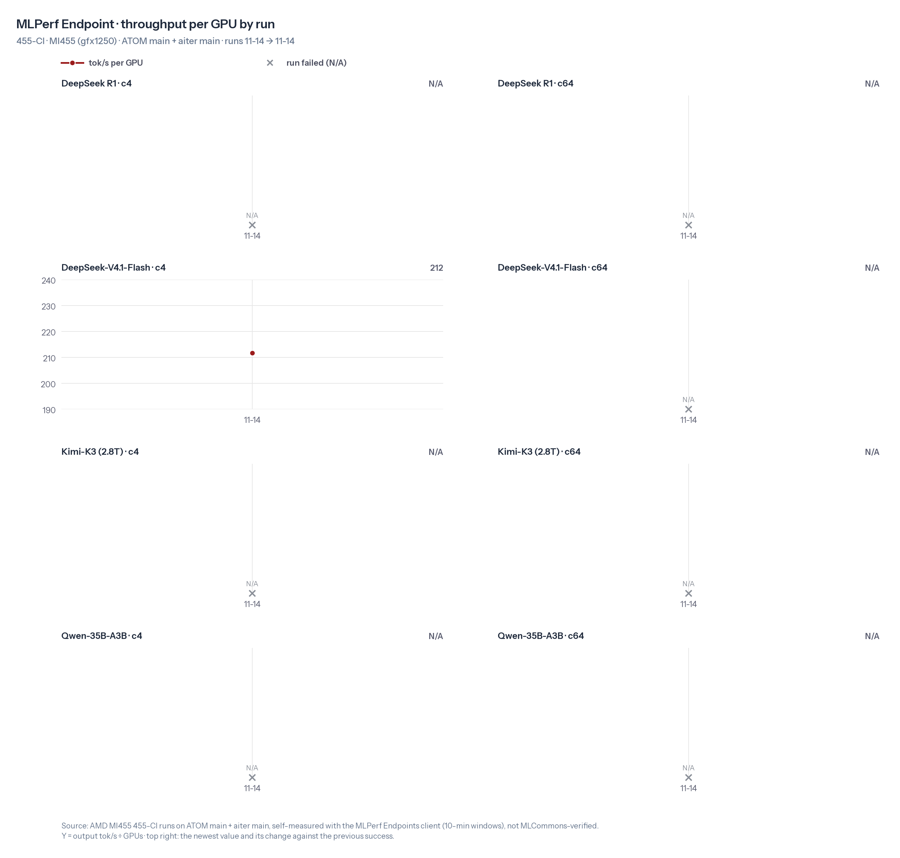
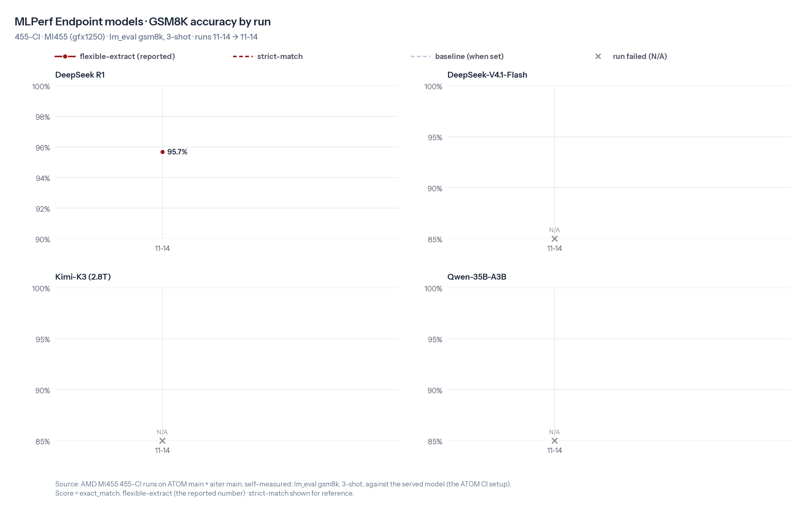
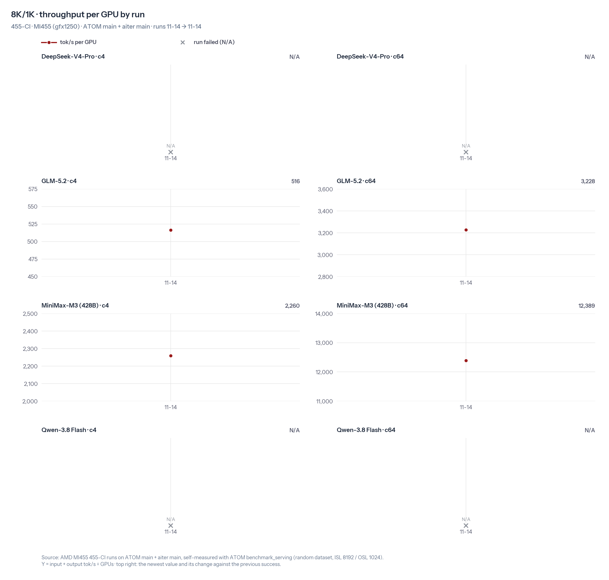
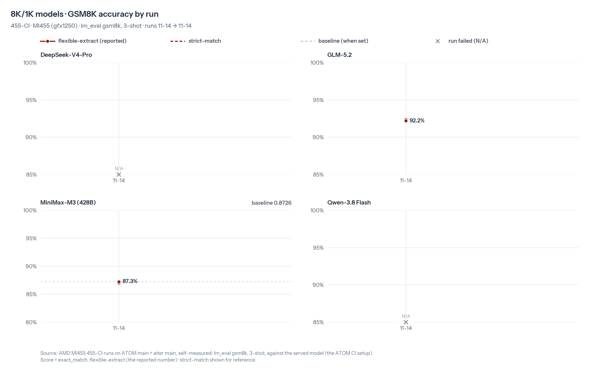

# 455-CI result · 2026-11-14 · MLPerf Endpoint + 8K/1K

## Summary

### Lowlights

| Model | What happened | Cause | Fix | Owner |
|---|---|---|---|---|
| ❌ DeepSeek R1 | c4 and c64 failed | chat template TypeError on tool-call history (HTTP 500) | Passes with [ROCm/ATOM#3345](https://github.com/ROCm/ATOM/pull/3345) (verified) |  |
| ❌ DeepSeek-V4.1-Flash | c64 and GSM8K failed | DEP4 server: DSpark rejects its FP4 KV cache (TP4 is fine) | Needs [ROCm/ATOM#2989](https://github.com/ROCm/ATOM/pull/2989) (open) |  |
| ❌ Kimi-K3 | all runs failed | no cross-node TP on main | Passes with [ROCm/ATOM#2647](https://github.com/ROCm/ATOM/pull/2647) + [#2760](https://github.com/ROCm/ATOM/pull/2760) + [ROCm/aiter#7912](https://github.com/ROCm/aiter/pull/7912) + [#7913](https://github.com/ROCm/aiter/pull/7913) + [#7963](https://github.com/ROCm/aiter/pull/7963) (verified) |  |
| ❌ Qwen-35B-A3B | all runs failed | gfx1250 fused-MoE layout check fails in warmup | Fixed on main by [ROCm/ATOM#3223](https://github.com/ROCm/ATOM/pull/3223) (merged after the image was built) |  |
| ❌ DeepSeek-V4-Pro | all runs failed | `AssertionError in aiter FlyDSL MegaMoE stage-1 (mxfp4_presh…` | No fix yet; [repro](../455-CI/runs/20261114/deepseek-v4-pro/repro.md) |  |
| ❌ Qwen-3.8 Flash | all runs failed | `ValueError: gfx1250 fused_moe requires gu_interleave weight…` | Needs [ROCm/ATOM#3225](https://github.com/ROCm/ATOM/pull/3225) + [ROCm/aiter#7847](https://github.com/ROCm/aiter/pull/7847) (open) |  |
| 🔴 MiniMax-M3 | GSM8K 87.3%, 7.4 points below the known-good 94.7% | not known yet; the known-good run used 5-shot chat, this CI 3-shot completions | No fix yet; [repro](../455-CI/runs/20261114/minimax-m3/repro.md) |  |

### Results

| Model | Scenario | — (tok/s/GPU) | 2026-11-14 (tok/s/GPU) | Delta | GSM8K delta |
|---|---|---|---|---|---|
| DeepSeek R1 | MLPerf Endpoint | — | N/A | N/A | first (now 95.7%) |
| DeepSeek-V4.1-Flash | MLPerf Endpoint | — | N/A | N/A | N/A |
| Kimi-K3 (2.8T) | MLPerf Endpoint | — | N/A | N/A | N/A |
| Qwen-35B-A3B | MLPerf Endpoint | — | N/A | N/A | N/A |
| DeepSeek-V4-Pro | 8K/1K | — | N/A | N/A | N/A |
| GLM-5.2 | 8K/1K | — | 3,228 | first | first (now 92.2%) |
| MiniMax-M3 (428B) | 8K/1K | — | 12,389 | first | first (now 87.3%) |
| Qwen-3.8 Flash | 8K/1K | — | N/A | N/A | N/A |

### Environment

- Image: `rocm/fw-bringup-mlperf:gfx1250-atom-ci455-20261114`
- ATOM: `main` @ `9fec99786b088168aec7729858c1176e99d818e6` (2026-11-13)
- aiter: `main` @ `b6f1ff6b7f3754aca8cc8c403b5fcd7a258eba47` (2026-11-13)

## Findings

- MLPerf Endpoint · DeepSeek R1: the recipe now runs with prefix caching and chunked prefill on (no turn is unschedulable any more). What still fails on main is the chat-template TypeError on tool-call history, which https://github.com/ROCm/ATOM/pull/3345 fixes.
- MLPerf Endpoint · Kimi-K3 needs five PRs today. https://github.com/ROCm/ATOM/pull/2647 runs one TP group across nodes. https://github.com/ROCm/ATOM/pull/2760 allows DSpark + DCP on gfx1250 and needs https://github.com/ROCm/aiter/pull/7912 + https://github.com/ROCm/aiter/pull/7913. https://github.com/ROCm/aiter/pull/7963 (ours) fixes a K3 TP8 MoE tuning row that faulted the GPU in warmup.
- MLPerf Endpoint · Qwen-35B-A3B's warmup failure was fixed on main by https://github.com/ROCm/ATOM/pull/3223, merged after this image was built.
- MLPerf Endpoint · DeepSeek-V4.1-Flash on main: TP4 is fine (c4 passes; GSM8K 0.9189, reference 0.9196). The c64 DEP4 server needs https://github.com/ROCm/ATOM/pull/2989 for its FP4 KV cache.
- MLPerf Endpoint · Kimi-K3 on the 1 TB trays loads slowly through mmap: e15-07 took 30 minutes and e15-06 took 6, so the server was ready after 41 minutes. The 2026-11-11 K3 runs also set `ATOM_DISABLE_MMAP=true`, which the recipe does not have.
- MLPerf Endpoint · Process: GSM8K needs `HF_HUB_OFFLINE=0` because the image sets it to 1. `wait_infer_drain.sh` reports a false hang when its log path contains `lm_eval`. Both still need a guide fix.
- 8K/1K · DeepSeek-V4-Pro: ROCm/aiter#7920 and #7924 are in this image, so the 2026-11-12 `IndexError` is gone. The server now dies in warmup in the MegaMoE stage-1 (S1F) GEMM1: `assert slot_width <= 128` in `mxfp4_preshuffle_gfx1250_tdm.py`. Reverting only https://github.com/ROCm/aiter/pull/5899 (merged 2026-11-13 20:27 +0800) on the same image fixes it (server up, GSM8K 0.9477/0.9484). [repro](../455-CI/runs/20261114/deepseek-v4-pro/repro.md)
- 8K/1K · GLM-5.2: the first run lost rank 3 at the first GSM8K prefill to `fmha_fwd_with_sink_varlen_asm failed: failed to load module for fmha_bf16_pertokenBf16_hd256_128x128_mask_varlen` (GPU 3 of e15-07). The engine then hung with the API server alive, and the c4 bench waited until stopped by hand. A rerun with the same image and command passed (GSM8K 0.9219, c4 516.3, c64 3,228.1 tok/s/GPU). On one e15-06 GPU the kernel loads and runs correctly, even when only 16 MiB of VRAM is free. Intermittent; cause unknown.
- 8K/1K · GLM-5.2 runs on main now: the recipe expected an `unexpected KV cache shape` failure in CUDA graph capture, which did not happen. c4 matches the 2026-11-11 reference (516 tok/s/GPU); c64 is 7.9% lower (3,228 vs 3,504).
- 8K/1K · MiniMax-M3: EAGLE3 acceptance 58.8% at c4 and 67.3% at c64, from `/debug/mtp_stats` read before and after each bench. GSM8K 0.8726 is 3-shot completions; the recipe reference 0.9568 is chat 5-shot.
- 8K/1K · Qwen-3.8 Flash: both servers (without and with `--spec-decode-acceptance-length 2.32`) die in warmup in the MTP draft layer (`qwen4_exp_mtp.py`, `UnquantizedFusedMoEMethod`) with `gfx1250 fused_moe requires gu_interleave weight layout`, although the recipe sets `ATOM_MOE_GU_ITLV=1`. The online MXFP4 quant of `mtp.layers.0.mlp.experts*` does not take effect on main; https://github.com/ROCm/ATOM/pull/3225 is the pending fix.
- 8K/1K · Process: the API server can outlive a dead model runner, after which bench requests hang without a timeout. The driver now stops when the server log shows `proc died unexpectedly` and bounds the bench with a timeout.

## Details

### Environment details

| Item | Value |
|---|---|
| Test image | `rocm/fw-bringup-mlperf:gfx1250-atom-ci455-20261114` (digest `sha256:9c38aef6ad030885b5309ad90b30ff778da4f764161aecdf7b7c7d8ae3ea1eb9`) |
| ATOM | `main` @ [`9fec99786b088168aec7729858c1176e99d818e6`](https://github.com/ROCm/ATOM/commit/9fec99786b088168aec7729858c1176e99d818e6), 2026-11-13 perf(dsv41): add the shared expert output in the MegaMoE combine on the mori v2 EP path (#3132) |
| aiter | `main` @ [`b6f1ff6b7f3754aca8cc8c403b5fcd7a258eba47`](https://github.com/ROCm/aiter/commit/b6f1ff6b7f3754aca8cc8c403b5fcd7a258eba47), 2026-11-13 [CI] FFM Triton: fall back to main when the suite source ref is gone (#7930) |
| Test date | 2026-11-14 |

### Performance · MLPerf Endpoint

| Model | Parallelism | Concurrency | tok/s/GPU | vs — | E2E avg interactivity (tok/s/user) | vs — |
|---|---|---|---|---|---|---|
| DeepSeek R1 | dp4ep4 | 4 | N/A | N/A | N/A | — |
| DeepSeek R1 | dp4ep4 | 64 | N/A | N/A | N/A | — |
| DeepSeek-V4.1-Flash | tp4 | 4 | 212 | first | 500 | first |
| DeepSeek-V4.1-Flash | dep4 | 64 | N/A | N/A | N/A | — |
| Kimi-K3 (2.8T) | tp8dcp8 | 4 | N/A | N/A | N/A | — |
| Kimi-K3 (2.8T) | tp8dcp8 | 64 | N/A | N/A | N/A | — |
| Qwen-35B-A3B | tp1 | 4 | N/A | N/A | N/A | — |
| Qwen-35B-A3B | tp1 | 64 | N/A | N/A | N/A | — |

### Accuracy (GSM8K, 3-shot) · MLPerf Endpoint

| Model | flexible-extract | strict-match | — | vs — |
|---|---|---|---|---|
| DeepSeek R1 | 95.7% | 95.7% | — | first |
| DeepSeek-V4.1-Flash | N/A | — | — | N/A |
| Kimi-K3 (2.8T) | N/A | — | — | N/A |
| Qwen-35B-A3B | N/A | — | — | N/A |

### Trends · MLPerf Endpoint





### Performance · 8K/1K

| Model | Parallelism | Concurrency | tok/s/GPU | vs — | ITL P50 (ms, lower is better) | vs — |
|---|---|---|---|---|---|---|
| DeepSeek-V4-Pro | dp4ep4 | 4 | N/A | N/A | N/A | — |
| DeepSeek-V4-Pro | dp4ep4 | 64 | N/A | N/A | N/A | — |
| GLM-5.2 | tp4 | 4 | 516 | first | 15.2 | first |
| GLM-5.2 | tp4 | 64 | 3,228 | first | 18.8 | first |
| MiniMax-M3 (428B) | tp4eagle3 | 4 | 2,260 | first | 6.9 | first |
| MiniMax-M3 (428B) | tp4eagle3 | 64 | 12,389 | first | 13.3 | first |
| Qwen-3.8 Flash | tp1 | 4 | N/A | N/A | N/A | — |
| Qwen-3.8 Flash | tp1 | 64 | N/A | N/A | N/A | — |

### Accuracy (GSM8K, 3-shot) · 8K/1K

| Model | flexible-extract | strict-match | — | vs — |
|---|---|---|---|---|
| DeepSeek-V4-Pro | N/A | — | — | N/A |
| GLM-5.2 | 92.2% | 92.3% | — | first |
| MiniMax-M3 (428B) | 87.3% | 87.0% | — | first |
| Qwen-3.8 Flash | N/A | — | — | N/A |

### Trends · 8K/1K





### Follow-ups

| Model | Problem | Next step | Note |
|---|---|---|---|
| DeepSeek R1 | chat template TypeError on tool-call history (HTTP 500) | Passes with [ROCm/ATOM#3345](https://github.com/ROCm/ATOM/pull/3345) (verified) | Verified on 455 with the recipe at 6941c359 (prefix cache and chunked prefill on) on main 9fec99786 + only #3345's changes: GSM8K 0.9553; c4 146/146 samples, 8.02 tok/s/GPU, 13.68 tok/s/user; c64 1220/1220 samples, 94.65 tok/s/GPU, 8.24 tok/s/user; c64 again on another node 1197/1197, 85.55 tok/s/GPU; no HTTP 500, no GPU fault. |
| DeepSeek-V4.1-Flash | DEP4 server: DSpark rejects its FP4 KV cache (TP4 is fine) | Needs [ROCm/ATOM#2989](https://github.com/ROCm/ATOM/pull/2989) (open) | Relaxes the V4.1 DSpark KV-cache check to allow fp4 (the c64/DEP4 ValueError); open. Its aiter dependency ROCm/aiter#7407 merged on 2026-11-13. |
| Kimi-K3 (2.8T) | no cross-node TP on main | Passes with [ROCm/ATOM#2647](https://github.com/ROCm/ATOM/pull/2647) + [#2760](https://github.com/ROCm/ATOM/pull/2760) + [ROCm/aiter#7912](https://github.com/ROCm/aiter/pull/7912) + [#7913](https://github.com/ROCm/aiter/pull/7913) + [#7963](https://github.com/ROCm/aiter/pull/7963) (verified) | Needs all five: ATOM#2647 (one TP group across nodes), ATOM#2760 (DSpark + DCP on gfx1250) with the aiter MLA kernels it needs (#7912, #7913), and our aiter#7963 (the K3 TP8 MoE tuning row whose tile_k2 512 > K 384 faulted the GPU in warmup). Verified on 455: GSM8K 0.9606/0.9613; c4 293/293 samples, 30.47 tok/s/GPU; c64 1703/1703 samples, 120.09 tok/s/GPU. |
| Qwen-35B-A3B | gfx1250 fused-MoE layout check fails in warmup | Fixed on main by [ROCm/ATOM#3223](https://github.com/ROCm/ATOM/pull/3223) (merged after the image was built) | Merged into main 2026-11-14 05:55 UTC, after the image was built (replaces the stale draft #2794). Verified on 455 with the recipe unchanged: GSM8K 0.8590/0.8552; c4 858/858 samples, 437.96 tok/s/GPU, 220.73 tok/s/user; c64 4405/4405 samples, 2365.83 tok/s/GPU, 55.57 tok/s/user. |
| DeepSeek-V4-Pro | — | No fix yet; [repro](../455-CI/runs/20261114/deepseek-v4-pro/repro.md) | Regression from ROCm/aiter#5899 (MegaMoE S1F, merged 2026-11-13): reverting it on the same image brings the server up and GSM8K to 0.9477. S1F GEMM1 picks a tile with tile_m/2 + tile_n/8 > 128 VGPRs for V4-Pro (EP4 h7168 topk9). Left to the S1F owner. |
| MiniMax-M3 (428B) | not known yet; the known-good run used 5-shot chat, this CI 3-shot completions | No fix yet; [repro](../455-CI/runs/20261114/minimax-m3/repro.md) | next: the recipe's 5-shot chat GSM8K on the same image, to split eval method from regression |
| Qwen-3.8 Flash | — | Needs [ROCm/ATOM#3225](https://github.com/ROCm/ATOM/pull/3225) + [ROCm/aiter#7847](https://github.com/ROCm/aiter/pull/7847) (open) | The MTP draft layer MoE stays BF16 (UnquantizedFusedMoEMethod) and fails the gfx1250 gu_interleave check in warmup; ATOM#3225 quantizes the MTP head for gfx1250 (registered in pending_fixes.csv). aiter#7847 is tuning only. Both open. |

### Failures

#### DeepSeek R1 (MLPerf Endpoint): c4, c64

- Error: `95% of turns failed: chat template TypeError on dict tool-call arguments (HTTP 500); a failed turn ends its trajectory`
- Full excerpt: [error.log](../455-CI/runs/20261114/deepseek-r1/error.log)

Core error log:

```text
[atom 06:14:07] joint kv: boundaries=0 (state_hbm=0 state_tier=0) | off=324
[atom.model_engine.prefill_delayer 06:14:07] [PrefillDelayer stats] total=5000 fire_fill=0 fire_stall=48 fire_cost=6 fire_ttft=0 fire_kv=0 fire_partial=3 fire_nodecode=1 fire_queue_ms=0 fire_vacuous=1827 hold_decode_interval=0 hold=3115 (hold_rate=62.30%)
[atom.model_engine.prefill_delayer 06:14:07] [PrefillDelayer stats] total=5000 fire_fill=0 fire_stall=48 fire_cost=6 fire_ttft=0 fire_kv=0 fire_partial=3 fire_nodecode=1 fire_queue_ms=0 fire_vacuous=1827 hold_decode_interval=0 hold=3115 (hold_rate=62.30%)
[atom.model_engine.prefill_delayer 06:14:07] [PrefillDelayer stats] total=5000 fire_fill=0 fire_stall=48 fire_cost=6 fire_ttft=0 fire_kv=0 fire_partial=3 fire_nodecode=1 fire_queue_ms=0 fire_vacuous=1827 hold_decode_interval=0 hold=3115 (hold_rate=62.30%)
[atom.model_engine.prefill_delayer 06:14:07] [PrefillDelayer stats] total=5000 fire_fill=0 fire_stall=48 fire_cost=6 fire_ttft=0 fire_kv=0 fire_partial=3 fire_nodecode=1 fire_queue_ms=0 fire_vacuous=1827 hold_decode_interval=0 hold=3115 (hold_rate=62.30%)
[atom 06:14:09] joint kv: boundaries=0 (state_hbm=0 state_tier=0) | off=325
[atom 06:14:09] joint kv: boundaries=0 (state_hbm=0 state_tier=0) | off=335
[atom 06:14:09] joint kv: boundaries=0 (state_hbm=0 state_tier=0) | off=339
[atom 06:14:09] joint kv: boundaries=0 (state_hbm=0 state_tier=0) | off=324
[atom 06:14:10] Engine Core: output send 1 reqs
[atom 06:14:11] joint kv: boundaries=0 (state_hbm=0 state_tier=0) | off=335
[atom 06:14:11] joint kv: boundaries=0 (state_hbm=0 state_tier=0) | off=325
[atom 06:14:11] joint kv: boundaries=0 (state_hbm=0 state_tier=0) | off=324
[atom 06:14:11] Engine Core: output send 1 reqs
[atom 06:14:12] Error in chat_completions
Traceback (most recent call last):
  File "/app/ATOM/atom/entrypoints/openai/api_server.py", line 2235, in _chat_completions
    prompt_or_tokens = await asyncio.to_thread(
                       ^^^^^^^^^^^^^^^^^^^^^^^^
  File "/usr/lib/python3.12/asyncio/threads.py", line 25, in to_thread
    return await loop.run_in_executor(None, func_call)
           ^^^^^^^^^^^^^^^^^^^^^^^^^^^^^^^^^^^^^^^^^^^
  File "/usr/lib/python3.12/concurrent/futures/thread.py", line 58, in run
    result = self.fn(*self.args, **self.kwargs)
             ^^^^^^^^^^^^^^^^^^^^^^^^^^^^^^^^^^
  File "/app/ATOM/atom/entrypoints/openai/chat_encoders.py", line 320, in apply_chat_template
    return tokenizer.apply_chat_template(messages, **kwargs)
           ^^^^^^^^^^^^^^^^^^^^^^^^^^^^^^^^^^^^^^^^^^^^^^^^^
  File "/usr/local/lib/python3.12/dist-packages/transformers/tokenization_utils_base.py", line 3108, in apply_chat_template
    rendered_chat, generation_indices = render_jinja_template(
                                        ^^^^^^^^^^^^^^^^^^^^^^
  File "/usr/local/lib/python3.12/dist-packages/transformers/utils/chat_template_utils.py", line 581, in render_jinja_template
    rendered_chat = compiled_template.render(
                    ^^^^^^^^^^^^^^^^^^^^^^^^^
  File "/usr/local/lib/python3.12/dist-packages/jinja2/environment.py", line 1295, in render
    self.environment.handle_exception()
  File "/usr/local/lib/python3.12/dist-packages/jinja2/environment.py", line 942, in handle_exception
    raise rewrite_traceback_stack(source=source)
  File "<template>", line 1, in top-level template code
TypeError: can only concatenate str (not "dict") to str
INFO:     127.0.0.1:39716 - "POST /v1/chat/completions HTTP/1.1" 500 Internal Server Error
[atom 06:14:12] Request 1323 arrived, input tokens: 26584, pending requests: 3
[atom 06:14:12] Engine Core Mgr: add rank1: 1 req / 26584 tok | in-flight reqs=[1, 1, 0, 1] queued_prefill_tokens=[0, 26584, 0, 0]
INFO:     127.0.0.1:39726 - "POST /v1/chat/completions HTTP/1.1" 200 OK
[atom 06:14:12] Scheduled prefill batch: 1 reqs, 88 new tokens (done: [26496], new: [88]), req_ids: (1323,)
[atom 06:14:19] Request 1324 arrived, input tokens: 26695, pending requests: 4
[atom 06:14:19] Engine Core Mgr: add rank2: 1 req / 26695 tok | in-flight reqs=[1, 1, 1, 1] queued_prefill_tokens=[0, 26584, 26695, 0]
INFO:     127.0.0.1:43270 - "POST /v1/chat/completions HTTP/1.1" 200 OK
[atom 06:14:19] Engine 001: Avg prompt throughput: 6.1 tokens/s, Avg generation throughput: 22.6 tokens/s, Running: 1 reqs, Waiting: 0 reqs, GPU KV cache usage: 0.3%, Prefix cache hit rate: 12.1%
[atom 06:14:19] Engine 000: Avg prompt throughput: 0.0 tokens/s, Avg generation throughput: 31.6 tokens/s, Running: 1 reqs, Waiting: 0 reqs, GPU KV cache usage: 0.0%, Prefix cache hit rate: 0.6%
[atom 06:14:19] Engine 002: Avg prompt throughput: 0.0 tokens/s, Avg generation throughput: 30.1 tokens/s, Running: 0 reqs, Waiting: 0 reqs, GPU KV cache usage: 0.0%, Prefix cache hit rate: 0.4%
[atom 06:14:19] Engine 003: Avg prompt throughput: 0.0 tokens/s, Avg generation throughput: 31.8 tokens/s, Running: 1 reqs, Waiting: 0 reqs, GPU KV cache usage: 0.0%, Prefix cache hit rate: 0.8%
[atom 06:14:19] Scheduled prefill batch: 1 reqs, 199 new tokens (done: [26496], new: [199]), req_ids: (1324,)
[atom 06:14:19] joint kv: boundaries=0 (state_hbm=0 state_tier=0) | off=340
[atom 06:14:19] joint kv: boundaries=0 (state_hbm=0 state_tier=0) | off=325
[atom 06:14:19] joint kv: boundaries=0 (state_hbm=0 state_tier=0) | off=335
----- last 30 lines -----
[atom 06:39:18] joint kv: boundaries=0 (state_hbm=0 state_tier=0) | off=630
[atom 06:39:19] joint kv: boundaries=0 (state_hbm=0 state_tier=0) | off=540
[atom 06:39:19] joint kv: boundaries=0 (state_hbm=0 state_tier=0) | off=630
… (87 lines in all; see error.log)
```

Reproduce:

```bash
# the test container (455-CI-recipe.md); the server and GSM8K commands below run inside it
docker run -d --name ci455-deepseek-r1 --network host --ipc host --shm-size 128g \
  --device /dev/kfd --device /dev/dri --group-add video --cap-add SYS_PTRACE \
  --security-opt seccomp=unconfined -v <weights dir>:/models/<model dir>:ro -v <results dir>:/results \
  rocm/fw-bringup-mlperf:gfx1250-atom-ci455-20261114
```

`server_cmd.sh`:

```bash
#!/bin/bash
# 455-CI recipe 6941c359, DeepSeek R1 server (prefix cache and chunked prefill at ATOM defaults: on)
export AITER_LOG_LEVEL=WARNING
env ATOM_MLA_ABSORB_BF16_FUSE_QOUT=1 ATOM_MLA_KV_SHUFFLED=1 ATOM_MEGA_MASK_PAD_ROWS=1 MEGA_COMBINE_WIRE=bf16 \
  AITER_DISABLE_KERNARG_PRELOAD=1 HSA_ENABLE_SDMA=1 HSA_USE_SVM=1 HSA_XNACK=1 ATOM_DP_LM_HEAD_MODE=allgather \
  ATOM_USE_UNIFIED_ATTN=1 ATOM_USE_TRITON_MLA=0 ATOM_MLA_PAGE_SIZE=1 AITER_MLA_DECODE_PS1_FLYDSL=1 \
  AITER_ROPE_TRITON_BACKEND=1 ATOM_ENABLE_DS_QKNORM_FUSION=0 ATOM_LOADER_NUM_THREADS=4 \
  ATOM_ENABLE_DS_INPUT_RMSNORM_QUANT_FUSION=0 ATOM_ENABLE_DS_QKNORM_QUANT_FUSION=0 ATOM_USE_TRITON_GEMM=1 \
  ATOM_USE_TRITON_MLA_SHUFFLE_KV=0 ENABLE_CK=0 AITER_USE_GROUPED_GEMM=1 AITER_FORCE_A8W4=0 \
  AITER_USE_OPUS_MOE_SORTING=1 ATOM_MOE_GU_ITLV=1 ATOM_MORI_V2=1 ATOM_MORI_V2_FUSED=1 ATOM_MEGA_STAGE1_FUSED=0 \
  MEGA_DISPATCH=mori MORI_GPU_ARCHS=gfx1250 FLYDSL_GPU_ARCH=gfx1250 AITER_FLYDSL_GATHER_REDUCE_WAVE_MIN_TOKENS=-1 \
  ATOM_GC_THRESHOLD=20000,50,50 MEGA_DISPATCH_WIRE=fp4 \
python3 -m atom.entrypoints.openai_server -tp 4 --model /models/Deepseek-S3_sq_a05_v2_mlperf6_1/ \
  --kv_cache_dtype fp8 --block-size 64 \
  --enable-expert-parallel --enable-dp-attention \
  --online_quant_config '{"layer_quant_config":{"*.self_attn.q_b_proj":"mxfp4"}}' \
  --max-num-seqs 2048 --gpu-memory-utilization 0.975 \
  --cudagraph-capture-sizes '[1,2,4,8,16,32,48,64,128,256,512,1024,1536,2048]'
```

`gsm8k_cmd.sh`:

```bash
HF_HUB_OFFLINE=0 lm_eval --model local-completions \
  --model_args "model=/models/Deepseek-S3_sq_a05_v2_mlperf6_1/,base_url=http://127.0.0.1:8000/v1/completions,num_concurrent=65,max_retries=3,max_gen_toks=2048,tokenized_requests=False,trust_remote_code=True" \
  --tasks gsm8k --num_fewshot 3 --output_path "$ACC_DIR" > "$ACC_DIR/lm_eval.log" 2>&1
```

`bench_cmd.sh`:

```bash
SERVED_NAME='/models/Deepseek-S3_sq_a05_v2_mlperf6_1/'; TOKENIZER='/data/Deepseek-S3_sq_a05_v2_mlperf6_1'; SERVER='127.0.0.1:8000'; CLIENT='/mnt/data/zejchen/ci455/client'
# ...then the shared client below
```

#### DeepSeek-V4.1-Flash (MLPerf Endpoint): c64, GSM8K

- Error: `ValueError: DeepSeek-V4.1 DSpark requires a BF16 or FP8 KV cache`
- Full excerpt: [error.log](../455-CI/runs/20261114/deepseek-v4.1-flash/error.log)

Core error log:

```text
[atom 04:03:05] Raised RLIMIT_NOFILE soft limit 1024 -> 65535 (hard=524288)
[atom 04:03:05] Loading tokenizer from /models/DeepSeek-V4.1-Flash...
[transformers] You are using a model of type `deepseek_v41` to instantiate a model of type ``. This may be expected if you are loading a checkpoint that shares a subset of the architecture (e.g., loading a `sam2_video` checkpoint into `Sam2Model`), but is otherwise not supported and can yield errors. Please verify that the checkpoint is compatible with the model you are instantiating.
[atom 04:03:06] Loaded message encoder from /models/DeepSeek-V4.1-Flash/encoding/encoding.py
[atom 04:03:06] Initializing engine with model /models/DeepSeek-V4.1-Flash...
[atom 04:03:06] Reasoning channel: </think>
[atom 04:03:06] Reasoning switches on thinking_mode: 'thinking' on, 'chat' off.
[atom 04:03:06] Tool-call format: dsml_v41 (from the chat template)
[transformers] DeepseekV41TextConfig got `key=rope_scaling` in kwargs but hasn't set it as attribute. For RoPE standardization you need to set `self.rope_parameters` in model's config. 
[transformers] DeepseekV41TextConfig got `key=rope_scaling` in kwargs but hasn't set it as attribute. For RoPE standardization you need to set `self.rope_parameters` in model's config. 
[atom 04:03:07] Engine kwargs: {'trust_remote_code': True, 'tensor_parallel_size': 4, 'decode_context_parallel_size': 1, 'pipeline_parallel_size': 1, 'prefill_context_parallel_size': 1, 'sequence_parallel_size': 1, 'data_parallel_size': 1, 'enforce_eager': False, 'enable_prefix_caching': True, 'port': 8006, 'kv_cache_dtype': 'fp4', 'index_cache_dtype': 'fp4', 'max_model_len': None, 'max_num_batched_tokens': 16384, 'long_prefill_token_threshold': 0, 'attn_prefill_chunk_size': 16384, 'state_checkpoint_interval_tokens': 8192, 'state_checkpoint_demand': True, 'enable_decoder_swa_bounded_replay': True, 'enable_encoder_swa_bounded_replay': True, 'enable_chunked_prefill': True, 'enable_log_stats': True, 'enable_request_context_metrics': False, 'sampler_independent_noise': False, 'throughput_log_interval': 10.0, 'throughput_log_interval_steps': 0, 'cache_hit_rate_window': 1000, 'enable_dynamic_chunking': False, 'dynamic_chunking_smooth_factor': None, 'dynamic_chunking_min_chunk_size': 4096, 'scheduler_delay_factor': 0.0, 'prefill_admit_policy': 'interval', 'max_num_seqs': 64, 'gpu_memory_utilization': 0.9, 'load_dummy': None, 'enable_expert_parallel': True, 'fake_eplb': False, 'torch_profiler_dir': None, 'enable_dp_attention': True, 'dp_load_balance': 'least_requests', 'moe_backend': 'standard', 'kv_transfer_config': '{}', 'mark_trace': False, 'enable_rapidserve': False, 'disagg_prefill_max_num_seqs': None, 'disagg_constrained': False, 'online_quant_config': None, 'hf_overrides': None, 'eplb_enable': False, 'kv_cache_block_size': 16, 'compilation_config': CompilationConfig(level=0, use_cudagraph=True, local_cache_dir=None, cudagraph_capture_sizes=[1, 2, 3, 4, 5, 6, 7, 8, 12, 16, 24, 32, 40, 48, 56, 64], cuda_graph_sizes=[512], debug_dump_path='', traced_files=set(), cache_dir='', use_inductor=True, cudagraph_mode=<CUDAGraphMode.FULL: 2>, compilation_time=0.0, splitting_ops=None, cudagraph_copy_inputs=False, inductor_compile_config={}, compile_sizes=None, static_forward_context={}), 'speculative_config': SpeculativeConfig(method='dspark', num_spec_tokens=5), 'enable_tbo': False, 'enable_tbo_decode': False, 'enable_low_latency': False, 'moe_all2all_backend': 'mori', 'dspark': DSparkConfig(confidence_schedule=False, ragged=False, ragged_graph_sizes='', q_buckets='', disable_sps_calib=False, calibration_profile=None), 'eplb_config': EPLBConfig(load_window_size=1000, rebalance_interval=3000, rebalance_layers_per_chunk=64, num_redundant_experts=0, rebalance_min_balancedness=2.0, rebalance_balancedness_agg='min', p2p_batch_chunk_size=32, placement_policy='naive'), 'dcp_config': DCPConfig(interleave_size=1, enable_query_replication=True, enable_project_before_merge=True, comm_backend='a2a', indexer_dcp_only=False), 'parallel_config': ParallelConfig(data_parallel_size=1, data_parallel_size_local=1, data_parallel_rank=0, data_parallel_rank_local=None, decode_context_parallel_size=1, pipeline_parallel_rank=0, pp_meta_addrs=[], pp_token_addr='', control_address='', pp_kv_status_addr='', data_parallel_master_port=29500, data_parallel_base_port=0, server_instance_id='', data_parallel_master_ip='127.0.0.1')}
[atom 04:03:07] dcp_config.enable_query_replication disabled: decode_context_parallel_size <= 1 (no DCP group) not supported.
[transformers] DeepseekV41TextConfig got `key=rope_scaling` in kwargs but hasn't set it as attribute. For RoPE standardization you need to set `self.rope_parameters` in model's config. 
[transformers] DeepseekV41TextConfig got `key=rope_scaling` in kwargs but hasn't set it as attribute. For RoPE standardization you need to set `self.rope_parameters` in model's config. 
[transformers] `torch_dtype` is deprecated! Use `dtype` instead!
Traceback (most recent call last):
  File "<frozen runpy>", line 198, in _run_module_as_main
  File "<frozen runpy>", line 88, in _run_code
  File "/app/ATOM/atom/entrypoints/openai_server.py", line 27, in <module>
    main()
  File "/app/ATOM/atom/entrypoints/openai/api_server.py", line 3795, in main
    engine = engine_args.create_engine(tokenizer=tokenizer)
             ^^^^^^^^^^^^^^^^^^^^^^^^^^^^^^^^^^^^^^^^^^^^^^
  File "/app/ATOM/atom/model_engine/arg_utils.py", line 1003, in create_engine
    return LLMEngine(self.model, tokenizer=tokenizer, **self._get_engine_kwargs())
           ^^^^^^^^^^^^^^^^^^^^^^^^^^^^^^^^^^^^^^^^^^^^^^^^^^^^^^^^^^^^^^^^^^^^^^^
  File "/app/ATOM/atom/model_engine/llm_engine.py", line 50, in __init__
    config = Config(model, **config_kwargs)
             ^^^^^^^^^^^^^^^^^^^^^^^^^^^^^^
  File "<string>", line 88, in __init__
  File "/app/ATOM/atom/config.py", line 3011, in __post_init__
    validate_runtime_config(self)
  File "/app/ATOM/atom/models/deepseek_v41/config.py", line 439, in validate_runtime_config
    validate_speculative_config(config)
  File "/app/ATOM/atom/models/deepseek_v41/config.py", line 325, in validate_speculative_config
    raise ValueError("DeepSeek-V4.1 DSpark requires a BF16 or FP8 KV cache")
ValueError: DeepSeek-V4.1 DSpark requires a BF16 or FP8 KV cache
----- last 30 lines -----
[atom 04:03:06] Tool-call format: dsml_v41 (from the chat template)
[transformers] DeepseekV41TextConfig got `key=rope_scaling` in kwargs but hasn't set it as attribute. For RoPE standardization you need to set `self.rope_parameters` in model's config. 
[transformers] DeepseekV41TextConfig got `key=rope_scaling` in kwargs but hasn't set it as attribute. For RoPE standardization you need to set `self.rope_parameters` in model's config. 
[atom 04:03:07] Engine kwargs: {'trust_remote_code': True, 'tensor_parallel_size': 4, 'decode_context_parallel_size': 1, 'pipeline_parallel_size': 1, 'prefill_context_parallel_size': 1, 'sequence_parallel_size': 1, 'data_parallel_size': 1, 'enforce_eager': False, 'enable_prefix_caching': True, 'port': 8006, 'kv_cache_dtype': 'fp4', 'index_cache_dtype': 'fp4', 'max_model_len': None, 'max_num_batched_tokens': 16384, 'long_prefill_token_threshold': 0, 'attn_prefill_chunk_size': 16384, 'state_checkpoint_interval_tokens': 8192, 'state_checkpoint_demand': True, 'enable_decoder_swa_bounded_replay': True, 'enable_encoder_swa_bounded_replay': True, 'enable_chunked_prefill': True, 'enable_log_stats': True, 'enable_request_context_metrics': False, 'sampler_independent_noise': False, 'throughput_log_interval': 10.0, 'throughput_log_interval_steps': 0, 'cache_hit_rate_window': 1000, 'enable_dynamic_chunking': False, 'dynamic_chunking_smooth_factor': None, 'dynamic_chunking_min_chunk_size': 4096, 'scheduler_delay_factor': 0.0, 'prefill_admit_policy': 'interval', 'max_num_seqs': 64, 'gpu_memory_utilization': 0.9, 'load_dummy': None, 'enable_expert_parallel': True, 'fake_eplb': False, 'torch_profiler_dir': None, 'enable_dp_attention': True, 'dp_load_balance': 'least_requests', 'moe_backend': 'standard', 'kv_transfer_config': '{}', 'mark_trace': False, 'enable_rapidserve': False, 'disagg_prefill_max_num_seqs': None, 'disagg_constrained': False, 'online_quant_config': None, 'hf_overrides': None, 'eplb_enable': False, 'kv_cache_block_size': 16, 'compilation_config': CompilationConfig(level=0, use_cudagraph=True, local_cache_dir=None, cudagraph_capture_sizes=[1, 2, 3, 4, 5, 6, 7, 8, 12, 16, 24, 32, 40, 48, 56, 64], cuda_graph_sizes=[512], debug_dump_path='', traced_files=set(), cache_dir='', use_inductor=True, cudagraph_mode=<CUDAGraphMode.FULL: 2>, compilation_time=0.0, splitting_ops=None, cudagraph_copy_inputs=False, inductor_compile_config={}, compile_sizes=None, static_forward_context={}), 'speculative_config': SpeculativeConfig(method='dspark', num_spec_tokens=5), 'enable_tbo': False, 'enable_tbo_decode': False, 'enable_low_latency': False, 'moe_all2all_backend': 'mori', 'dspark': DSparkConfig(confidence_schedule=False, ragged=False, ragged_graph_sizes='', q_buckets='', disable_sps_calib=False, calibration_profile=None), 'eplb_config': EPLBConfig(load_window_size=1000, rebalance_interval=3000, rebalance_layers_per_chunk=64, num_redundant_experts=0, rebalance_min_balancedness=2.0, rebalance_balancedness_agg='min', p2p_batch_chunk_size=32, placement_policy='naive'), 'dcp_config': DCPConfig(interleave_size=1, enable_query_replication=True, enable_project_before_merge=True, comm_backend='a2a', indexer_dcp_only=False), 'parallel_config': ParallelConfig(data_parallel_size=1, data_parallel_size_local=1, data_parallel_rank=0, data_parallel_rank_local=None, decode_context_parallel_size=1, pipeline_parallel_rank=0, pp_meta_addrs=[], pp_token_addr='', control_address='', pp_kv_status_addr='', data_parallel_master_port=29500, data_parallel_base_port=0, server_instance_id='', data_parallel_master_ip='127.0.0.1')}
[atom 04:03:07] dcp_config.enable_query_replication disabled: decode_context_parallel_size <= 1 (no DCP group) not supported.
[transformers] DeepseekV41TextConfig got `key=rope_scaling` in kwargs but hasn't set it as attribute. For RoPE standardization you need to set `self.rope_parameters` in model's config. 
[transformers] DeepseekV41TextConfig got `key=rope_scaling` in kwargs but hasn't set it as attribute. For RoPE standardization you need to set `self.rope_parameters` in model's config. 
[transformers] `torch_dtype` is deprecated! Use `dtype` instead!
Traceback (most recent call last):
  File "<frozen runpy>", line 198, in _run_module_as_main
  File "<frozen runpy>", line 88, in _run_code
  File "/app/ATOM/atom/entrypoints/openai_server.py", line 27, in <module>
    main()
  File "/app/ATOM/atom/entrypoints/openai/api_server.py", line 3795, in main
    engine = engine_args.create_engine(tokenizer=tokenizer)
             ^^^^^^^^^^^^^^^^^^^^^^^^^^^^^^^^^^^^^^^^^^^^^^
  File "/app/ATOM/atom/model_engine/arg_utils.py", line 1003, in create_engine
    return LLMEngine(self.model, tokenizer=tokenizer, **self._get_engine_kwargs())
           ^^^^^^^^^^^^^^^^^^^^^^^^^^^^^^^^^^^^^^^^^^^^^^^^^^^^^^^^^^^^^^^^^^^^^^^
  File "/app/ATOM/atom/model_engine/llm_engine.py", line 50, in __init__
    config = Config(model, **config_kwargs)
             ^^^^^^^^^^^^^^^^^^^^^^^^^^^^^^
… (68 lines in all; see error.log)
```

Reproduce:

```bash
# the test container (455-CI-recipe.md); the server and GSM8K commands below run inside it
docker run -d --name ci455-deepseek-v4.1-flash --network host --ipc host --shm-size 128g \
  --device /dev/kfd --device /dev/dri --group-add video --cap-add SYS_PTRACE \
  --security-opt seccomp=unconfined -v <weights dir>:/models/<model dir>:ro -v <results dir>:/results \
  rocm/fw-bringup-mlperf:gfx1250-atom-ci455-20261114
```

`server_cmd_dep4.sh`:

```bash
#!/bin/bash
export AITER_LOG_LEVEL=WARNING
cd /app/ATOM
R=/app/endpoints-recipe-dsv41
export HIP_VISIBLE_DEVICES=0,1,2,3 OMP_NUM_THREADS=4 ATOM_DISABLE_MMAP=true AITER_LOG_LEVEL=WARNING
export AITER_REUSE_IDENTICAL_COMM_GROUPS=1 HF_HUB_OFFLINE=1 PYTHONFAULTHANDLER=1 HSA_DISABLE_COREDUMP_ON_EXCEPTION=1
export MORI_AMD_SMI_PATH=/opt/rocm/lib/libamd_smi.so.27 MORI_GPU_ARCHS=gfx1250 FLYDSL_GPU_ARCH=gfx1250
export HIP_FORCE_DEV_KERNARG=1 HSA_ENABLE_SCRATCH_ASYNC_RECLAIM=0 HSA_ENABLE_SDMA=1 HSA_USE_SVM=1 HSA_XNACK=1
export ATOM_GC_THRESHOLD=20000,50,50 AITER_CUSTOM_AR_MIN_SIZE=131072 AITER_CUSTOM_AR_MAX_SIZE=8388608
export MORI_SHMEM_HEAP_SIZE=17179869184
export ATOM_DSPARK_PROB_DRAFT=1 ATOM_DSPARK_BLOCK_VERIFY=1
export ATOM_DP_SESSION_AFFINITY=1
export ATOM_ENGRAM_UVA=1 ATOM_ENGRAM_UVA_COPY=0
export ATOM_PREFILL_DECODE_INTERVAL=24
export ATOM_MORI_V2=1 MEGA_DISPATCH_WIRE=fp4
export ATOM_DP_LM_HEAD_MODE=allgather
export ATOM_STEP_TIMER=1 ATOM_STEP_TIMER_EVERY=500
export MAX_JOBS=16
export ATOM_DSV41_ROPE_HEAD_BLOCK=1
export ATOM_DECODER_GRAPH_SIZES=1,2,3,4,8,16
export ATOM_TOKEN_GRAPH_SIZES=256,512,1024,2048,3072,4096,5120,6144
export AITER_CONFIG_GEMM_BF16="/app/aiter/aiter/configs/bf16_tuned_gemm.csv:/app/aiter/aiter/configs/model_configs/dsr1_bf16_tuned_gemm.csv:/app/aiter/aiter/configs/model_configs/dsv3_bf16_tuned_gemm.csv:/app/aiter/aiter/configs/model_configs/dsv41_bf16_tuned_gemm.csv:/app/aiter/aiter/configs/model_configs/dsv4_bf16_tuned_gemm.csv:/app/aiter/aiter/configs/model_configs/flux2_bf16_tuned_gemm.csv:/app/aiter/aiter/configs/model_configs/glm47_bf16_tuned_gemm.csv:/app/aiter/aiter/configs/model_configs/glm53_bf16_tuned_gemm.csv:/app/aiter/aiter/configs/model_configs/glm53_flash_bf16_tuned_gemm.csv:/app/aiter/aiter/configs/model_configs/glm5_bf16_tuned_gemm.csv:/app/aiter/aiter/configs/model_configs/gptoss_bf16_tuned_gemm.csv:/app/aiter/aiter/configs/model_configs/inkling_bf16_tuned_gemm.csv:/app/aiter/aiter/configs/model_configs/kimi_bf16_tuned_gemm.csv:/app/aiter/aiter/configs/model_configs/kimik2_bf16_tuned_gemm.csv:/app/aiter/aiter/configs/model_configs/kimik3_bf16_tuned_gemm.csv:/app/aiter/aiter/configs/model_configs/llama405B_bf16_tuned_gemm.csv:/app/aiter/aiter/configs/model_configs/llama70B_bf16_tuned_gemm.csv:/app/aiter/aiter/configs/model_configs/minimax_m3_eagle_bf16_tuned_gemm.csv:/app/aiter/aiter/configs/model_configs/minimax_m3_mxfp4_bf16_tuned_gemm.csv:/app/aiter/aiter/configs/model_configs/muse_glimmer_bf16_tuned_gemm.csv:/app/aiter/aiter/configs/model_configs/q3vl_bf16_tuned_gemm.csv:/app/aiter/aiter/configs/model_configs/qwen32B_bf16_tuned_gemm.csv:/app/aiter/aiter/configs/model_configs/qwen38_flash_next_bf16_tuned_gemm.csv:/app/aiter/aiter/configs/model_configs/qwen3_5_397b_bf16_tuned_gemm.csv:/app/aiter/aiter/configs/model_configs/qwen3_8_27b_bf16_tuned_gemm.csv:/app/aiter/aiter/configs/model_configs/qwen3_8_2p4t_a95b_bf16_tuned_gemm.csv:/app/aiter/aiter/configs/model_configs/qwen3_8b_bf16_tuned_gemm.csv:/app/aiter/aiter/configs/model_configs/wan22_bf16_tuned_gemm.csv:$R/configs/dsv41_bf16_all_tuned.csv"
export AITER_CONFIG_GEMM_A8W8_BLOCKSCALE_MXSCALE_BPRESHUFFLE="/app/aiter/aiter/configs/a8w8_blockscale_mxscale_bpreshuffle_tuned_gemm.csv:$R/configs/dsv41_a8w8_blockscale_mxscale_bpreshuffle_tuned_gemm.minus_recipe9.csv:/app/aiter/aiter/configs/model_configs/dsv4_a8w8_blockscale_mxscale_bpreshuffle_tuned_gemm.csv:/app/aiter/aiter/configs/model_configs/minimax_m3_a8w8_blockscale_mxscale_bpreshuffle_tuned_gemm.csv:/app/aiter/aiter/configs/model_configs/kimik3_a8w8_blockscale_mxscale_bpreshuffle_tuned_gemm.csv:$R/configs/dsv41_dep4_dense_mx32_tuned.csv"
export AITER_CONFIG_BATCHED_GEMM_A8W8_BLOCKSCALE_MXSCALE_BPRESHUFFLE="/app/aiter/aiter/configs/batched_gemm_a8w8_blockscale_mxscale_bpreshuffle_tuned.csv:/app/aiter/aiter/configs/model_configs/dsv4_batched_gemm_a8w8_blockscale_mxscale_bpreshuffle_tuned.csv:$R/configs/dsv41_dep4_bmm_mx32_tuned.csv"
export AITER_MEGA_S1F=1 AITER_S1F_BLOCK_RUNS=4,2,8,8 AITER_S1F_MAX_RECV=4096 AITER_S1F_ANY_TILE=1
export AITER_TDM_COMPACT_ROUTE_UPTO=1024 AITER_TDM_COMPACT_ROUTE_SPEC=384,16
export ATOM_PREFILL_ADMIT=adaptive ATOM_PREFILL_ADMIT_VERSION=2
export ATOM_ENGRAM_MLOCK=1 ATOM_HYI_TPL_EXECUTOR=1 ATOM_HYI_DROP_FINISHED_SEQS=1 ATOM_HYI_ENC_MEMO=1
export ATOM_DSPARK_PROB_FUSED_CHAIN=1
export ATOM_DP_LOGITS_PEER_EXCHANGE=1
export AITER_MOE_LOC=1
python3 -u -m atom.entrypoints.openai_server --model /models/DeepSeek-V4.1-Flash --trust-remote-code \
  --host 0.0.0.0 --server-port 8000 -tp 4 \
  --kv_cache_dtype fp4 --index-cache-dtype fp4 --gpu-memory-utilization 0.9 \
  --max-num-batched-tokens 16384 --attn-prefill-chunk-size 16384 --block-size 16 \
  --level 0 --max-num-seqs 64 --cudagraph-capture-sizes "[1,2,3,4,5,6,7,8,12,16,24,32,40,48,56,64]" \
  --enable-expert-parallel --enable-dp-attention --all2all-backend high-throughput \
  --method dspark --num-speculative-tokens 5 \
  --disable-uvicorn-access-log --api-server-count 4
```

`server_cmd_tp4.sh`:

```bash
#!/bin/bash
export AITER_LOG_LEVEL=WARNING
cd /app/ATOM
export HIP_VISIBLE_DEVICES=0,1,2,3
export ATOM_DSPARK_PROB_DRAFT=1 ATOM_DSPARK_BLOCK_VERIFY=1
export AITER_CUSTOM_AR_MIN_SIZE=131072 AITER_CUSTOM_AR_MAX_SIZE=8388608 ATOM_GC_THRESHOLD=20000,50,50 HSA_XNACK=1
export HSA_ENABLE_SCRATCH_ASYNC_RECLAIM=1
export ATOM_MONO_ENABLE=1
python3 -u -m atom.entrypoints.openai_server --model /models/DeepSeek-V4.1-Flash --trust-remote-code \
  --host 0.0.0.0 --server-port 8000 -tp 4 \
  --kv_cache_dtype bf16 --index-cache-dtype fp8 \
  --max-num-seqs 64 --max-num-batched-tokens 16384 --attn-prefill-chunk-size 16384 --block-size 16 \
  --level 0 --method dspark --num-speculative-tokens 5 \
  --cudagraph-capture-sizes "[1,2,3,4,5,6,7,8,12,16,24,32,40,48,56,64]" \
  --disable-uvicorn-access-log
```

`gsm8k_cmd_dep4.sh`:

```bash
ACC_DIR=/results/deepseek-v4.1-flash/gsm8k_dep4
HF_HUB_OFFLINE=0 lm_eval --model local-completions \
    --model_args "model=/models/DeepSeek-V4.1-Flash,base_url=http://127.0.0.1:8000/v1/completions,num_concurrent=65,max_retries=3,tokenized_requests=False,trust_remote_code=True" \
    --tasks gsm8k --num_fewshot 3 --output_path "$ACC_DIR" > "$ACC_DIR/lm_eval.log" 2>&1
```

`gsm8k_cmd_tp4.sh`:

```bash
ACC_DIR=/results/deepseek-v4.1-flash/gsm8k_tp4
HF_HUB_OFFLINE=0 lm_eval --model local-completions \
    --model_args "model=/models/DeepSeek-V4.1-Flash,base_url=http://127.0.0.1:8000/v1/completions,num_concurrent=65,max_retries=3,tokenized_requests=False,trust_remote_code=True" \
    --tasks gsm8k --num_fewshot 3 --output_path "$ACC_DIR" > "$ACC_DIR/lm_eval.log" 2>&1
```

`bench_cmd.sh`:

```bash
#!/bin/bash
# needs CONC and RESULT_DIR; recipe "MLPerf Endpoint 的 bench（所有模型共用）"
SERVED_NAME='/models/DeepSeek-V4.1-Flash'; TOKENIZER='/mnt/data/zejchen/ci455/models/DeepSeek-V4.1-Flash'; SERVER='127.0.0.1:8000'; CLIENT='/mnt/data/qichu/ci455/client'
# Recipe "MLPerf Endpoint 的 bench（所有模型共用）", verbatim. Caller sets SERVED_NAME TOKENIZER SERVER CLIENT CONC RESULT_DIR.
# ...then the shared client below
```

#### Kimi-K3 (2.8T) (MLPerf Endpoint): c4, c64, GSM8K

- Error: `openai_server.py: error: unrecognized arguments: --tensor-parallel-size-local 4 --tensor-parallel-rank 0`
- Full excerpt: [error.log](../455-CI/runs/20261114/kimi-k3/error.log)

Core error log:

```text
                        [--disagg-prefill-max-num-seqs DISAGG_PREFILL_MAX_NUM_SEQS]
                        [--disagg-constrained]
                        [--online_quant_config ONLINE_QUANT_CONFIG]
                        [--hf-overrides HF_OVERRIDES]
                        [--dspark-config DSPARK_CONFIG]
                        [--dcp-config DCP_CONFIG] [--eplb-enable]
                        [--eplb-config EPLB_CONFIG] [--host HOST]
                        [--tool-call-parser TOOL_CALL_PARSER]
                        [--server-port SERVER_PORT]
                        [--timeout-keep-alive TIMEOUT_KEEP_ALIVE]
                        [--disable-uvicorn-access-log]
                        [--chat-template CHAT_TEMPLATE]
                        [--default-chat-template-kwargs DEFAULT_CHAT_TEMPLATE_KWARGS]
                        [--api-server-count API_SERVER_COUNT]
                        [--request-log REQUEST_LOG]
openai_server.py: error: unrecognized arguments: --tensor-parallel-size-local 4 --tensor-parallel-rank 0
----- node1: last 5 lines -----
                        [--chat-template CHAT_TEMPLATE]
                        [--default-chat-template-kwargs DEFAULT_CHAT_TEMPLATE_KWARGS]
                        [--api-server-count API_SERVER_COUNT]
                        [--request-log REQUEST_LOG]
openai_server.py: error: unrecognized arguments: --tensor-parallel-size-local 4 --tensor-parallel-rank 4
```

Reproduce:

```bash
# the test container (455-CI-recipe.md); the server and GSM8K commands below run inside it
docker run -d --name ci455-kimi-k3 --network host --ipc host --shm-size 128g \
  --device /dev/kfd --device /dev/dri --group-add video --cap-add SYS_PTRACE \
  --security-opt seccomp=unconfined -v <weights dir>:/models/<model dir>:ro -v <results dir>:/results \
  rocm/fw-bringup-mlperf:gfx1250-atom-ci455-20261114
```

`server_cmd_node0.sh`:

```bash
#!/bin/bash
RANK0=0 NODE0_IP=<NODE0_IP> NIC=enp4s0np0
# Recipe "## Kimi-K3 (2.8T)" server (455-CI 256124df). Needs RANK0, NODE0_IP, NIC. 1 TB trays: prefetch off.
export AITER_LOG_LEVEL=WARNING
export PYTORCH_ROCM_ARCH=gfx1250 GPU_ARCHS=gfx1250 GPU_ARCH_LIST=gfx1250 MORI_GPU_ARCHS=gfx1250 GPU_TARGETS=gfx1250
export HSA_OVERRIDE_GFX_VERSION=12.5.0 ENABLE_CK=0
export HSA_USE_SVM=1 HSA_ENABLE_SDMA=1 HSA_XNACK=1 ATOM_LOADER_NUM_THREADS=4
export ATOM_LOADER_PREFETCH=false    # 1 TB 内存的 tray
export ATOM_USE_TRITON_MLA=0 AITER_MLA_DECODE_PS1_FLYDSL=1 ATOM_USE_TRITON_MLA_SHUFFLE_KV=0 ATOM_USE_UNIFIED_ATTN=1
export ATOM_USE_ASM_FP8_PREFILL_ATTN=1
export ATOM_TOKEN_GRAPH_SIZES=256,512,1024,1536,2048,3072,4096,5120,6144,7168,8192,10240,12288,14336,16384
export ATOM_MOE_GU_ITLV=1 ATOM_USE_TRITON_MOE_DECODE=0 AITER_USE_GROUPED_GEMM=1 AITER_FLYDSL_USE_HERD=1 ATOM_MONO_ENABLE=0
export ATOM_FP8_BLOCKSCALE_WEIGHT_PRESHUFFLE=1 ATOM_FP8_BLOCKSCALE_USE_E8M0_SCALE=1 ATOM_FP4_MXSCALE_USE_32X4_SCALE_SHUFFLE=1
export AITER_ROPE_TRITON_BACKEND=1 AITER_USE_SYSTEM_TRITON=1
export NCCL_MNNVL_ENABLE=1 NCCL_IB_DISABLE=1 NCCL_P2P_DISABLE=0 NCCL_P2P_LEVEL=SYS NCCL_CUMEM_ENABLE=1
export MORI_SOCKET_IFNAME=$NIC NCCL_SOCKET_IFNAME=$NIC GLOO_SOCKET_IFNAME=$NIC
export AITER_CUSTOM_AR_USE_SYMM_MEM=1 AITER_CUSTOM_AR_MAX_SIZE=8388608
export RCCL_DDA_LL_ONESHOT_THRESHOLD=2097152 RCCL_DDA_LL_TWOSHOT_THRESHOLD=134217728
export ATOM_USE_CUSTOM_ALL_GATHER=0
export NCCL_GRAPH_REGISTER=0

M=64
cd /tmp
python3 -m atom.entrypoints.openai_server \
  --model /models/Kimi-K3 --served-model-name moonshotai/Kimi-K3 --trust-remote-code --server-port 8000 \
  -tp 8 --tensor-parallel-size-local 4 --tensor-parallel-rank $RANK0 --decode-context-parallel-size 8 \
  --data-parallel-master-ip $NODE0_IP --data-parallel-base-port 29700 \
  --kv_cache_dtype fp8 --block-size 128 --cudagraph-mode FULL --gpu-memory-utilization 0.90 \
  --max-num-seqs $M --cudagraph-capture-sizes "[$(seq -s, 1 $M)]" \
  --max-num-batched-tokens 16384 --enable_prefix_caching --state-checkpoint-interval-tokens -1 \
  --method dspark --draft-model /models/Kimi-K3-DSpark --num-speculative-tokens 4 \
  --online_quant_config '{"global_quant_config": "per_block_fp8", "layer_quant_config": {"*self_attn.kv_b_proj": "ptpc_fp8"}, "exclude_layer": ["*self_attn.[qkv]_conv1d*", "*block_sparse_moe.experts*", "*block_sparse_moe.routed_expert_*"]}' \
  --disable_uvicorn_access_log
```

`server_cmd_node1.sh`:

```bash
#!/bin/bash
RANK0=4 NODE0_IP=<NODE0_IP> NIC=enp4s0np0
# Recipe "## Kimi-K3 (2.8T)" server (455-CI 256124df). Needs RANK0, NODE0_IP, NIC. 1 TB trays: prefetch off.
export AITER_LOG_LEVEL=WARNING
export PYTORCH_ROCM_ARCH=gfx1250 GPU_ARCHS=gfx1250 GPU_ARCH_LIST=gfx1250 MORI_GPU_ARCHS=gfx1250 GPU_TARGETS=gfx1250
export HSA_OVERRIDE_GFX_VERSION=12.5.0 ENABLE_CK=0
export HSA_USE_SVM=1 HSA_ENABLE_SDMA=1 HSA_XNACK=1 ATOM_LOADER_NUM_THREADS=4
export ATOM_LOADER_PREFETCH=false    # 1 TB 内存的 tray
export ATOM_USE_TRITON_MLA=0 AITER_MLA_DECODE_PS1_FLYDSL=1 ATOM_USE_TRITON_MLA_SHUFFLE_KV=0 ATOM_USE_UNIFIED_ATTN=1
export ATOM_USE_ASM_FP8_PREFILL_ATTN=1
export ATOM_TOKEN_GRAPH_SIZES=256,512,1024,1536,2048,3072,4096,5120,6144,7168,8192,10240,12288,14336,16384
export ATOM_MOE_GU_ITLV=1 ATOM_USE_TRITON_MOE_DECODE=0 AITER_USE_GROUPED_GEMM=1 AITER_FLYDSL_USE_HERD=1 ATOM_MONO_ENABLE=0
export ATOM_FP8_BLOCKSCALE_WEIGHT_PRESHUFFLE=1 ATOM_FP8_BLOCKSCALE_USE_E8M0_SCALE=1 ATOM_FP4_MXSCALE_USE_32X4_SCALE_SHUFFLE=1
export AITER_ROPE_TRITON_BACKEND=1 AITER_USE_SYSTEM_TRITON=1
export NCCL_MNNVL_ENABLE=1 NCCL_IB_DISABLE=1 NCCL_P2P_DISABLE=0 NCCL_P2P_LEVEL=SYS NCCL_CUMEM_ENABLE=1
export MORI_SOCKET_IFNAME=$NIC NCCL_SOCKET_IFNAME=$NIC GLOO_SOCKET_IFNAME=$NIC
export AITER_CUSTOM_AR_USE_SYMM_MEM=1 AITER_CUSTOM_AR_MAX_SIZE=8388608
export RCCL_DDA_LL_ONESHOT_THRESHOLD=2097152 RCCL_DDA_LL_TWOSHOT_THRESHOLD=134217728
export ATOM_USE_CUSTOM_ALL_GATHER=0
export NCCL_GRAPH_REGISTER=0

M=64
cd /tmp
python3 -m atom.entrypoints.openai_server \
  --model /models/Kimi-K3 --served-model-name moonshotai/Kimi-K3 --trust-remote-code --server-port 8000 \
  -tp 8 --tensor-parallel-size-local 4 --tensor-parallel-rank $RANK0 --decode-context-parallel-size 8 \
  --data-parallel-master-ip $NODE0_IP --data-parallel-base-port 29700 \
  --kv_cache_dtype fp8 --block-size 128 --cudagraph-mode FULL --gpu-memory-utilization 0.90 \
  --max-num-seqs $M --cudagraph-capture-sizes "[$(seq -s, 1 $M)]" \
  --max-num-batched-tokens 16384 --enable_prefix_caching --state-checkpoint-interval-tokens -1 \
  --method dspark --draft-model /models/Kimi-K3-DSpark --num-speculative-tokens 4 \
  --online_quant_config '{"global_quant_config": "per_block_fp8", "layer_quant_config": {"*self_attn.kv_b_proj": "ptpc_fp8"}, "exclude_layer": ["*self_attn.[qkv]_conv1d*", "*block_sparse_moe.experts*", "*block_sparse_moe.routed_expert_*"]}' \
  --disable_uvicorn_access_log
```

#### Qwen-35B-A3B (MLPerf Endpoint): c4, c64, GSM8K

- Error: `ValueError: gfx1250 fused_moe requires gu_interleave weight layout (gate_mode=interleave), got separated`
- Full excerpt: [error.log](../455-CI/runs/20261114/qwen-35b-a3b/error.log)

Core error log:

```text
  File "/app/ATOM/atom/utils/decorators.py", line 214, in wrapped
    return record_wrapped(*args, **kwargs)
  File "/app/ATOM/atom/utils/decorators.py", line 88, in _wrapped
    return func(*args, **kwargs)
  File "/app/ATOM/atom/model_ops/moe.py", line 2454, in apply
    return fused_moe(
  File "/app/aiter/aiter/presorted_moe.py", line 230, in wrapper
    return fn(*args, **kwargs)
  File "/app/aiter/aiter/fused_moe.py", line 1342, in fused_moe
    return fused_moe_(
  File "/app/aiter/aiter/jit/utils/torch_guard.py", line 341, in wrapper_custom
    getattr(torch.ops.aiter, f"{loadName}")(*args, **kwargs)
  File "/usr/local/lib/python3.12/dist-packages/torch/_ops.py", line 1269, in __call__
    return self._op(*args, **kwargs)
  File "/app/aiter/aiter/jit/utils/torch_guard.py", line 372, in outer_wrapper
    wrapper(*args, **kwargs)
  File "/app/aiter/aiter/jit/utils/torch_guard.py", line 254, in wrapper
    return func(*args, **kwargs)
  File "/app/aiter/aiter/fused_moe.py", line 1508, in fused_moe_
    return _fused_moe_impl(
  File "/app/aiter/aiter/fused_moe.py", line 1656, in _fused_moe_impl
    raise ValueError(
ValueError: gfx1250 fused_moe requires gu_interleave weight layout (gate_mode='interleave'), got 'separated'
[atom 03:35:02] AsyncIOProcManager(ModelRunner): [ModelRunner0/1] proc died unexpectedly (exitcode=1), shutting down.
[atom 03:35:02] Engine Core Mgr: Failed to initialize all EngineCores, cleaning up: Engine Core Mgr: Received unexpected SHUTDOWN signal from DP rank 0 during initialization
[atom 03:35:02] Engine Core Mgr: Shutting down 1 EngineCores
[atom 03:35:02] AsyncIOProcManager(ModelRunner): shutdown all runners...
[atom 03:35:02] AsyncIOProcManager(ModelRunner): All runners are shutdown.
----- last 30 lines -----
  File "/app/aiter/aiter/fused_moe.py", line 1656, in _fused_moe_impl
    raise ValueError(
ValueError: gfx1250 fused_moe requires gu_interleave weight layout (gate_mode='interleave'), got 'separated'
[atom 03:35:02] AsyncIOProcManager(ModelRunner): [ModelRunner0/1] proc died unexpectedly (exitcode=1), shutting down.
[atom 03:35:02] Engine Core Mgr: Failed to initialize all EngineCores, cleaning up: Engine Core Mgr: Received unexpected SHUTDOWN signal from DP rank 0 during initialization
[atom 03:35:02] Engine Core Mgr: Shutting down 1 EngineCores
[atom 03:35:02] AsyncIOProcManager(ModelRunner): shutdown all runners...
[atom 03:35:02] AsyncIOProcManager(ModelRunner): All runners are shutdown.
[atom 03:35:02] [gc] unfroze 375 objects
[atom 03:35:02] Engine Core: load model runner failed
[atom 03:35:07] Engine Core Mgr: All EngineCores shut down
Traceback (most recent call last):
  File "<frozen runpy>", line 198, in _run_module_as_main
  File "<frozen runpy>", line 88, in _run_code
  File "/app/ATOM/atom/entrypoints/openai_server.py", line 27, in <module>
    main()
  File "/app/ATOM/atom/entrypoints/openai/api_server.py", line 3795, in main
    engine = engine_args.create_engine(tokenizer=tokenizer)
             ^^^^^^^^^^^^^^^^^^^^^^^^^^^^^^^^^^^^^^^^^^^^^^
  File "/app/ATOM/atom/model_engine/arg_utils.py", line 1003, in create_engine
    return LLMEngine(self.model, tokenizer=tokenizer, **self._get_engine_kwargs())
           ^^^^^^^^^^^^^^^^^^^^^^^^^^^^^^^^^^^^^^^^^^^^^^^^^^^^^^^^^^^^^^^^^^^^^^^
  File "/app/ATOM/atom/model_engine/llm_engine.py", line 98, in __init__
    self.core_mgr = CoreManager(config)
                    ^^^^^^^^^^^^^^^^^^^
  File "/app/ATOM/atom/model_engine/engine_core_mgr.py", line 665, in __init__
    self._wait_for_all_ready_signals()
  File "/app/ATOM/atom/model_engine/engine_core_mgr.py", line 750, in _wait_for_all_ready_signals
    raise RuntimeError(
RuntimeError: Engine Core Mgr: Received unexpected SHUTDOWN signal from DP rank 0 during initialization
```

Reproduce:

```bash
# the test container (455-CI-recipe.md); the server and GSM8K commands below run inside it
docker run -d --name ci455-qwen-35b-a3b --network host --ipc host --shm-size 128g \
  --device /dev/kfd --device /dev/dri --group-add video --cap-add SYS_PTRACE \
  --security-opt seccomp=unconfined -v <weights dir>:/models/<model dir>:ro -v <results dir>:/results \
  rocm/fw-bringup-mlperf:gfx1250-atom-ci455-20261114
```

`server_cmd.sh`:

```bash
#!/bin/bash
export AITER_LOG_LEVEL=WARNING
HIP_VISIBLE_DEVICES=0 python3 -m atom.entrypoints.openai_server \
  --model /models/Qwen3.5-35B-A3B-MXFP4 \
  --tensor-parallel-size 1 --max-model-len 262144 --server-port 8000 \
  --method mtp --num-speculative-tokens 3 \
  --online_quant_config '{"layer_quant_config":{"mtp.layers.*.mlp.experts":"mxfp4"}}'
```

`gsm8k_cmd.sh`:

```bash
ACC_DIR=/results/qwen-35b-a3b/gsm8k
HF_HUB_OFFLINE=0 lm_eval --model local-completions \
    --model_args "model=/models/Qwen3.5-35B-A3B-MXFP4,base_url=http://127.0.0.1:8000/v1/completions,num_concurrent=65,max_retries=3,tokenized_requests=False,trust_remote_code=True" \
    --tasks gsm8k --num_fewshot 3 --output_path "$ACC_DIR" > "$ACC_DIR/lm_eval.log" 2>&1
```

`bench_cmd.sh`:

```bash
#!/bin/bash
# needs CONC and RESULT_DIR; recipe "MLPerf Endpoint 的 bench（所有模型共用）"
SERVED_NAME='/models/Qwen3.5-35B-A3B-MXFP4'; TOKENIZER='/data/Qwen3.5-35B-A3B-MXFP4'; SERVER='127.0.0.1:8000'; CLIENT='/mnt/data/qichu/ci455/client'
# Recipe "MLPerf Endpoint 的 bench（所有模型共用）", verbatim. Caller sets SERVED_NAME TOKENIZER SERVER CLIENT CONC RESULT_DIR.
# ...then the shared client below
```

#### DeepSeek-V4-Pro (8K/1K): c4, c64, GSM8K

- Error: `AssertionError in aiter FlyDSL MegaMoE stage-1 (mxfp4_preshuffle_gfx1250_tdm make_rmem_slot: slot_width <= 128) in warm…`
- Full excerpt: [error.log](../455-CI/runs/20261114/deepseek-v4-pro/error.log)

Core error log:

```text
    return fn(result_names, *state_values)
  File "/usr/local/lib/python3.12/dist-packages/flydsl/compiler/jit_function.py", line 1133, in __call__
    return self._compile_or_execute(args, kwargs, execute=True)
  File "/app/aiter/aiter/ops/flydsl/kernels/mxfp4_preshuffle_gfx1250_tdm.py", line 1579, in gemm_task
    rmem_slots = [make_rmem_slot(i) for i in range_constexpr(2)]
  File "/app/aiter/aiter/ops/flydsl/kernels/mega_moe_gfx1250/s1f_stage1.py", line 1885, in kernel
    while code >= fx.Int32(0):
  File "/app/aiter/aiter/ops/flydsl/kernels/mega_moe_gfx1250/s1f_stage1.py", line 1990, in __while_after_36
    g1_task(
  File "/usr/local/lib/python3.12/dist-packages/flydsl/compiler/jit_function.py", line 1141, in _compile_or_execute
    return self.func(*args, **kwargs)
  File "/app/aiter/aiter/ops/flydsl/kernels/mxfp4_preshuffle_gfx1250_tdm.py", line 1560, in make_rmem_slot
    assert slot_width <= 128
  File "/usr/local/lib/python3.12/dist-packages/flydsl/compiler/ast_rewriter.py", line 1497, in scf_while_dispatch
    body_result = ReplaceIfWithDispatch._call_branch(after_fn, result_names, wrapped_after)
  File "/usr/local/lib/python3.12/dist-packages/flydsl/compiler/jit_function.py", line 1133, in __call__
    return self._compile_or_execute(args, kwargs, execute=True)
  File "/app/aiter/aiter/ops/flydsl/kernels/mxfp4_preshuffle_gfx1250_tdm.py", line 1579, in gemm_task
    rmem_slots = [make_rmem_slot(i) for i in range_constexpr(2)]
  File "/usr/local/lib/python3.12/dist-packages/flydsl/compiler/ast_rewriter.py", line 719, in _call_branch
    return fn(result_names, *state_values)
AssertionError
  File "/usr/local/lib/python3.12/dist-packages/flydsl/compiler/jit_function.py", line 1141, in _compile_or_execute
    return self.func(*args, **kwargs)
----- last 30 lines -----
[atom 13:46:55] Engine Core: load model runner failed
[atom 13:46:55] AsyncIOProcManager(ModelRunner): All runners are shutdown.
[atom 13:46:55] [gc] unfroze 375 objects
[atom 13:46:55] Engine Core: load model runner failed
[atom 13:46:55] AsyncIOProcManager(ModelRunner): All runners are shutdown.
[atom 13:46:55] [gc] unfroze 375 objects
[atom 13:46:55] Engine Core: load model runner failed
[atom 13:46:55] AsyncIOProcManager(ModelRunner): All runners are shutdown.
[atom 13:46:55] [gc] unfroze 375 objects
[atom 13:46:55] Engine Core: load model runner failed
[atom 13:47:00] Engine Core Mgr: All EngineCores shut down
Traceback (most recent call last):
  File "<frozen runpy>", line 198, in _run_module_as_main
  File "<frozen runpy>", line 88, in _run_code
  File "/app/ATOM/atom/entrypoints/openai_server.py", line 27, in <module>
    main()
  File "/app/ATOM/atom/entrypoints/openai/api_server.py", line 3795, in main
    engine = engine_args.create_engine(tokenizer=tokenizer)
             ^^^^^^^^^^^^^^^^^^^^^^^^^^^^^^^^^^^^^^^^^^^^^^
  File "/app/ATOM/atom/model_engine/arg_utils.py", line 1003, in create_engine
    return LLMEngine(self.model, tokenizer=tokenizer, **self._get_engine_kwargs())
           ^^^^^^^^^^^^^^^^^^^^^^^^^^^^^^^^^^^^^^^^^^^^^^^^^^^^^^^^^^^^^^^^^^^^^^^
  File "/app/ATOM/atom/model_engine/llm_engine.py", line 98, in __init__
    self.core_mgr = CoreManager(config)
                    ^^^^^^^^^^^^^^^^^^^
  File "/app/ATOM/atom/model_engine/engine_core_mgr.py", line 665, in __init__
    self._wait_for_all_ready_signals()
  File "/app/ATOM/atom/model_engine/engine_core_mgr.py", line 750, in _wait_for_all_ready_signals
    raise RuntimeError(
RuntimeError: Engine Core Mgr: Received unexpected SHUTDOWN signal from DP rank 0 during initialization
```

Reproduce:

```bash
# the test container (455-CI-recipe.md); the server and GSM8K commands below run inside it
docker run -d --name ci455-deepseek-v4-pro --network host --ipc host --shm-size 128g \
  --device /dev/kfd --device /dev/dri --group-add video --cap-add SYS_PTRACE \
  --security-opt seccomp=unconfined -v <weights dir>:/models/<model dir>:ro -v <results dir>:/results \
  rocm/fw-bringup-mlperf:gfx1250-atom-ci455-20261114
```

`server_cmd.sh`:

```bash
#!/bin/bash
export AITER_LOG_LEVEL=WARNING
env ATOM_MEGA_COMBINE_WIRE=fp4 PYTHONPATH=/app/aiter HSA_ENABLE_SDMA=1 HSA_USE_SVM=1 HSA_XNACK=1 \
  AITER_DISABLE_KERNARG_PRELOAD=0 ATOM_USE_TRITON_MOE=0 ATOM_USE_TRITON_MOE_DECODE=0 ATOM_USE_TRITON_MOE_A4W4=0 \
  ATOM_USE_UNIFIED_ATTN=1 ATOM_FORCE_ATTN_TRITON=0 ATOM_USE_V4_PREFILL_ASM_FOR_DECODE=1 ATOM_LOADER_USE_THREADPOOL=1 \
  AITER_ROPE_TRITON_BACKEND=1 ATOM_ENABLE_DS_QKNORM_FUSION=0 ATOM_ENABLE_DS_INPUT_RMSNORM_QUANT_FUSION=0 \
  ATOM_ENABLE_DS_QKNORM_QUANT_FUSION=0 ATOM_USE_TRITON_GEMM=1 ATOM_LOADER_NUM_THREADS=4 ENABLE_CK=0 \
  AITER_USE_OPUS_MOE_SORTING=1 AITER_FORCE_A8W4=0 AITER_USE_GROUPED_GEMM=1 ATOM_USE_AITER_TRITON_ATTN=1 \
  AITER_TRITON_USE_HERD=1 ATOM_FP8_BLOCKSCALE_USE_E8M0_SCALE=1 ATOM_DSV4_USE_GFX1250_MXFP8_ASM_GEMM=1 \
  AITER_CUSTOM_AR_MIN_SIZE=131072 ATOM_MOE_GU_ITLV=1 ATOM_MORI_V2=1 MEGA_DISPATCH=mori ATOM_WO_A_USE_FLYDSL=1 \
  MORI_GPU_ARCHS=gfx1250 FLYDSL_GPU_ARCH=gfx1250 ATOM_MEGA_STAGE2_FUSED=1 ATOM_MEGA_STAGE1_FUSED=1 \
  AITER_FLYDSL_GATHER_REDUCE_WAVE_MIN_TOKENS=-1 ATOM_GC_THRESHOLD=20000,50,50 AITER_CUSTOM_AR_MAX_SIZE=8388608 \
  ATOM_DP_LM_HEAD_MODE=allgather MEGA_DISPATCH_WIRE=fp4 \
python3 -m atom.entrypoints.openai_server -tp 4 --model /models/DeepSeek-V4-Pro \
  --kv_cache_dtype fp8 --index-cache-dtype fp4 --no-enable_prefix_caching \
  --enable-expert-parallel --enable-dp-attention --disable_uvicorn_access_log
```

`gsm8k_cmd.sh`:

```bash
ACC_DIR=/results/deepseek-v4-pro/gsm8k
HF_HUB_OFFLINE=0 lm_eval --model local-completions \
  --model_args "model=/models/DeepSeek-V4-Pro,base_url=http://127.0.0.1:8000/v1/completions,num_concurrent=65,max_retries=3,max_gen_toks=2048,tokenized_requests=False,trust_remote_code=True" \
  --tasks gsm8k --num_fewshot 3 --output_path "$ACC_DIR" > "$ACC_DIR/lm_eval.log" 2>&1
```

`bench_cmd.sh`:

```bash
#!/bin/bash
# runs in the container; needs CONC and RESULT_DIR; recipe "8K/1K 的 bench（所有模型共用）"
MODEL_PATH='/models/DeepSeek-V4-Pro'; PORT=8000
# Recipe "8K/1K 的 bench（所有模型共用）", verbatim. Caller sets MODEL_PATH PORT CONC RESULT_DIR; runs in the test container.
mkdir -p $RESULT_DIR
python3 -m atom.benchmarks.benchmark_serving \
  --model=$MODEL_PATH --backend=vllm --base-url=http://127.0.0.1:$PORT \
  --dataset-name=random --random-input-len=8192 --random-output-len=1024 --random-range-ratio=0.8 \
  --max-concurrency=$CONC --num-prompts=$((CONC * 10)) --num-warmups=$((CONC * 2)) \
  --request-rate=inf --ignore-eos --trust-remote-code \
  --save-result --result-dir=$RESULT_DIR --result-filename=raw.json \
  --percentile-metrics="ttft,tpot,itl,e2el"
```

#### Qwen-3.8 Flash (8K/1K): c4, c64, GSM8K

- Error: `ValueError: gfx1250 fused_moe requires gu_interleave weight layout, got separated (MTP draft layer MoE stays BF16)`
- Full excerpt: [error.log](../455-CI/runs/20261114/qwen-3.8-flash/error.log)

Core error log:

```text
  File "/usr/local/lib/python3.12/dist-packages/torch/nn/modules/module.py", line 1790, in _call_impl
  File "/app/ATOM/atom/models/qwen4_exp.py", line 393, in forward
  File "/usr/local/lib/python3.12/dist-packages/torch/nn/modules/module.py", line 1779, in _wrapped_call_impl
  File "/usr/local/lib/python3.12/dist-packages/torch/nn/modules/module.py", line 1790, in _call_impl
  File "/app/ATOM/atom/model_ops/moe.py", line 5353, in forward
  File "/usr/local/lib/python3.12/dist-packages/torch/_ops.py", line 1269, in __call__
  File "/usr/local/lib/python3.12/dist-packages/torch/utils/_device.py", line 116, in __torch_function__
  File "/usr/local/lib/python3.12/dist-packages/torch/_ops.py", line 1269, in __call__
  File "/app/ATOM/atom/model_ops/moe.py", line 3460, in moe_forward
  File "/app/ATOM/atom/model_ops/moe.py", line 5663, in forward_impl
  File "/app/ATOM/atom/model_ops/moe.py", line 5495, in _run_experts
  File "/app/ATOM/atom/utils/decorators.py", line 88, in _wrapped
  File "/app/ATOM/atom/model_ops/moe.py", line 900, in apply
  File "/app/aiter/aiter/presorted_moe.py", line 230, in wrapper
  File "/app/aiter/aiter/fused_moe.py", line 1342, in fused_moe
  File "/app/aiter/aiter/jit/utils/torch_guard.py", line 341, in wrapper_custom
  File "/usr/local/lib/python3.12/dist-packages/torch/_ops.py", line 1269, in __call__
  File "/app/aiter/aiter/jit/utils/torch_guard.py", line 372, in outer_wrapper
  File "/app/aiter/aiter/jit/utils/torch_guard.py", line 254, in wrapper
  File "/app/aiter/aiter/fused_moe.py", line 1508, in fused_moe_
  File "/app/aiter/aiter/fused_moe.py", line 1656, in _fused_moe_impl
    raise ValueError(
ValueError: gfx1250 fused_moe requires gu_interleave weight layout (gate_mode='interleave'), got 'separated'
----- (same error in server_perf.log) -----
ValueError: gfx1250 fused_moe requires gu_interleave weight layout (gate_mode='interleave'), got 'separated'
----- last 10 lines (acc) -----
    return LLMEngine(self.model, tokenizer=tokenizer, **self._get_engine_kwargs())
           ^^^^^^^^^^^^^^^^^^^^^^^^^^^^^^^^^^^^^^^^^^^^^^^^^^^^^^^^^^^^^^^^^^^^^^^
  File "/app/ATOM/atom/model_engine/llm_engine.py", line 98, in __init__
    self.core_mgr = CoreManager(config)
                    ^^^^^^^^^^^^^^^^^^^
  File "/app/ATOM/atom/model_engine/engine_core_mgr.py", line 665, in __init__
    self._wait_for_all_ready_signals()
  File "/app/ATOM/atom/model_engine/engine_core_mgr.py", line 750, in _wait_for_all_ready_signals
    raise RuntimeError(
RuntimeError: Engine Core Mgr: Received unexpected SHUTDOWN signal from DP rank 0 during initialization
```

Reproduce:

```bash
# the test container (455-CI-recipe.md); the server and GSM8K commands below run inside it
docker run -d --name ci455-qwen-3.8-flash --network host --ipc host --shm-size 128g \
  --device /dev/kfd --device /dev/dri --group-add video --cap-add SYS_PTRACE \
  --security-opt seccomp=unconfined -v <weights dir>:/models/<model dir>:ro -v <results dir>:/results \
  rocm/fw-bringup-mlperf:gfx1250-atom-ci455-20261114
```

`server_cmd_acc.sh`:

```bash
#!/bin/bash
export AITER_LOG_LEVEL=WARNING
HIP_VISIBLE_DEVICES=0 ENABLE_CK=0 GPU_ARCHS=gfx1250 \
ATOM_MOE_GU_ITLV=1 ATOM_GDN_STATE_MIDSTEP=1 \
python3 -m atom.entrypoints.openai_server \
  --model /models/Qwen3.8-Flash-Next-Quark-MXFP4 \
  --served-model-name /models/Qwen3.8-Flash-Next-Quark-MXFP4 \
  --host 0.0.0.0 --server-port 8000 --trust-remote-code \
  -tp 1 \
  --max-num-seqs 160 \
  --max-num-batched-tokens 16384 \
  --gpu-memory-utilization 0.95 \
  --enable_prefix_caching \
  --timeout-keep-alive 60 \
  --method mtp \
  --num-speculative-tokens 3 \
  --online_quant_config '{"layer_quant_config":{"mtp.layers.0.mlp.experts*":"mxfp4"}}' \
  --kv_cache_dtype fp8 \
  --index-cache-dtype bf16 \
  --block-size 16 \
  --cudagraph-capture-sizes '[1,2,3,4,5,6,7,8,9,10,11,12,13,14,15,16,18,20,22,24,26,28,30,32,36,40,44,48,52,56,60,64,68,72,76,80,84,88,92,96,100,104,108,112,116,120,124,128]'
```

`server_cmd_perf.sh`:

```bash
#!/bin/bash
export AITER_LOG_LEVEL=WARNING
HIP_VISIBLE_DEVICES=0 ENABLE_CK=0 GPU_ARCHS=gfx1250 \
ATOM_MOE_GU_ITLV=1 ATOM_GDN_STATE_MIDSTEP=1 \
python3 -m atom.entrypoints.openai_server \
  --model /models/Qwen3.8-Flash-Next-Quark-MXFP4 \
  --served-model-name /models/Qwen3.8-Flash-Next-Quark-MXFP4 \
  --host 0.0.0.0 --server-port 8000 --trust-remote-code \
  -tp 1 \
  --max-num-seqs 160 \
  --max-num-batched-tokens 16384 \
  --gpu-memory-utilization 0.95 \
  --enable_prefix_caching \
  --timeout-keep-alive 60 \
  --method mtp \
  --num-speculative-tokens 3 \
  --spec-decode-acceptance-length 2.32 \
  --online_quant_config '{"layer_quant_config":{"mtp.layers.0.mlp.experts*":"mxfp4"}}' \
  --kv_cache_dtype fp8 \
  --index-cache-dtype bf16 \
  --block-size 16 \
  --cudagraph-capture-sizes '[1,2,3,4,5,6,7,8,9,10,11,12,13,14,15,16,18,20,22,24,26,28,30,32,36,40,44,48,52,56,60,64,68,72,76,80,84,88,92,96,100,104,108,112,116,120,124,128]'
```

`gsm8k_cmd_acc.sh`:

```bash
ACC_DIR=/results/qwen-3.8-flash/gsm8k_acc
HF_HUB_OFFLINE=0 lm_eval --model local-completions \
  --model_args "model=/models/Qwen3.8-Flash-Next-Quark-MXFP4,base_url=http://127.0.0.1:8000/v1/completions,num_concurrent=65,max_retries=3,tokenized_requests=False,trust_remote_code=True" \
  --tasks gsm8k --num_fewshot 3 --output_path "$ACC_DIR" > "$ACC_DIR/lm_eval.log" 2>&1
```

`bench_cmd.sh`:

```bash
#!/bin/bash
# runs in the container; needs CONC and RESULT_DIR; recipe "8K/1K 的 bench（所有模型共用）"
MODEL_PATH='/models/Qwen3.8-Flash-Next-Quark-MXFP4'; PORT=8000
# Recipe "8K/1K 的 bench（所有模型共用）", verbatim. Caller sets MODEL_PATH PORT CONC RESULT_DIR; runs in the test container.
mkdir -p $RESULT_DIR
python3 -m atom.benchmarks.benchmark_serving \
  --model=$MODEL_PATH --backend=vllm --base-url=http://127.0.0.1:$PORT \
  --dataset-name=random --random-input-len=8192 --random-output-len=1024 --random-range-ratio=0.8 \
  --max-concurrency=$CONC --num-prompts=$((CONC * 10)) --num-warmups=$((CONC * 2)) \
  --request-rate=inf --ignore-eos --trust-remote-code \
  --save-result --result-dir=$RESULT_DIR --result-filename=raw.json \
  --percentile-metrics="ttft,tpot,itl,e2el"
```

#### Shared MLPerf Endpoint client

Each bench command above sets its model's variables and then runs this, on the host (455-CI-recipe.md):

```bash
# point_yaml <name> <并发> <轨迹数> <warmup|run> <report_dir>
point_yaml() {
  cat << YAML
name: "$1"
version: "1.0"
type: "online"
model_params:
  name: "$SERVED_NAME"
  tokenizer_name: "$TOKENIZER"
  temperature: 1.0
  top_p: 1.0
  max_new_tokens: 8192
  streaming: "on"
datasets:
  - name: agentic_combined
    type: performance
    path: $CLIENT/data/mlperf_agentic_inference_dataset.jsonl
    accuracy_config:
      eval_method: agentic_inference_inline
      num_repeats: 1
    agentic_inference:
      turn_timeout_s: 86400.0
      enable_salt: true
      inject_tool_delay: true
      num_trajectories_to_issue: $3
      stop_issuing_on_first_user_complete: true
settings:
  runtime:
YAML
  if [ "$4" = warmup ]; then
    printf '    scheduler_random_seed: 1\n    dataloader_random_seed: 2\n'
  else
    printf '    max_issue_duration_ms: 600000\n'
  fi
  cat << YAML
  timeouts:
    run_timeout_s: 14400
  load_pattern:
    type: agentic_inference
    target_concurrency: $2
  client:
    warmup_connections: 0
    max_idle_time: 0.5
endpoint_config:
  endpoints: ["http://$SERVER"]
  api_type: openai
report_dir: $5
YAML
}
run_point() { (ulimit -n 524288 && cd $CLIENT/endpoints && UV_FROZEN=1 uv run inference-endpoint benchmark from-config --config "$1" --mode perf); }

NW=$(( CONC < 16 ? 2 * CONC : CONC ))
point_yaml warmup-c$CONC $CONC $NW warmup $RESULT_DIR/warmup > $RESULT_DIR/warmup.yaml
point_yaml run-c$CONC $CONC 613 run $RESULT_DIR/report > $RESULT_DIR/run.yaml
run_point $RESULT_DIR/warmup.yaml > $RESULT_DIR/warmup.log 2>&1
run_point $RESULT_DIR/run.yaml > $RESULT_DIR/bench.log 2>&1
```
