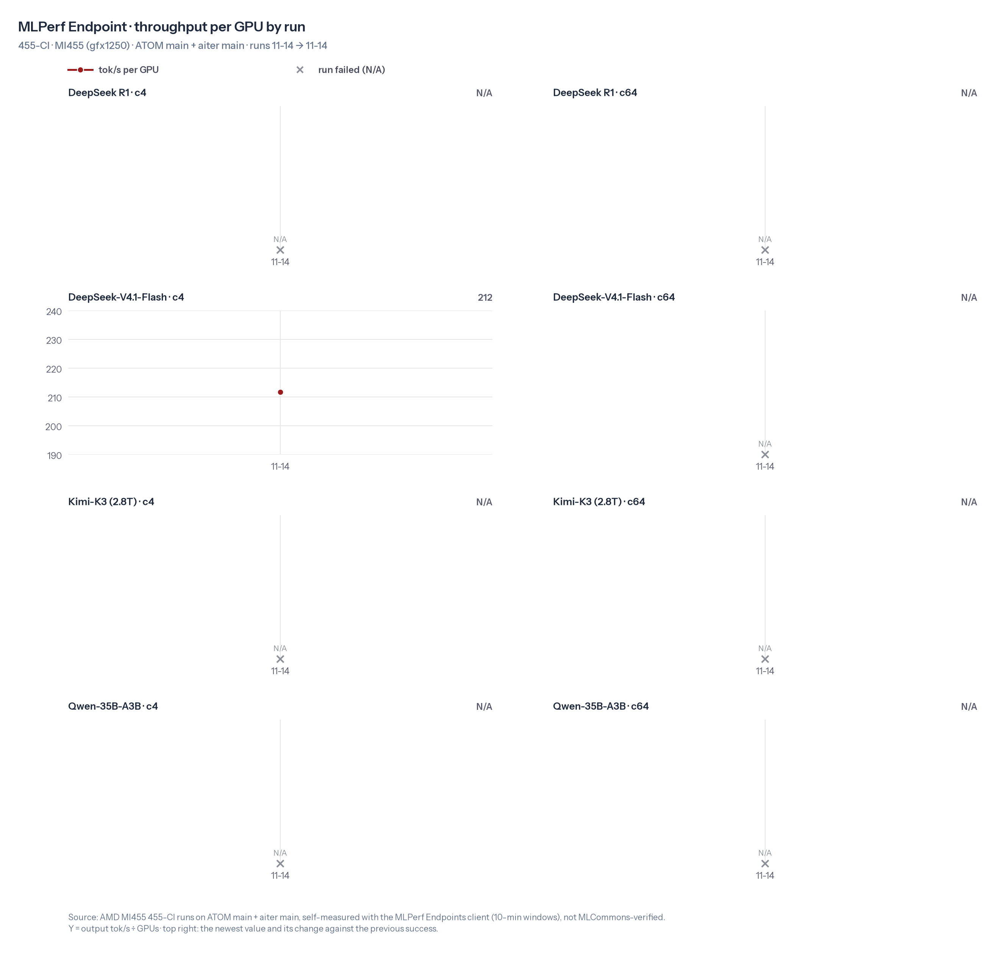
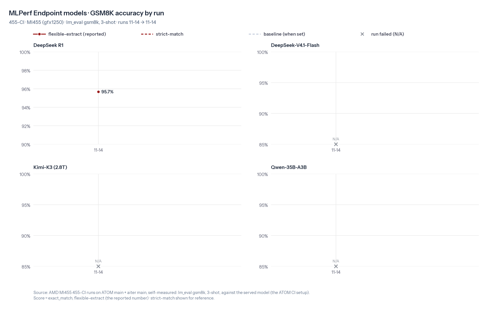

# 455-CI result · 2026-11-14 · MLPerf Endpoint

Image `gfx1250-atom-ci455-20261114` · ATOM `main@9fec99786` · aiter `main@b6f1ff6b7`

## Summary

### Highlights

- ❌ DeepSeek R1: c4 and c64 failed (95% of turns failed: chat template TypeError on dict tool-c…). Fixed by us in [ROCm/ATOM#3345](https://github.com/ROCm/ATOM/pull/3345), verified.
- ❌ DeepSeek-V4.1-Flash: c64 and GSM8K failed (ValueError: DeepSeek-V4.1 DSpark requires a BF16 or FP8 KV …). Fix in progress: [ROCm/ATOM#2989](https://github.com/ROCm/ATOM/pull/2989). The failed GSM8K is the DEP4 server's; the TP4 server scored 0.9189 (reference 0.9196).
- ❌ Kimi-K3: all runs failed (openai_server.py: error: unrecognized arguments: --tensor-p…). Fix in progress: [ROCm/ATOM#2647](https://github.com/ROCm/ATOM/pull/2647) + [ROCm/ATOM#2760](https://github.com/ROCm/ATOM/pull/2760) + [ROCm/aiter#7912](https://github.com/ROCm/aiter/pull/7912) + [ROCm/aiter#7913](https://github.com/ROCm/aiter/pull/7913), plus a one-row fix to aiter's K3 TP8 MoE tuning table (no PR yet); verified with all of them.
- ❌ Qwen-35B-A3B: all runs failed (ValueError: gfx1250 fused_moe requires gu_interleave weight…). Fixed on main by [ROCm/ATOM#3223](https://github.com/ROCm/ATOM/pull/3223) (merged after the image was built), verified.

### Results

| Model | Scenario | — (tok/s/GPU) | 2026-11-14 (tok/s/GPU) | Delta | GSM8K delta |
|---|---|---|---|---|---|
| DeepSeek R1 | MLPerf Endpoint | — | N/A | N/A | first (now 95.7%) |
| DeepSeek-V4.1-Flash | MLPerf Endpoint | — | N/A | N/A | N/A |
| Kimi-K3 (2.8T) | MLPerf Endpoint | — | N/A | N/A | N/A |
| Qwen-35B-A3B | MLPerf Endpoint | — | N/A | N/A | N/A |

## Findings

- DeepSeek R1 (MLPerf Endpoint): ATOM main turns history tool-call `arguments` into dicts for every chat template except Kimi-K3's (`template_keeps_tool_call_arguments` in `atom/entrypoints/openai/tool_parser/registry.py`, added in https://github.com/ROCm/ATOM/pull/2944). R1's template string-concatenates `tool['function']['arguments']`, so every turn after a tool call returns HTTP 500 with `TypeError: can only concatenate str (not "dict") to str` (728 turns in this session).
- DeepSeek R1 (MLPerf Endpoint): the recipe server runs `--no-enable-chunked-prefill` with the default `max_num_batched_tokens=16384`, but agentic prompts are 26k+ tokens, so ATOM rejects them as unschedulable (971 turns). These flags come from the single-turn MLPerf R1 setup. The agentic bench needs chunked prefill or a larger `--max-num-batched-tokens`.
- DeepSeek R1: with both problems, only 251/5886 (c4) and 809/13244 (c64) samples succeeded, and the client reports no `e2e_avg_interactivity`. Both points are recorded as failed. GSM8K is unaffected: 0.9545, matching the 2026-11-13 main reference (0.9538-0.9545).
- Guide §3.3: `wait_infer_drain.sh` is given `$ACC_DIR/lm_eval.log`. Its own command line then matches its `CLIENT_PATTERN` (`lm_eval`), so it never sees lm_eval exit and reports a hang (rc=1) 3 minutes after GSM8K finishes. R1's GSM8K had finished normally. Later models pass the same file through a symlink named `client.log`.
- The image ENV sets `HF_HUB_OFFLINE=1`, so the generic §3.3 GSM8K command cannot download `openai/gsm8k`. `HF_HUB_OFFLINE=0` was added for Qwen-35B-A3B, as the R1 and V4.1-Flash recipes already do.
- DeepSeek R1: aiter repeatedly logs `Ignoring invalid OPUS tuned row for gfx=gfx1250, shape=(1,129280,7168), kid=13` (the lm_head GEMM) and falls back to the default backend.
- DeepSeek R1: the server was ready 501 s after launch with an empty JIT cache.
- Qwen-35B-A3B: the server dies in warmup (341 s after launch) in aiter `fused_moe` with `ValueError: gfx1250 fused_moe requires gu_interleave weight layout (gate_mode=interleave), got separated`. ATOM main defaults `ATOM_MOE_GU_ITLV` to 0 (`atom/utils/envs.py`). The DeepSeek R1 and Kimi-K3 recipes set `ATOM_MOE_GU_ITLV=1`, but the Qwen-35B-A3B recipe does not, so ATOM keeps the separated gate/up layout that gfx1250 fused MoE rejects. Not retried.
- DeepSeek-V4.1-Flash c64 (DEP4): main now accepts `--kv_cache_dtype fp4` in argparse (the recipe expected `invalid choice: fp4`), but the server stops 20 s after launch in `validate_speculative_config` with `ValueError: DeepSeek-V4.1 DSpark requires a BF16 or FP8 KV cache`. https://github.com/ROCm/ATOM/pull/2989 (open) relaxes this check; https://github.com/ROCm/aiter/pull/7407 merged on 2026-11-13.
- DeepSeek-V4.1-Flash c4 (TP4): 1061/1061 samples succeeded on the MLPerf Endpoints agentic bench, 211.74 tok/s/GPU, interactivity 499.58; client inline accuracy 0.513. The recipe reference (274.51 tok/s/GPU) used the earlier single-config bench, so the two are not comparable.
- Kimi-K3: both nodes exit at argument parsing 37 s after launch with `unrecognized arguments: --tensor-parallel-size-local 4 --tensor-parallel-rank 0`, as the recipe expects. Cross-node TP needs https://github.com/ROCm/ATOM/pull/2647, and DSpark + DCP on gfx1250 needs https://github.com/ROCm/ATOM/pull/2760 (main still asserts `Speculative decode + DCP is only supported on gfx950`); both are open. No GPU was touched. Weights on both nodes match the pinned revisions.
- DeepSeek-V4.1-Flash GSM8K: the recipe asks for one accuracy row per server (TP4 and DEP4). The report and the accuracy chart take a model's last row of the session, so they show the failed DEP4 row; the TP4 server scored 0.9189 flexible / 0.9181 strict (accuracy.csv).
- DeepSeek R1 follow-up E2E (not a CI run; numbers not in perf.csv): ATOM main + https://github.com/ROCm/ATOM/pull/3345 with the recipe server minus `--no-enable-chunked-prefill`. A history tool-call request returns 200, c4 completes 127/127 samples (0 HTTP 500, 0 unschedulable), GSM8K stays 0.9545. At c64 the server dies about 1 s into warmup with a GPU memory fault in aiter `_triton_gather_kv_b_proj` (chunked prefill gathering cached KV, `ATOM_MLA_KV_SHUFFLED=1`): [repro](../455-CI/runs/20261114/deepseek-r1/e2e-chunked-prefill/repro.md). c4 performance was low (6.5 tok/s/GPU, interactivity 9.9) with prefix caching off: every turn re-prefills the whole history.
- DeepSeek R1 rerun (recipe 6941c359, which drops `--no-enable_prefix_caching` and `--no-enable-chunked-prefill`, so both are on): no turn is unschedulable any more (26K+ token prompts are prefilled in 16,384-token chunks), and the prefix cache reuses the ~26.5K-token system prompt and tool definitions every conversation shares (about 93% hit rate at c64). GSM8K 0.9568.
- DeepSeek R1 rerun on main still fails c4 and c64 with one cause, the chat-template TypeError on history tool-call arguments (HTTP 500): 3000/3157 (c4) and 14914/15726 (c64) samples failed. The server answered 116 of 283 (c4) and 546 of 1422 (c64) chat requests with 500; the client then counts the rest of that trajectory as failed, hence about 95%. Recorded as failed (rows marked as the rerun); the throughput would be 7.12 / 52.99 tok/s/GPU with no interactivity.
- DeepSeek R1 with https://github.com/ROCm/ATOM/pull/3345 (only the PR's own 4 files applied on the image's ATOM 9fec99786, recipe 6941c359; not a CI run, numbers not in perf.csv): GSM8K 0.9553; c4 146/146 samples, 8.02 tok/s/GPU, 13.68 tok/s/user; c64 1220/1220 samples, 94.65 tok/s/GPU, 8.24 tok/s/user; no HTTP 500 and no GPU fault (e15-07). A second c64 run on e15-06 (a fresh server, c64 only): 1197/1197 samples, 85.55 tok/s/GPU, 7.41 tok/s/user, no GPU fault. So with the prefix cache and chunked prefill on, #3345 is the one PR R1 needs on main.
- DeepSeek R1: the GPU memory fault in aiter `_triton_gather_kv_b_proj` that ended c64 with chunked prefill on and the prefix cache off ([repro](https://github.com/ROCm/ATOM/blob/455-CI/recipes/455-CI/runs/20261114/deepseek-r1/e2e-chunked-prefill/repro.md)) did not come back in the c64 runs with the prefix cache on. With the cache on, nearly every request starts from the cached shared prefix, so batches that mix a long continued prefill with requests that have no cached tokens (the batches right before that fault) are rare. The fault is not fixed and still applies to a setup without the prefix cache.
- DeepSeek R1 agentic performance is low with this server config: at c64 each DP rank runs about 13 requests at 250-300 generated tokens/s in all (about 20 tok/s per request, roughly 50 ms per decode step over 30-50K-token contexts), with the KV cache about 1% used. The config (DP4 attention, EP4, max-num-seqs 2048) was tuned for the single-turn MLPerf R1 setup.
- Qwen-35B-A3B: https://github.com/ROCm/ATOM/pull/3223 merged into main at 2026-11-14 05:55 UTC, after the image was built. It makes gfx1250's fused MoE use the interleaved gate/up layout without `ATOM_MOE_GU_ITLV`, which is the warmup ValueError here, and it replaces https://github.com/ROCm/ATOM/pull/2794 (a draft from 2026-10-28 that no longer applies to main). With only #3223 on the image's ATOM 9fec99786 and the recipe unchanged (not a CI run, numbers not in perf.csv): GSM8K 0.8590 / 0.8552, inside the Qwen team's 3-shot range for this checkpoint on gfx1250 ATOM (0.861-0.867 / 0.851-0.859); c4 858/858 samples, 437.96 tok/s/GPU, 220.73 tok/s/user; c64 4405/4405 samples, 2365.83 tok/s/GPU, 55.57 tok/s/user; the server was ready in 442 s.
- DeepSeek-V4.1-Flash TP4 accuracy is right on main: GSM8K 0.9189 / 0.9181 on the TP4 server (accuracy.csv), against the recipe reference 0.9196 / 0.9196. The summary table shows N/A only because the failed DEP4 server's row is the session's last.
- Kimi-K3 runs once its fixes are in (not a CI run, numbers not in perf.csv), with ATOM https://github.com/ROCm/ATOM/pull/2647 + https://github.com/ROCm/ATOM/pull/2760 on the image's ATOM 9fec99786 and aiter https://github.com/ROCm/aiter/pull/7912 + https://github.com/ROCm/aiter/pull/7913 on its aiter b6f1ff6b7, plus a one-row fix to aiter's K3 TP8 tuning table (below). Results: GSM8K 0.9606 / 0.9613 (5-shot chat, the recipe's baseline strict 0.9659); c4 293/293 samples, 30.47 tok/s/GPU, 112.18 tok/s/user; c64 1703/1703 samples, 120.09 tok/s/GPU, 19.22 tok/s/user; no failed sample, no GPU fault.
- Kimi-K3: #2760 also needs aiter. Without https://github.com/ROCm/aiter/pull/7913 every rank stops while building the model with `RuntimeError: Speculative decode with DCP on gfx1250 needs an aiter with get_mla_decode_num_heads (ROCm/aiter#7913)`, and #2760's description lists https://github.com/ROCm/aiter/pull/7912 (MLA reduce LDS race) as needed by #7913. Both aiter PRs are open drafts, so the recipe's list (#2647 and #2760) is incomplete.
- Kimi-K3: with those four PRs the server faulted in warmup (2 x 8192 tokens) in the gfx1250 TDM grouped MoE GEMM `mxfp4_tdm_fp4_t128x128x512_..._K384_e896` ("Page not present"). Cause: the token=16384 row of aiter's `kimik3tp8_tuned_grouped_fmoe.csv` runs stage 2 (K = inter_dim = 384 per TP8 expert slice) with tile_k2 = 512, larger than K, so the kernel reads past the slice. aiter main (9ac5ce9) still has it; the row came from https://github.com/ROCm/aiter/pull/7296. Setting tile_k2 = 128, as every other row of the table has, fixed it; that change is not a PR yet.
- Kimi-K3 load time on the 1 TB trays: e15-06 loaded its half of the 1.56 TB checkpoint in about 6 minutes, e15-07 took about 30 (its four ranks read 2+ TB through mmap while the page cache thrashed), so the server was ready after 41 minutes. The recipe's `ATOM_LOADER_PREFETCH=false` does not prevent this; the 2026-11-11 K3 runs also used `ATOM_DISABLE_MMAP=true`, which the recipe does not have.
- Kimi-K3 GSM8K: the recipe's lm_eval command needs `HF_HUB_OFFLINE=0` (the image ENV sets 1), as R1 and V4.1-Flash have. The run used `wait_infer_drain.sh` with a 120-minute limit instead of the guide's 30, because K3 answers think for up to 12,288 tokens; it finished in 7.5 minutes.

## Details

### Environment

| Item | Value |
|---|---|
| Test image | `rocm/fw-bringup-mlperf:gfx1250-atom-ci455-20261114` (digest `sha256:9c38aef6ad030885b5309ad90b30ff778da4f764161aecdf7b7c7d8ae3ea1eb9`) |
| ATOM | `main` @ [`9fec99786`](https://github.com/ROCm/ATOM/commit/9fec99786b088168aec7729858c1176e99d818e6), 2026-11-13 perf(dsv41): add the shared expert output in the MegaMoE combine on the mori v2 EP path (#3132) |
| aiter | `main` @ [`b6f1ff6b7`](https://github.com/ROCm/aiter/commit/b6f1ff6b7f3754aca8cc8c403b5fcd7a258eba47), 2026-11-13 [CI] FFM Triton: fall back to main when the suite source ref is gone (#7930) |
| Test date | 2026-11-14 |

### Performance · MLPerf Endpoint

| Model | Parallelism | Concurrency | tok/s/GPU | vs — | E2E avg interactivity (tok/s/user) | vs — |
|---|---|---|---|---|---|---|
| DeepSeek R1 | dp4ep4 | 4 | N/A | N/A | N/A | — |
| DeepSeek R1 | dp4ep4 | 64 | N/A | N/A | N/A | — |
| DeepSeek-V4.1-Flash | tp4 | 4 | 212 | first | 500 | first |
| DeepSeek-V4.1-Flash | dep4 | 64 | N/A | N/A | N/A | — |
| Kimi-K3 (2.8T) | tp8dcp8 | 4 | N/A | N/A | N/A | — |
| Kimi-K3 (2.8T) | tp8dcp8 | 64 | N/A | N/A | N/A | — |
| Qwen-35B-A3B | tp1 | 4 | N/A | N/A | N/A | — |
| Qwen-35B-A3B | tp1 | 64 | N/A | N/A | N/A | — |

### Accuracy (GSM8K, 3-shot) · MLPerf Endpoint

| Model | flexible-extract | strict-match | — | vs — |
|---|---|---|---|---|
| DeepSeek R1 | 95.7% | 95.7% | — | first |
| DeepSeek-V4.1-Flash | N/A | — | — | N/A |
| Kimi-K3 (2.8T) | N/A | — | — | N/A |
| Qwen-35B-A3B | N/A | — | — | N/A |

### Trends · MLPerf Endpoint





### Follow-ups

| Model | Next step | Note |
|---|---|---|
| DeepSeek R1 | Fixed by us in [ROCm/ATOM#3345](https://github.com/ROCm/ATOM/pull/3345), verified. | Verified on 455 with the recipe at 6941c359 (prefix cache and chunked prefill on) on main 9fec99786 + only #3345's changes: GSM8K 0.9553; c4 146/146 samples, 8.02 tok/s/GPU, 13.68 tok/s/user; c64 1220/1220 samples, 94.65 tok/s/GPU, 8.24 tok/s/user; c64 again on another node 1197/1197, 85.55 tok/s/GPU; no HTTP 500, no GPU fault. |
| DeepSeek-V4.1-Flash | Fix in progress: [ROCm/ATOM#2989](https://github.com/ROCm/ATOM/pull/2989). | Relaxes the V4.1 DSpark KV-cache check to allow fp4 (the c64/DEP4 ValueError); open. Its aiter dependency ROCm/aiter#7407 merged on 2026-11-13. |
| Kimi-K3 (2.8T) | Fix in progress: [ROCm/ATOM#2647](https://github.com/ROCm/ATOM/pull/2647) + [ROCm/ATOM#2760](https://github.com/ROCm/ATOM/pull/2760) + [ROCm/aiter#7912](https://github.com/ROCm/aiter/pull/7912) + [ROCm/aiter#7913](https://github.com/ROCm/aiter/pull/7913), plus a one-row fix to aiter's K3 TP8 MoE tuning table (no PR yet); verified with all of them. | All four open; the aiter two are drafts that #2760 needs. Also needs a one-row fix to aiter's kimik3tp8_tuned_grouped_fmoe.csv (tile_k2 512 -> 128 at 16384 tokens; the GPU faults in warmup without it), not yet a PR. Verified on 455 with all of them: GSM8K 0.9606/0.9613; c4 293/293 samples, 30.47 tok/s/GPU; c64 1703/1703 samples, 120.09 tok/s/GPU; no GPU fault. |
| Qwen-35B-A3B | Fixed on main by [ROCm/ATOM#3223](https://github.com/ROCm/ATOM/pull/3223) (merged after the image was built), verified. | Merged into main 2026-11-14 05:55 UTC, after the image was built (replaces the stale draft #2794). Verified on 455 with the recipe unchanged: GSM8K 0.8590/0.8552; c4 858/858 samples, 437.96 tok/s/GPU, 220.73 tok/s/user; c64 4405/4405 samples, 2365.83 tok/s/GPU, 55.57 tok/s/user. |

### Failures

#### DeepSeek R1 (MLPerf Endpoint): c4, c64

- Error: `95% of turns failed: chat template TypeError on dict tool-call arguments (HTTP 500); a failed turn ends its trajectory`
- Full excerpt: [error.log](../455-CI/runs/20261114/deepseek-r1/error.log)

Core error log:

```text
[atom 06:14:07] joint kv: boundaries=0 (state_hbm=0 state_tier=0) | off=324
[atom.model_engine.prefill_delayer 06:14:07] [PrefillDelayer stats] total=5000 fire_fill=0 fire_stall=48 fire_cost=6 fire_ttft=0 fire_kv=0 fire_partial=3 fire_nodecode=1 fire_queue_ms=0 fire_vacuous=1827 hold_decode_interval=0 hold=3115 (hold_rate=62.30%)
[atom.model_engine.prefill_delayer 06:14:07] [PrefillDelayer stats] total=5000 fire_fill=0 fire_stall=48 fire_cost=6 fire_ttft=0 fire_kv=0 fire_partial=3 fire_nodecode=1 fire_queue_ms=0 fire_vacuous=1827 hold_decode_interval=0 hold=3115 (hold_rate=62.30%)
[atom.model_engine.prefill_delayer 06:14:07] [PrefillDelayer stats] total=5000 fire_fill=0 fire_stall=48 fire_cost=6 fire_ttft=0 fire_kv=0 fire_partial=3 fire_nodecode=1 fire_queue_ms=0 fire_vacuous=1827 hold_decode_interval=0 hold=3115 (hold_rate=62.30%)
[atom.model_engine.prefill_delayer 06:14:07] [PrefillDelayer stats] total=5000 fire_fill=0 fire_stall=48 fire_cost=6 fire_ttft=0 fire_kv=0 fire_partial=3 fire_nodecode=1 fire_queue_ms=0 fire_vacuous=1827 hold_decode_interval=0 hold=3115 (hold_rate=62.30%)
[atom 06:14:09] joint kv: boundaries=0 (state_hbm=0 state_tier=0) | off=325
[atom 06:14:09] joint kv: boundaries=0 (state_hbm=0 state_tier=0) | off=335
[atom 06:14:09] joint kv: boundaries=0 (state_hbm=0 state_tier=0) | off=339
[atom 06:14:09] joint kv: boundaries=0 (state_hbm=0 state_tier=0) | off=324
[atom 06:14:10] Engine Core: output send 1 reqs
[atom 06:14:11] joint kv: boundaries=0 (state_hbm=0 state_tier=0) | off=335
[atom 06:14:11] joint kv: boundaries=0 (state_hbm=0 state_tier=0) | off=325
[atom 06:14:11] joint kv: boundaries=0 (state_hbm=0 state_tier=0) | off=324
[atom 06:14:11] Engine Core: output send 1 reqs
[atom 06:14:12] Error in chat_completions
Traceback (most recent call last):
  File "/app/ATOM/atom/entrypoints/openai/api_server.py", line 2235, in _chat_completions
    prompt_or_tokens = await asyncio.to_thread(
                       ^^^^^^^^^^^^^^^^^^^^^^^^
  File "/usr/lib/python3.12/asyncio/threads.py", line 25, in to_thread
    return await loop.run_in_executor(None, func_call)
           ^^^^^^^^^^^^^^^^^^^^^^^^^^^^^^^^^^^^^^^^^^^
  File "/usr/lib/python3.12/concurrent/futures/thread.py", line 58, in run
    result = self.fn(*self.args, **self.kwargs)
             ^^^^^^^^^^^^^^^^^^^^^^^^^^^^^^^^^^
  File "/app/ATOM/atom/entrypoints/openai/chat_encoders.py", line 320, in apply_chat_template
    return tokenizer.apply_chat_template(messages, **kwargs)
           ^^^^^^^^^^^^^^^^^^^^^^^^^^^^^^^^^^^^^^^^^^^^^^^^^
  File "/usr/local/lib/python3.12/dist-packages/transformers/tokenization_utils_base.py", line 3108, in apply_chat_template
    rendered_chat, generation_indices = render_jinja_template(
                                        ^^^^^^^^^^^^^^^^^^^^^^
  File "/usr/local/lib/python3.12/dist-packages/transformers/utils/chat_template_utils.py", line 581, in render_jinja_template
    rendered_chat = compiled_template.render(
                    ^^^^^^^^^^^^^^^^^^^^^^^^^
  File "/usr/local/lib/python3.12/dist-packages/jinja2/environment.py", line 1295, in render
    self.environment.handle_exception()
  File "/usr/local/lib/python3.12/dist-packages/jinja2/environment.py", line 942, in handle_exception
    raise rewrite_traceback_stack(source=source)
  File "<template>", line 1, in top-level template code
TypeError: can only concatenate str (not "dict") to str
INFO:     127.0.0.1:39716 - "POST /v1/chat/completions HTTP/1.1" 500 Internal Server Error
[atom 06:14:12] Request 1323 arrived, input tokens: 26584, pending requests: 3
[atom 06:14:12] Engine Core Mgr: add rank1: 1 req / 26584 tok | in-flight reqs=[1, 1, 0, 1] queued_prefill_tokens=[0, 26584, 0, 0]
INFO:     127.0.0.1:39726 - "POST /v1/chat/completions HTTP/1.1" 200 OK
[atom 06:14:12] Scheduled prefill batch: 1 reqs, 88 new tokens (done: [26496], new: [88]), req_ids: (1323,)
[atom 06:14:19] Request 1324 arrived, input tokens: 26695, pending requests: 4
[atom 06:14:19] Engine Core Mgr: add rank2: 1 req / 26695 tok | in-flight reqs=[1, 1, 1, 1] queued_prefill_tokens=[0, 26584, 26695, 0]
INFO:     127.0.0.1:43270 - "POST /v1/chat/completions HTTP/1.1" 200 OK
[atom 06:14:19] Engine 001: Avg prompt throughput: 6.1 tokens/s, Avg generation throughput: 22.6 tokens/s, Running: 1 reqs, Waiting: 0 reqs, GPU KV cache usage: 0.3%, Prefix cache hit rate: 12.1%
[atom 06:14:19] Engine 000: Avg prompt throughput: 0.0 tokens/s, Avg generation throughput: 31.6 tokens/s, Running: 1 reqs, Waiting: 0 reqs, GPU KV cache usage: 0.0%, Prefix cache hit rate: 0.6%
[atom 06:14:19] Engine 002: Avg prompt throughput: 0.0 tokens/s, Avg generation throughput: 30.1 tokens/s, Running: 0 reqs, Waiting: 0 reqs, GPU KV cache usage: 0.0%, Prefix cache hit rate: 0.4%
[atom 06:14:19] Engine 003: Avg prompt throughput: 0.0 tokens/s, Avg generation throughput: 31.8 tokens/s, Running: 1 reqs, Waiting: 0 reqs, GPU KV cache usage: 0.0%, Prefix cache hit rate: 0.8%
[atom 06:14:19] Scheduled prefill batch: 1 reqs, 199 new tokens (done: [26496], new: [199]), req_ids: (1324,)
[atom 06:14:19] joint kv: boundaries=0 (state_hbm=0 state_tier=0) | off=340
[atom 06:14:19] joint kv: boundaries=0 (state_hbm=0 state_tier=0) | off=325
[atom 06:14:19] joint kv: boundaries=0 (state_hbm=0 state_tier=0) | off=335
----- last 30 lines -----
[atom 06:39:18] joint kv: boundaries=0 (state_hbm=0 state_tier=0) | off=630
[atom 06:39:19] joint kv: boundaries=0 (state_hbm=0 state_tier=0) | off=540
[atom 06:39:19] joint kv: boundaries=0 (state_hbm=0 state_tier=0) | off=630
… (87 lines in all; see error.log)
```

#### DeepSeek-V4.1-Flash (MLPerf Endpoint): c64, GSM8K

- Error: `ValueError: DeepSeek-V4.1 DSpark requires a BF16 or FP8 KV cache`
- Full excerpt: [error.log](../455-CI/runs/20261114/deepseek-v4.1-flash/error.log)

Core error log:

```text
[atom 04:03:05] Raised RLIMIT_NOFILE soft limit 1024 -> 65535 (hard=524288)
[atom 04:03:05] Loading tokenizer from /models/DeepSeek-V4.1-Flash...
[transformers] You are using a model of type `deepseek_v41` to instantiate a model of type ``. This may be expected if you are loading a checkpoint that shares a subset of the architecture (e.g., loading a `sam2_video` checkpoint into `Sam2Model`), but is otherwise not supported and can yield errors. Please verify that the checkpoint is compatible with the model you are instantiating.
[atom 04:03:06] Loaded message encoder from /models/DeepSeek-V4.1-Flash/encoding/encoding.py
[atom 04:03:06] Initializing engine with model /models/DeepSeek-V4.1-Flash...
[atom 04:03:06] Reasoning channel: </think>
[atom 04:03:06] Reasoning switches on thinking_mode: 'thinking' on, 'chat' off.
[atom 04:03:06] Tool-call format: dsml_v41 (from the chat template)
[transformers] DeepseekV41TextConfig got `key=rope_scaling` in kwargs but hasn't set it as attribute. For RoPE standardization you need to set `self.rope_parameters` in model's config. 
[transformers] DeepseekV41TextConfig got `key=rope_scaling` in kwargs but hasn't set it as attribute. For RoPE standardization you need to set `self.rope_parameters` in model's config. 
[atom 04:03:07] Engine kwargs: {'trust_remote_code': True, 'tensor_parallel_size': 4, 'decode_context_parallel_size': 1, 'pipeline_parallel_size': 1, 'prefill_context_parallel_size': 1, 'sequence_parallel_size': 1, 'data_parallel_size': 1, 'enforce_eager': False, 'enable_prefix_caching': True, 'port': 8006, 'kv_cache_dtype': 'fp4', 'index_cache_dtype': 'fp4', 'max_model_len': None, 'max_num_batched_tokens': 16384, 'long_prefill_token_threshold': 0, 'attn_prefill_chunk_size': 16384, 'state_checkpoint_interval_tokens': 8192, 'state_checkpoint_demand': True, 'enable_decoder_swa_bounded_replay': True, 'enable_encoder_swa_bounded_replay': True, 'enable_chunked_prefill': True, 'enable_log_stats': True, 'enable_request_context_metrics': False, 'sampler_independent_noise': False, 'throughput_log_interval': 10.0, 'throughput_log_interval_steps': 0, 'cache_hit_rate_window': 1000, 'enable_dynamic_chunking': False, 'dynamic_chunking_smooth_factor': None, 'dynamic_chunking_min_chunk_size': 4096, 'scheduler_delay_factor': 0.0, 'prefill_admit_policy': 'interval', 'max_num_seqs': 64, 'gpu_memory_utilization': 0.9, 'load_dummy': None, 'enable_expert_parallel': True, 'fake_eplb': False, 'torch_profiler_dir': None, 'enable_dp_attention': True, 'dp_load_balance': 'least_requests', 'moe_backend': 'standard', 'kv_transfer_config': '{}', 'mark_trace': False, 'enable_rapidserve': False, 'disagg_prefill_max_num_seqs': None, 'disagg_constrained': False, 'online_quant_config': None, 'hf_overrides': None, 'eplb_enable': False, 'kv_cache_block_size': 16, 'compilation_config': CompilationConfig(level=0, use_cudagraph=True, local_cache_dir=None, cudagraph_capture_sizes=[1, 2, 3, 4, 5, 6, 7, 8, 12, 16, 24, 32, 40, 48, 56, 64], cuda_graph_sizes=[512], debug_dump_path='', traced_files=set(), cache_dir='', use_inductor=True, cudagraph_mode=<CUDAGraphMode.FULL: 2>, compilation_time=0.0, splitting_ops=None, cudagraph_copy_inputs=False, inductor_compile_config={}, compile_sizes=None, static_forward_context={}), 'speculative_config': SpeculativeConfig(method='dspark', num_spec_tokens=5), 'enable_tbo': False, 'enable_tbo_decode': False, 'enable_low_latency': False, 'moe_all2all_backend': 'mori', 'dspark': DSparkConfig(confidence_schedule=False, ragged=False, ragged_graph_sizes='', q_buckets='', disable_sps_calib=False, calibration_profile=None), 'eplb_config': EPLBConfig(load_window_size=1000, rebalance_interval=3000, rebalance_layers_per_chunk=64, num_redundant_experts=0, rebalance_min_balancedness=2.0, rebalance_balancedness_agg='min', p2p_batch_chunk_size=32, placement_policy='naive'), 'dcp_config': DCPConfig(interleave_size=1, enable_query_replication=True, enable_project_before_merge=True, comm_backend='a2a', indexer_dcp_only=False), 'parallel_config': ParallelConfig(data_parallel_size=1, data_parallel_size_local=1, data_parallel_rank=0, data_parallel_rank_local=None, decode_context_parallel_size=1, pipeline_parallel_rank=0, pp_meta_addrs=[], pp_token_addr='', control_address='', pp_kv_status_addr='', data_parallel_master_port=29500, data_parallel_base_port=0, server_instance_id='', data_parallel_master_ip='127.0.0.1')}
[atom 04:03:07] dcp_config.enable_query_replication disabled: decode_context_parallel_size <= 1 (no DCP group) not supported.
[transformers] DeepseekV41TextConfig got `key=rope_scaling` in kwargs but hasn't set it as attribute. For RoPE standardization you need to set `self.rope_parameters` in model's config. 
[transformers] DeepseekV41TextConfig got `key=rope_scaling` in kwargs but hasn't set it as attribute. For RoPE standardization you need to set `self.rope_parameters` in model's config. 
[transformers] `torch_dtype` is deprecated! Use `dtype` instead!
Traceback (most recent call last):
  File "<frozen runpy>", line 198, in _run_module_as_main
  File "<frozen runpy>", line 88, in _run_code
  File "/app/ATOM/atom/entrypoints/openai_server.py", line 27, in <module>
    main()
  File "/app/ATOM/atom/entrypoints/openai/api_server.py", line 3795, in main
    engine = engine_args.create_engine(tokenizer=tokenizer)
             ^^^^^^^^^^^^^^^^^^^^^^^^^^^^^^^^^^^^^^^^^^^^^^
  File "/app/ATOM/atom/model_engine/arg_utils.py", line 1003, in create_engine
    return LLMEngine(self.model, tokenizer=tokenizer, **self._get_engine_kwargs())
           ^^^^^^^^^^^^^^^^^^^^^^^^^^^^^^^^^^^^^^^^^^^^^^^^^^^^^^^^^^^^^^^^^^^^^^^
  File "/app/ATOM/atom/model_engine/llm_engine.py", line 50, in __init__
    config = Config(model, **config_kwargs)
             ^^^^^^^^^^^^^^^^^^^^^^^^^^^^^^
  File "<string>", line 88, in __init__
  File "/app/ATOM/atom/config.py", line 3011, in __post_init__
    validate_runtime_config(self)
  File "/app/ATOM/atom/models/deepseek_v41/config.py", line 439, in validate_runtime_config
    validate_speculative_config(config)
  File "/app/ATOM/atom/models/deepseek_v41/config.py", line 325, in validate_speculative_config
    raise ValueError("DeepSeek-V4.1 DSpark requires a BF16 or FP8 KV cache")
ValueError: DeepSeek-V4.1 DSpark requires a BF16 or FP8 KV cache
----- last 30 lines -----
[atom 04:03:06] Tool-call format: dsml_v41 (from the chat template)
[transformers] DeepseekV41TextConfig got `key=rope_scaling` in kwargs but hasn't set it as attribute. For RoPE standardization you need to set `self.rope_parameters` in model's config. 
[transformers] DeepseekV41TextConfig got `key=rope_scaling` in kwargs but hasn't set it as attribute. For RoPE standardization you need to set `self.rope_parameters` in model's config. 
[atom 04:03:07] Engine kwargs: {'trust_remote_code': True, 'tensor_parallel_size': 4, 'decode_context_parallel_size': 1, 'pipeline_parallel_size': 1, 'prefill_context_parallel_size': 1, 'sequence_parallel_size': 1, 'data_parallel_size': 1, 'enforce_eager': False, 'enable_prefix_caching': True, 'port': 8006, 'kv_cache_dtype': 'fp4', 'index_cache_dtype': 'fp4', 'max_model_len': None, 'max_num_batched_tokens': 16384, 'long_prefill_token_threshold': 0, 'attn_prefill_chunk_size': 16384, 'state_checkpoint_interval_tokens': 8192, 'state_checkpoint_demand': True, 'enable_decoder_swa_bounded_replay': True, 'enable_encoder_swa_bounded_replay': True, 'enable_chunked_prefill': True, 'enable_log_stats': True, 'enable_request_context_metrics': False, 'sampler_independent_noise': False, 'throughput_log_interval': 10.0, 'throughput_log_interval_steps': 0, 'cache_hit_rate_window': 1000, 'enable_dynamic_chunking': False, 'dynamic_chunking_smooth_factor': None, 'dynamic_chunking_min_chunk_size': 4096, 'scheduler_delay_factor': 0.0, 'prefill_admit_policy': 'interval', 'max_num_seqs': 64, 'gpu_memory_utilization': 0.9, 'load_dummy': None, 'enable_expert_parallel': True, 'fake_eplb': False, 'torch_profiler_dir': None, 'enable_dp_attention': True, 'dp_load_balance': 'least_requests', 'moe_backend': 'standard', 'kv_transfer_config': '{}', 'mark_trace': False, 'enable_rapidserve': False, 'disagg_prefill_max_num_seqs': None, 'disagg_constrained': False, 'online_quant_config': None, 'hf_overrides': None, 'eplb_enable': False, 'kv_cache_block_size': 16, 'compilation_config': CompilationConfig(level=0, use_cudagraph=True, local_cache_dir=None, cudagraph_capture_sizes=[1, 2, 3, 4, 5, 6, 7, 8, 12, 16, 24, 32, 40, 48, 56, 64], cuda_graph_sizes=[512], debug_dump_path='', traced_files=set(), cache_dir='', use_inductor=True, cudagraph_mode=<CUDAGraphMode.FULL: 2>, compilation_time=0.0, splitting_ops=None, cudagraph_copy_inputs=False, inductor_compile_config={}, compile_sizes=None, static_forward_context={}), 'speculative_config': SpeculativeConfig(method='dspark', num_spec_tokens=5), 'enable_tbo': False, 'enable_tbo_decode': False, 'enable_low_latency': False, 'moe_all2all_backend': 'mori', 'dspark': DSparkConfig(confidence_schedule=False, ragged=False, ragged_graph_sizes='', q_buckets='', disable_sps_calib=False, calibration_profile=None), 'eplb_config': EPLBConfig(load_window_size=1000, rebalance_interval=3000, rebalance_layers_per_chunk=64, num_redundant_experts=0, rebalance_min_balancedness=2.0, rebalance_balancedness_agg='min', p2p_batch_chunk_size=32, placement_policy='naive'), 'dcp_config': DCPConfig(interleave_size=1, enable_query_replication=True, enable_project_before_merge=True, comm_backend='a2a', indexer_dcp_only=False), 'parallel_config': ParallelConfig(data_parallel_size=1, data_parallel_size_local=1, data_parallel_rank=0, data_parallel_rank_local=None, decode_context_parallel_size=1, pipeline_parallel_rank=0, pp_meta_addrs=[], pp_token_addr='', control_address='', pp_kv_status_addr='', data_parallel_master_port=29500, data_parallel_base_port=0, server_instance_id='', data_parallel_master_ip='127.0.0.1')}
[atom 04:03:07] dcp_config.enable_query_replication disabled: decode_context_parallel_size <= 1 (no DCP group) not supported.
[transformers] DeepseekV41TextConfig got `key=rope_scaling` in kwargs but hasn't set it as attribute. For RoPE standardization you need to set `self.rope_parameters` in model's config. 
[transformers] DeepseekV41TextConfig got `key=rope_scaling` in kwargs but hasn't set it as attribute. For RoPE standardization you need to set `self.rope_parameters` in model's config. 
[transformers] `torch_dtype` is deprecated! Use `dtype` instead!
Traceback (most recent call last):
  File "<frozen runpy>", line 198, in _run_module_as_main
  File "<frozen runpy>", line 88, in _run_code
  File "/app/ATOM/atom/entrypoints/openai_server.py", line 27, in <module>
    main()
  File "/app/ATOM/atom/entrypoints/openai/api_server.py", line 3795, in main
    engine = engine_args.create_engine(tokenizer=tokenizer)
             ^^^^^^^^^^^^^^^^^^^^^^^^^^^^^^^^^^^^^^^^^^^^^^
  File "/app/ATOM/atom/model_engine/arg_utils.py", line 1003, in create_engine
    return LLMEngine(self.model, tokenizer=tokenizer, **self._get_engine_kwargs())
           ^^^^^^^^^^^^^^^^^^^^^^^^^^^^^^^^^^^^^^^^^^^^^^^^^^^^^^^^^^^^^^^^^^^^^^^
  File "/app/ATOM/atom/model_engine/llm_engine.py", line 50, in __init__
    config = Config(model, **config_kwargs)
             ^^^^^^^^^^^^^^^^^^^^^^^^^^^^^^
… (68 lines in all; see error.log)
```

#### Kimi-K3 (2.8T) (MLPerf Endpoint): c4, c64, GSM8K

- Error: `openai_server.py: error: unrecognized arguments: --tensor-parallel-size-local 4 --tensor-parallel-rank 0`
- Full excerpt: [error.log](../455-CI/runs/20261114/kimi-k3/error.log)

Core error log:

```text
                        [--disagg-prefill-max-num-seqs DISAGG_PREFILL_MAX_NUM_SEQS]
                        [--disagg-constrained]
                        [--online_quant_config ONLINE_QUANT_CONFIG]
                        [--hf-overrides HF_OVERRIDES]
                        [--dspark-config DSPARK_CONFIG]
                        [--dcp-config DCP_CONFIG] [--eplb-enable]
                        [--eplb-config EPLB_CONFIG] [--host HOST]
                        [--tool-call-parser TOOL_CALL_PARSER]
                        [--server-port SERVER_PORT]
                        [--timeout-keep-alive TIMEOUT_KEEP_ALIVE]
                        [--disable-uvicorn-access-log]
                        [--chat-template CHAT_TEMPLATE]
                        [--default-chat-template-kwargs DEFAULT_CHAT_TEMPLATE_KWARGS]
                        [--api-server-count API_SERVER_COUNT]
                        [--request-log REQUEST_LOG]
openai_server.py: error: unrecognized arguments: --tensor-parallel-size-local 4 --tensor-parallel-rank 0
----- node1: last 5 lines -----
                        [--chat-template CHAT_TEMPLATE]
                        [--default-chat-template-kwargs DEFAULT_CHAT_TEMPLATE_KWARGS]
                        [--api-server-count API_SERVER_COUNT]
                        [--request-log REQUEST_LOG]
openai_server.py: error: unrecognized arguments: --tensor-parallel-size-local 4 --tensor-parallel-rank 4
```

#### Qwen-35B-A3B (MLPerf Endpoint): c4, c64, GSM8K

- Error: `ValueError: gfx1250 fused_moe requires gu_interleave weight layout (gate_mode=interleave), got separated`
- Full excerpt: [error.log](../455-CI/runs/20261114/qwen-35b-a3b/error.log)

Core error log:

```text
  File "/app/ATOM/atom/utils/decorators.py", line 214, in wrapped
    return record_wrapped(*args, **kwargs)
  File "/app/ATOM/atom/utils/decorators.py", line 88, in _wrapped
    return func(*args, **kwargs)
  File "/app/ATOM/atom/model_ops/moe.py", line 2454, in apply
    return fused_moe(
  File "/app/aiter/aiter/presorted_moe.py", line 230, in wrapper
    return fn(*args, **kwargs)
  File "/app/aiter/aiter/fused_moe.py", line 1342, in fused_moe
    return fused_moe_(
  File "/app/aiter/aiter/jit/utils/torch_guard.py", line 341, in wrapper_custom
    getattr(torch.ops.aiter, f"{loadName}")(*args, **kwargs)
  File "/usr/local/lib/python3.12/dist-packages/torch/_ops.py", line 1269, in __call__
    return self._op(*args, **kwargs)
  File "/app/aiter/aiter/jit/utils/torch_guard.py", line 372, in outer_wrapper
    wrapper(*args, **kwargs)
  File "/app/aiter/aiter/jit/utils/torch_guard.py", line 254, in wrapper
    return func(*args, **kwargs)
  File "/app/aiter/aiter/fused_moe.py", line 1508, in fused_moe_
    return _fused_moe_impl(
  File "/app/aiter/aiter/fused_moe.py", line 1656, in _fused_moe_impl
    raise ValueError(
ValueError: gfx1250 fused_moe requires gu_interleave weight layout (gate_mode='interleave'), got 'separated'
[atom 03:35:02] AsyncIOProcManager(ModelRunner): [ModelRunner0/1] proc died unexpectedly (exitcode=1), shutting down.
[atom 03:35:02] Engine Core Mgr: Failed to initialize all EngineCores, cleaning up: Engine Core Mgr: Received unexpected SHUTDOWN signal from DP rank 0 during initialization
[atom 03:35:02] Engine Core Mgr: Shutting down 1 EngineCores
[atom 03:35:02] AsyncIOProcManager(ModelRunner): shutdown all runners...
[atom 03:35:02] AsyncIOProcManager(ModelRunner): All runners are shutdown.
----- last 30 lines -----
  File "/app/aiter/aiter/fused_moe.py", line 1656, in _fused_moe_impl
    raise ValueError(
ValueError: gfx1250 fused_moe requires gu_interleave weight layout (gate_mode='interleave'), got 'separated'
[atom 03:35:02] AsyncIOProcManager(ModelRunner): [ModelRunner0/1] proc died unexpectedly (exitcode=1), shutting down.
[atom 03:35:02] Engine Core Mgr: Failed to initialize all EngineCores, cleaning up: Engine Core Mgr: Received unexpected SHUTDOWN signal from DP rank 0 during initialization
[atom 03:35:02] Engine Core Mgr: Shutting down 1 EngineCores
[atom 03:35:02] AsyncIOProcManager(ModelRunner): shutdown all runners...
[atom 03:35:02] AsyncIOProcManager(ModelRunner): All runners are shutdown.
[atom 03:35:02] [gc] unfroze 375 objects
[atom 03:35:02] Engine Core: load model runner failed
[atom 03:35:07] Engine Core Mgr: All EngineCores shut down
Traceback (most recent call last):
  File "<frozen runpy>", line 198, in _run_module_as_main
  File "<frozen runpy>", line 88, in _run_code
  File "/app/ATOM/atom/entrypoints/openai_server.py", line 27, in <module>
    main()
  File "/app/ATOM/atom/entrypoints/openai/api_server.py", line 3795, in main
    engine = engine_args.create_engine(tokenizer=tokenizer)
             ^^^^^^^^^^^^^^^^^^^^^^^^^^^^^^^^^^^^^^^^^^^^^^
  File "/app/ATOM/atom/model_engine/arg_utils.py", line 1003, in create_engine
    return LLMEngine(self.model, tokenizer=tokenizer, **self._get_engine_kwargs())
           ^^^^^^^^^^^^^^^^^^^^^^^^^^^^^^^^^^^^^^^^^^^^^^^^^^^^^^^^^^^^^^^^^^^^^^^
  File "/app/ATOM/atom/model_engine/llm_engine.py", line 98, in __init__
    self.core_mgr = CoreManager(config)
                    ^^^^^^^^^^^^^^^^^^^
  File "/app/ATOM/atom/model_engine/engine_core_mgr.py", line 665, in __init__
    self._wait_for_all_ready_signals()
  File "/app/ATOM/atom/model_engine/engine_core_mgr.py", line 750, in _wait_for_all_ready_signals
    raise RuntimeError(
RuntimeError: Engine Core Mgr: Received unexpected SHUTDOWN signal from DP rank 0 during initialization
```
