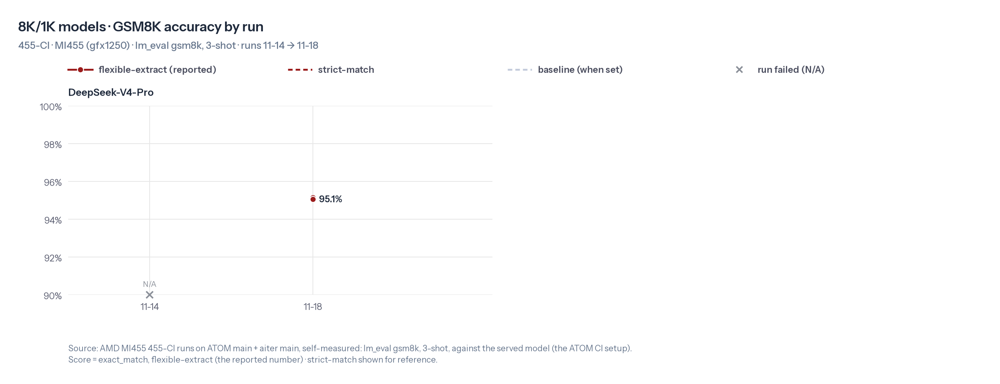

# 2026-11-18 MI455 Workload Weekly Status Report

## Highlights

| Model | What happened | Owner |
|---|---|---|
| ✅ DeepSeek-V4-Pro | recovered from the previous failure |  |

## Results

| Model | Scenario | 2026-11-14 (GSM8K) | 2026-11-18 (GSM8K) | Delta |
|---|---|---|---|---|
| DeepSeek R1 | MLPerf Endpoint | 95.7% | 95.7% | 0.0 pts |
| DeepSeek-V4.1-Flash | MLPerf Endpoint | — | — | — |
| DeepSeek-V4-Pro | 8K/1K | — | 95.1% | first |

## Environment

- Image: `rocm/fw-bringup-mlperf:gfx1250-atom-ci455-20261118`
- ATOM: `main` @ `9b2e67b7f6f5841b0d32db9589e989ff52673761` (2026-11-18)
- aiter: `main` @ `b1d849ff36907402d7ea6a3483e6f0dafa995aca` (2026-11-18)

## Findings

- Process: this file covers the three DeepSeek models, run on g13-01, g13-03 and g13-11 (one model per node) instead of e15-06/e15-07; the other five models of the session are in the unsuffixed files.
- Image: `gfx1250-atom-ci455-20261118` was pushed again during the session. The first digest (`sha256:6a2b207a…`, aiter `ee71544e`) was replaced by `sha256:d17a28d3…` with aiter `b1d849ff`, which adds https://github.com/ROCm/aiter/pull/8179 (an import that `fused_moe` already used). All three DeepSeek models ran on the second digest.
- Process: `wait_infer_drain.sh` ran with `WAIT_CLIENT_PID` set to the lm_eval process. Its own argv holds `lm_eval.log`, which matches its client pattern and gave the false hang of 2026-11-14; with the PID it drains with rc=0 as soon as lm_eval exits.
- 8K/1K · DeepSeek-V4-Pro recovered: the server was ready after 601 s and GSM8K is 0.9507 / 0.9515 (2026-11-14 revert check: 0.9477). The 2026-11-14 warmup failure (MegaMoE S1F GEMM1 `assert slot_width <= 128`) did not occur. This image has https://github.com/ROCm/aiter/pull/7973 (merged 2026-11-16), which targets that assert. https://github.com/ROCm/aiter/pull/7921, still listed in `pending_fixes.csv` for V4-Pro, is still open and was not needed.

## Details

### Environment details

| Item | Value |
|---|---|
| Test image | `rocm/fw-bringup-mlperf:gfx1250-atom-ci455-20261118` (digest `sha256:d17a28d3ea228c67c25fd1d15ae7138162287a7002ba13e2bae3ee33ed14cb69`) |
| ATOM | `main` @ [`9b2e67b7f6f5841b0d32db9589e989ff52673761`](https://github.com/ROCm/ATOM/commit/9b2e67b7f6f5841b0d32db9589e989ff52673761), 2026-11-18 fix(engine): honor ATOM_TORCH_PROFILER_DIR (#2925) |
| aiter | `main` @ [`b1d849ff36907402d7ea6a3483e6f0dafa995aca`](https://github.com/ROCm/aiter/commit/b1d849ff36907402d7ea6a3483e6f0dafa995aca), 2026-11-18 [Config] [Perf] Add DeepSeek-V4.1-Flash EP8 MXFP4 (a4w4) fused-MoE rows for gfx950 (#7582) |
| Test date | 2026-11-18 |

### Accuracy (GSM8K, 3-shot) · MLPerf Endpoint

| Model | flexible-extract | strict-match | 2026-11-14 | vs 2026-11-14 |
|---|---|---|---|---|
| DeepSeek R1 | 95.7% | 95.6% | 95.7% | 0.0 pts |
| DeepSeek-V4.1-Flash | — | — | — | — |

### Trends · MLPerf Endpoint

### Accuracy (GSM8K, 3-shot) · 8K/1K

| Model | flexible-extract | strict-match | — | vs — |
|---|---|---|---|---|
| DeepSeek-V4-Pro | 95.1% | 95.2% | — | first |

### Trends · 8K/1K

### Failures

No failures.
