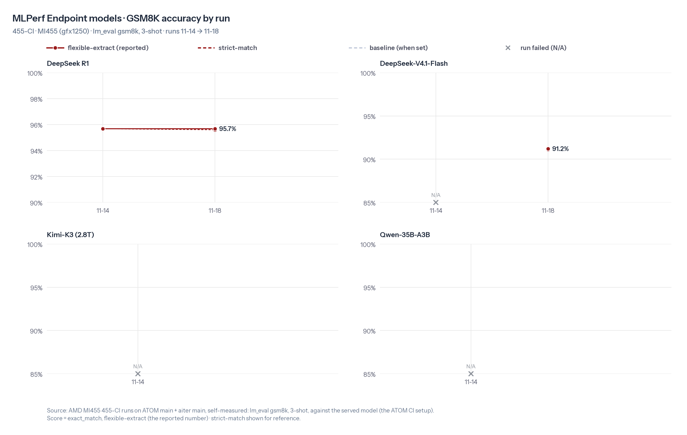
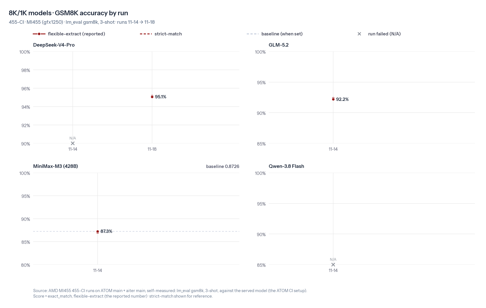

# 2026-11-18 MI455 Workload Weekly Status Report

## Highlights

| Model | What happened |
|---|---|
| ✅ DeepSeek-V4.1-Flash | recovered from the previous failure |
| ✅ DeepSeek-V4-Pro | recovered from the previous failure |

## Results

| Model | 2026-11-14 (GSM8K) | 2026-11-18 (GSM8K) | Delta |
|---|---|---|---|
| DeepSeek R1 | 95.7% | 95.7% | 0.0 pts |
| DeepSeek-V4.1-Flash | — | 91.2% | first |
| Kimi-K3 (2.8T) | — | — | — |
| Qwen-35B-A3B | — | — | — |
| DeepSeek-V4-Pro | — | 95.1% | first |
| GLM-5.2 | 92.2% | — | — |
| MiniMax-M3 (428B) | 87.3% | — | — |
| Qwen-3.8 Flash | — | — | — |

## Environment

- Image: `rocm/fw-bringup-mlperf:gfx1250-atom-ci455-20261118`
- ATOM: `main` @ `9b2e67b7f6f5841b0d32db9589e989ff52673761` (2026-11-18)
- aiter: `main` @ `b1d849ff36907402d7ea6a3483e6f0dafa995aca` (2026-11-18)

## Findings

- 8K/1K · DeepSeek-V4-Pro recovered: the server was ready in 601 s and GSM8K is 0.9507 (2026-11-14 revert check: 0.9477), with no MegaMoE S1F GEMM1 `assert slot_width <= 128`. The image has https://github.com/ROCm/aiter/pull/7973 (merged 2026-11-16), which targets that assert; https://github.com/ROCm/aiter/pull/7921, still in `pending_fixes.csv` for V4-Pro, was not needed.
- MLPerf Endpoint · DeepSeek-V4.1-Flash passes on both servers: TP4 gives 0.9189 (same as 2026-11-14) now that https://github.com/ROCm/ATOM/pull/2724 makes the recipe's `ATOM_DSPARK_PROB_DRAFT` and `ATOM_DSPARK_BLOCK_VERIFY` take effect, and DEP4 gives 0.9121, its first GSM8K on main since https://github.com/ROCm/ATOM/pull/2989.
- MLPerf Endpoint · DeepSeek-V4.1-Flash DEP4: the recipe's `$R/configs/dsv41_bf16_all_tuned.csv` repeats 6 shapes of aiter main's `model_configs/dsv41_bf16_tuned_gemm.csv`, so the first start exited on aiter's duplicate-shape check. The rerun leaves that table out, as the recipe says for duplicate tables, in a fresh container (aiter rewrites the source CSVs when it finds duplicates); the recipe's DEP4 command should drop it.
- Setup: the DeepSeek models ran on g13-01, g13-03 and g13-11 on the image's second push (digest `sha256:d17a28d3…`, aiter `b1d849ff`). `wait_infer_drain.sh` ran with `WAIT_CLIENT_PID` set to lm_eval, because its own `lm_eval.log` argument matches its client pattern (the false hang of 2026-11-14).

## Details

### Environment details

| Item | Value |
|---|---|
| Test image | `rocm/fw-bringup-mlperf:gfx1250-atom-ci455-20261118` (digest `sha256:d17a28d3ea228c67c25fd1d15ae7138162287a7002ba13e2bae3ee33ed14cb69`) |
| ATOM | `main` @ [`9b2e67b7f6f5841b0d32db9589e989ff52673761`](https://github.com/ROCm/ATOM/commit/9b2e67b7f6f5841b0d32db9589e989ff52673761), 2026-11-18 fix(engine): honor ATOM_TORCH_PROFILER_DIR (#2925) |
| aiter | `main` @ [`b1d849ff36907402d7ea6a3483e6f0dafa995aca`](https://github.com/ROCm/aiter/commit/b1d849ff36907402d7ea6a3483e6f0dafa995aca), 2026-11-18 [Config] [Perf] Add DeepSeek-V4.1-Flash EP8 MXFP4 (a4w4) fused-MoE rows for gfx950 (#7582) |
| Test date | 2026-11-18 |

### Accuracy (GSM8K, 3-shot) · MLPerf Endpoint

| Model | flexible-extract | strict-match | 2026-11-14 | vs 2026-11-14 |
|---|---|---|---|---|
| DeepSeek R1 | 95.7% | 95.6% | 95.7% | 0.0 pts |
| DeepSeek-V4.1-Flash | 91.2% | 91.1% | — | first |
| Kimi-K3 (2.8T) | — | — | — | — |
| Qwen-35B-A3B | — | — | — | — |

### Trends · MLPerf Endpoint

### Accuracy (GSM8K, 3-shot) · 8K/1K

| Model | flexible-extract | strict-match | 2026-11-14 | vs 2026-11-14 |
|---|---|---|---|---|
| DeepSeek-V4-Pro | 95.1% | 95.2% | — | first |
| GLM-5.2 | — | — | 92.2% | — |
| MiniMax-M3 (428B) | — | — | 87.3% | — |
| Qwen-3.8 Flash | — | — | — | — |

### Trends · 8K/1K

### Failures

No failures.
