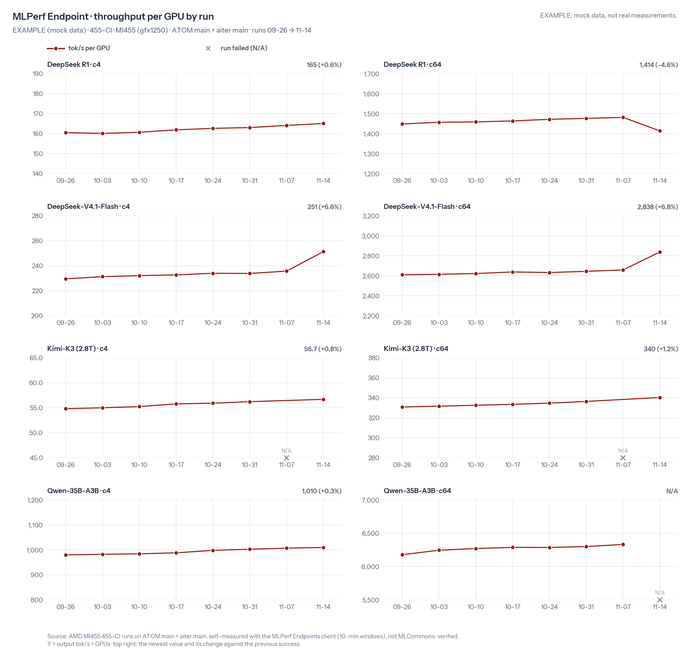
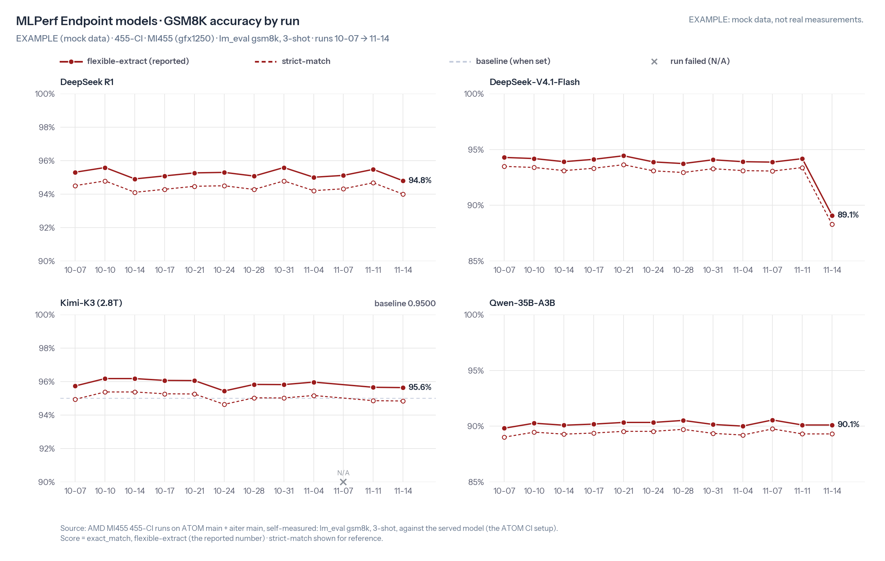
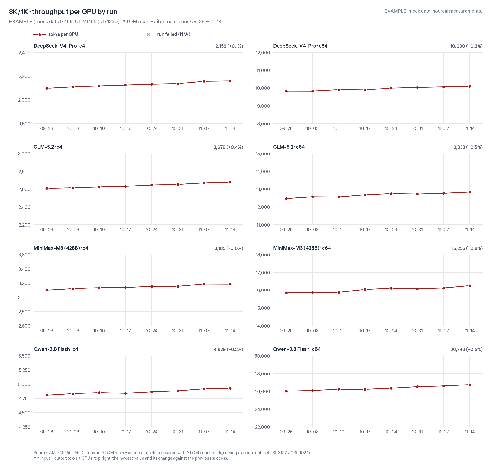
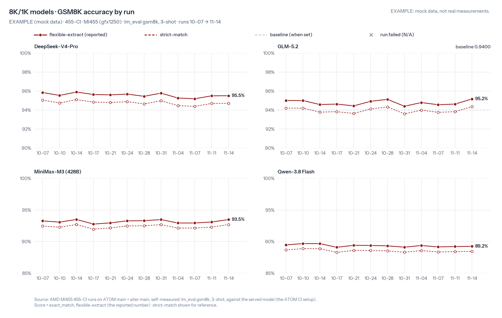

# 2026-11-14 MI455 Workload Weekly Status Report · EXAMPLE

> ⚠️ **EXAMPLE**: this file only illustrates the format. All numbers are made up; they are not real test results.

## Lowlights

| Model | What happened | Cause | Fix | Owner |
|---|---|---|---|---|
| ❌ Qwen-35B-A3B | c64 failed | (mock) out of memory capturing CUDA graphs | No fix yet; [reproducer](../455-CI/tools/examples/runs/20261114/qwen-35b-a3b/repro.md) |  |
| ⚠️ DeepSeek R1 | throughput down 4.6% | (mock) a new MoE dispatch default | Passes with [ROCm/ATOM#99901](https://github.com/ROCm/ATOM/pull/99901) (verified) |  |
| ⚠️ DeepSeek-V4.1-Flash | GSM8K down 5.1 points to 89.1% | (mock) MoE scale rounding | Needs [ROCm/aiter#99902](https://github.com/ROCm/aiter/pull/99902) (open) |  |

## Highlights

| Model | What happened |
|---|---|
| 🟢 DeepSeek-V4.1-Flash | throughput up 6.8% |
| ✅ Kimi-K3 | recovered from the previous failure |

## Results

| Model | Scenario | 2026-11-07 (tok/s/GPU) | 2026-11-14 (tok/s/GPU) | Delta | % of target | Unmerged optimization PRs | GSM8K delta |
|---|---|---|---|---|---|---|---|
| DeepSeek R1 | MLPerf Endpoint | 1,481 | 1,414 | ⚠️ −4.6% | — | — | −0.7 pts |
| DeepSeek-V4.1-Flash | MLPerf Endpoint | 2,658 | 2,838 | 🟢 +6.8% | — | — | ⚠️ −5.1 pts |
| Kimi-K3 (2.8T) | MLPerf Endpoint | 336 (2026-10-31) | 340 | +1.2% | 85.1% of 400 | [ATOM-99911](https://github.com/ROCm/ATOM/pull/99911), [aiter-99912](https://github.com/ROCm/aiter/pull/99912) | 0.0 pts |
| Qwen-35B-A3B | MLPerf Endpoint | 6,332 | N/A | N/A | N/A | — | 0.0 pts |
| DeepSeek-V4-Pro | 8K/1K | 10,063 | 10,090 | +0.3% | — | — | 0.0 pts |
| GLM-5.2 | 8K/1K | 12,765 | 12,833 | +0.5% | 80.2% of 16,000 | [aiter-99913](https://github.com/ROCm/aiter/pull/99913) | +0.5 pts |
| MiniMax-M3 (428B) | 8K/1K | 16,120 | 16,255 | +0.8% | — | — | +0.4 pts |
| Qwen-3.8 Flash | 8K/1K | 26,603 | 26,746 | +0.5% | — | — | 0.0 pts |

## Environment

- Image: `rocm/fw-bringup-mlperf:gfx1250-atom-ci455-20261114`
- ATOM: `main` @ [`000000`](https://github.com/ROCm/ATOM/commit/0000000000000000000000000000000000000000) (2026-11-14)
- aiter: `main` @ [`111111`](https://github.com/ROCm/aiter/commit/1111111111111111111111111111111111111111) (2026-11-14)

## Findings

- (mock) Kimi-K3: the server took 41 min to start on the new image, most of it
  JIT compiling; plan an hour for the first start.
- (mock) DeepSeek R1: the c64 drop comes from the new MoE dispatch default in
  ATOM main; turning it off restores the 11-07 number (fix in the follow-ups).
- (mock) DeepSeek-V4.1-Flash: faster at both concurrencies, but GSM8K fell at the
  same time; the aiter MoE change behind the speedup also rounds the scales.

## Details

### Environment details

| Item | Value |
|---|---|
| Test image | `rocm/fw-bringup-mlperf:gfx1250-atom-ci455-20261114` (digest `sha256:0000mock`) |
| ATOM | `main` @ [`000000`](https://github.com/ROCm/ATOM/commit/0000000000000000000000000000000000000000), 2026-11-14 (mock) ATOM main head |
| aiter | `main` @ [`111111`](https://github.com/ROCm/aiter/commit/1111111111111111111111111111111111111111), 2026-11-14 (mock) aiter main head |
| Test date | 2026-11-14 |

### Performance · MLPerf Endpoint

| Model | Parallelism | Concurrency | tok/s/GPU | vs 2026-11-07 | % of target | E2E avg interactivity (tok/s/user) | vs 2026-11-07 |
|---|---|---|---|---|---|---|---|
| DeepSeek R1 | tp4 | 4 | 165 | +0.6% | — | 150 | −0.4% |
| DeepSeek R1 | tp4 | 64 | 1,414 | ⚠️ −4.6% | — | 58.3 | −0.3% |
| DeepSeek-V4.1-Flash | dp4ep4 | 4 | 251 | 🟢 +6.6% | — | 212 | +0.7% |
| DeepSeek-V4.1-Flash | dp4ep4 | 64 | 2,838 | 🟢 +6.8% | — | 95.7 | +1.2% |
| Kimi-K3 (2.8T) | tp8dcp8 | 4 | 56.7 | +0.8% (vs 2026-10-31) | — | 104 | −0.9% (vs 2026-10-31) |
| Kimi-K3 (2.8T) | tp8dcp8 | 64 | 340 | +1.2% (vs 2026-10-31) | 85.1% of 400 | 45.3 | +1.0% (vs 2026-10-31) |
| Qwen-35B-A3B | tp1 | 4 | 1,010 | +0.3% | — | 258 | −0.7% |
| Qwen-35B-A3B | tp1 | 64 | N/A | N/A | N/A | N/A | — |

### Accuracy (GSM8K, 3-shot) · MLPerf Endpoint

| Model | flexible-extract | strict-match | 2026-11-11 | vs 2026-11-11 |
|---|---|---|---|---|
| DeepSeek R1 | 94.8% | 94.0% | 95.5% | −0.7 pts |
| DeepSeek-V4.1-Flash | 89.1% | 88.3% | 94.2% | ⚠️ −5.1 pts |
| Kimi-K3 (2.8T) | 95.6% | 94.8% | 95.7% | 0.0 pts |
| Qwen-35B-A3B | 90.1% | 89.3% | 90.1% | 0.0 pts |

### Trends · MLPerf Endpoint





### Performance · 8K/1K

| Model | Parallelism | Concurrency | tok/s/GPU | vs 2026-11-07 | % of target | ITL P50 (ms, lower is better) | vs 2026-11-07 |
|---|---|---|---|---|---|---|---|
| DeepSeek-V4-Pro | dp4ep4 | 4 | 2,159 | +0.1% | — | 13.6 | +0.5% |
| DeepSeek-V4-Pro | dp4ep4 | 64 | 10,090 | +0.3% | — | 37.1 | +0.8% |
| GLM-5.2 | tp4 | 4 | 2,679 | +0.4% | — | 10.6 | +0.7% |
| GLM-5.2 | tp4 | 64 | 12,833 | +0.5% | 80.2% of 16,000 | 29.2 | +0.2% |
| MiniMax-M3 (428B) | tp4 | 4 | 3,185 | −0.0% | — | 8.7 | −1.2% |
| MiniMax-M3 (428B) | tp4 | 64 | 16,255 | +0.8% | — | 23.3 | +0.8% |
| Qwen-3.8 Flash | tp1 | 4 | 4,929 | +0.2% | — | 5.8 | −1.2% |
| Qwen-3.8 Flash | tp1 | 64 | 26,746 | +0.5% | — | 15.6 | −0.5% |

### Accuracy (GSM8K, 3-shot) · 8K/1K

| Model | flexible-extract | strict-match | 2026-11-11 | vs 2026-11-11 |
|---|---|---|---|---|
| DeepSeek-V4-Pro | 95.5% | 94.7% | 95.5% | 0.0 pts |
| GLM-5.2 | 95.2% | 94.4% | 94.6% | +0.5 pts |
| MiniMax-M3 (428B) | 93.5% | 92.7% | 93.1% | +0.4 pts |
| Qwen-3.8 Flash | 89.2% | 88.4% | 89.2% | 0.0 pts |

### Trends · 8K/1K





### Follow-ups

| Model | Problem | Next step | Note |
|---|---|---|---|
| DeepSeek R1 | (mock) a new MoE dispatch default | Passes with [ROCm/ATOM#99901](https://github.com/ROCm/ATOM/pull/99901) (verified) | (mock) verified on 455: c64 back to 1,560 tok/s/GPU |
| DeepSeek-V4.1-Flash | (mock) MoE scale rounding | Needs [ROCm/aiter#99902](https://github.com/ROCm/aiter/pull/99902) (open) | (mock) the open aiter PR fixes the MoE scale rounding |
| Qwen-35B-A3B | (mock) out of memory capturing CUDA graphs | No fix yet; [reproducer](../455-CI/tools/examples/runs/20261114/qwen-35b-a3b/repro.md) | (mock) OOM while capturing CUDA graphs, at c64 only |

### Failures

#### Qwen-35B-A3B (MLPerf Endpoint): c64

- Error: `RuntimeError: HIP error: out of memory (mock)`
- Full excerpt: [error.log](../455-CI/tools/examples/runs/20261114/qwen-35b-a3b/error.log)

Core error log:

```text
(mock) INFO  [model_runner] capturing CUDA graphs for batch sizes 1..64
(mock) Traceback (most recent call last):
(mock)   File "/app/ATOM/atom/model_engine/model_runner.py", line 1234, in capture_cudagraph
(mock)     self.run_model(dummy_batch)
(mock)   File "/app/ATOM/atom/model_engine/model_runner.py", line 987, in run_model
(mock)     hidden = self.model(input_ids, positions)
(mock) RuntimeError: HIP error: out of memory (mock)
----- last 30 lines -----
(mock) ERROR [engine_core] EngineCore_DP0 died, shutting down the server
```

Reproduce:

```bash
# the test container (455-CI-recipe.md); the server and GSM8K commands below run inside it
docker run -d --name ci455-qwen-35b-a3b --network host --ipc host --shm-size 128g \
  --device /dev/kfd --device /dev/dri --group-add video --cap-add SYS_PTRACE \
  --security-opt seccomp=unconfined -v <weights dir>:/models/<model dir>:ro -v <results dir>:/results \
  rocm/fw-bringup-mlperf:gfx1250-atom-ci455-20261114
```

`server_cmd.sh`:

```bash
# (mock) 455-CI recipe, Qwen-35B-A3B server
HIP_VISIBLE_DEVICES=0 python3 -m atom.entrypoints.openai_server \
  --model /models/Qwen3.5-35B-A3B-MXFP4 --tensor-parallel-size 1 --server-port 8000
```

`bench_cmd.sh`:

```bash
SERVED_NAME='/models/Qwen3.5-35B-A3B-MXFP4'; SERVER='127.0.0.1:8000'  # (mock)
# ...then the shared client below
```

#### Shared MLPerf Endpoint client

Each bench command above sets its model's variables and then runs this, on the host (455-CI-recipe.md):

```bash
# point_yaml <name> <concurrency> <trajectories> <warmup|run> <report_dir>
point_yaml() { echo '(mock) the shared MLPerf Endpoint client config'; }
```
